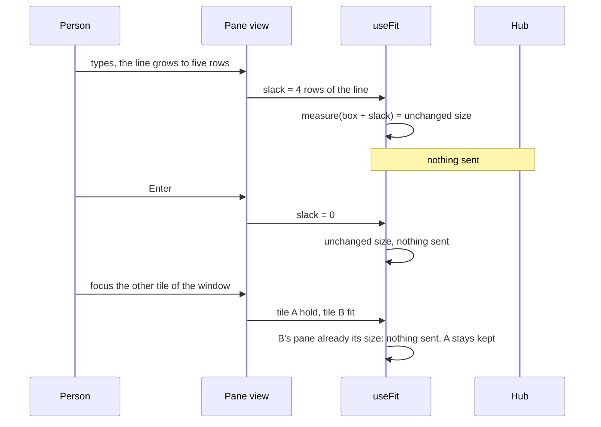

# Feature: fit keeps still

## 1. Goal

Four things seen in one afternoon of use, all from fit and the tiles
reacting to the browser more than a person expects:

1. Composing a long line, with three inbox paths on it, grew the input
   line a row at a time; each row shrank the tile and fit resized the
   host pane, five times before Enter, each a full redraw of Claude
   Code and a squeeze of the host window.
2. Moving the focus between two tiles of one window released the one
   pane and fitted the other, twice over, a release restoring the
   window's old layout for a second, the held tile drawn with tiny text
   while it showed a full-width pane in half a view.
3. A click in a tile that still showed the last frame of a pane just
   resized was refused by the hub as `bad input`, with no audit line,
   because the cell was outside the pane's new size.
4. Two tiles that are every pane of their window open at the host's
   proportions, often far from the middle; the `+` of the strip
   disappears whenever the focused pane is not loaded or is read-only.
5. Keys and text sent from the line go as separate requests at once,
   and the hub takes them as they arrive, so four keys pressed quickly
   can reach the pane in another order (seen in a test run on
   2026-10-26: `Up PageUp Tab Home` for `Up PageUp Home Tab`).

Out of scope: the host-side rate limit; the Android client (its own
plan, `muxway-android/docs/plans/2026-10-26-web-parity-2.md`).

## 2. Design

**The input line's growth is not a resize.** The pane view and the
window view measure the extra height the line takes beyond one row and
pass it to `useFit` as `slack`; the fit measures the box as if the line
were one row. The box keeps `overflow: auto` and the screen stays
pinned to its bottom, so the rows that would not fit scroll out at the
top while the line is being written, and come back when it is sent.
The screen's box gets `scrollbar-gutter: stable`, so the scrollbar's
coming and going never changes the columns either.

**A held tile stays fitted.** A tile that becomes held (another tile of
its window carries the fit) no longer releases its pane: `useFit` takes
`hold`, which disables sending without the release that turning fit
off does. The pane stays in the kept set and is released with the rest
when the view is left. Moving the focus between two tiles whose panes
already have their tiles' sizes then sends nothing, and the held tile
scales a pane that is already its box's size, at the font it had.

**Clicks stay inside the pane.** The screen clamps a click or a wheel
notch to the pane's listed size and drops one that falls outside, so no
request can be refused for the cell; a stale frame's rows below the
pane's height are inert. The hub's refusal keeps its code and gains an
audit line, as every other refusal of an input has.

**Equal shares in the pane view.** `=` and `⊞` even every split of the
tiles, as the window view has; with fit on and the tiles every pane of
one window, the host follows as after a divider drag. Tiles of one
window still open at the host's proportions, by the owner's decision of
2026-10-25 that these tiles track the window.

**Input goes in order.** The line's sends to one pane queue behind
each other: the next request leaves when the previous one has been
answered, so what was pressed first arrives first. A refusal does not
hold the queue. The same queue serves the key bar and the keyboard
window.

**The `+` stays.** The strip's `+` shows whenever a tile is writable or
the token may start a session on any host; the items that do not apply
to the focused pane are disabled with a reason in their title, instead
of the button vanishing.

## 3. Protocol and API changes

None. The hub's `400 bad_input` for a click outside the pane is
unchanged; it is now audited.

## 4. Security analysis

- Nothing new crosses a trust boundary. Fewer resizes reach the host.
- A click outside the pane is dropped by the client; the hub still
  refuses one that arrives, and now logs it, so a misbehaving client is
  seen.
- No new logs of content; the audit line names the pane and the cell.

## 5. Privacy check

Fixtures stay synthetic; new screenshots are of the test environment.

## 6. Test plan

| # | Test | Kind | Expected |
|---|------|------|----------|
| 1 | A click outside the pane's size | e2e-security | 400 bad_input with an audit line naming the cell, no content |
| 2 | Three files pasted, a long line, then Enter | UI | the agent sees no resize between the open and the send |
| 3 | Two tiles of one window, focus moved back and forth | UI | no release and no resize after the first fit of each; the held tile's font equals the fitted one's |
| 4 | Leaving the view | UI | both panes released once |
| 5 | A click on a row below the pane's height while a stale frame shows | UI | no input request sent |
| 6 | `=` with two uneven tiles of one window | UI | the host's layout evened; screenshot `web-tiles-equal.png` |
| 7 | A read-only focused pane on a host that starts sessions; a pane not yet loaded | UI | `+` present, split disabled with a reason |
| 8 | Eight keys pressed within a few milliseconds, twenty times | UI | the pane sees them in order every time |

## 7. Documentation

`docs/features/web-client.md` (fit while composing, held tiles,
`=` in the pane view, the `+`), `docs/ui-guideline.md` (the `=` key in
the pane view's table), the diagram above in the fit section.

## 8. Implementation steps

1. `useFit`: `slack` and `hold`; unit test of the measure with slack.
2. Pane view and window view pass the line's extra height; the screen's
   gutter.
3. Held tiles use `hold`; the kept set unchanged.
4. Screen clamps clicks and notches; hub audits the refusal.
5. `=` in the pane view, the `+` rule, the send queue.
6. Specs 2 to 8, Go test 1.
7. Docs.
