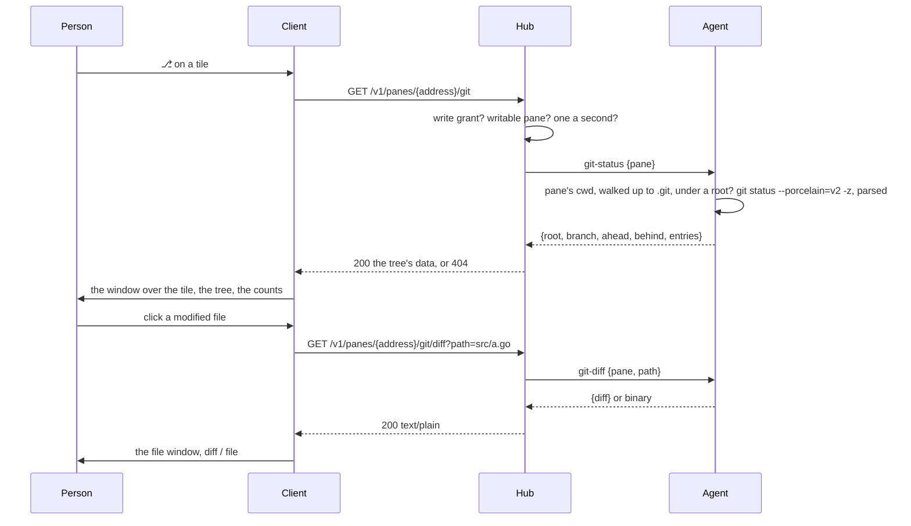

# Feature: the changes window, git's view of the pane's repository

## 1. Goal

A pane running an AI agent or a build leaves a trail of changed files.
Seeing them means `git status` in the pane, which interrupts the program
there, or another pane. Warp has a changes panel beside the terminal;
muxway gets one over the pane: a window docked to the tile's right edge,
toggled by `⎇` or `g`, that lists the repository's changes as a folder
tree with the colours and marks GitHub uses, added, modified, deleted,
renamed, untracked, conflicted, and the branch and counts in its bar. A
click on a file opens it in the file window, as its diff against the last
commit or as the file it is now. The tile keeps its size: the window lies
over the screen, and folds to its bar.

Out of scope: staging, committing, reverting or any other write; the
history; diffs between arbitrary commits; the Android client (its own
round).

## 2. Design

**The agent runs two read-only git commands.** Both start from the
pane's current directory (`#{pane_current_path}`) and only when the
repository's root, `git rev-parse --show-toplevel`, lies under one of
the `--preview` roots: the roots are already the owner's word on what a
writer may read, and a repository's changes are reads of its files.

- `git-status`: `git -C <root> --no-optional-locks status --porcelain=v2
  --branch --untracked-files=all -z`, parsed on the agent into entries
  `{path, kind, staged}` with `kind` one of `added modified deleted
  renamed untracked conflict`, plus `{root, branch, ahead, behind}`.
  Paths are the repository's, relative to its root; the root is the
  absolute directory, which a writer sees with `pwd` anyway. At most
  2000 entries; more say `truncated`.
- `git-diff`: `git -C <root> --no-optional-locks diff --no-color
  --no-ext-diff HEAD -- <path>` for one entry; an untracked file has no
  diff and is read as a file; a binary file answers `binary`. At most
  1 MiB of diff.

The commands run with a clean environment (`GIT_DIR`, `GIT_WORK_TREE`,
`GIT_PAGER`, hooks and aliases cannot reach them: `-c core.pager=cat`,
`--no-optional-locks`, no alias expands under plumbing names), a ten
second timeout, and `-c safe.directory=<root>` so a root the owner named
is read even when the agent's user is not the repository's owner. Status
and diff write nothing; `--no-optional-locks` keeps even the index
refresh from touching the disk.

**The hub exposes them to writers.** `GET /v1/panes/{address}/git` and
`GET /v1/panes/{address}/git/diff?path=…`, with the write grant and a
writable pane as the preview has, since a writer can run both commands
in the pane already; `404 not_found` for a pane whose directory is not
in a repository under a root, one code for every refusal; status one a
second per principal with a burst of three, diffs two a second with a
burst of five; audit lines with the pane, the root, the path and the
size, never the content.

**The window.** A tool `⎇` in the pane view's header (and `g`) opens
the changes window over the focused tile, docked to its right edge, a
third of the tile wide and at least 32 columns, its full height; the
screen under it keeps its size and its fit. Its bar reads
`┌─ changes ─ muxway · main ↑1 ─ +3 ~5 −1 ─ [_] [×]`; `_` folds it to
the bar along the edge, `×` or `Esc` closes it, `g` toggles it. The
body is a tree: directories first, folded or unfolded by a click,
remembered while the window is open; files with a mark and a colour:

| mark | kind | drawn |
|---|---|---|
| `+` | added, untracked | the ok colour |
| `~` | modified | the ink |
| `−` | deleted | dim, struck through |
| `→` | renamed (`old → new`) | the ink |
| `!` | conflict | the warn colour, bold |

Staged entries carry a `●` after the mark. The window refreshes every
five seconds while open, and at once after the pane's content changes
and settles. A pane whose directory is not in a repository shows
`not in a repository the host shows` and the bar's counts stay empty.

**The file window shows a diff.** A click on a modified, deleted,
renamed or conflicted file opens the file window with a `diff` / `file`
switch in its bar: the diff as unified text, `+` rows in the ok colour,
`−` rows dim and struck, hunk headers dim, the rest as it is; `file`
shows the file as the preview does, rendered or with its colours. An
added or untracked file opens as the file, with no diff to show; a
deleted file has only its diff. The download stays what it is.

## 3. Protocol and API changes

Compatible: two endpoints and two agent ops added. `GET
/v1/panes/{address}/git` answers `{"root", "branch", "ahead", "behind",
"truncated", "entries": [{"path", "from", "kind", "staged"}]}`; `from`
only on a rename. `GET /v1/panes/{address}/git/diff?path=` answers the
diff as `text/plain; charset=utf-8` with `nosniff` and `no-store`, or
`{"binary": true}`. The hosts listing's `preview` flag says a host may
have repositories to show, as it says for files.

## 4. Security analysis

This is the first time the agent runs a program other than tmux on the
host, by the owner's decision: two read-only git commands, under the
roots the owner already named, for writers who could run both in the
pane.

- Reach: nothing a writer cannot do already; a reader gets nothing. A
  stolen write token sees the changes of repositories under the roots.
- Arguments: the root comes from git itself, checked under a root with
  every symlink followed as the preview does; a diff's path comes from
  the status the agent produced, must be one of its entries (the agent
  checks the path against a fresh status), and goes after `--`, so a
  path that starts with a dash is a path. `-z` output is parsed, so a
  file name with a newline, a quote or a control character is a name.
- Execution: a fixed argument list, a clean environment, no shell, a
  timeout, `--no-optional-locks`; hooks do not run for status or diff
  and aliases cannot shadow built-in commands. `safe.directory` is set
  for the one root, not `*`.
- Output: capped, served as plain text with `nosniff`; the client draws
  the diff as text runs, never as HTML; file names in the tree are text.
- Limits per principal; one refusal code; audit with path and size,
  never content.
- A host without `git` answers `404` like a host without roots.

## 5. Privacy check

Fixtures: a repository made by the test under its temporary root, with
`alice` as the committer; screenshots of the test environment.

## 6. Test plan

| # | Test | Kind | Expected |
|---|------|------|----------|
| 1 | No roots; a repository outside the roots; a read-only token; a read-only pane; a directory in no repository | e2e-security | 404, 404, 403, 403, 404; the agent ran no git for the refused ones |
| 2 | A diff path not in the status (`../x`, `/etc/passwd`, a tracked but unchanged file, `-rf`) | e2e-security | 404; nothing read |
| 3 | File names with a space, a quote, a newline, a leading dash, UTF-8 | e2e-security | listed as names, diffed by `--`, no shell |
| 4 | `.git/index` and the working tree unchanged after status and diff; a hook in the repository that would write a file does not run | e2e-security | untouched |
| 5 | Rate limits; audit lines without content | e2e-security | 429 on the fourth status and the sixth diff; lines name path and size |
| 6 | A repository with an added, a modified, a deleted, a renamed, an untracked and a staged file, and one on a branch ahead of its upstream | e2e | kinds, `staged`, `from`, branch, ahead |
| 7 | A binary file's diff; a 2 MiB diff | e2e | `binary`; cut at 1 MiB |
| 8 | `⎇` opens the window over the tile; the tree, the marks, the counts; fold, `×`, `g`, `Esc`; the tile's size and fit unchanged | UI | screenshot `web-changes.png`; no resize request |
| 9 | Click a modified file: the diff with its colours; `file` shows the file; a deleted file has only the diff; an untracked file opens as the file | UI | screenshot `web-changes-diff.png` |
| 10 | A pane not in a repository | UI | the window says so |

## 7. Documentation

New `docs/features/changes.md`; `docs/protocol/v1.md`; `docs/features/
web-client.md`; `docs/ui-guideline.md` (the window, its key, the marks);
hub-and-agent (what `--preview` now also allows).

## 8. Implementation steps

1. Agent: `git.go` with the root check, the runner, the status parser
   and the diff, unit-tested on a repository made in the test.
2. Wire and hub: the ops, the endpoints, limits, audit.
3. Go end-to-end tests 1 to 7.
4. Web: the window (`Changes.tsx`), the tree, the tool and key; the diff
   view in the file window.
5. Specs 8 to 10, screenshots.
6. Docs.

## Review (after implementation)

- [x] Diff matches the plan. Deviations: the diff endpoint answers
  JSON `{"diff", "binary", "cut"}` rather than `text/plain`, so a
  binary and a cut diff have the one shape and the client draws every
  diff as rows of text; the agent finds the repository root itself by
  walking up to the nearest `.git`, so git runs only inside a root the
  owner named and never to discover one; a repository under a hidden
  directory is refused as a hidden file would be; a file name with a
  newline is listed as a name but its diff cannot be asked for, as
  `path` admits no control characters (`400`); the window's fold shows
  the bar alone in the tile's corner; an added file opens on its diff
  like a modified one (it has one against HEAD), an untracked file on
  the file. Hooks are kept off with `core.hooksPath=/dev/null`, the
  file monitor with `core.fsmonitor=false`, and no global or system
  configuration is read at all.
- [x] Security rules hold: roots opt-in, write grant and writable pane,
  the root found by the agent and checked under a root with symlinks
  followed, a fixed argument list, no shell, a clean environment,
  `--no-optional-locks`, a timeout, the path after `--` and only one
  the status lists, `-z` parsing, capped output, one refusal code,
  rate limits, audit without content; test 163 and the unit test prove
  a hook, an alias, an external diff, a text converter, a pager and a
  file monitor configured in the repository do not run and the index
  is not written.
- [x] Privacy check: `scripts/prepush-check.sh` clean, diff read;
  fixtures under the test's temporary directories with `alice` as the
  author.
- [x] Docs: `changes.md`, protocol, agent flags, web client, guideline,
  README.

## Test run

Go end-to-end tests 160 to 166 and browser spec 103 (three tests), with
the UI root made a repository. Run recorded as the test-run issue linked
from the commit.
