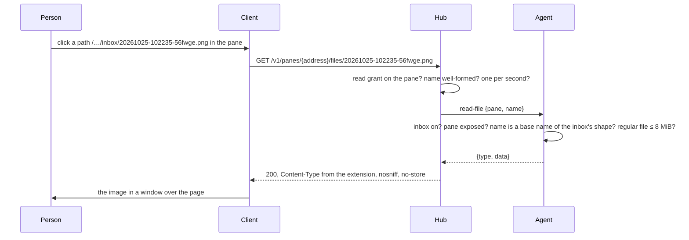

# Feature: inbox files opened in place

## 1. Goal

A file a client sent to a pane's program is a path on the screen. When
Claude Code answers about three screenshots, the three paths are all a
person sees of them; to look at one again they go to the host. Now a
path of the host's inbox printed in a pane is a link: a click shows the
image in a window over the page, without leaving the pane. Any client
can do the same through one new read endpoint.

Out of scope: files outside the inbox, files the client did not send
through muxway, editing or deleting inbox files, thumbnails.

## 2. Design

The agent already owns the inbox and names its files
`<yyyymmdd-hhmmss>-<6 random>.<ext>`. A new agent op, `read-file`, hands
back one file of it by that name. The hub exposes it as
`GET /v1/panes/{address}/files/{name}` for a principal that may read
the pane, and serves the bytes with the type the extension says.

In the web client, `links.ts` finds a path whose last segment is such a
name and marks it as a file link, next to the web addresses it finds
today. A click opens an image in a window over the page, the way the
keyboard window is shown: a bar with the name, size and `×`, the picture
scaled to the viewport, `Escape` or a click outside closes it, one at a
time. Other inbox types (PDF, text, JSON, Markdown) open in a new tab
from the same endpoint, which the browser renders itself. A click on a
file link is not a click on the pane, like a web link.



## 3. Protocol and API changes

Compatible: a new endpoint and a new agent op, nothing changed.

`GET /v1/panes/{address}/files/{name}`: the principal needs a read grant
on the pane. `name` is exactly one inbox file name,
`^[0-9]{8}-[0-9]{6}-[a-z0-9]{6}\.(png|jpg|gif|webp|pdf|txt|md|json)$`;
anything else is `400 bad_input` before the agent hears of it. Answers
`200` with the bytes, `Content-Type` by the extension,
`Content-Disposition: inline`, `X-Content-Type-Options: nosniff`,
`Cache-Control: private, no-store`; `404 not_found` when there is no
such pane, no inbox on the host, or no such file; `429 rate_limited`
above one read a second per principal (burst of three); `503
host_offline`.

```http
GET /v1/panes/alice-laptop/work/0.0/files/20261025-102235-56fwge.png
```

Agent op `read-file`: request `{op, actor, pane, name}`; response
`{type, data}` with the bytes base64 in JSON, as the upload carries them
the other way. The message may be up to 12 MiB like the upload's; the hub
raises its read limit for agent messages to that.

## 4. Security analysis

- Abuse: a reader of a pane reads files that a writer of it sent to its
  program. Those paths are on the screen for every reader already, and
  the file is a day old at most. Nothing else on the host is reachable:
  the agent joins the name to its inbox directory and refuses any name
  that is not a base name of the inbox's own shape, so `..`, slashes,
  symlink names and absolute paths never get as far as the file system.
  A link in a pane is text written by whoever controls the pane; it is
  only ever turned into a name under the same rule, and a name that does
  not exist is a 404.
- Grant: read on the pane, the agent's inbox enabled, the pane exposed.
- Input: the name, validated by the hub and again by the agent with the
  same expression. The path shown in the pane never travels; the client
  sends the name only.
- Served bytes: the type comes from the extension, never from the
  bytes or the client, with `nosniff`, so a file is rendered as what the
  inbox accepted it as. SVG is not an inbox type, so no script reaches
  the page; the image is shown from a blob URL in an `img`. Text and JSON
  are served as `text/plain` so nothing in them is interpreted.
- Rate limit: one read a second per principal, burst three, counted on
  the hub; the agent reads at most 8 MiB, which the upload cap already
  guarantees.
- Logs: an audit line on hub and agent with the principal, host, pane,
  name, size and result. Never the content.
- Dependencies: none new.

## 5. Privacy check

Fixtures use `alice-laptop`, `/home/alice/.config/muxway/agent/inbox`,
synthetic PNGs. The screenshot shows the test environment.

## 6. Test plan

| # | Test | Kind | Expected |
|---|------|------|----------|
| 1 | A read-only grant reads a file; no grant on the pane | e2e-security | 200 with read; 404 without |
| 2 | Names `../agent.key`, `a/b.png`, `20261025-102235-56fwge.png.exe`, an absolute path, 300 bytes | e2e-security | 400 bad_input, the agent sees no request |
| 3 | A well-formed name that is not in the inbox; a symlink in the inbox with a well-formed name pointing outside | e2e-security | 404 |
| 4 | Host without `--inbox` | e2e-security | 404 |
| 5 | Four reads in a second | e2e-security | the fourth is 429 |
| 6 | Audit lines on hub and agent | e2e-security | name and size present, no bytes |
| 7 | Upload a PNG, read it back | e2e | same bytes, `image/png`, nosniff, no-store, inline |
| 8 | A JSON file read back | e2e | served as `text/plain` |
| 9 | A pane prints an inbox path; click it | UI | a window with the image; screenshot `web-file-window.png`; Escape closes |
| 10 | The path's punctuation and a wrapped path | unit | the link stops at the extension; a path cut by the row's end is not a link |
| 11 | A click on the link with mouse mode on | UI | no input request reaches the host |

## 7. Documentation

`docs/protocol/v1.md` (the endpoint, the op, the message limit),
`docs/features/attachments.md` (reading back, with the diagram above),
`docs/features/web-client.md` (the window), `docs/ui-guideline.md`
(a file link and its window are shared across clients).

## 8. Implementation steps

1. `wire`: `OpReadFile`, `Request.Name`, `ValidFileName`, the extension
   to type table; unit tests.
2. Agent: `readFile` in `inbox.go`, the op in the dispatch, the audit
   line; the hub's read limit for agent messages raised.
3. Hub: `handleFileRead` under `GET …/files/{name}`, grant, name check,
   rate limit, headers, audit.
4. Go end-to-end tests 1 to 8.
5. Web: `findFiles` in `links.ts`, the file link in `Screen`, the
   `Picture` window, other types in a new tab; unit test 10.
6. Browser specs 9 and 11, screenshot.
7. Docs.
