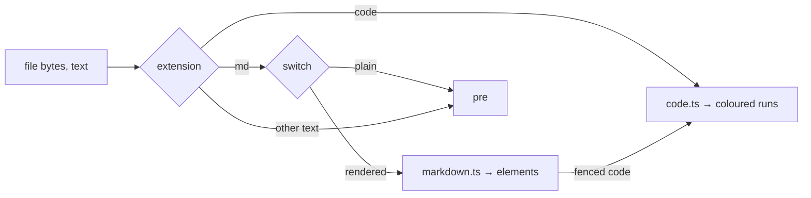

# Feature: a rendered preview, and code with its colours

## 1. Goal

The file window shows a Markdown plan as its source. That is honest, and
hard to read: a rendered view, headings, lists, emphasis, code blocks,
tables, is what a plan is for. Code files, JSON, JavaScript, TypeScript,
C#, Go, HTML, CSS, shell, YAML, are shown as plain grey text; a little
colour, strings, comments, keywords, numbers, makes them readable. The
window gets a switch in its bar, `rendered` / `plain`, remembered by the
browser, and shows code with its colours in both.

Out of scope: editing; images inside Markdown (a path is a link, the
browser does not fetch files on its own); HTML inside Markdown (shown as
text); a full language grammar for any language.

## 2. Design

**No new dependency.** A Markdown renderer that emits React elements
is written in `web/src/term/markdown.ts`: headings, paragraphs, bullet
and numbered lists (nested by indent), block quotes, fenced and indented
code blocks (with the fence's language), tables, horizontal rules, and
inline code, emphasis, strong, strike-through, links (web addresses only,
the screen's rule) and a path of the host (a file link, the preview's
rule). Anything else is text. There is no HTML pass-through and no
`dangerouslySetInnerHTML`, so a Markdown file cannot script the page.

**Colours by a small tokenizer**, `web/src/term/code.ts`: per language
a word list of keywords and the comment and string syntax; one scanner
yields runs of `comment`, `string`, `number`, `keyword`, `name` and
`punctuation`, drawn in the theme's ink tones (bright, dim, accent),
never a second palette. Languages: json, js, ts, jsx, tsx, cs, go, py,
sh, html, css, yaml, toml, sql, rs, java, kt, c, cpp. A language the
scanner does not know is shown plain. The fence's language in Markdown
and the file's extension in the window pick the scanner.

**The switch.** The bar gains `rendered` and `plain`, one selected, for
`.md` and `.markdown`; the choice is kept in the browser's storage and
applies to every Markdown file. A code file has no switch and always
shows with colours; `plain` is what every other type was. The window's
text column keeps the monospace type and the screen's size.

**More previewable types.** The agent's preview list grows with source
extensions: `js jsx ts tsx cs go py rb rs java kt c h cpp hpp sh bash
zsh fish sql css scss less`, all served as `text/plain; charset=utf-8`,
and the client's path rule links them on hosts with roots. Scripts in
the list are read and shown, never run, as every file here.

## 3. Protocol and API changes

None on the wire. The preview extension list grows on the agent and in
the docs; a client that does not know a type still gets `text/plain`.

## 4. Security analysis

- Rendering is the only new surface. The renderer builds elements from
  the parsed structure and never from raw HTML, so no tag, attribute or
  script in a file reaches the DOM; a link is only a web address or a
  file path under the existing rules, with `rel="noopener noreferrer"`.
- The tokenizer only classifies runs of the text it was given.
- Scripts are among the previewed types now, as text. The agent still
  runs nothing; the write grant and the roots stay as they are.
- No new logs, no new dependencies.

## 5. Privacy check

Fixtures are synthetic Markdown and code; screenshots of the test
environment.

## 6. Test plan

| # | Test | Kind | Expected |
|---|------|------|----------|
| 1 | A Markdown file with `<script>`, an ``, a `javascript:` link, raw HTML | UI, security | rendered with no script run, no element from the HTML, the link text plain; no CSP violation |
| 2 | `markdown.ts` on a fixture with every construct | unit | the element tree expected, HTML as text |
| 3 | `code.ts` on JSON, JS, C#, Go, HTML, shell snippets | unit | comments, strings, keywords and numbers classified; unknown language plain |
| 4 | Open a `.md`: rendered by default, `plain` shows the source, the choice survives a reload | UI | screenshot `web-preview-rendered.png` |
| 5 | Open a `.cs` and a `.json` | UI | coloured runs present; screenshot `web-preview-code.png` |
| 6 | A `.sh` path printed in a pane on a host with roots | e2e | served as text; never run |

## 7. Documentation

`docs/features/preview.md` (the switch, the colours, the types),
`docs/protocol/v1.md` (the extension list), `docs/ui-guideline.md`.

## 8. Implementation steps

1. `code.ts` with its tests.
2. `markdown.ts` with its tests, fenced code through `code.ts`.
3. The window: the switch, storage, the renderer and the colours.
4. The agent's and the client's extension lists; docs.
5. Specs 1, 4, 5, 6.

---

## Review (after implementation)

- [x] Diff matches the plan. Deviations: the path rule in the client
  and the agent's list grew by the same source types; `.sh` and its kin
  are links now, shown as text. The scanner also knows Rust, Java,
  Kotlin, C and SQL beyond the languages named. Headings use the pixel
  face, the rest the terminal's type.
- [x] Security: elements from the parse only, no HTML pass-through, web
  links with `noopener`, paths under the existing rules, no new
  dependency; the hostile-file spec checks no script runs and no element
  comes from the file.
- [x] Privacy check: `scripts/prepush-check.sh` clean, diff read.
- [x] Docs: preview page, protocol list, guideline.

## Test run

Unit tests for `code.ts` and `markdown.tsx`; browser spec 86 (three
tests); Go tests 141 and 143 with the shell script served as text.
Recorded as the test-run issue linked from the commit.
