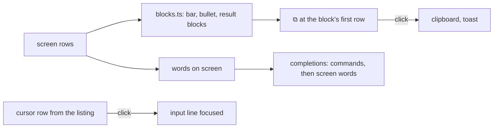

# Feature: from the screen to the line

## 1. Goal

Three ways the screen and the input line work together, asked for
after a day of driving Claude Code and shells from the browser:

1. **Copy a block.** Claude Code prints its answer as blocks: a `●`
   paragraph and its indented rows, a quoted or coded block with a bar
   (`│`, `┃`, `|`, `>`) down its left side, a `⎿` result and its rows.
   Getting that text out today means selecting across rows and stripping
   the markers by hand. A block gets a copy mark; one click puts the
   block's text, without markers, on the clipboard.
2. **A click on the prompt types there.** With the mouse on, a click in
   the pane goes to the program; without, it only focuses the tile. A
   click on the row where the program waits for input (Claude Code's
   `❯` box, a shell's prompt) now also focuses the input line, so what
   is typed next goes to that pane, whichever tile had the keyboard.
3. **Completion of any word.** The line completes the first word only,
   from a fixed list. Now it also completes the word at the caret from
   the words on the screen (paths, identifiers, file names, the
   options a program printed), so a path Claude printed or a file name
   from `ls` is three letters and a Tab away, for shells and Claude
   Code alike.

Out of scope: a selection tool, copying with formatting, completion
from the host's file system or shell history.

## 2. Design

**Blocks.** `blocks.ts` groups a screen's rows: a run of rows whose first
non-blank character is the same bar is a bar block, its text the rows
after the bar; a `●` or `❯` row with the rows indented under it is a
bullet block, its text the rows after the marker and the indent; a `⎿`
row likewise. A hover over a block shows `⧉` in the margin at its first
row; a click on it copies the block with `navigator.clipboard` and
toasts `copied, 12 rows`. The mark is not a click on the pane. On a
touch screen a long press on a block's row does the same (Android has
its own plan).

**The prompt row.** The screen knows the cursor's row when the host
says it: the listing gains `cursor_x` and `cursor_y` from tmux's
`#{cursor_x}` and `#{cursor_y}`, which costs nothing and lets a client
draw a cursor too. A click on the cursor's row of the screen, after any
click the program gets, calls `onPrompt`, and the view focuses the line.
Without a cursor from an older agent, a click on the last non-blank row
does the same.

**Completion from the screen.** `completions` takes the screen's plain
text as a third pool: the words of the last `height` rows and the
history the client has, split on blank space, bars and brackets, at
least three characters, longest and most recent first, after the
program's own commands. The word at the caret is completed, not only
the first; `complete` replaces that word. Tab takes the first offer,
as today. Nothing the hub said and nothing from another pane is ever
offered.

## 3. Protocol and API changes

Compatible: `cursor_x` and `cursor_y` (1-based) are added to a pane in
the listing and in `GET /v1/panes/{address}` when the agent reports
them; a client that does not know them ignores them.

## 4. Security analysis

- The clipboard is written only on a click on the mark, from the rows
  the person can see. Nothing is read from the clipboard.
- The cursor position is two integers from tmux; it is bounded by the
  pane's size by the hub.
- Completion offers text already on the screen to the person reading
  it; it still sends nothing by itself, and the line still goes through
  the hub's text checks.
- No new logs.

## 5. Privacy check

Fixtures are synthetic Claude Code frames with `alice` paths.

## 6. Test plan

| # | Test | Kind | Expected |
|---|------|------|----------|
| 1 | A cursor outside the pane's size in a forged agent reply | e2e-security | the hub clamps or drops it |
| 2 | `blocks()` on a frame with a bar block, a bullet, a result | unit | three blocks, markers gone, indent kept inside |
| 3 | Hover a bar block, click `⧉` | UI | clipboard holds the rows; toast; screenshot `web-copy-block.png`; no input request |
| 4 | Click the `❯` row with the mouse off and on | UI | the line is focused; with the mouse on the click also reaches the pane |
| 5 | Type three letters of a path on the screen, Tab | UI | the path completes; the first-word commands still come first |
| 6 | A word from another pane | unit | not offered |

## 7. Documentation

`docs/features/web-client.md`, `docs/ui-guideline.md` (the mark, the
prompt row, completion), `docs/protocol/v1.md` (the cursor).

## 8. Implementation steps

1. Agent and hub: the cursor in the listing; protocol page.
2. `blocks.ts` with unit tests; the mark in `Screen`; the toast.
3. `onPrompt` and the line's focus in the pane view and the window view.
4. Completion of the word at the caret from the screen's words.
5. Specs 3 to 5.
6. Docs.

---

## Review (after implementation)

- [x] Diff matches the plan. Deviations: the cursor is bounded by the
  hub (dropped when outside the pane) rather than clamped; a screen word
  is offered from two letters typed, the word itself three or more; the
  mark replaces the block's marker character for the hover, so nothing
  shifts; a browser that refuses the clipboard gets a toast saying so.
- [x] Security rules hold: the clipboard is only written, on a click;
  the cursor is two bounded integers; completion sends nothing.
- [x] Privacy check passed: `scripts/prepush-check.sh` clean, diff read.
- [x] Docs updated: web client, guideline, protocol (the cursor).

## Test run

Browser spec 85 (three tests), Go test 150 (the cursor in the listing)
and the hub's bound in a unit test; `blocks.ts` and `complete.ts` unit
tests. Recorded as the test-run issue linked from the commit.
