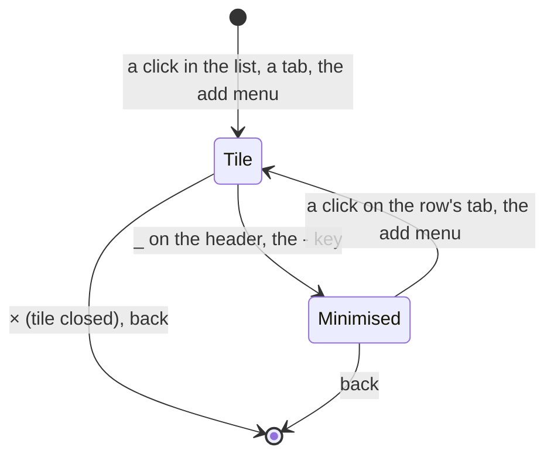

# Feature: the add menu and the minimised row

> The owner asked on 2026-10-27, from the demo hub: "I don't see a plus
> next to headers at all. I want a plus sign to offer adding a new pane or
> an existing one. `×` should have `_` next to it to minimise panes, which
> then switch from the top header to a footer right above the input. On
> Android and web both." Approved the same day: "GO and implement all of
> that." The Android client has its side in its own repository's plan of
> the same name and commit of the same day; this is the web's.

## 1. Goal

Two things the pane view lacks, in both clients:

1. **Add from the view.** The web had `+` after the tabs with *split
   here* and *new session* only. The `+` after the last tab now opens a
   menu that offers, in this order: a new pane (beside the focused one,
   on its host), a new session (where the host starts them), a rule, the
   panes minimised below, a rule, every other readable pane grouped by
   host and session. A pane picked becomes one more tile; at four tiles
   the menu says so and the pick swaps into the focused tile, as a tab
   does today.
2. **Minimise.** `_` beside `×` on a tile's header takes the tile out of
   the arrangement and puts its tab in a **minimised row** right above
   the input, painted like a tab and still reading (every two seconds,
   like an open tile that is not focused), so its state and glyph keep
   moving. A click on it brings the tile back; its tab leaves the top
   strip while it is below. The last tile cannot be minimised: its `_`
   is off.

Out of scope: minimised panes surviving a reload (they are part of the
view's arrangement, which is forgotten with it today, on both clients);
the window view's own tiles; any new endpoint.

## 2. Design

A pane open in the view is in one of three places. Nothing of this
reaches the host: the arrangement is the client's own.



The view's state grows by one list, `minimised: [address]`, beside the
open addresses (which travel in the route), the focus, the layout and
the weights. A pane is in at most one of the two lists; the count of
tiles is the route's, so the arrangement options and the fit rules
follow it as now. The web mounts the tiles anew when their count
changes, so the minimised list is carried across that navigation the
way the arrangement of a closed tile is (`minimisedKept`), named by the
tiles it belongs to, and dropped when the view is left. Reads: a
minimised pane is read like an unfocused tile, by its own tab.

```
┌─ muxway ─┐ [⟳ build][! review] [+]      [▦][⤢][⊡][≡]  [alice ▾]
┌ ⟳ build · claude · write     ⟳ working  96×28  _ × ┐
│ …                                                  │
└────────────────────────────────────────────────────┘
[? deploy][logs]                       ← minimised row
> ______________________________  [⇪][◉][⏎]
```

The `+` menu, built from the listing the client has (no request):

```
+ pane         beside build on alice-laptop
+ session      on alice-laptop
──────────────
minimised
  ? deploy     alice-laptop/work/0.1
──────────────
alice-laptop · work
  logs         alice-laptop/work/1.0
bob-server · ops
  htop         bob-server/ops/0.0
  hub.log      bob-server/ops/1.0
```

Entries the token or host do not allow are dimmed with the reason (*read
only*, *no sessions here*). The focused pane and the open tiles are not
listed. With four tiles the heading reads `four open: a pick replaces
build`.

```mermaid
sequenceDiagram
    participant U as you
    participant V as pane view
    participant H as hub
    U->>V: + → "+ pane"
    V->>H: POST /v1/windows/{host}/{session}/{window}/panes
    H-->>V: the new pane's address
    V->>V: one more tile, focused
    U->>V: + → an existing pane
    V->>V: one more tile from the listing, focused; no request
    U->>V: _ on a header
    V->>V: tile out, tab into the minimised row; reads go on
```

Web: the menu's rows come from one pure function, `addRows` in
`web/src/term/addmenu.ts` (input: the listing, the hosts, `/v1/me`, the
open and minimised addresses, the focused pane; output: the two
entries with their reasons, the minimised panes, the groups, and
whether four are open), unit-tested with vitest; `AddMenu.tsx` draws
them; `Pane.tsx` keeps `minimised` beside the route's addresses, the
tile header gets `_` before `×` and the `-` key, `MinimisedRow`
(`components/Minimised.tsx`) sits between the tiles and the input
panel, and the strip leaves a minimised pane's tab out. Closing the
last tile with panes minimised brings the first of them back rather
than leaving the view. The window view's `+` has the same menu; a pick
there opens the pane view with the window's focused pane and the pick
side by side. Android has the same shape in its protocol module's
`AddMenu.rows`.

## 3. Protocol and API changes

None. The new pane and the new session use the endpoints the list uses
today; an existing pane is opened from the listing already held.

## 4. Security analysis

- An attacker gains nothing new: no endpoint, no grant, no input to the
  host. The menu lists only panes the hub already listed for the token,
  and the split goes through the hub's own check of the write grant.
- Pane names and titles in the menu are the listing's, already filtered
  by the client's text rules; they are drawn as text, never interpreted.
- Nothing is logged by the client; the hub logs the split as it does.
- No new dependency on either client; the content security policy is
  unchanged.

## 5. Privacy check

Fixtures use `alice-laptop`, `bob-server`, `bob-desktop`, `work`,
`ops`. Screenshots come from the browser suite against the test hub.

## 6. Test plan

| # | Test | Kind | Expected |
|---|------|------|----------|
| 1 | A read-only token opens the menu | UI, web spec 105 | `+ pane` dimmed *read only*, `+ session` dimmed *no sessions here*; the other panes still listed and openable; nothing asked of the hub |
| 2 | A host without `sessions`, a read-only focused pane, no focused pane | unit (vitest) | the entries off with their reasons |
| 3 | Menu rows: open and focused panes left out, minimised first, the rest grouped by host and session in listing order; a minimised address the listing no longer has is dropped | unit (vitest) | as the sketch |
| 4 | `+` → `+ pane` | UI, web spec 105 | one more tile, focused, the hub asked once |
| 5 | `+` → a pane of the other host | UI, web spec 105 | one more tile, focused, no request; screenshot `105-add-menu` |
| 6 | Four tiles, `+` → a pane | unit, web spec 105 | the heading says so, the focused tile swapped, count stays four; screenshot `105-add-menu-full` |
| 7 | `_` on a header | UI, web spec 105 | tile gone, tab in the minimised row, gone from the strip, the route without it; screenshot `105-minimised` |
| 8 | A click on the minimised tab, and the menu's entry | UI, web spec 105 | tile back, focused, row empty, strip has the tab again |
| 9 | `_` and `-` on the last tile | UI, web spec 105 | the button disabled, the key does nothing |
| 10 | A minimised pane's state changes (notify) | UI, web spec 105 | its tab in the row is still read and repaints with the glyph |

## 7. Documentation

Guideline §1.4 (header row, add menu, header, a new *minimised row*
element) and §1.6 (two rows: the add menu, minimise and restore) first;
core `web-client.md` (Tiles: the add menu, the minimised row, the
keyboard table), `new-panes.md`; the help overlay.

## 8. Implementation steps

1. Guideline rows and sketch.
2. `term/addmenu.ts` with its unit test.
3. The menu's two lists, `_`, the `-` key, the minimised row.
4. Spec 105, specs 84 and 90 on the reasons' wording, docs, `web/dist`.
5. One commit here naming the Android client's.

---

## Review (after implementation)

- [x] Diff matches the plan. Deviations: the window view's `+` lists
  the other panes too and a pick there opens the pane view with the
  window's focused pane beside it, since the window view has no tiles
  of its own choosing; closing the last tile with panes minimised
  brings the first of them back, so nothing minimised is lost by `x`;
  a minimised pane that exits leaves the row by itself, as a tile would.
- [x] Security rules hold: no new endpoint, grant or input; the menu is
  the listing drawn as text; the split goes through the hub's check.
- [x] Privacy check: `scripts/prepush-check.sh` run at the commit;
  fixtures are the suite's own panes.
- [x] Docs: guideline, web client, new panes, help.

## Test run

Run here on 2026-10-27, before the commit, not as a recorded run
directory: `vitest` (18 files, 115 tests, `addmenu.test.ts` among them)
passed; `tsc -b`, eslint and prettier clean; the browser specs 105 (three
tests, rows 1 and 4 to 10), 84, 85, 90, 98 and 62 run through the Go
harness (`MX_GREP`, `TestUI_WebClient`) passed, 18 of 18, with the
screenshots `105-add-menu`, `105-add-menu-full` and `105-minimised`
(the first and last are `web-add-menu.png` and `web-minimised.png` in
the feature page). The full suite (`make e2e`) was not run for this
commit; it runs with the next one, every hub, and is recorded there.

Follow-up on 2026-10-29, from the owner: `+ pane` beside a pane with
neighbours left the view saying *a pane named twice*, since tmux
numbers panes by place and the new pane shifted its neighbours'
addresses while the route kept the old ones. The open tiles now follow
their panes by id through a fresh listing after the split (spec 105).
