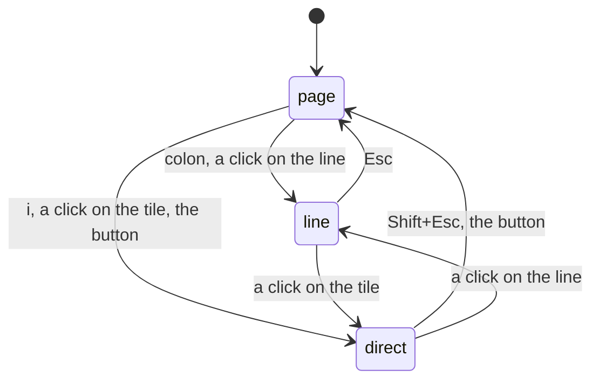
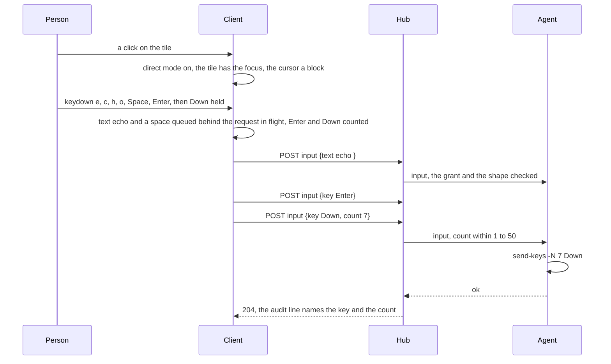

# Feature: direct typing, keys go to the pane as they are pressed

## 1. Goal

The input line composes: a line is written, read over and sent whole,
which suits a prompt for an AI agent or a long command. It does not
suit a shell or an editor in the pane: every arrow, every `Ctrl+R`,
every character of a `vim` session, a `y` to a question. A terminal
takes keys as they come, and so should muxway from a keyboard. This
adds a **direct** mode to the pane view: `i`, or a click on the
focused tile's screen, and from then on every key goes to the pane as
it is pressed, the way a terminal emulator sends it, until `Shift+Esc`
or a click on the line brings the line back. The line stays what it is,
a step away, as vim's `:` line is from its text: `:` focuses it.

Out of scope: the Android client (a soft keyboard composes words and
sends text, so direct typing there is its own round, planned with its
own gestures), the glasses and MIDP, the window view (it has no input
line either; the pane view is where typing happens), remembering the
mode between visits.

## 2. Design

**Three states of the pane view**, one at a time, said in the input row:

| state | keys go to | prompt | enter | leave |
|---|---|---|---|---|
| page | the view's shortcuts (`g`, `f`, `z`, `]` …), as today | `>` | `Esc` from the line, `Shift+Esc` from direct | |
| line | the input line, as today | `>` with the caret in the line | `:` (was `i`), a click on the line or on the row the program waits on | `Esc` |
| direct | the focused pane, key by key | `▮` and the word `direct` in the line's placeholder and in the status bar; the pane's cursor drawn as a block | `i`, a click on a writable tile's screen (with a fine pointer), the `▮` button | `Shift+Esc`, the `▮` button, a click on the line, a read-only tile focused |



`i` moves from the line to direct typing, which is what vim's `i` does;
`:` takes the line, which is what vim's `:` does, and the owner asked
for that pairing. `Esc` in direct mode is the pane's, since the
programs in it live on `Esc` (Claude Code interrupts, vim leaves insert
mode, readline's `M-` prefix), so leaving is `Shift+Esc`, the mirror of
the line's `Shift+Esc` that sends `Escape` while typing: Shift+Esc is
always "the other one". In direct mode the view's single-letter
shortcuts are keys for the pane, so `g` types a `g`; the header buttons
and the mouse keep working, and the changes window closes by `×` or
`⎇` rather than `Esc`, which goes to the pane. While the file window is
open its `Esc` closes it as now and no key reaches the pane; the
keyboard window's caps send as they do.

**What a key becomes**, in `web/src/term/direct.ts`, a pure function of
the browser's `KeyboardEvent` to a request body or nothing, unit
tested:

| pressed | sent |
|---|---|
| a printable character (`key.length === 1`), alone or with Shift, or from a dead key or an IME (`compositionend`) | `{"text": "<the character or the composed text>"}` |
| `Ctrl` + a `char` of the grammar (`a`–`z`, digits, `` ` - = [ ] \ ' , . / ``) | `{"key": "C-<char>"}`; `Ctrl+C` with text selected in the view is the browser's copy instead |
| `Alt` + such a `char` | `{"key": "M-<char>"}` |
| `Enter`, `Tab`, `Backspace`, `Escape`, `Space` with a modifier, arrows, `PageUp`/`PageDown`, `Home`/`End`, `Insert`/`Delete`, `F1`–`F12`, with `C-` `M-` `S-` in the grammar's order; `Shift+Tab` is `BTab` | `{"key": "<name>"}` |
| a paste (`Ctrl+V`, `Shift+Insert`, the menu) | as the line does: text as one `{"text"}`, a file to the inbox with its path typed |
| `Ctrl+Shift+C`/`V`, `Ctrl+T`/`W`/`N`/`Tab`, `F5`, `F11`, `F12`, the OS key, `CapsLock`, `Dead`, a key while composing | nothing: left to the browser |

Keys are listened for on the window, in the capture phase, only while
direct mode is on and no input element has the focus; the tile's
screen takes the focus (`tabIndex=-1`) when the mode is entered so
nothing else has it.

**Keys are queued per pane and coalesced.** The client already sends a
pane's inputs in order, one at a time; direct mode adds a backlog in
front of it: while a request is in flight, a printable character joins
the text waiting behind it (up to 4096 bytes), and a named key equal to
the one waiting adds to its `count`. A held `Backspace` or `Down` at
the keyboard's 30 repeats a second becomes a few requests of
`{"key": "Down", "count": 7}`, never a storm against the hub's limit
of 20 requests a second per principal; typing at speed is one request
per round trip. A refusal is a toast and the key is dropped, as the
line's is; nothing is retried.

**`count` for a key** is new in the protocol: `{"key": "Down",
"count": 5}`, 1 to 50 as the wheel's, sends the key that many times
(`send-keys -N`). A host whose agent takes it lists `"keys": 3`; to an
older host the client sends the key once per press and never a count.



## 3. Protocol and API changes

Compatible. `POST /v1/panes/{address}/input` takes `count` with `key`,
an integer 1 to 50, absent meaning one; with `text` or `mouse` it is
`400 bad_input`. The hosts listing's `keys` becomes `3` for an agent
that takes it; `2` and absent mean what they do today. The agent op
`input` carries `count` the same way.

```http
POST /v1/panes/alice-laptop/work/0.0/input
{"key": "Down", "count": 5}
→ 204
{"key": "Down", "count": 51}
→ 400 {"error": "bad_input"}
{"text": "a", "count": 2}
→ 400 {"error": "bad_input"}
```

## 4. Security analysis

- Reach: nothing new. The same endpoint, the same write grant and
  writable pane, the same whitelist of keys and the same text rules;
  `count` repeats a key the whitelist admits, never text, at most 50
  times, so one request types at most 50 keys where 50 requests did.
- The boundary is the browser's event: the mapper emits names of the
  grammar and printable text only; a key it does not know is dropped
  on the client, and the hub and agent validate as they do, so no
  escape sequence can be built from keys. Composed text goes through
  the text rules; control characters are never text.
- Typing into the wrong pane: the mode is shown in the prompt, the
  placeholder, the status bar and the block cursor; keys go to the
  focused tile only, and focusing a read-only tile ends the mode.
  Leaving the view ends it.
- Clipboard: nothing is read without a paste event the person made.
- Limits: the per-principal rate stands as the backstop; coalescing
  keeps a held key under it. Audit lines as today, with `count` on a
  key; never the text.
- No new dependencies.

## 5. Privacy check

Fixtures are the test suite's throwaway tmux panes; the screenshot is
of the test environment with `alice-laptop`.

## 6. Test plan

| # | Test | Kind | Expected |
|---|------|------|----------|
| 1 | `count` 0, 51, 2.5, `"5"`, with `text`, with `mouse`; a key with count on a read-only pane and with a read-only token | e2e-security | `400 bad_input` for every shape, `403 read_only` for the grants; nothing typed |
| 2 | A key with count 50 and the audit line | e2e-security | typed 50 times; the hub's and agent's lines name the key and 50, no content |
| 3 | A hub forwards `count` to an agent that lists `keys: 3`; the client sends once per press to a host listing `keys: 2` | e2e, unit (web) | five `Down` reach `cat -v` as five `^[[B`; the fallback sends five requests |
| 4 | The mapper: printable, Shift, dead keys, composing, `Ctrl+c`, `Alt+x`, `Shift+Tab`, `C-M-S-Up`, browser-owned keys, `;` with Ctrl | unit (web) | the table above; nothing for what is not in the grammar |
| 5 | The queue: text merges up to 4096 bytes, equal keys count up to 50, order kept across text and keys, a refusal drops only its own | unit (web) | as said |
| 6 | A click on the focused tile turns direct on; `echo hi` and `Enter` typed key by key show `hi`; `g` types a `g` and opens no window; `Esc` reaches `cat -v` as `^[`; `Shift+Esc` leaves and `g` opens the changes window; `:` focuses the line; `i` from the page enters again | UI | screenshot `web-direct.png` |
| 7 | A held `Down` (repeat events) and a paste of three lines | UI | fewer requests than key events, none with a count over 50; one text request for the paste |
| 8 | A read-only tile: a click only focuses, `i` does nothing; a touch tap (coarse pointer) on the cursor row focuses the line as today | UI | the mode never turns on; the line has the focus |
| 9 | The file window over direct mode: `Esc` closes it and reaches the pane no more; the keyboard window's `Esc` cap sends `Escape` | UI | `cat -v` shows one `^[` from the cap and none from the window's Esc |

## 7. Documentation

New `docs/features/direct.md` (the three states, the table of keys,
the diagrams, security); `docs/protocol/v1.md` (`count`, `keys: 3`);
`docs/features/web-client.md` (the keyboard table: `i`, `:`,
`Shift+Esc`, the `▮` button; the input section); `docs/ui-guideline.md`
(1.6: a row for direct typing, the line's row `:`, 2 web only);
`docs/features/keyboard.md` (a cap sends while direct mode is on);
`docs/features/changes.md` (`Esc` while direct). README's feature list.

## 8. Implementation steps

1. Protocol, agent (`send-keys -N`, `keys: 3`) and hub (`count`
   validated, forwarded, audited), with the Go tests of rows 1 to 3.
2. `web/src/term/direct.ts`: the mapper and the queue, unit tested
   (rows 4, 5).
3. The pane view: the mode, the listeners, the focusable screen, the
   block cursor, the `▮` button; the input row's prompt and
   placeholder; `:` and `i` in the shell's keys; the status bar.
4. The windows: the changes window leaves `Esc` to the pane while
   direct; the file window keeps it.
5. Specs 104 (rows 6 to 9) and the screenshot.
6. Docs.

---

## Review (after implementation)

- [x] Diff matches the plan. Deviations: the agent announces a count
  with `"repeat": true` in the hosts listing rather than `keys: 3`,
  because the web and Android clients compare `keys` for equality with
  2 and would have lost the grammar; a click on the screen with a fine
  pointer turns direct typing on wherever it lands, the prompt row
  included (the row's click focusing the line is a touch's way, so spec
  85 says so now); `Ctrl+Shift` with a letter is left to the browser as
  a whole; `F1` to `F10` are sent and `F5`, `F11`, `F12` left to the
  browser; the keyboard window's `Esc` cap sends `Escape` and the
  window closes by `×` while direct typing is on; a key typed while the
  focus moves goes to the new tile; the status bar carries the mode
  through the heading store.
- [x] Security rules hold: the same endpoint, grant, whitelist and text
  rules; `count` bounded 1 to 50 on hub and agent, with a key only, the
  key repeated by tmux's `-N`; the mapper emits grammar names and
  printable text only; pasted and composed text go through the text
  rules; audit lines name the key and the count, never text; tests 167
  and 168 prove the bounds, the grants and the audit.
- [x] Privacy check: `scripts/prepush-check.sh` to run at the commit;
  fixtures are the suite's own panes, the screenshot `alice-laptop`.
- [x] Docs: `direct.md`, protocol (`count`, `repeat`), web client,
  guideline (1.6 rows, 2), keyboard, changes, README, the help overlay.

## Test run

Go end-to-end tests 167 and 168, browser spec 104 (four tests, the key
echo environment and the main one, a touch context for the tap) and
spec 85 updated. The run is run `20261027-110819-0127ced`: 152 tests passed, 0 failed; recorded as the test-run issue linked from the commit.
