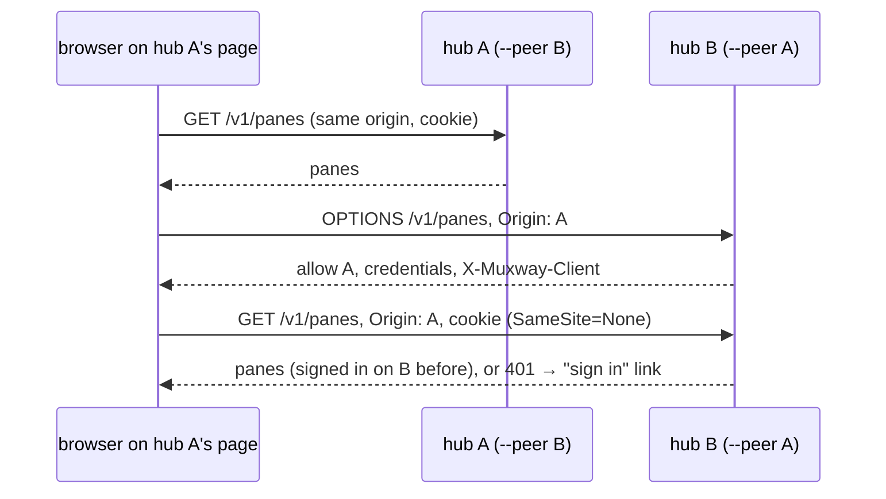
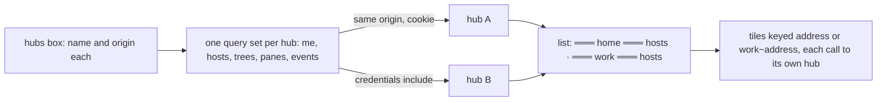

# Feature: every hub's panes in one list

> The owner, 2026-10-27: "I cannot see both server connections on
> Android. I mean all the hubs on all servers. Go and implement all of
> that." This reverses the decision of 2026-10-24 (hubs stay separate,
> one at a time; `2026-10-24-several-hubs.md`) for both clients. The
> decision is the owner's, taken with the security consequences in
> section 4 in front of him. The Android client has its side in its own
> repository's plan of the same name and commit of the same day; this is
> the hub's and the web's.

## 1. Goal

A person with a hub at home and one at work sees the panes of both in
one list, opens them side by side, is told when any of them waits, and
on the web signs in on each hub once and then sees all of them on any
hub's page. Out of scope: a hub relaying another (no hub ever holds
another hub's credential); mixing two hubs' panes inside one host group;
the window view for a pane of another hub (it stays this hub's own).

## 2. Design

### Hub

A browser holds a session cookie per origin, and the hub's cookie is
`SameSite=Strict`, so a page on hub A cannot call hub B today. The hub
gains a **peer** list: `muxway hub serve --peer https://work.example.com`
(repeatable; each value must be an https origin, or http to this
machine, with nothing after the host, else the hub does not start). For
a request whose `Origin` is exactly a peer, the hub answers the
preflight and the request with `Access-Control-Allow-Origin: <that
origin>`, `Access-Control-Allow-Credentials: true`, `Vary: Origin` and
the client header among the allowed ones; with at least one peer the
session cookie is set `SameSite=None` (still `Secure`, `HttpOnly`), and
the web page's content security policy lets it connect to the peers.
Without peers nothing changes.

### Web

The hubs box stays the list of hubs. The pane list asks every hub in it
for `/v1/me`, `/v1/hosts` and, per host, the tree, with
`credentials: 'include'` for the others (`api()` takes the hub's origin;
same-origin calls are as they were); the add menu, the strip and the
selector ask every hub for `/v1/panes`. The list draws the hub level as
guideline §1.3 says: the hub's name on its own line only with more than
one hub, a hub that answers 401 with *not signed in* and a *sign in*
link to its own page, an unreachable one with *unreachable*, nothing
under either; a host is listed under the hub it belongs to. A pane of
another hub is addressed `<hub name>~<address>` in routes, tile lists,
the selector and the add menu (which groups by hub when the listing
has more than one); every call for such a pane (read, input, resize and
its release, files, preview, changes, close, split, a session) goes to
that hub's origin with the browser's cookie for it, and the answer's
pane is named the page's way again. The session's own hub keeps bare
addresses, so every existing bookmark and spec stands. Events: one long
poll per hub, each invalidating its own hub's lists; a hub's refusal or
absence backs that poll off and moves nothing else. A peer's 401 never
sends this page to sign-in.

### Android

In the Android repository's plan: every hub with a token is in use, one
listing per hub, panes keyed `<hub id>:<address>`, one event poll per
hub, the watch's board the union.

## 3. Protocol and API changes

Compatible. One hub flag, `--peer <origin>`; the CORS answer for a peer
origin gains `Access-Control-Allow-Credentials: true`, echoes the origin
and allows `X-Muxway-Client`; the session cookie's `SameSite` is `None`
when peers are set; the web page's `connect-src` names the peers.
Documented in `docs/protocol/v1.md` (the CORS bullets),
`docs/features/sign-in.md` and `docs/features/hub-and-agent.md`.

## 4. Security analysis

- **What changes on the hub**: a signed-in browser's cookie now travels
  with cross-site requests, but the hub only honours it together with the
  `X-Muxway-Client` header, which a browser can add cross-origin only
  after a preflight, and the hub answers that preflight for peer origins
  alone; every other origin keeps the wildcard without credentials, which
  a browser refuses to pair with a cookie. A form post or an image from
  any other site carries no header and is refused as today
  (`41-cross-site.spec.ts` keeps proving it, now against a hub with
  peers). The peer list is the owner's explicit decision, per hub, on the
  command line, checked to be an origin; an empty list is the old
  behaviour exactly. The sign-in, agent and admin endpoints answer no
  preflight, peer or not.
- **What an attacker gains**: a peer hub's page that is compromised can
  act on this hub as the signed-in person. Peers are therefore hubs the
  same owner runs, and the docs say so.
- **The web page**: the content security policy names the peers and
  nothing else, so a script on the page still reaches no third origin. A
  hub's name is the person's own, checked when it is added to the box; an
  address with a name the box does not have falls to this hub, which does
  not know the pane. Hub names and pane addresses are drawn as text.
- **Android**: nothing crosses a new boundary; each token is used only
  against its own hub, as before.
- **Logging**: unchanged; hub names are not secrets, tokens and cookies
  never appear (the suite searches the logs for the ones it made).
- **No new dependencies.**

## 5. Privacy check

Fixtures use `home`/`work`, `hub.example.com`, `work.example.com`,
`lab.example.com`, `evil.example.com`, `alice-laptop`, `bob-desktop`,
`carol-desk`. Screenshots come from the browser suite against the two
test hubs.

## 6. Test plan

| # | Test | Kind | Expected |
|---|------|------|----------|
| 1 | Credentialed request from a non-peer origin with the client header, on a hub with peers | e2e-security (170) | the preflight allows neither the header nor credentials; a cookie without the header is 401; the answer to one with the header carries the wildcard and no credentials, which a browser throws away |
| 2 | Same from a peer origin | e2e-security (171) | preflight and request allowed, origin echoed, credentials true, `Vary: Origin`; the sign-in, agent and admin endpoints answer no peer preflight; the page's CSP names the peers |
| 3 | Cookie attributes with and without `--peer`, a malformed `--peer` | e2e-security (172) | `SameSite=None` only with peers, `Secure` and `HttpOnly` both ways, the clearing cookie the same; the hub refuses to start on a value that is not an origin |
| 4 | `PeerOrigin` | unit (Go) | origins taken and normalised; schemes, paths, queries, credentials refused |
| 5 | A page on another origin against a hub with peers | UI, spec 41 | still blocked or 401, nothing typed |
| 6 | Two hubs listed, one pane of each side by side, typed into on its own hub | UI, spec 94 | hub lines, hosts under each, the far pane's requests to the second hub; screenshots `94-every-hub`, `94-side-by-side` |
| 7 | A hub not signed in | UI, spec 94 | its line says so with *sign in* to its own page, nothing under it; screenshot `94-not-signed-in` |
| 8 | Addresses with a hub name in the route, the add menu's hub level | unit (vitest) | `work~host/s/w.p` accepted, a bad name refused; groups carry the hub |
| 9 | Events from hub B | e2e | one poll per hub; hub B's events re-list hub B's queries only (by key) |

## 7. Documentation

Guideline §1.3, §2, §3 (done first by the owner). Core: `web-client.md`
(*Several hubs* rewritten, the security considerations), `sign-in.md`,
`hub-and-agent.md` (the flag), `docs/protocol/v1.md` (CORS). Android:
`connect.md`, `notifications.md`, `watch.md`, in its repository.

## 8. Implementation steps

1. Hub: `--peer`, CORS and cookie, the CSP; tests 170 to 172 and the
   unit test.
2. Web: the address form and `api()`'s hub, per-hub queries and events,
   the list's hub level, every pane call by hub, the add menu's hub
   level.
3. The harness's second hub with an agent and peers both ways; spec 94.
4. Docs; `web/dist`; one commit here naming the Android client's.

---

## Review (after implementation)

- [x] Diff matches the plan. Deviations: the window view stays this
  hub's own (a pane of another hub has no window button and `w` does
  nothing for it) rather than growing a hub parameter; a hub's own
  `/v1/me` is asked per hub, so `+ session` follows that hub's grants;
  the harness allocates the second hub's address first so each hub can
  name the other as a peer.
- [x] Security rules hold: credentials only for an exact peer origin,
  checked on the command line; the header still required; no new
  preflight on sign-in, agent or admin endpoints; the CSP names the
  peers alone; nothing relayed, no secret logged.
- [x] Privacy check: `scripts/prepush-check.sh` run at the commit;
  fixtures are the suite's own.
- [x] Docs: protocol, sign-in, hub and agent, web client, help.

## Test run

Run `20261027-140637-174741e` (`scripts/e2e.sh`, this checkout, before
the commit): lint, the web unit tests (18 files, 117 tests), the dist
check, and 156 end-to-end tests, among them 170 to 172 and
`TestPeerOrigin`, the browser specs 94 (six tests, with `94-every-hub`,
`94-side-by-side` and `94-not-signed-in`), 41 against the hub with
peers, 43 with the cookie's `SameSite=None`, and 105 from the add menu
and minimised row commit. 155 passed; one failed, spec 103's *a pane
outside a repository says so* (the repository line not shown within
eight seconds of a `cd`), which is unrelated to this change and passed
four of four twice when run on its own afterwards. An earlier run of
the same tree, `20261027-135115-174741e`, had spec 43 expecting
`SameSite=Strict` on the harness hub, which now has a peer, and spec 64
finding a window the add menu spec had left fitted; both specs were
corrected and the suite run again. The run was not recorded as a
GitHub issue from here: no push was made.
