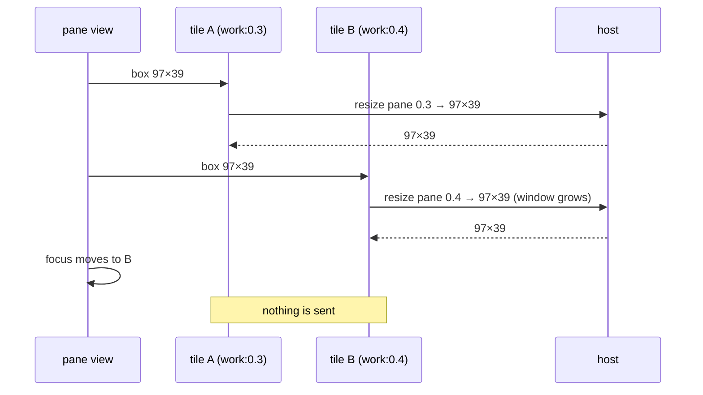
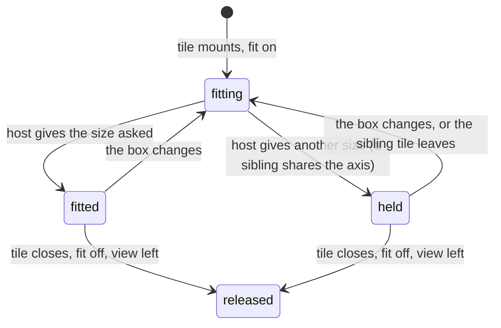

# Feature: fits that stay put

> The owner reported on 2026-10-29, from two tiles of one window on the
> web: one tile's text tiny ("fit is messed on one of the panes"),
> fixing itself when that tile is focused while the other goes small,
> and "it recalculates fit on every focus switch when in multi-pane
> view. It makes a lot of moving, and it's not required to do that on
> focus change." Approved the same day: "there's no need to do anything
> on focus change. It doesn't resize any pane window. … I see you
> proposed to set size first before (un)zoom. I support that. You can
> also make zoom some nice animation." The animation is added to the
> design below.

## 1. Goal

Both complaints are one rule, the *held* rule of the 2026-10-24
tile-fits plan: tiles that are some (not all) of a window's panes share
one fit, the focused tile's; the others keep fit off, say *held* and
are drawn scaled into their box. The screenshot shows it exactly: the
focused pane at 97×39 fits its tile, the other pane, left at 204
columns by the host, is shrunk to half the screen's width and reads at
half size. Every focus change moves the fit to the newly focused tile
and releases the other, so the host re-lays the window and both tiles
redraw on each switch.

The goal: a tile's fit depends on its box, never on the focus. Open
tiles of one window each fit their own pane. Nothing moves when the
focus moves. *Held* remains only for the case it was made for, a size
the host could not give because another tile's fit shares the axis,
and then it stays as it is until a box changes.

Out of scope: tiles that are every pane of one window (they already fit
the window as one with an exact layout; unchanged), the window view,
the lone pane's window-scope zoom (unchanged). Android has the same
rule in `TileFit.kt` and gets the same change in its own plan.

## 2. Design

**Each tile fits its pane.** `heldTile` in `Pane.tsx` no longer looks at
the focus: for tiles of a partly open window it is false, so every
such tile runs `useFit` at pane scope exactly as tiles of different
windows do today. The agent's `ResizePane` handles siblings: on an axis
the pane shares, the neighbours give or take, and the window grows
before any pane goes under the floor (20 columns, 5 rows).

**The agent keeps the fits of a window.** Growing the window scales
every pane, so a second fit used to take the first pane's size away
(found while testing: three panes in a row, two fitted to 60 columns,
the first ended at 95). The agent now remembers, per window, the size
each pane was given at pane scope (`fits`, beside `layouts`), gives
those panes their sizes again before sizing the one asked, sizes the
asked pane last so it wins where two cannot both be had, and goes
round up to four times until the kept sizes and the floors hold. A
window-scope fit or a release forgets the window's fits; a pane gone
since its fit is skipped. Two tiles side by side that are two panes of
a five-pane row therefore make the window wide enough for both at
their tiles' sizes, and the three panes not shown share what is left.

**Held means "the host said otherwise".** A pane fit's answer carries
the pane's size. When it differs from what was asked (the host could
not give it: the two panes are stacked and share one width, so the
later fit set both), the tile is drawn scaled to its box as a held tile
is today, with *held* in its header, and nothing is sent again until
its box changes or the other tile leaves. The last fit sent wins; since
each tile sends only when its own box changes, there is no fight and no
loop. The focus plays no part.

**Zoom is undone before a pane fit.** `ResizePane` in the agent calls
`unzoom` first, as `ResizeWindow` does: a pane that was alone in the
view (window scope, zoomed) and gets a sibling opened beside it is
resized in a window that is still zoomed, which is where the 204-column
pane came from. (The window-scope path with `zoom` keeps zooming as it
does now.)

**Focus changes send nothing.** The focus moves the thick border, the
keys and the input line, and that is all. `F` (fit all) and `f` on a
tile still toggle fits as they do.

**The zoom is drawn.** `z`, `⊡` or a double-click takes a tile to the
whole view and back; the tile now grows into the view and shrinks back
to its place as the browser's view transition (`view-transition-name`
on that tile alone, 240 ms, the rest of the page not cross-faded), and
not at all with effects off or `prefers-reduced-motion`. Browsers
without the API change the view at once, as today.

## 3. Protocol and API changes

None. `POST /v1/panes/{address}/resize` with pane scope is used as it
is; its answer already carries the pane's size.

## 4. Security analysis

- Abuse: none new. The same endpoint, the same write grant, the same
  limits (one resize a second per principal, the floor for neighbours).
  Fewer requests than today: a focus change no longer sends two.
- Authentication and authorisation: unchanged.
- Input crossing a boundary: the host's answered size, compared to the
  size asked; both already validated.
- Logging: unchanged; resizes are audited as writes already.
- Dependencies: none.

## 5. Privacy check

Fixtures use the harness's `alice-laptop` window `work:1` split through
the control endpoint; no real host, path or person. Screenshots in the
test environment.

## 6. Test plan

| # | Test | Kind | Expected |
|---|------|------|----------|
| 1 | security: a read-only tile beside a writable sibling | UI, spec 99 | no resize for the read-only one, the writable one fits |
| 2 | two tiles of a three-pane window side by side; the resize requests are counted | UI, spec 99 | one pane fit per tile; both panes at their tiles' sizes; the window grew; screenshot `99-both-fit.png` |
| 3 | the focus moves between them ten times (`]`, clicks) | UI, spec 99 | no resize request, both sizes unchanged, no *held* |
| 4 | two tiles whose panes are stacked (share the width) with different tile widths | UI, spec 99 | the later fit's width on both; the other tile says *held* and is scaled; nothing sent on focus; screenshot `99-held.png` |
| 5 | a pane opened alone (zoomed), then a sibling opened beside it | UI, spec 99 | the window unzoomed, both fit, no tiny text |
| 6 | `ResizePane` on a zoomed window | e2e (Go) | unzoomed first, the pane at the size asked |
| 6b | two panes of a three-pane row fitted one after the other | e2e (Go) | both at their sizes after the second fit, the third not under the floor |
| 7 | leaving the view | UI, spec 99 | every pane released (`fit: auto`), as today |
| 8 | `z` from two tiles and back, with effects on and off | UI, spec 99 | one tile, then two in their places; the zooming mark on the tile is gone when the transition ends |

## 7. Documentation

- `docs/ui-guideline.md` §1.4 *fit*: the one-fit-per-window paragraph
  rewritten: each open tile of a window fits its pane; *held* only when
  the host could not give the size; nothing moves with the focus.
- `docs/features/web-client.md`, *Fit: the host follows the browser*.
- `docs/plans/2026-10-24-tile-fits.md` gets a line pointing here.
- Android: its plan and docs, and android#26 stays separate (the full
  window as one).

## 8. Implementation steps

1. Agent: `unzoom` in `ResizePane`, the window's fits kept and given
   again; Go e2e tests.
2. `Pane.tsx`: `heldTile` without the focus; held from the answered
   size; the scaled drawing reused.
3. Spec 99 rewritten as the table says; docs; `make web`; local
   review; `make e2e`; record; `scripts/prepush-check.sh`; push;
   redeploy.
4. Android: `TileFit.kt` and `PaneTile`, tests, docs, version.

---

## Review (after implementation)

- [x] Diff matches the plan. Deviations: the agent keeps and reapplies
  the window's pane fits (section 2, found in testing); *held* is also
  set when a later listing shows the pane at another size than asked,
  not only from the answer, since the sibling's fit moves it after the
  answer; `useFit` reports the size asked (`asked`) for that; the zoom
  mark is a small store the tiles watch, since the tiles mount anew on
  the way and a plain state was left behind; spec 99 is five tests (the
  window as one, both fit, one held, the zoom undone and `z` drawn, a
  pane left for another).
- [x] Security rules (AGENTS.md section 2) hold: the same endpoint and
  grants; the agent's kept fits are sizes it already validated; fewer
  requests than before.
- [x] Privacy check passed: `scripts/prepush-check.sh` clean and diff read
- [x] Docs and diagrams updated: guideline §1.4 *fit* and *zoom*, the
  web client's fit section, the protocol's resize paragraph, the
  tile-fits plan pointed here.

## Test run

[Run 20261029-143014-2369b22](https://github.com/notmarkopadjen/muxway/issues/158): passed, 159 tests, 0 failed, with spec 99's five tests
(screenshots `99-window`, `99-both-fit`, `99-held`) and the Go tests
Flow170 (a pane fit undoes the zoom), Flow171 (two fits of one window
both hold) and Flow172 (a window whose fitter left is given back).

Follow-up the same afternoon, from the owner's next screenshot: the
window-scope fit (every pane of one window as tiles, and the window
view) was keyed on the focused pane, so each focus change released the
window through the old pane and fitted it again through the new one,
the reflow the owner saw. Both views now fit the window through one
writable pane of it, the same one while it is shown (specs 76 and 99
check that the focus sends nothing). [Run 20261029-150403-19e873c](https://github.com/notmarkopadjen/muxway/issues/160): passed, 159 tests, 0 failed.

Shipped in the same commit, from the owner's report of the same day:
a pane alone that exits (`exit` in its shell) now leaves the view too,
back to the list or the first minimised pane, with a toast; the "gone"
rule only applied among several tiles. The agent gives a window back
when the pane that fitted it is gone, since no client can release it
through that pane (spec 79, Flow172). Under the full suite's load the
changes window was found not to re-ask a pane outside a repository for
up to a minute, so while open it asks every five seconds now (spec
103); specs 65, 85 and 106 wait past one listing refresh.
