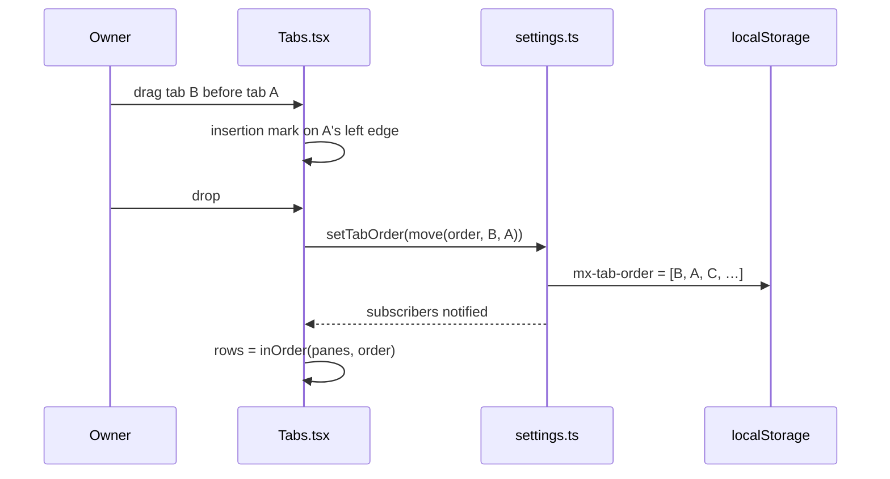
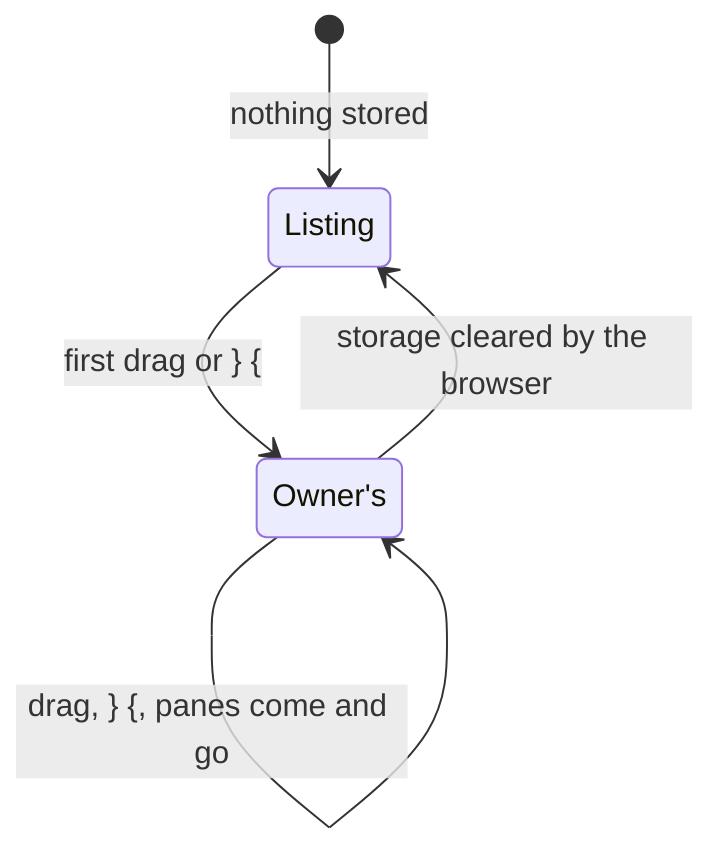

# Feature: the strip in the owner's order

> The owner asked on 2026-10-29: "I would like to drag and drop pane
> list in header and rearrange them." Approved the same day ("I approve
> tab order plan").

## 1. Goal

The strip lists every readable pane in listing order: host, session,
window, pane, as the hub returns them. With several hosts and a dozen
panes the ones that matter sit wherever tmux put them. The owner wants
to drag a tab along the strip and have the strip keep that order.

In scope: the web client's strip in the pane view, a drag with the
pointer, a pair of keys for the keyboard, the order kept in the browser
across reloads and views. Out of scope: the window view's strip (it
shows one window in the host's order, which is the point of that view),
the panes page (the tmux tree stays a tree), the add menu (grouped by
host and session), Android (its strip is dragged to scroll; a long-press
reorder would be its own plan), the hub (the order is a view preference
of one browser, like the theme, the font and the hubs list; nothing of a
client's arrangement lives on the hub today and this does not start it),
and dropping a tab onto a tile to open it there (worth a later plan).

## 2. Design

**The order** is a list of pane addresses in `localStorage` under
`mx-tab-order`, read and written through `settings.ts` like the theme.
The strip is drawn by one pure function, `inOrder(panes, stored)` in
`web/src/term/order.ts`:

1. the panes whose address is in the stored list, in the list's order;
2. then every other pane in listing order.

So a pane never dragged stays where the listing puts it, after the ones
that were; a new pane appears at the end of the undragged ones; a pane
that goes away loses its tab and comes back in its slot when the same
address comes back (tmux reuses `session:window.pane`, and the owner's
long-lived panes are the ones worth ordering). The stored list keeps
addresses the listing no longer has, so a host that is offline for a
minute does not lose its order; it is capped at 256 entries, the oldest
dropped first, and an entry is at most 256 characters. Addresses of
other hubs are the same strings the strip keys its rows by today.

**The drag** uses the browser's drag and drop as the tile headers do
(`draggable`, `dragstart`, `dragover`, `drop`). A tab dragged over
another shows an insertion mark, a 2 px bar in the ink colour on the
nearer edge of the tab under the pointer, and the drop puts it there:
`move(order, dragged, before)` writes a stored list that holds the
*whole* visible strip in its new order (not only the two tabs), so the
first drag fixes every pane's place as it was and later listing changes
cannot shuffle what the owner saw. A drop outside the strip, or `Esc`,
changes nothing. The pointer over a tab stays a hand; while a drag is
on, the dragged tab is dimmed. A click still opens, Shift+click still
opens beside, a double-click still zooms: a drag starts only after the
pointer moves, which the browser decides.

**The keys**: `{` and `}` move the focused pane's tab one place left or
right in the strip, with the same `move`. They sit next to `[` and `]`,
which already walk the strip in its (now stored) order. On a tile view
with several tiles the focused pane is the focused tile's.

**Follow-through.** `[` `]` and the phone-style neighbour step already
read `strip.indexOf`, so they follow the new order with no change. The
minimised row keeps its own order (the order of minimising). The window
view's `Tabs` is given the window's panes and never the stored order.

## 3. Protocol and API changes

None. Nothing is sent to the hub; the listing is read as today.

## 4. Security analysis

- Abuse: none reachable. The feature reads and writes one key of the
  browser's own storage and reorders buttons the page already draws.
  Whoever can write that storage already runs script on the origin.
- Authentication and authorisation: unchanged; a tab is drawn only for a
  pane the listing (already authorised) returned.
- Input crossing a boundary: the stored value. It is parsed on a guard:
  JSON, an array, strings only, each at most 256 characters, at most 256
  of them; anything else is treated as empty. An address in it is only
  ever compared to the listing's addresses, never rendered on its own,
  so a planted string shows nothing. The `dataTransfer` payload is an
  empty string as in the tile drag; the dragged address is kept in
  React state, not read back from the event.
- Logging: nothing is logged; the stored list holds host and session
  names the page already keeps in its query cache and the hubs list.
- Dependencies: none added.

## 5. Privacy check

Fixtures use the harness's `alice-laptop` / `bob-desktop` hosts and the
`work` session; screenshots are taken in the test environment with the
amber theme. No real host, person or secret in code, docs or tests.

## 6. Test plan

| # | Test | Kind | Expected |
|---|------|------|----------|
| 1 | `mx-tab-order` holds garbage: not JSON, a number, an array with objects, 1000 entries, a 10 kB string | unit (vitest) | `getTabOrder()` is `[]` or the valid prefix; the strip shows listing order; nothing thrown |
| 2 | a stored address the listing lacks | unit | kept in storage, drawn as nothing |
| 3 | `inOrder`: stored panes first in stored order, the rest in listing order; `move` writes the whole visible strip; cap at 256 with the oldest dropped | unit | as section 2 |
| 4 | drag the third tab before the first; screenshot `106-reorder-dragged.png`; reload; screenshot `106-reorder-kept.png` | UI, spec 106 | the strip shows the new order before and after the reload, `[` and `]` walk it |
| 5 | `}` moves the focused tab right, `{` back; at either end nothing happens | UI, spec 106 | tab order as expected, no error |
| 6 | a pane leaves the listing (closed through the control endpoint) and a new one is split; the strip | UI, spec 106 | the dragged ones keep their places, the new pane is last; screenshot `106-reorder-new-pane.png` |
| 7 | the window view after a drag in the pane view | UI, spec 106 | the window's order, untouched |
| 8 | a drop outside the strip, and `Esc` during a drag | UI, spec 106 | the order unchanged |

## 7. Documentation

- `docs/ui-guideline.md` §1.4 *strip*: "in listing order, or the order
  the owner dragged them into (web)"; the keys table gets `{` `}` and
  "reorder the strip: drag a tab (web)".
- `docs/features/web-client.md`: the tab strip paragraph and the
  keyboard table.
- This plan, with its review and test run.

## 8. Implementation steps

1. `settings.ts`: `getTabOrder` / `setTabOrder` with the guard;
   `term/order.ts` with `inOrder` and `move`; vitest for both.
2. `Tabs.tsx`: a `reorder` prop (the pane view passes it, the window view
   does not); the drag handlers and the insertion mark; `pages.css` for
   the mark and the dimmed dragged tab.
3. `Pane.tsx`: `strip` built from `inOrder`; `{` `}` in the key handler.
4. Spec 106, docs, `make web`, local review, `make e2e`, record the run,
   `scripts/prepush-check.sh`, push, redeploy.

---

## Review (after implementation)

- [x] Diff matches the plan. Deviations: the stored list is read
  as a whole or not at all (a non-string entry makes it empty) rather
  than as a valid prefix, which is simpler to state; the spec tests
  the ends of `{` `}` by pressing once more than needed; the keys are
  listed in the help overlay too.
- [x] Security rules (AGENTS.md section 2) hold: nothing new leaves the
  browser, the stored value is guarded, addresses are compared, never
  drawn from storage.
- [x] Privacy check passed: `scripts/prepush-check.sh` clean and diff read
- [x] Docs and diagrams updated: guideline §1.4 and the keys table, the
  web client page, the help overlay.

Shipped with the same commit: spec 103 waits fifteen seconds for the
repository to be asked again (it failed under the full suite's load,
never alone), and spec 65 filters the selector on the window's name,
since a split the spec before it killed can still be listed.

## Test run

[Run 20261029-124747-245f83e](https://github.com/notmarkopadjen/muxway/issues/156):
passed, 156 tests, 0 failed, with spec 106 (the drag, the reload, `{`
`}`, a drop outside, a new and a closed pane, the window view, and the
garbage-in-storage security test) and the screenshots
`106-reorder-dragged`, `106-reorder-kept`, `106-reorder-new-pane`.
