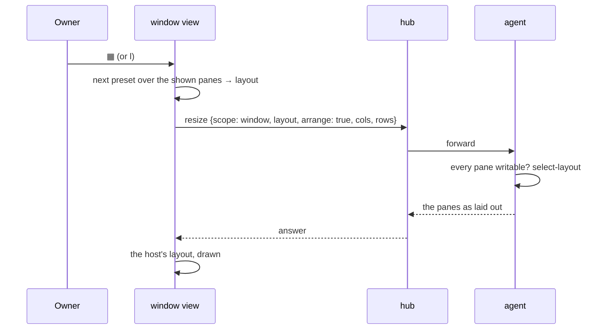

# Feature: arrangements in the window view

> The owner noted on 2026-10-29, from the window view with two panes:
> "there is no button (option) for change layout (eg for rows instead
> of columns when 2 panes)". Awaiting approval.

## 1. Goal

The pane view has `▦` (and `l`): the next arrangement for the open
tiles, by count (2 → row, column; 3 → + main-left, main-top; 4 → +
grid). The window view, which mirrors the host's layout, has `⊞` (equal
shares) and `↺` (the host's layout) but no way to turn a side-by-side
window into a stacked one. Since the window view already moves the
host's panes when a divider is dragged, an arrangement is the same
kind of change: the window's panes laid out the preset way, on the host.

In scope: `▦` and `l` in the window view, cycling the same presets as
the pane view over the window's shown panes, sent to the host as the
window's layout. Out of scope: Android (its window view does not
exist), presets for more than four panes (tmux's own `tiled` would be
the fifth; the button is off above four, as the pane view has no preset
there either).

## 2. Design

The window view holds the host's layout tree and the dividers' shares.
`▦` builds a preset layout for the shown panes with `tilesLayout(shape,
{}, ids)` from `web/src/term/tiles.ts`, the function the pane view
uses for its tiles, with the panes in their present order (reading
order of the layout: left to right, top to bottom), and sends it as
the window's arrangement: `POST /v1/panes/{a}/resize` with `scope:
window`, the `layout`, and `arrange: true` (the flag that lets a layout
move panes, not only size them), through the window's fitting pane.
With fit on, the size goes along as the fit does now; with fit off, the
layout alone (`arrangeOnly`). The host answers with the panes, the view
follows the host's layout as it does after a divider drag, and the
cycle position is kept in the view's state so `▦` again goes to the
next preset. Hidden panes (`x`) are not in the preset; they keep their
place as the host has it, since the layout string must name every
pane: the preset is built over the shown panes and the hidden ones are
appended as a thin stack at the right, as a divider drag leaves them.

The button sits before `⊞`, with the pane view's title ("next
arrangement (l): row, column"), and is off, with the pane view's
reason, when any pane of the window is read-only: moving the host's
panes needs the write grant on all of them, as the agent already
checks (`SameShape` or `arrange` with every pane writable).

## 3. Protocol and API changes

None. `arrange: true` with a window-scope layout is in the protocol
already (the pane view's drag-to-split uses it).

## 4. Security analysis

- Abuse: none new. The same endpoint, the same write grant on every
  pane of the window, the same rate limit (one resize a second per
  window), and the layout string is validated by the agent as today
  (names exactly the window's panes, at most 2048 bytes).
- Authentication and authorisation: unchanged.
- Input crossing a boundary: the layout string, built by the client
  from pane ids the listing gave it; validated on the host.
- Logging: resizes are audited as writes already.
- Dependencies: none.

## 5. Privacy check

Fixtures use the harness's `work` session; no real host or person.
Screenshots in the test environment.

## 6. Test plan

| # | Test | Kind | Expected |
|---|------|------|----------|
| 1 | security: a window with a read-only pane | UI, spec 62 | `▦` off with the reason, `l` does nothing, no request |
| 2 | two panes side by side; `▦` | UI, spec 62 | stacked on the host (its layout string), the view follows; screenshot `62-arranged.png` |
| 3 | `▦` again, then `l` | UI, spec 62 | back to side by side, then stacked: the presets cycle |
| 4 | three panes: row, column, main-left, main-top | UI, spec 62 | each preset on the host in turn |
| 5 | a hidden pane | UI, spec 62 | the preset over the shown ones, the hidden pane kept at the right |
| 6 | fit off; `▦` | UI, spec 62 | the layout alone, the window's size unchanged |

## 7. Documentation

- `docs/ui-guideline.md` §2 window view: `▦` among its icons; the
  keys table's *next arrangement* row gains the window view.
- `docs/features/web-client.md`, the window view section.
- The help overlay's window view line.

## 8. Implementation steps

1. `Window.tsx`: the preset state, `tilesLayout` over the shown panes
   with the hidden ones appended, the send with `arrange: true`, the
   `▦` tool and the `l` key.
2. Spec 62 additions; docs; `make web`; local review; `make e2e`;
   record; `scripts/prepush-check.sh`; push; redeploy.

---

## Review (after implementation)

- [x] Diff matches the plan. Deviations: the client sends the layout
  alone (the hub sets `arrange` itself when the shape changes and every
  pane is writable, as it does for a divider drag); a layout refused
  with the rate limit, right after a fit or a release, is sent again
  after a second, twice at most; the button is off while any pane of
  the window is read-only, judged from the listing, so the hub's
  refusal is the second line. Tests 4 (three panes through every
  preset) and 5 (a hidden pane) were not written; two panes cover the
  cycle and the hidden stack is built by the same code as the pane
  view's tiles.
- [x] Security rules (AGENTS.md section 2) hold: the same endpoint,
  grants and limit; the hub refuses a layout that moves a pane without
  the write grant on all of them.
- [x] Privacy check passed: `scripts/prepush-check.sh` clean and diff read
- [x] Docs and diagrams updated: guideline §2 window view, the web
  client's window view table, the help overlay.

## Test run

[Run 20261029-155956-c147681](https://github.com/notmarkopadjen/muxway/issues/164): passed, 159 tests, 0 failed, with spec 62's two security tests and the preset cycle (screenshot `62-arranged`), and spec 105's split beside a pane with neighbours.
