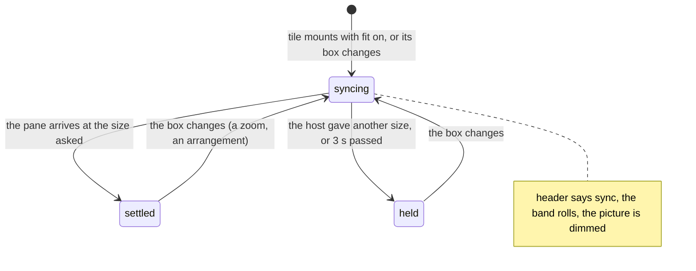
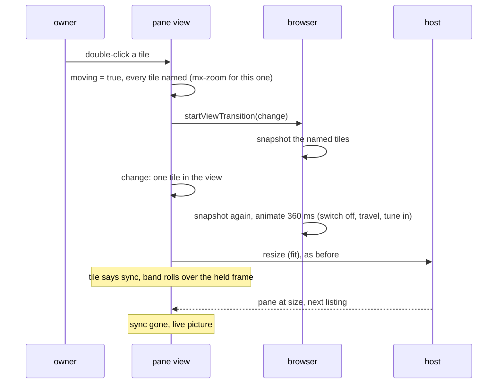

# Feature: moves that are drawn, and a screen that says it is syncing

> The owner reported on 2026-10-30, from the web client: "When I
> double click to zoom in / zoom out on a pane, I see that panes are
> frozen, then work. I would like to have some visual feedback that
> it's not stuck, also some animation for zoom in / zoom out, retro
> (same CRT style) if possible. Same for snapping on multi-window
> layout. That part works great, I just want animations on
> transition."

## 1. Goal

Two things, both in the web client, both pure presentation.

**The screen says it is syncing.** After a zoom each tile asks the host
for its size and, until the pane comes back at that size, keeps showing
the last frame it had (the *held frame*, up to three seconds), so a
smaller screen does not flash by. That is the freeze the owner sees: a
still picture with nothing saying why. While a tile waits for its size
it now says so: *sync* in its header, and the picture is drawn like a
tube tuning in, a soft band rolling down it, until the pane arrives at
size. With effects off (or reduced motion) the band is not drawn and
the word stays.

**Every move of the tiles is drawn.** The zoom already uses the
browser's view transition, as a plain slide of the one tile's snapshot
(2026-10-29). It becomes a CRT change: the tile switches off to a
bright line, the line travels to the tile's new place, and the picture
opens there; a tile that leaves the view switches off, one that comes
powers on, and a tile that only moves slides to its place with a
brightness retrace. The same drawing serves every rearrangement of the
pane view, which is what the owner calls snapping: a header dropped on
a tile (swap, or a split of its place), on a divider or an edge (laid
across), `l` the next arrangement, `=` equal shares, `e` / `E`, a tile
minimised or restored. And the window view's own moves: `=`, `↺`, a
pane hidden or brought back, and `▦` when the host's new layout
arrives.

Out of scope: divider drags (the tiles follow the pointer, there is
nothing to draw); the strip's tabs; Android, which has no counterpart
to the view transition (a parity note, no plan). Nothing changes in
what is sent to the host, when, or how often.

## 2. Design

### 2.1 Syncing

`Tile` in `Pane.tsx` already knows the state: `fitting` and not
`settled` (the pane is not yet at the size the fit asked) and not
`held` (the host gave another size, or three seconds passed). That
becomes `syncing`, set as `data-syncing` on the tile, and drawn:

- the header shows `sync` after the size, dim, blinking with the
  cursor's blink (`mx-blink`), `data-testid="syncing"`; *held*
  replaces it when the wait is over without the size;
- the tile body's `::after` (the body is already `position: relative`)
  lays a soft horizontal band over the screen, a gradient of the
  theme's ink at a few percent, rolling from top to bottom every
  900 ms (`background-position` animated, so nothing overflows the
  tile, no new element in the DOM);
- the held picture is dimmed a little (`filter: brightness(0.85)` on
  the screen), so the live picture visibly snaps back when it arrives.

Effects off (`data-motion="off"`) and `prefers-reduced-motion` hide the
band, stop the blink and leave the word. The word is the information;
the band is the effect.

The window view has no held frame, so no freeze, and gets no sync
mark.

### 2.2 Drawn moves

The zoom's `animated` in `Pane.tsx` moves to `web/src/term/drawn.ts`
as `drawn(change, zoom?)`, and is used by both views:

- `drawn` does nothing special with effects off, reduced motion or no
  `startViewTransition`: the change is applied at once (as today);
- otherwise it marks the view as *moving* (a module flag with
  subscribers, `useMoving()`), flushes that into the DOM, starts the
  view transition around the change (the change, then two frames, as
  today), and clears the mark when the transition finishes or after
  1.5 s, whichever is first;
- `nameFor(id)` gives an element its `view-transition-name`: `mx-t-`
  and the pane's address (or pane id in the window view) with every
  character that is not a letter or digit as `-`. Addresses are unique
  within a view, so names are too. The zoomed tile is named `mx-zoom`
  instead, so the stylesheet can give it the bigger effect.

While moving, every tile (`Tile`) and every cell (the window view's
`Tree`) carries `data-moving` and its name as an inline style; the
zoomed tile keeps `data-zooming` as well. The browser snapshots each
named element before and after the change and animates between them.
Names that exist on both sides morph; a name only before is a leaving
element; only after, an arriving one. The root's own snapshots keep
`animation: none` as today, so the rest of the page cuts.

The stylesheet (`motion.css`) gives the pseudo-elements the CRT:

| Pseudo-element | What | Keyframes |
|---|---|---|
| `::view-transition-group(*)` | the box travels from the old place to the new | 320 ms, `--mx-ease-out` |
| `::view-transition-group(mx-zoom)` | the zoomed tile's box | 360 ms, `--mx-ease-crt` (the slight overshoot of the power-on) |
| `::view-transition-old(*)` with a new sibling | the old picture of a moving tile: a quick retrace | `mx-fade-out`, 160 ms |
| `::view-transition-new(*)` with an old sibling | the new picture of a moving tile tunes in | `mx-resync`, 320 ms (brightness 3 and low contrast at 10 %, then normal) |
| `::view-transition-old(*):only-child` | a tile that leaves switches off | `mx-switch-off`: brightness up, squashed to a line, gone; 220 ms |
| `::view-transition-new(*):only-child` | a tile that arrives powers on | `mx-power-on`, 320 ms |
| `::view-transition-old(mx-zoom)` | the zoomed tile's old picture switches off in the first half of the travel | `mx-switch-off`, 180 ms |
| `::view-transition-new(mx-zoom)` | its new picture opens from the line in the second half | `mx-tune-in`: a bright line held, then opening to the full picture; 360 ms, delayed 160 ms |
| `::view-transition-group(root)`, `-old(root)`, `-new(root)` | the page itself | `none`, as today |

`mx-switch-off` is `mx-power-on` backwards in spirit but shorter and
asymmetric, so a tile that closes does not look like a window closing.
Named rules outrank the `*` rules by specificity, so root and `mx-zoom`
keep theirs.

What calls `drawn` in the pane view: `zoom` (as today), the drop
handler (swap and split), `lay` (across), `spread`, `l` / `▦`, `=` /
`⊞`, `minimise` and `restore`. In the window view: `=`, `↺`, `×`
(hide), a hidden pane's tab (bring back), and `▦`: that one changes
the host's layout, and the new tree arrives with the next listing; the
view keeps the layout it draws in state, and a layout change that
follows an arrangement of its own (within 3 s of `▦`) is applied
through `drawn`, any other at once.

### 2.3 Browsers

Chromium and Safari 18 have view transitions; Firefox 144 and later
too. Where the API is missing the change is immediate, as today. The
pseudo-element selectors with `*` are in the spec and in all three.

## 3. Protocol and API changes

None. Not a request, field or timing changes; the fit is sent exactly
as today and the sync mark reads state the tile already has.

## 4. Security analysis

- Abuse: nothing to abuse; no input, no request, no storage.
- Authentication and authorisation: unchanged.
- Input crossing a boundary: a pane's address or id becomes a CSS
  identifier through a whitelist (letters and digits kept, all else
  `-`), set as an inline style property value through React, never as
  a stylesheet string. The content security policy (no inline
  `<style>`, `style-src 'self'`) is not touched: element style
  properties set through the CSSOM are not inline styles under CSP.
- Logging: unchanged. The sync word carries no content.
- Dependencies: none.

## 5. Privacy check

Fixtures are the harness's `alice-laptop`, windows `work:0` and
`work:1`; screenshots in the test environment only.

## 6. Test plan

Security first: none new, since nothing is sent, stored or parsed; the
existing resize and header tests stand (specs 40, 42, 60, 83, 99) and
the suite's CSP check proves the inline style property passes.

| # | Test | Kind | Expected |
|---|------|------|----------|
| 1 | a tile zoomed with the resize answer delayed 1.5 s by a route | UI, spec 108 | the tile says `sync` and has `data-syncing`, the band's animation is `mx-tune` on the body's `::after`; once the pane is at size both are gone; screenshot `108-sync.png` |
| 2 | the same with effects off (`m`) | UI, spec 108 | the word shows, `::after` has no animation |
| 3 | the same under `prefers-reduced-motion` | UI, spec 108 | as 2 |
| 4 | `startViewTransition` wrapped by an init script that records, at each call, the named elements and the zoom name | UI, spec 108 | `z` from two tiles: one call, two names, one of them `mx-zoom`; `z` back: one call, `mx-zoom` and the other; no `[data-moving]` and no names when the transition is over |
| 5 | a drop of one header on another's middle, `l`, `=`, `-` and a restore | UI, spec 108 | one call each, every tile named, none named afterwards; the arrangement and the fits are as spec 97 and 100 already check |
| 6 | effects off: `z`, `l`, a drop | UI, spec 108 | no call, no name at any point, the result the same |
| 7 | the window view: `=`, `↺`, `×` on a cell, its tab, `▦` | UI, spec 108 | one call each (the `▦` one when the layout arrives), every cell named, none afterwards |
| 8 | the pseudo-element animations | UI, spec 108 | `getAnimations()` on the document during a zoom lists `mx-switch-off`, `mx-tune-in` and the group's travel; during `l`, `mx-resync` |
| 9 | spec 75 and 99 unchanged | UI | `[data-zooming]` still set during a zoom and gone after |

The screenshots go to the run directory as every spec's do; the plan's
own pictures for the feature page are taken from a run with effects on.

## 7. Documentation

- `docs/features/web-client.md`: *Look and motion* gets the drawn
  moves and the sync mark; the tiles section's *fit* paragraph names
  *sync* next to *held*; the zoom bullet says how it is drawn.
- `docs/ui-guideline.md` §1.5 (look): the drawn moves as a web effect;
  the tile header row: `sync` beside `held`; the zoom row of §1.6.
- This plan.

## 8. Implementation steps

1. `web/src/term/drawn.ts`: `drawn`, `useMoving`, `nameFor`; `Pane.tsx`
   uses it for the zoom (no behaviour change yet); spec 99's
   `[data-zooming]` checks still pass.
2. Tiles carry `data-moving` and their names while moving; every
   rearrangement, minimise and restore go through `drawn`.
3. `motion.css`: the pseudo-element rules and the new keyframes
   (`mx-switch-off`, `mx-tune-in`, `mx-tune`); the old `mx-zoom` rules
   folded in.
4. The sync mark: `data-syncing`, the header word, the band, the dim.
5. The window view: cells named while moving; `=`, `↺`, hide, bring
   back and `▦` drawn.
6. Spec 108 and the fixtures' init script for counting transitions.
7. Docs, `make web`, the full `make e2e`, the recorded run, deploy.

---

## Review (after implementation)

- [x] Diff matches the plan, deviations explained here
- [x] Security rules (AGENTS.md section 2) hold
- [x] Privacy check passed: `scripts/prepush-check.sh` clean and diff read
- [x] Docs and diagrams updated

**The freeze had a second cause, found by spec 108.** The zoom's view
transition of 2026-10-29 resolved its update callback after two
animation frames. Rendering is paused while a view transition waits for
its callback, so no frame ever came, Chromium gave up after its four
second limit, and in those four seconds the page did not draw at all.
That is the freeze the owner saw; the held frame was only its tail.
`drawn` now resolves the callback after React's commit (a task and a
timer, never a frame), and spec 108 proves the transition reaches
`ready` by reading the animations it runs.

**Deviations.** The zoomed tile's collapse is on the image pair
(`::view-transition-image-pair(mx-zoom)`), not on the old and new
pictures separately: the pair collapses to a line, the pictures swap
while it is one, and the pair opens. The pictures of every named
element keep their natural size and are clipped to the travelling box
(`object-fit: none`), since the default stretched a tile's text while
its box grew, which read as a morph and not as a tube. `go` returns the
navigation so the drawn change can wait for it.

## Test run

[Run 20261030-184127](https://github.com/notmarkopadjen/muxway/issues/173):
passed, 167 tests (123 browser specs), at 577fa7c; spec 108 green,
specs 75 and 99 unchanged and green.
