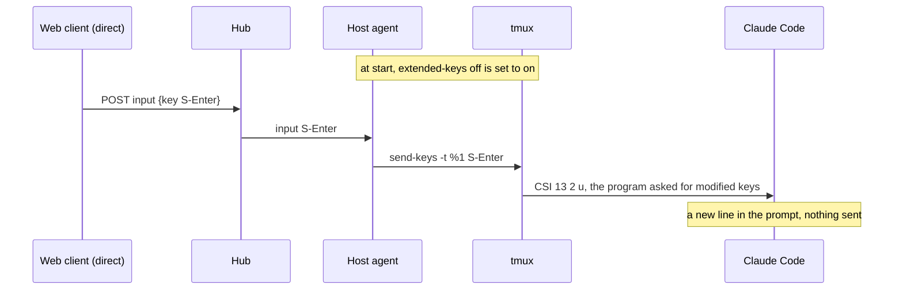
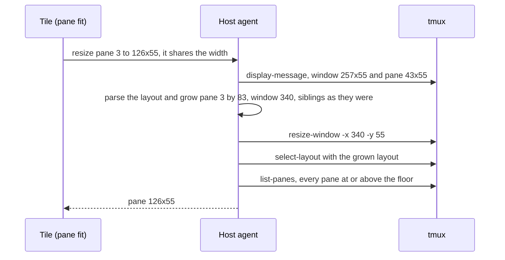

# Feature: a pane fit grows its own cell, and Shift+Enter reaches the program

> The owner reported two things on 2026-10-30: `Shift+Enter` typed direct
> into a Claude Code pane sends the message instead of starting a new
> line, and a tile among several goes to a tiny font for a couple of
> seconds whenever the focus moves to it or away. Both were traced to the
> host side: the first to tmux's `extended-keys` default, the second to
> the agent's pane fit, which can blow a window up to thousands of
> columns after a zoom. This plan fixes both.

## 1. Goal

**Shift+Enter.** Every client sends `Shift+Enter` as the key `S-Enter`
and the agent runs `tmux send-keys S-Enter`. tmux only encodes a modified
key for the program when its server option `extended-keys` is `on` or
`always`; at the default `off` it drops the modifier and the program gets
a plain Enter. Claude Code asks for modified keys (modifyOtherKeys), so
with the option on it gets `ESC [ 13 ; 2 u` and starts a new line; a
program that does not ask still gets Enter. The agent turns the option
on for the tmux server it serves, so Shift+Enter works in every client
without a line in anyone's `tmux.conf`.

**The fit.** With several tiles open, each fits its own pane. On an axis
the pane shares with neighbours, the agent grows the window by what the
pane lacks and then re-lays the window with every cell scaled in
proportion, so the growth is spread over all panes and the target pane
gets only a share of it; tmux's `resize-pane` then takes the rest from
the neighbour, which can end at one column. The floor rule that follows
("no pane under 20 columns") assumes proportional scaling and grows the
window by a factor of `20 / width`: a one-column neighbour makes the
window twenty times wider, 6801 columns from 340 in the replay, and
nothing ever shrinks it. Every fit after that flips between two row
counts (the over-wide pane's scrollbar in the tile takes a row and gives
it back), the tile is drawn scaled to its box, and the owner sees a tiny
font that recovers after the next fit the host accepts. After this plan
a pane fit gives the growth to the pane's own cell, neighbours keep their
sizes, and the floor rule adds what a squeezed pane lacks, never a
multiple.

Out of scope: a change to the web client (its measurements were right;
the row flip is the symptom of the host's size and goes with it), the
Android, glasses and MIDP clients (they send `S-Enter` already), a flag
to keep `extended-keys` off (an owner who wants `always` sets it; the
agent leaves anything but `off` alone).

## 2. Design

### Shift+Enter: the agent and `extended-keys`

At start, after the tmux server answers, the agent reads
`show-options -s -v extended-keys`. When it is `off` (or unset), it runs
`set-option -s extended-keys on` and logs one line: `tmux extended-keys
turned on: modified keys reach the programs that ask`. `on` and `always`
are left as they are. Nothing else changes: `KeyName` already accepts
`S-Enter`, the clients already send it. The option is a server option,
so it holds for every session of that server and survives the agent's
restart; the agent checks again on every start in case the owner's
`tmux.conf` reset it. tmux 3.2 added the option; on an older tmux the
`set-option` fails, the agent logs that Shift+Enter will not reach the
programs, and runs on.

### The fit: growth goes to the pane

`internal/tmux/layout.go` gets `grow(id, dw, dh)` on the layout tree:
walk from the root to the pane's leaf; at a side-by-side split (`{`) the
split widens by `dw`, only the child on the path widens, and the
siblings after it move right by `dw`; at a stacked split (`[`) every
child widens by `dw`, the ones off the path by scaling them to their new
width in their old proportions. Rows the same way with the kinds swapped.
The result is a consistent layout whose root is the new window size.

`resizePaneOnce` uses it. Today, on a shared axis where the pane wants
more than it has, it resizes the window by the difference, re-lays the
window scaled, and then runs `resize-pane`, which squeezes a neighbour.
After: it parses the live layout, calls `grow` with the difference on
each shared axis the pane wants more on, resizes the window to the
grown root and lays the grown layout; on an axis the pane spans, the
window is sized and the layout scaled as today. `resize-pane` remains
only for a pane that wants less than it has on a shared axis (the
neighbour takes the difference, nothing is squeezed) and for a pane that
spans one axis and shares the other.

The floor rule in `ResizePane` becomes additive and exact: for every
pane of the window under 20 columns or 5 rows, `grow` that pane by what
it lacks, then size the window to the root and lay it. The fitted panes
keep their cells, so one round settles; the rounds stay as a guard, and
a window is still never shrunk by a fit. The multiplicative formula goes.

Before, the same request went: window 340 scaled (pane 57), `resize-pane
-x 126` (neighbour 1), floor rule ×20 (window 6801).

## 3. Protocol and API changes

None to the messages. The resize endpoint's description in
`docs/protocol/v1.md` changes its words, not its contract: "on an axis it
shares with neighbours, the window grows by what the pane lacks and the
neighbours keep their sizes; a pane that would go under 20 columns or 5
rows gets the difference the same way". Compatible.

## 4. Security analysis

- **Abuse.** A writer could already size a window to 500×300. After this
  plan a fit grows a window by at most what the pane and the floor need,
  bounded by the request limits, so the worst case shrinks: no fit can
  take a window past a few hundred columns over the sizes asked (the
  replay's 6801 is gone). The release and the one-per-second limit stay.
- **Grants.** Unchanged: a pane fit needs the write grant on that pane.
  `grow` moves no pane, so the layout-moves-panes check is untouched.
- **Trust boundary.** The layout `grow` works on is tmux's own, read
  from the server, never a client's. The client's layout path (window
  scope) is unchanged.
- **extended-keys.** The agent changes one option on a server it already
  controls fully; the option decides how key modifiers are encoded for a
  program that asked for them, nothing more. A client still cannot send
  anything but the grammar's names: `S-Enter` was already in it. No
  escape sequence from a client is passed through.
- **Logging.** The audit line for a resize is unchanged (who, pane, size,
  result); the new start-up line names an option, no secret.
- **Dependencies.** None new.

## 5. Privacy check

The plan, code, tests and docs use the test environment's names only
(`work:0`, `%1`, `alice`). The replay in this plan quotes column counts,
no host. Screenshots are not needed.

## 6. Test plan

| # | Test | Kind | Expected |
|---|------|------|----------|
| 1 | `S-Enter` and the rest of the grammar after the option change: `S-Enter` accepted, `Enter;kill-server`, `S-S-Enter`, a 17-byte name refused | e2e-security (existing 16-keys suite, one case added) | 400 `bad_input` for the refused, nothing typed |
| 2 | A reader's fit, a fit on an unexposed pane, after the resize change | e2e-security (52, unchanged, re-run) | 403 / 404, no window changed |
| 3 | Replay: four panes side by side, one zoomed with the window scope, then a sibling fitted to 126×55 | e2e (new, `s6_layout_test.go`) | window width ≤ sum of pane widths + 3; no pane under 20 columns; the fitted pane 126 wide |
| 4 | The same window, two siblings fitted alternately at 54 and 55 rows twelve times | e2e | window width unchanged throughout; both panes 126 wide at the end |
| 5 | A pane fitted wider in a stacked split under a side-by-side one | e2e | its column, not the other column, grows; the pane across from it keeps its width |
| 6 | A pane fitted smaller on a shared axis | e2e | the neighbour takes the difference, window unchanged |
| 7 | `grow` on a layout string: side by side, stacked, nested, rows and columns, siblings' offsets | unit (`layout_test.go`) | the layouts expected, `String()` round-trips, root is the new size |
| 8 | Agent start on a server with `extended-keys off` | e2e (new, `s16_keys_test.go`) | the option reads `on` after `waitOnline`; a server started with `always` keeps `always` |
| 9 | `S-Enter` to a pane whose program asked for modified keys (`printf '\033[>4;2m'; cat -v`) | e2e | the screen shows `^[[13;2u`; a plain `Enter` shows `^M`; a pane running `cat -v` alone shows `^M` for `S-Enter` |

Security tests first, as listed. No UI test: the web client does not
change; the 99-held spec stays as it is and is run with the suite.

## 7. Documentation

- `docs/protocol/v1.md`: the resize paragraph, as in section 3.
- `docs/features/web-client.md`: the fit paragraph ("the window grows by
  what the pane lacks and its neighbours keep their sizes").
- `docs/features/hub-and-agent.md`: a short note under running the agent:
  the agent turns tmux's `extended-keys` on when it is off, why, and
  that `always` is left alone.
- `docs/features/direct.md`: a line at the key table: `Shift+Enter`
  reaches a program that asked for modified keys (Claude Code starts a
  new line); others get Enter.
- `README.md` host section: one line, tmux 3.2 or newer for Shift+Enter.

## 8. Implementation steps

1. `layout.go`: `grow`, with unit tests (test 7).
2. `tmux.go`: `resizePaneOnce` grows the pane's cell on a shared axis;
   `ResizePane`'s floor rule additive through `grow`. Docs for the
   protocol and the web client in the same commit.
3. e2e tests 3–6; run the layout suite.
4. `agent.go`: `extended-keys` at start, with its log lines; docs for
   the agent, direct typing and the README in the same commit.
5. e2e tests 1, 8, 9; run the keys suite.
6. `make e2e`, record the run, redeploy.

---

## Review (after implementation)

- [ ] Diff matches the plan, deviations explained here
- [ ] Security rules (AGENTS.md section 2) hold
- [ ] Privacy check passed: `scripts/prepush-check.sh` clean and diff read
- [ ] Docs and diagrams updated

## Test run

Link to the recorded run: result, commit, logs, screenshots.
