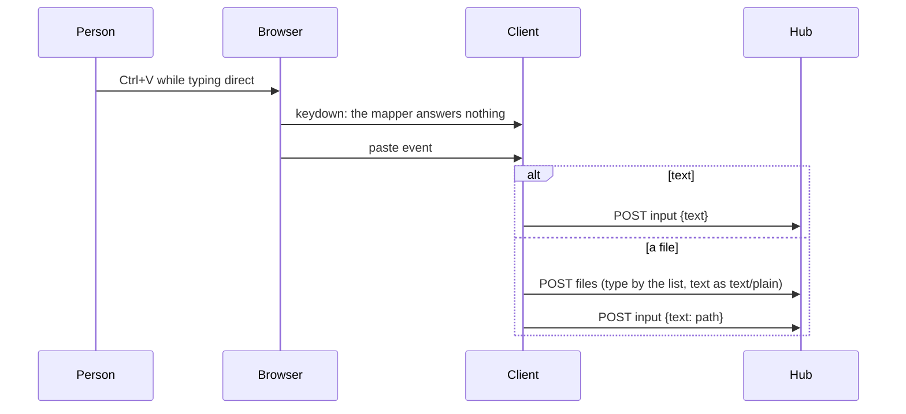

# Feature: more file types previewed, code in colours, paste in direct typing

> The owner asked on 2026-10-30, after `.py` files answered `the host
> does not preview this file`, for every file type the projects use to
> be previewed, for code in colours rather than bold alone, with the
> screen's filters kept over it, and for `Ctrl+V` in direct typing to
> paste text and files instead of telling the pane's program about an
> empty clipboard. Built from that message; the plan records the
> decisions.

## 1. Goal

Three things a person meets in a day with an agent in a pane:

- **A printed path is not a link, or the window refuses it.** The
  preview list has thirty-odd extensions; a project has far more (`.py`
  was in it, but `.cshtml`, `.proto`, `.http`, `.ps1`, `.diff`, `.svg`,
  a `Makefile` were not). The refusals the owner met were paths outside
  the roots the agent runs with, which the list cannot help; the list
  is still widened to what the owner's projects hold.
- **Code reads as bold or not.** The scanner tells six kinds of run
  apart, and the sheet drew them in the theme's ink: comments dim,
  strings in the accent, keywords bold. The owner wants hues.
- **`Ctrl+V` while typing direct goes to the pane as `C-v`.** Claude
  Code reads that as "paste an image" and answers that the clipboard
  has none; nothing else pastes, text or file, because the browser never
  gets its paste event.

Out of scope: files over 8 MiB, directory listings, editing, a scanner
that parses (the runs stay a classification), paste from a hardware
keyboard on Android (its own plan).

## 2. Design

**The list.** One list, in the protocol page, applied by the agent, the
web client's path matcher and the Android one. Text, served as
`text/plain; charset=utf-8`: every source, script, markup, data, config
and template extension the owner's projects use (the census is in the
commit message), the names without an extension that a project prints
(`Makefile`, `Dockerfile`, `LICENSE`, `README`, …, matched without
case), and `diff` / `patch`. Images: `bmp ico avif` join the four.
Download only, as `application/octet-stream`: `zip gz tgz tar 7z docx
xlsx pptx odt ods odp`; the window says `no preview for this type; ⤓
downloads it`. Still out, on purpose: keys and certificates (`pem key
crt cer der p12 pfx jks keystore kdbx ovpn asc gpg`), `env` (a `.env`
is hidden anyway; `x.env` holds the same), executables and libraries,
databases.

**The colours.** Six syntax tokens per theme in `tokens.css` /
`themes.css`, used only by `.mx-code`: comment (the dim ink, italic),
string, number, keyword (bold too), name, punctuation (dim). Amber:
strings pale green, numbers cyan, keywords orange, names violet; green:
strings yellow, the rest as amber; paper: strings green, numbers blue,
keywords brown, names violet. The hues are the tint set the key rows
already carry, so nothing new enters the palette. Each coloured run
glows in its own colour (`color-mix` with `currentColor`), none on
paper. The scanlines and vignette are fixed layers above the window
(`z-index` 49 and 50 over 40), so the filters stay on top of the colours.
Android draws the same kinds from a `Syntax` set on its palette.
This is an owner's decision recorded in the guideline: code is the one
place a second hue carries meaning.

**More languages.** The scanner gains ruby, php, lua, perl, r, julia,
swift, dart, scala and groovy, haskell, elixir, erlang, ocaml and f#,
visual basic, powershell, batch, zig, nim, d, lisp family, tex,
fortran, assembly, ini, make, dockerfile, cmake, protobuf, graphql, hcl,
nix, http; and aliases from every new extension to a scanner it fits
(`cshtml` and `razor` to html, `csproj` and `xaml` to xml, `ipynb` and
`jsonl` to json, …). A `.diff` or `.patch` file opens in the diff view
the changes window uses. A `dollar` flag replaces the shell-only checks
for `$name`.

**Paste.** `Ctrl+V` and `Shift+Insert` are the terminal's paste, so the
mapper leaves them to the browser, whose paste event follows: text goes
to the pane as one request as before; a file goes to the inbox and its
path is typed, wherever the focus is while direct typing is on. The
inbox keeps its fixed types (the agent names a file by its type, never
by the client's name), and the client now sends any text file, by the
browser's type or by an extension of the list, as plain text, so a
`.py` pasted lands as `.txt`.

## 3. Protocol and API changes

Compatible. `GET /v1/panes/{address}/preview` serves the longer list;
`application/octet-stream` is a new answer type. No new endpoint or
message.

## 4. Security analysis

- A longer list adds no reach: a writer could already `cat` any of
  them. What the list guards, keys and certificates, stays out, named
  one by one; the roots, the dot rule, the symlink resolution and the
  one refusal code are unchanged.
- Every text type is still served as plain text with `nosniff`, so a
  `.svg`, `.cshtml` or `.vue` never renders; the download-only types
  are served as `application/octet-stream`, never opened in the page.
- The names without an extension are a closed set; `Makefile.am` or
  `Dockerfile.dev` are not matched by the client and not served.
- The scanner only classifies runs; colours are CSS on class names.
- Paste: nothing is read without a paste the person made; the mapper
  now leaves two more chords to the browser, and sends nothing for
  them. A pasted file goes through the inbox's checks as before (type
  by the list, size, sniffed).
- Logs: unchanged, never the content.

## 5. Privacy check

Fixtures are synthetic (`tx.py`, `Makefile`, `a.zip` under the test's
temporary root). The census of the owner's projects is summarised in
the commit message as counts of extensions only.

## 6. Test plan

| # | Test | Kind | Expected |
|---|------|------|----------|
| 1 | `key.pem`, `id.crt`, `a.exe`, `x.env` under a root | e2e-security | 404, one code |
| 2 | `tx.py`, `Makefile`, `a.diff`, `a.zip` under a root | e2e | 200: text, text, text, octet-stream |
| 3 | The mapper: `Ctrl+V`, `Shift+Insert` | unit | null; `Ctrl+Shift+V` still null, `C-c` unchanged |
| 4 | Direct typing: `Ctrl+V` pressed | UI | no `C-v` body; a paste event types its text |
| 5 | `./tx.py` clicked: keywords, strings and comments in three different computed colours; screenshot | UI | `web-preview-code.png` |
| 6 | `./Makefile` clicked | UI | the window with the text |
| 7 | `findPaths` on the new extensions and names | unit | matched; `Makefile.am`, `a.exe`, `agent.key` not |
| 8 | Android `Links` and `Code` | unit | the same |

## 7. Documentation

`docs/protocol/v1.md`, `docs/features/preview.md`,
`docs/features/direct.md`, `docs/features/attachments.md`,
`docs/ui-guideline.md` (the colours decision, the paste chords), the
Android `look.md` and `pane-view.md`.

## 8. Implementation steps

1. Agent list and names; protocol page; Go tests.
2. Web: the list module, the path matcher, the scanner, the colours,
   the diff view for `.diff`, the mapper, the paste zone, `fileType`.
3. Specs 4 to 7; dist rebuilt.
4. Android: `Links`, `Code`, the palette, the sheet, docs, tests.
5. Docs; the run recorded.

---

## Review (after implementation)

- [x] Diff matches the plan. Deviations: the browser keeps the list in
  one module (`web/src/term/types.ts`) and the Android matcher and
  scanner table are generated from the browser's sources, so the three
  copies are one; `.diff` and `.patch` reuse the changes window's diff
  view; the inbox's refused-type spec now sends an executable, since a
  shell script is text of the list and goes through as plain text.
- [x] Security rules hold: roots, the dot rule, symlink resolution and
  the one refusal code untouched; keys, certificates, `env`,
  executables and databases named out; every text type plain with
  `nosniff`; archives as `application/octet-stream`; the mapper sends
  nothing for the paste chords; a pasted file still passes the inbox's
  type, size and sniff checks.
- [x] Privacy check: `scripts/prepush-check.sh` clean, diff read; the
  census in the commit message is counts of extensions only.
- [x] Docs: protocol, `preview.md`, `direct.md`, `attachments.md`,
  `web-client.md`, the guideline (the hues decision, the paste chords),
  the Android `look.md` and `pane-view.md`.

## Test run

Go end-to-end 143 and the security test of 18 extended; browser specs
83 (the Makefile), 86 (the Python file, four computed colours, the
scanlines above the window) and 104 (Ctrl+V, Shift+Insert) added; 80
changed. Android `LinksTest` and `CodeTest` extended. Run
`20261030-090640-1b0a7db`: 159 passed, recorded as
[#166](https://github.com/notmarkopadjen/muxway/issues/166).
