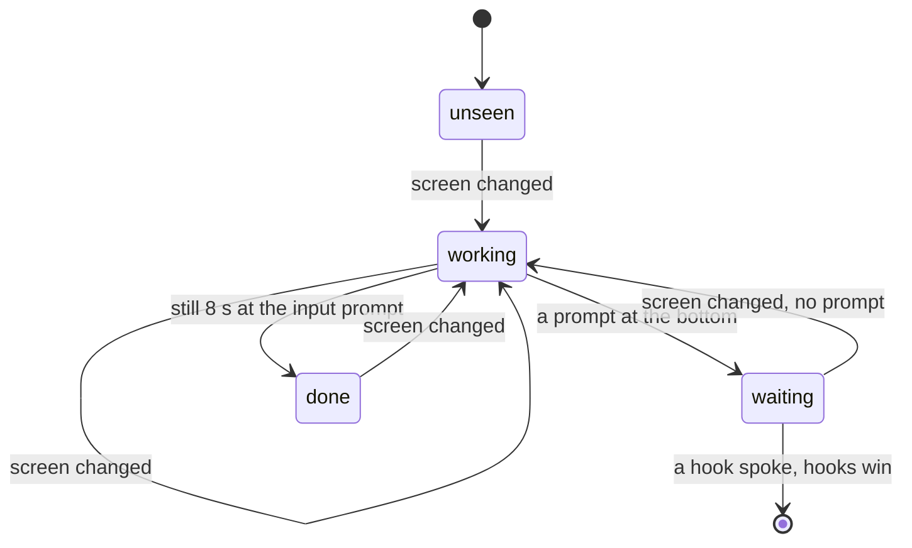
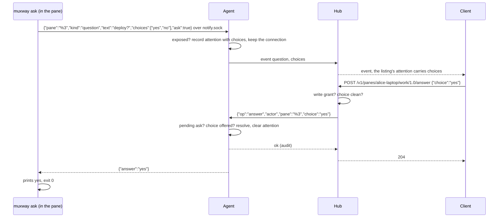

# Feature: agent orchestration

> Status: proposed 2026-10-31, from the owner's ask to "catch up" on what
> muxway does for the AI agents in its panes after the comparison with
> tuios, herdr and the rest; tracked in issue #181. Built as one PR for
> the owner's review; the plan is reviewed with it.

## 1. Goal

An AI coding agent in a pane is the pane muxway is for, and today it gets
little: one harness is tested (Claude Code), it needs its hooks installed,
every client guesses the pane's state from the title and the screen, no
list says what waits across hosts, an agent cannot ask its owner a
question with fixed answers, and nothing but `curl` lets a script or an
agent drive muxway. This closes the gap in one feature:

- **hooks** for Codex, Gemini CLI, Copilot CLI and OpenCode next to Claude
  Code's, printed by `muxway hooks <harness>` and read by `muxway notify
  --from <harness>`;
- **the watcher**: the agent reads the screens of exposed panes that run a
  known harness and reports working, a prompt, or done, so a harness
  without hooks lights up too;
- **questions with answers**: `muxway ask` from a pane blocks until a
  client picks one of its choices, through `POST .../answer`;
- **the inbox**: `GET /v1/inbox`, every waiting pane across hosts, oldest
  first; on the web `I` opens it and `o` opens the oldest;
- **driving muxway**: `muxway client` (a CLI for a hub), `muxway mcp` (the
  same as an MCP server over stdio) and `muxway skill` (the guide an agent
  reads);
- **lenses** on the web for the other harnesses.

Out of scope: fleets and worktrees (muxway does not start harnesses),
agent-to-agent mail (a pane is a shell; `client send` and `client wait`
are the message and the wait), auto-approving a permission from a hook (a
write to a pane stays a person's act), the native clients (follow-up
issues in their repositories).

## 2. Design

### Hooks

`muxway hooks <harness>` prints the harness's own configuration shape with
`muxway notify --from <harness> --dir <agent dir>` as the command, as
`hooks claude-code` does. `notify --from <harness>` reads the harness's
payload from stdin (OpenCode: from the arguments its plugin passes) and
maps it to the five kinds:

| Harness | File | → working | → permission | → question | → done | → clear |
|---|---|---|---|---|---|---|
| claude-code | `~/.claude/settings.json` | `UserPromptSubmit` | `Notification` `permission_prompt` | `elicitation_dialog`, `agent_needs_input` | `Stop` | |
| codex | `~/.codex/hooks.json` | `UserPromptSubmit` | `PermissionRequest` (text: the tool name) | | `Stop` | `SessionEnd` |
| gemini | `~/.gemini/settings.json` | `BeforeAgent` | `Notification` `ToolPermission` (text: its message) | | `AfterAgent` | `SessionEnd` |
| copilot | `~/.copilot/hooks/muxway.json` | `userPromptSubmitted` | `notification` `permission_prompt` | `notification` `elicitation_dialog` | `agentStop` | `sessionEnd` |
| opencode | `~/.config/opencode/plugins/muxway.ts` | `message.updated`, role user | `permission.asked` | | `session.idle` | |

"Clear" is a `working` notification with no text: it takes the attention
away when the harness exits. A payload's free text leaves the host only
when it is the harness's own notice to its user (Claude's and Gemini's
`message`, Copilot's); a prompt, a tool input or a model answer never
does (Codex's `Stop` carries `last_assistant_message`; the event carries
nothing).

### The watcher

Every 2 s the agent lists its panes and, for each exposed one whose
command (or title) names a known harness, captures the last 40 rows
without colour and classifies them with the harness's table: a
**permission** prompt (Claude's "Do you want to proceed?" with numbered
choices, Codex's "Allow", Gemini's "Allow execution", a generic
`[y/n]`), a **question** (numbered choices under a line ending in `?`),
the **input prompt** (`❯`, `›`, `>` as the last non-empty row). The
screen changed since the last look is **working**; a prompt is
**waiting**; still for 8 s at the input prompt after working is **done**.
It tells the hub only when the state changes, through the same path as a
notification, with a fixed phrase as text ("asks for a permission",
"asks a question", "finished"), never a line of the screen. A pane that
has sent a notification over the socket since the agent started is left
to its hooks. On by default, `--watch=false` turns it off. Known
harnesses: claude, codex, gemini, opencode, copilot, aider, goose, amp,
cursor-agent, by `pane_current_command`; Claude by its spark in the
title too, Gemini and Copilot by their names in the title when the
command is `node`.

### Questions with answers

`muxway ask --text ... --choice a --choice b [--timeout 10m]` exits 0
with the answer on stdout, 2 on timeout (the attention is cleared), 3
when the owner typed into the pane or the harness said `working`
(answered in the pane), 1 without an agent. One ask per pane: a second
replaces the first, which exits 3. A choice is 1 to 40 characters of
clean text without `|`; 2 to 8 choices. Answering needs a write grant on
the pane and the pane's write mark: it is an input, audit-logged with the
choice's index. Without a pending ask the hub answers `409 no_question`;
a choice not offered, `400 bad_input`. The ask dies with the agent (the
socket closes) and with the pane.

### The inbox

`GET /v1/inbox` is the panes the principal may read that carry
attention, oldest first, with `count`; text mode one row per pane. The
web client gets an inbox window (`I`): kind, how long, the pane as its
tab names it, the text, the choices as buttons; `Enter` or a click opens
the pane, `o` anywhere opens the oldest waiting pane. The header shows
the count next to the brand when it is not zero.

### Driving muxway

`internal/client` is a small HTTP client for a hub (bearer token, JSON,
long-polled events). `muxway client <verb>` uses it: `connect --hub URL
--token-file F` keeps both in the client directory (`muxway/client`,
mode 700, the token file 600); `MUXWAY_HUB` and `MUXWAY_TOKEN` override;
`panes`, `inbox`, `read ADDRESS [--lines N]`, `send ADDRESS TEXT
[--enter]`, `key ADDRESS KEY`, `answer ADDRESS CHOICE`, `wait [ADDRESS]
[--timeout D]` (prints the first attention it sees, exit 2 on timeout),
`events [--follow]`; `--json` prints the hub's answer as is. `muxway
mcp` serves the same seven operations as MCP tools over stdio
(newline-delimited JSON-RPC 2.0, protocol 2025-06-18, `initialize`,
`tools/list`, `tools/call`, `ping`), no dependency beyond the standard
library; it has the token's rights and nothing more. `muxway skill`
prints `internal/skill/SKILL.md`, the guide an agent in a pane reads.

### Lenses

`describe` names the other harnesses from the command and the title;
`working` applies to any named agent. Android, glasses and MIDP follow in
their repositories.

## 3. Protocol and API changes

All compatible, within v1.

- `attention` on a pane and an event gains `"choices": ["yes","no"]`
  when a question has fixed answers.
- `POST /v1/panes/{address}/answer` `{"choice": "yes"}` → `204`;
  `403 read_only`, `404 not_found`, `409 no_question`, `400 bad_input`,
  `503 host_offline`.
- `GET /v1/inbox` → `{"inbox": [<pane as in /v1/panes>...], "count": 2}`
  oldest first; text mode `<address><TAB><kind><TAB><at><TAB><text><TAB><choices joined by |>`.
- `GET /v1/hosts` gains `"ask": true` on a host whose agent answers
  questions (feature detection).
- Agent channel: `{"id","op":"answer","actor","pane","choice"}` answered
  with `no_question`, `bad_input`, `read_only`, `not_exposed`; `list`
  answers carry `"ask": true`; an event may carry `choices`, which the
  hub validates like the rest (2 to 8, each 1 to 40 clean characters).

## 4. Security analysis

- **Hooks**: a new parser is a new input from a process of the same user;
  the payload is read with a 1 MiB cap, unknown events are dropped, free
  text is cleaned and capped as today. Nothing a hook says reaches the
  hub for an unexposed pane.
- **The watcher** reads screens the agent can read anyway and sends fixed
  phrases: a screen can make itself look like a prompt, which lights a
  badge and nothing else. Hooks win so a harness with precise hooks is
  never second-guessed. Rate: one capture every 2 s per agent pane; events
  only on change, far under the hub's 10 a second.
- **Answers** are writes: write grant and write mark checked on the hub
  and on the agent, like input; the choice is validated against the list
  the ask gave, so a client cannot inject text into the asking process;
  audit-logged on both sides with the index, not the text. An ask is from
  a same-user process over the mode 600 socket, for an exposed pane only.
- **The inbox** shows only what the principal's read grants show in
  `/v1/panes`.
- **The client and the MCP server** hold a token the owner minted with its
  grants; they can do nothing the token cannot. The token file is written
  mode 600; the token is never printed or logged. The MCP server speaks to
  one local process over stdio.
- No new dependency.

## 5. Privacy check

Docs, fixtures and tests use `alice-laptop`, `hub.example.com` and
synthetic screens; the harness payloads in the tests are made up from the
harnesses' public documentation.

## 6. Test plan

| # | Test | Kind | Expected |
|---|------|------|----------|
| 1 | answer without a write grant, with a read-only mark, for a hidden pane | e2e-security | 403 / 403 / 404, nothing reaches the ask |
| 2 | a choice not offered, 9 choices, a 41-character choice, a choice with a control character | e2e-security | 400, the ask refused on the host |
| 3 | an answer when nothing waits; a second answer | e2e-security | 409 |
| 4 | a one-pane token's inbox and the choices in events follow read grants | e2e-security | one row; another host's question not seen |
| 5 | a read-only token through `client send`, `client answer` and the MCP `send_text` | e2e-security | refused; the token never appears in output or logs |
| 6 | the watcher on a stand-in harness: working, permission, done; silent for a pane that notified | e2e | the event sequence; no event for the hooked pane |
| 7 | `muxway ask` answered, timed out, typed over | e2e | exit 0 with the answer, 2, 3 |
| 8 | `/v1/inbox` order and text mode | e2e | oldest first, five columns |
| 9 | `muxway client` panes, read, send, wait, answer, events | e2e | as the hub answers |
| 10 | `muxway mcp` initialize, tools/list, tools/call | e2e | JSON-RPC answers, a tool error for a bad address |
| 11 | hook parsers for codex, gemini, copilot, opencode; the printed configurations | unit | kinds and texts as the table says; nothing but the harness's own message passes |
| 12 | the watcher's classifier on synthetic screens of every harness | unit | prompt kinds and the input prompt |
| 13 | `describe` for the other harnesses, the lens's working for them | unit | names and ring |
| 14 | web: inbox window, `I` and `o`, choices answered from the pane line and the inbox, the count in the header; a codex-named pane shows the ring | UI | screenshots `109-inbox`, `109-choices`, `109-lens-codex` |

## 7. Documentation

`docs/features/notifications.md` (the harness table, the watcher,
questions), new `docs/features/inbox.md` and `docs/features/driving.md`,
`docs/protocol/v1.md`, `docs/ui-guideline.md` §1.2 and §1.6,
`docs/ARCHITECTURE.md` (flows), the README, `internal/skill/SKILL.md`.

## 8. Implementation steps

1. wire: choices, the answer op, `ask` in list answers.
2. agent: the four parsers and printers; asks over the socket; the
   answer op; input cancels an ask.
3. agent: the watcher and its classifier.
4. hub: `/answer`, `/inbox`, choices on events, `ask` on hosts.
5. `internal/client`, `muxway client`, `muxway mcp`, `muxway skill`.
6. web: types, describe, lens, the inbox window, keys, choices.
7. docs.
8. e2e and UI tests; the run.

---

## Review (after implementation)

- [x] Diff matches the plan, deviations explained here: the watcher reads
      the **visible screen** rather than the last 40 rows, since tmux's
      history keeps a prompt that has scrolled away and the state would
      never leave "waiting"; a canary string shaped like a token was
      taken out of the answer test, since the secret scanner flagged it
      over the whole outgoing history; the web client's header count is
      its own `/v1/inbox` query rather than a view over the pane list,
      and the event callback depends on the mutation's stable `mutate`,
      after a first full run lost a key in spec 84's burst to an event
      stream that re-subscribed on every render; the hub also drops
      choices a listing carries outside a valid question (`sanePanes`).
      The plan itself was not approved before the code: the owner asked
      for one issue and one PR to review together.
- [x] Security rules (AGENTS.md section 2) hold: answers are writes with
      both grants checked on hub and agent and audited with sizes; asks
      and notifications come over the mode 600 socket for exposed panes
      only; the watcher sends fixed phrases; the client and the MCP
      server have a token's rights and print it nowhere; no dependency
      added.
- [x] Privacy check passed: `scripts/prepush-check.sh` clean (gitleaks and
      the deny-list) on every push, and the diff read; the screenshots
      come from the test environment.
- [x] Docs and diagrams updated: `features/notifications.md`, new
      `features/inbox.md` and `features/driving.md`, `protocol/v1.md`,
      `ui-guideline.md`, `ARCHITECTURE.md`, the README, `hub-and-agent.md`,
      `web-client.md`; every Mermaid block parsed with the library.

## Test run

Run `20261031-131641-b45bd2d`: **passed**, 182 tests, 0 failed, at
b45bd2d, recorded as
[muxway#185](https://github.com/notmarkopadjen/muxway/issues/185); the
run directory holds the logs, the screenshots `109-inbox`,
`109-choices-toast`, `109-choices-pane`, `109-lens-codex` and the traces.
An earlier full run at 310378d failed on spec 84's key burst (the event
stream churn above), fixed in b45bd2d.
