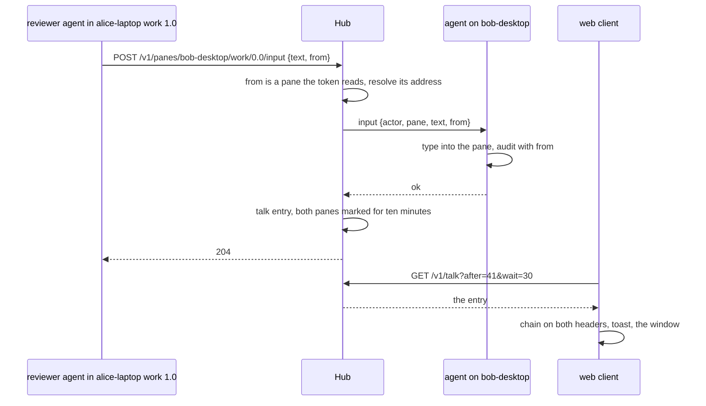
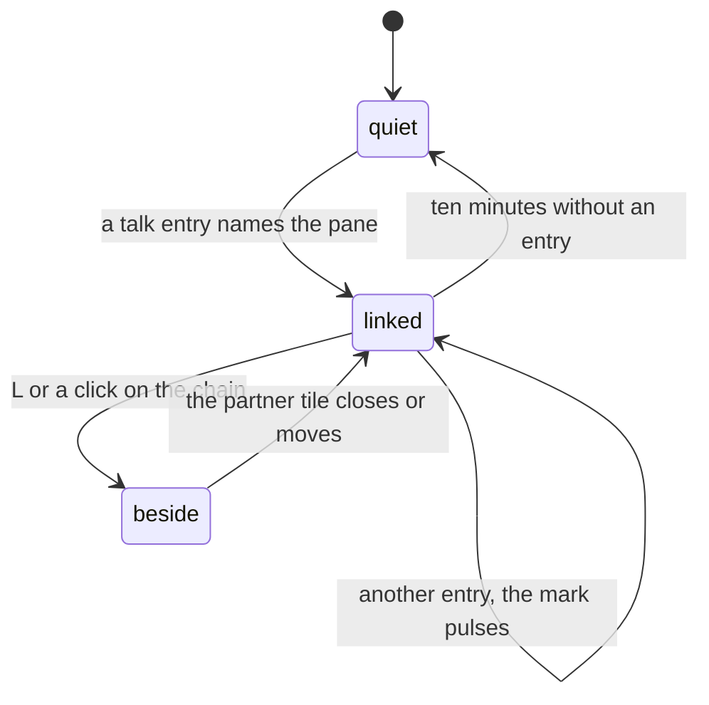

# Feature: talk, panes writing to panes, and the owner seeing it

> Status: approved 2026-10-31 ("Implement this"), implemented on the
> branch `pane-talk`. Asked for on 2026-10-31 as
> "I like the idea of messaging the connected panes. Is there a way also
> to see that communication on the clients? Also visually show in header
> links which pane talks to which, rearrange them one next to the other
> with some chain visually, slightly different colour, reddish but in
> theme".

## 1. Goal

An agent in a pane can already type into another exposed pane with
`muxway client send` or the MCP tool `send_text`, under its own token
and grants, audited on both sides. What nobody can see today is that it
was a *pane* that typed, and which one: the hub records the token, not
the place the request came from, so to the owner a message from a
reviewer agent to a build pane looks like any other write.

Talk makes that visible, without a second channel:

- a write carries, when the sender runs in a pane, the pane it came
  **from**. The hub resolves it, records it and shows it;
- every client that reads both panes can see the exchange: who said what
  to whom, when, across hosts;
- on the web the two panes are chained: a mark on their headers and
  tabs, the divider between them painted in a hue of its own, and one
  key or click lays the partner beside.

Out of scope: a mailbox (agents keep talking through the panes, so
every word is typed where the owner can read it and audited where it
lands); any pane-to-pane channel that bypasses grants; talk between
hubs (a token speaks to one hub); moving tiles by itself while the
owner works (the chain is a button, not an automatism; see §2).

## 2. Design

### The origin of a write

`POST /v1/panes/{address}/input` and `POST /v1/panes/{address}/answer`
take an optional `from`: the host and the tmux pane id of the pane the
sender runs in. Pane ids (`%3`) are stable while a pane lives, where an
address shifts when panes are split or closed, and a process knows its
own id from `$TMUX_PANE`.

The hub looks the origin up in the listing it holds. It must be a pane
the token may read; otherwise the request is refused and nothing is
typed. The hub passes the origin to the destination's agent in the
`input` request, so the host's audit log says where the write came
from, and keeps one **talk entry** in memory: when, the token, from, to,
what kind of write, how many bytes, and the first 200 characters of a
text or the key or the choice.

Nothing changes for a write without `from`: a person at a browser is
not a pane.

### The command line and MCP

`muxway client send`, `key` and `answer` get `--from <host>/<pane id>`.
Its default is found without the user doing anything: `$TMUX_PANE` for
the pane, the host name from the agent directory on the same machine
(`agent.json` holds it; `--agent-dir` points elsewhere). Without a
pane, or without a readable agent directory, there is no origin, as
today. `--from none` sends as nobody. `$MUXWAY_FROM` sets it for a
process that knows better.

The MCP server runs in the pane whose agent started it, so `send_text`,
`send_key` and `answer` carry the same default. `muxway client talk
[--follow]` prints the feed in text mode, and the MCP tool `talk` reads
it, so an agent can follow what the others say. `muxway skill` tells an
agent that what it types into another pane is shown to its owner as a
conversation between the two panes.



### What clients see

**The listing.** A pane that talked, or was talked to, in the last ten
minutes carries `talk`: its partners among the panes the principal may
read, each with the pane id, the current address, when, and the way
(`to`, `from`, `both`). That one field is enough for a small client to
draw the chain: the lens (§1.2 of the guideline) gets a row, and the
list pages of every client put the chain mark after the name.

**The feed.** `GET /v1/talk` is the list of entries, oldest first,
polled like `/v1/events` (`after`, `wait`, `limit`), and visible only
where the principal may read *both* panes. The text travels with it, so
a client can show the conversation without reading the destination
pane; it is the first 200 characters, kept in memory only, and the
owner's decision (§4).

**The web.** Three places, all in the talk hue:

- *Header and tab.* A tile whose pane has partners shows `⛓` after the
  mode word, then the partner's tab name (`⛓ 2` with several, the names
  on hover). The mark pulses for three seconds after a new entry, with
  effects on. Its tab in the strip carries a small `⛓` beside the state
  glyph. On the pane list the chain follows the name.
- *The chain between tiles.* When two linked panes are open as tiles
  and sit beside each other, the divider between them is painted in the
  hue, with `⛓` at its middle; the two headers' marks make the chain's
  ends. `L`, or a click on the header's `⛓`, **lays the partner beside**
  the focused tile: an open partner is swapped into the place next to
  it (right in a row, below in a column); a closed one opens there as
  one more tile, and with four tiles open it takes the place of the
  tile focused longest ago that is not one of the two. Nothing moves
  until the owner asks: four tiles are the owner's arrangement.
- *The talk window.* `T`, or a click on `⛓ n` beside `⚑ n` in the
  header row (shown while anything was said in the last ten minutes),
  opens it over the view: one row per entry, newest at the bottom, with
  the time, `from → to` as their tabs name them, the kind, the text on
  one line, and the token's name dimmed at the end. `j` `k` and the
  arrows move, `Enter` or a click lays the two panes beside each other,
  `Esc` closes. It follows the feed live, per hub, as the inbox does.
  On the pane view the newest entry that touches an open tile shows as
  a toast in the hue: `work/1.0 → work/0.0: run the tests`.



**The hue.** The guideline has no second hue for states, by the owner's
decision of 2026-10-25, with code the one exception. Talk is the second
exception, by this plan: not a state of one pane but a relation between
two, which a glyph alone cannot draw across a divider. One token,
`--mx-talk`, red leaning toward each theme's ink and away from the
alert red, which stays for errors only:

| Theme | talk | alert, for comparison |
|---|---|---|
| amber | `#ff5c3a` | `#ff3b3b` |
| green | `#ff6b5e` | `#ff3b3b` |
| paper | `#b4301e` | `#a3161b` |

Android's `Theme.kt` mirrors it when the client follows.

**The native clients.** Android, the glasses and the MIDP client take
the listing's `talk` field for the chain mark on their lists; the feed
and the lay-beside gesture are follow-ups in their repositories, with
an issue each, opened with this plan's PR.

## 3. Protocol and API changes

Compatible: optional fields, one new endpoint, one new agent-channel
field. No version bump.

`POST /v1/panes/{address}/input`, `POST /v1/panes/{address}/answer`:

```json
{"text": "run the tests", "from": {"host": "alice-laptop", "pane_id": "%3"}}
```

- `from.host` is a host name as the listing shows it, `from.pane_id` a
  tmux pane id, `%` and 1 to 9 digits. The pane must be one the token
  may read: otherwise `404 not_found`, as for any pane the token may
  not see, and nothing is typed.
- `from` with `mouse` is `400 bad_input`: a click is not a message.
- The origin's host must be online, since the hub checks the token reads
  the pane against that host's listing; an origin on an offline host is
  refused like a pane the token may not see. The origin may be the
  destination itself.

`GET /v1/panes`: a pane that talked within ten minutes carries

```json
"talk": [{"address": "bob-desktop/work/0.0", "pane_id": "%5", "at": 1767225600, "way": "to"}]
```

limited to partners the principal may read; absent otherwise.

`GET /v1/talk?after=41&wait=30&limit=50`:

```json
{"talk": [{
  "seq": 42, "at": 1767225600,
  "actor": {"id": "0ddba4b5", "name": "reviewer"},
  "from": {"host": "alice-laptop", "address": "alice-laptop/work/1.0", "pane_id": "%3", "alias": "review"},
  "to": {"host": "bob-desktop", "address": "bob-desktop/work/0.0", "pane_id": "%5"},
  "kind": "text", "bytes": 13, "text": "run the tests"
}], "next": 42}
```

- `kind` is `text`, `key` or `answer`; `text` is the first 200
  characters of a text, the key name, or the choice. A text with a
  newline is one entry with `bytes` as sent.
- Visible only where the principal may read both panes. `next` and
  `wait` as on `/v1/events`; the ring holds 500 entries and starts over
  with the hub.
- Text mode: `<seq><TAB><at><TAB><from address><TAB><to address><TAB><kind><TAB><text>`
  per entry, then `next<TAB><seq>`. The text's tabs and newlines are
  spaces.
- Under the per-principal rate limit like every listing; CORS preflight
  answered like `/v1/events`.

Agent channel: `{"op": "input" | "answer", ..., "from": "alice-laptop/%3"}`,
a string the agent only writes to its audit log. An agent from before
the field ignores it.

## 4. Security analysis

- **What an attacker gains.** A token that may write a pane can already
  type into it; talk adds no write. A token can *claim* an origin: the
  owner would see a false chain between two panes. The hub takes an
  origin only among the panes the token may read, every entry names the
  token, and both audit logs record the token id with the origin, so a
  false claim is attributed to its token. The owner minted that token
  for that agent; a token held by someone else is the breach, not the
  claim.
- **Authentication and authorisation.** `from` needs no new grant: a
  write still needs the destination's write grant, and the origin must
  be readable by the token. The feed and the listing's `talk` show an
  entry only to a principal that may read both of its panes; a pane the
  principal may not see is not named, not counted and not hinted at.
- **Content kept.** The feed is the one new place where typed content
  lives outside a pane: 200 characters per entry, 500 entries in
  memory, never on disk, never in a log. The same characters are on the
  destination's screen, which the same principal may read. The owner
  decides whether that is right; the alternative is a feed without
  text, where the client reads the destination pane, and that is a
  one-line change to the plan.
- **Input across the boundary.** `from.host` is validated like a host
  name, `from.pane_id` against `%[0-9]{1,9}`, the whole body under the
  existing 64 KiB limit. The feed's text is the text `/input` already
  accepted (no control characters), shown as text by every client,
  never as terminal output. A pane name in the feed is the listing's.
- **Rate and size.** Writes are under the per-token limit already; the
  ring is bounded; `wait` is capped at 30 s as on `/v1/events`.
- **Logged.** Hub: `talk from=<host>/%3 to=<address> actor=<id>
  kind=text bytes=13`, no content. Agent: the existing audit line with
  `from` added. No token, no text, no secret.
- **Dependencies.** None.

## 5. Privacy check

Examples use `alice-laptop`, `bob-desktop`, `hub.example.com`, token
names `reviewer` and `phone`. Fixtures are synthetic panes of the test
tmux server; screenshots are taken in the test environment.

## 6. Test plan

| # | Test | Kind | Expected |
|---|------|------|----------|
| 1 | `from` naming a pane the token may not read | e2e-security | `404 not_found`, nothing typed, no entry, audit says refused |
| 2 | the feed for a token that reads the destination but not the origin, and the other way round | e2e-security | empty feed, no `talk` on the listing |
| 3 | `from` with a bad host, a bad pane id, an oversize body, `from` with `mouse` | e2e-security | `400 bad_input`, nothing typed |
| 4 | the feed and both audit logs after a write with `from` | e2e-security | the token id and the addresses, no token secret, no text in any log |
| 5 | 60 writes with `from` in a second from one token | e2e-security | `429 rate_limited` after the burst, the ring holds what got through |
| 6 | `muxway client send` from inside a pane of the test tmux, no flags | e2e | the entry names that pane, the listing marks both panes |
| 7 | `--from none` and a client outside tmux | e2e | no entry, the write lands |
| 8 | the MCP tool `send_text` from a pane | e2e | the entry names the pane |
| 9 | `talk` on the listing after ten minutes | unit | the ring's window (no clock in the test hub) |
| 10 | text mode of `/v1/talk`, `muxway client talk --follow` | e2e | the rows, the cursor |
| 11 | the hub resolves `from` by pane id after the origin's address shifted (a split before it) | unit | the entry carries the new address |
| 12 | web: a reviewer pane sends to a build pane; the chain on both headers and tabs, the divider in the hue, the toast; `L` lays the partner beside; `T` opens the window, `Enter` lays both beside | UI | screenshots `110-talk-header`, `110-talk-divider`, `110-talk-window`, `110-talk-beside` |
| 13 | web: the chain on a pane opened later, and a click on it lays the partner beside | UI | two tiles |
| 14 | the lens names a linked pane on the list page | unit | `⛓` after the name |

## 7. Documentation

- `docs/features/talk.md`, new: what it is, the chain, the window, the
  command line, security considerations.
- `docs/features/driving.md`: `--from`, `client talk`, the MCP tool.
- `docs/protocol/v1.md`: `from` on input and answer, `talk` on the
  listing, `GET /v1/talk`, the agent-channel field.
- `docs/ui-guideline.md`: §1.2 a lens row, §1.4 the header, strip and
  tiles rows, §1.5 the hue and the second exception, §1.6 rows for `L`
  and `T` with the Android and glasses columns as follow-ups.
- `docs/ARCHITECTURE.md`: the talk ring beside the event ring.
- `internal/skill/SKILL.md`: the paragraph for agents.
- README: a line under the agent side.

## 8. Implementation steps

1. Hub: `from` parsed and validated on input and answer, resolved
   against the listing, refused when unreadable; the talk ring; the
   audit line. Unit tests.
2. Agent channel: `from` on the request; the agent's audit line.
3. Hub: `GET /v1/talk` with `after`, `wait`, `limit`, JSON and text
   mode, visibility on both panes; `talk` on the listing with the
   ten-minute window.
4. CLI: `--from` with its defaults, `client talk`; MCP: the default on
   the three tools and the `talk` tool; the skill text.
5. Web: the token `--mx-talk` in the three themes; the lens row and the
   list mark; the header and tab marks; the divider.
6. Web: `L` lays the partner beside; the talk window with `T` and the
   header count; the toast; the feed poller per hub.
7. e2e and security tests, the UI specs with their screenshots.
8. Docs, the guideline, the follow-up issues in the three client
   repositories.

---

## Review (after implementation)

- [ ] Diff matches the plan, deviations explained here
- [ ] Security rules (AGENTS.md section 2) hold
- [ ] Privacy check passed: `scripts/prepush-check.sh` clean and diff read
- [ ] Docs and diagrams updated

## Test run

Not yet run.
