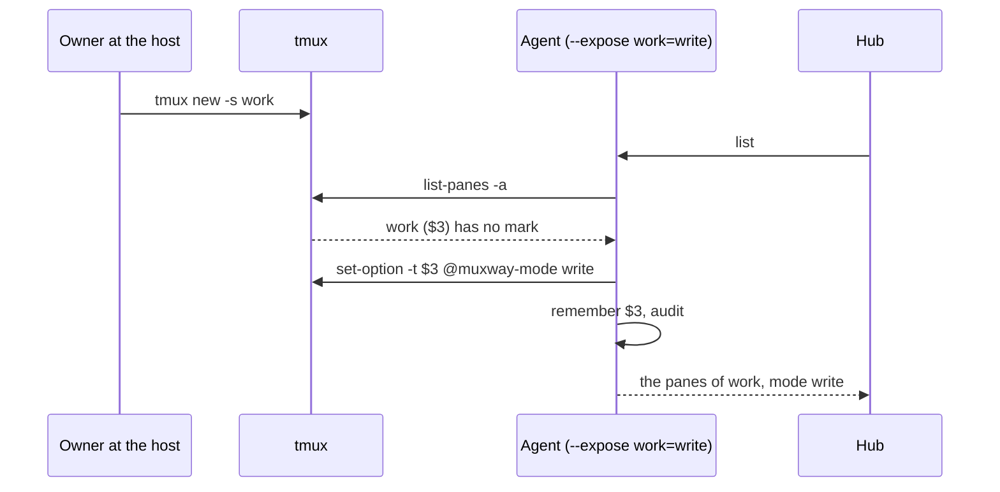
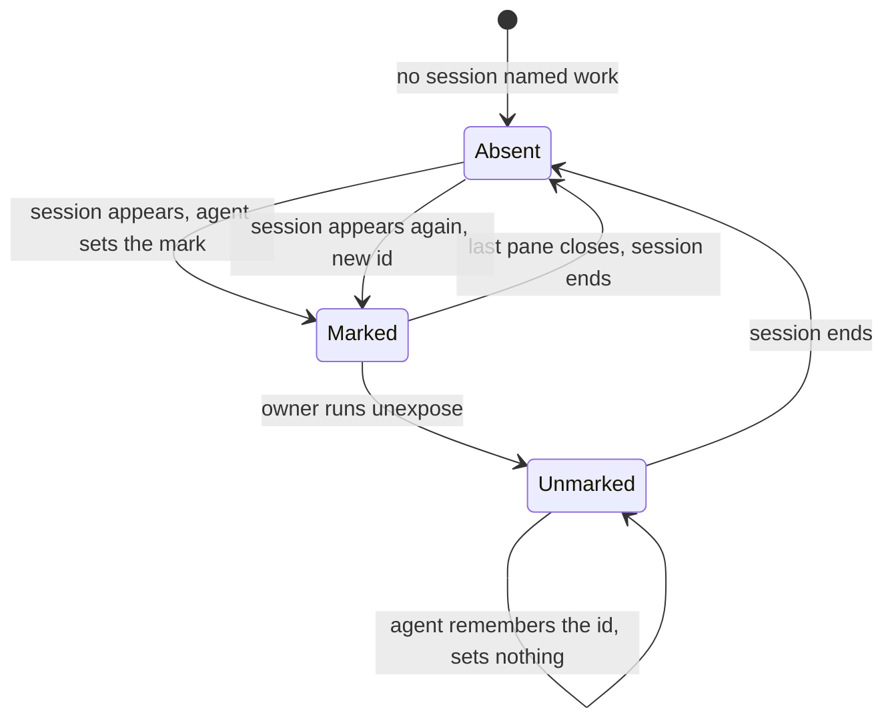

# Feature: standing marks, and the last pane of a session

> Status: approved by the owner on 2026-10-31. Asked for that day as
> "I closed all panes on the web and it closed the session as well; a new
> session started on the server shows nothing; and I want an option on
> the web to create a session when there is none, and a pane as well".

## 1. Goal

A mark is a tmux option, so it lives and dies with the session it is set
on. Closing a session's last pane from a client ends the session and its
mark with it; the next session the owner starts on the host, even under
the same name, is unmarked and invisible until `muxway expose` runs
there again. Two things fix that:

- **Standing marks.** The owner names, on the agent's command line, the
  sessions that are exposed whenever they exist: `--expose work=write`.
  A session of that name started after the agent, or started again
  after it ended, is marked the moment the agent sees it.
- **The last pane warns.** A client closing the only pane of a session
  is told that the session ends with it, in the question it already
  asks.

Starting a session or a pane from the web when the host shows nothing
already exists (`+ session` on the host's line, then `+ pane` under its
window) and needs the agent's `--allow-sessions`; it is turned on for
the owner's own agent today. Nothing in the client changes for that.

Out of scope: patterns or wildcards in `--expose` (one name is one
session), aliases on standing marks, standing marks on windows or
panes, persisting marks made with `muxway expose` across sessions.

## 2. Design

**Standing marks.** `muxway agent run --expose <session>=<read|write>`,
repeatable, parsed at start; a bad name or mode refuses to start. The
name is exact and `[A-Za-z0-9_.-]{1,32}`.

On every listing the agent already runs, it looks for sessions whose
name has a standing mark and whose session id it has not marked yet,
and sets the real tmux option on them, `set-option -t $id @muxway-mode
<mode>`, as `new-session` from a client does today. So:

- `muxway exposed` lists the session like any other, with the mode.
- A pane mark, `--deny` included, still wins inside it, and so does a
  pane alias: tmux's resolution is unchanged.
- `muxway unexpose -t work` holds for the life of that session, because
  the agent marks each session id once; the mark is set again only when
  a new session of that name appears (a new id).
- Marks are never read back from a file. The agent's command line is
  the whole configuration, next to `--allow-sessions` and
  `--allow-close`.





**The last pane.** The web's close question on a tile's header reads
`close the pane on alice-laptop? y n`. For the only pane of its session
it reads `close the last pane of work on alice-laptop? the session ends.
y n`. The client cannot tell that from its listing, which holds only
exposed panes, so the agent says it: a pane that is the only pane of
its session carries `"last": true` in the listing, the hub passes it
through in the tree and in `GET /v1/panes`, and the client reads it.
The agent sees every pane of the server already (it lists them all and
keeps the exposed ones), so the count costs nothing.

Android gets the same text in its close dialog in a later step in its
own repository.

## 3. Protocol and API changes

One compatible addition: a pane in the agent's `list` answer, in the
hub's tree and in `GET /v1/panes` may carry `"last": true`, meaning it
is the only pane of its session, so closing it ends the session. Absent
means there are others. The agent gains a flag, documented with the
others.

```json
{"address": "alice-laptop/work/0.0", "session": "work", "window_index": 0,
 "pane_index": 0, "mode": "write", "last": true}
```

Version impact: compatible; the field is added to the protocol page's
pane table and example.

## 4. Security analysis

- **What is new.** The owner can say "the session called `work` is
  always writable from my clients". That is the same power as running
  `muxway expose -t work --write` after every tmux start, which is what
  the owner did by hand until now. No client can set, extend or ask for
  a standing mark: it is an argument of the agent's process, set by
  whoever controls the host's service definition, which is the host's
  owner by definition.
- **Exact names only.** No wildcard, so a standing mark can never
  expose a session the owner did not name. A session a client starts
  (`--allow-sessions`) cannot take a standing mark's name without the
  name being free, and then it is the owner's named session anyway and
  gets the same mark it would have gotten.
- **In the open.** The agent sets the real tmux option, so `muxway
  exposed` and `tmux show-options` show it; nothing is hidden state.
  Each application is audited: session name, id and mode, never
  content.
- **Still deniable.** `--deny` on a pane or window, and `unexpose` on
  the session, work as before and are not undone while the session
  lives.
- **Validation.** Name and mode are validated at start; the name is
  passed to tmux as an argument of `set-option -t`, with the session
  id, never the name, as the target, and never through a shell.
- **The warning** adds one boolean to a pane a client may already
  read. It tells that the session has no other pane, exposed or not,
  which is a count, not content, and the same a client learns the
  moment it closes the pane. The close itself keeps every check it has
  (`--allow-close`, write grant, writable mark, rate, audit).
- No new dependencies. No change to the content security policy.

## 5. Privacy check

Names in docs and tests: `alice-laptop`, `work`, `scratch`. Screenshots
from the test run only. The owner's own session names and flags stay in
the private deployment notes.

## 6. Test plan

| # | Test | Kind | Expected |
|---|------|------|----------|
| 1 | `--expose 'a;b=write'`, `--expose work=admin`, a 33-character name | e2e-security | the agent refuses to start, each with a clear error |
| 2 | `--expose work=write`, a session `scratch` started on the host | e2e-security | `scratch` is not listed; nothing is marked |
| 3 | a client token with no grant on `work` | e2e-security | the standing mark exposes, the grant still denies: `403` |
| 4 | audit lines of an application | e2e-security | session name, id, mode; no content |
| 5 | session `work` started after the agent | e2e | listed writable within one listing; `muxway exposed` shows `work: write` |
| 6 | last pane closed, `work` started again | e2e | listed again, new session id |
| 7 | `muxway unexpose -t work` | e2e | gone from the list and not re-marked while the session lives; marked again after it is recreated |
| 8 | `--deny` on a pane inside `work` | e2e | that pane hidden, the others listed |
| 9 | `--expose work=read` | e2e | listed read-only; a write is `403 read_only` |
| 10 | flag parsing | unit | name and mode split, errors named |
| 11 | `last` on a session of one pane, absent with two, absent again when the other is unexposed but alive | e2e | as stated: the field reports the session, not the listing |
| 12 | close the only pane of a session from a tile | UI | the question names the session and says it ends; `y` closes and the tile leaves; screenshot `110-last-pane` |
| 13 | close one of two panes | UI | the plain question as today |

## 7. Documentation

- `docs/features/exposing-panes.md`: a section "Standing marks" with
  the flag, the diagram above and the rules (exact names, once per
  session id, unexpose holds, deny wins).
- `docs/features/hub-and-agent.md`: the flag in the agent's list.
- `docs/features/new-panes.md`, "Closing a pane": the last pane's
  question.
- `docs/protocol/v1.md`: the `last` field in the pane table and the
  example.
- `docs/ui-guideline.md`: the close question's two texts.
- `README.md`: one line under exposing.

## 8. Implementation steps

1. Agent: `--expose` parsing and validation, the standing table, the
   application in the listing path with its audit line; unit tests.
2. End-to-end tests 1 to 10 in the agent suite.
3. Agent and hub: the `last` field; test 11; protocol page.
4. Web: the close question reads it; spec 110; `web/dist`.
5. Docs. Run, record, pull request.

---

## Review (after implementation)

- [x] Diff matches the plan. Deviations: the last pane's question reads
  `end session work on alice-laptop? y n` rather than the longer text
  planned, because the planned one overflowed a half-width tile's
  header and hid the `y` and `n`; the agent tells sessions apart by the
  tmux server's pid as well as the session id and creation time, since
  a restarted server hands out the same ids within the same second.
  Found on the way and fixed, as the plan's goal needs it: the agent's
  guard against a pane whose process changed under the same id kept
  every pane id forever, so after a tmux server restart (the last pane
  closed, say) the new `%0` was refused for the agent's lifetime; the
  guard now forgets dead ids and takes a new server's panes afresh
  (tests 179 and 180 cover it).
- [x] Security rules (AGENTS.md section 2) hold: a standing mark is set
  only by the agent's own command line, with exact names and the two
  modes validated at start; the agent sets the real tmux option, so it
  is in the open; grants are checked as before (test 176); each
  application is logged with name, id and mode, no content (test 177);
  `last` is one boolean; no new dependency; CSP unchanged.
- [x] Privacy check passed: `scripts/prepush-check.sh` clean and the diff
  read; names are `alice-laptop`, `work`, `solo`, `later`, `scratch`.
- [x] Docs updated: exposing-panes (the section with both diagrams and
  the security note), hub-and-agent, new-panes, the protocol page's
  pane example and text, the guideline's close row, README.

## Test run

Pending.
