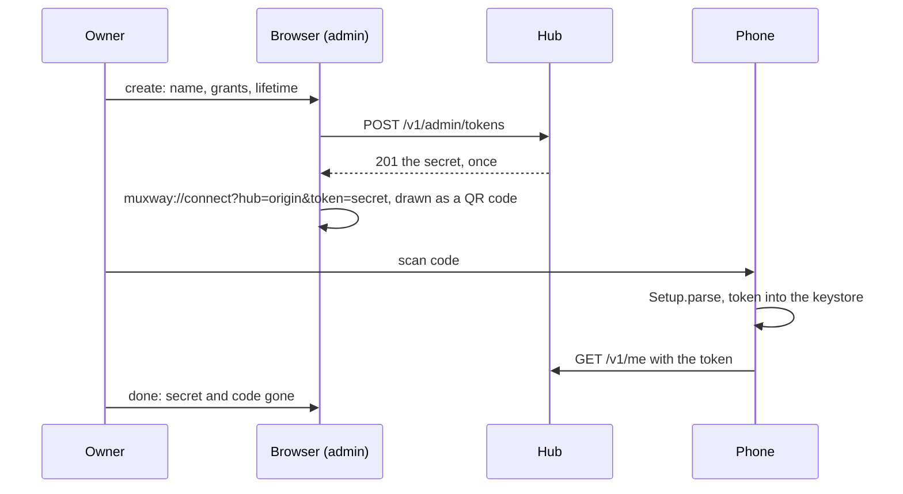

# Feature: the connect code on the admin page

> Status: approved by the owner on 2026-10-31. Asked for as "an option to add a token on
> the web admin, with a QR code for Android to scan". The tokens box
> already creates and revokes tokens; what it lacks is the code.

## 1. Goal

A token for the phone is made today on the admin page or with the CLI,
and typed into the app, or piped through `scripts/connect-qr.py` in the
Android repository, which prints the connect code as a QR code in the
terminal. The owner away from the hub's machine has the page but not the
script. This draws the same code on the page, next to the secret it
shows once, so the phone is connected by pointing it at the screen.

Out of scope: revoking (every token row has *revoke* already), a code
for anything but a freshly created token (the hub never has the secret
again), scanning in the browser, a code on Android.

## 2. Design

**Web only.** When `POST /v1/admin/tokens` answers, the secret box shows,
beside the text and *copy*, a QR code of

```
muxway://connect?hub=<this page's origin>&token=<secret>
```

built exactly as `connect-qr.py` builds it (the hub percent-encoded
except `:` and `/`, the token with nothing kept), which is what the app's
`Setup.parse` accepts. The hub is `location.origin`: the admin page is
always the page of the hub it administers (a peer's admin is reached on
the peer's page).

```
┌ tokens & users ───────────────────────────────────────────┐
│ phone  r:alice-laptop/*  until 2026-11-01          revoke │
│ ┌─────────────────────────────────────────────────────────┐│
│ │ token phone, until 2026-11-01. it is shown only now,    ││
│ │ never again:                        ▛▀▀▀▀▀▀▀▀▀▀▀▀▀▀▀▀▜ ││
│ │ mxt_Y0aYE14mqEEG8vPiFqnhaspXCCpVNq… ▌▛▀▀▜ ▄▀▄▀ ▛▀▀▜▐ ││
│ │                                     ▌▌  ▐ ▀▄█▄ ▌  ▐▐ ││
│ │ scan it with the phone app: ≡ hubs, ▌▙▄▄▟ ▄ ▀▄ ▙▄▄▟▐ ││
│ │ scan code                           ▙▄▄▄▄▄▄▄▄▄▄▄▄▄▄▄▄▟ ││
│ │ [copy] [done]                                           ││
│ └─────────────────────────────────────────────────────────┘│
└───────────────────────────────────────────────────────────┘
```

- `web/src/qr.ts`: a port of the script's encoder. Byte mode, level M,
  versions 1 to 10 (213 bytes: a 47-character token and a hub of up to
  about 150 characters), the eight masks scored by the standard penalty,
  Reed-Solomon over GF(256). About 200 lines, no dependency. It returns
  the module matrix or null when the text does not fit.
- `components/Qr.tsx`: the matrix as an inline `<svg>`, one `<rect>` per
  dark module on a white square with the four-module quiet zone,
  `shape-rendering: crispEdges`. Explicit black on white, whatever the
  theme: a scanner needs the contrast, and the page's amber on black is
  the wrong way round. It is about 180 px wide; on a narrow window it
  drops under the text.
- The box's text says what to do with it: *scan it with the phone app:
  ≡ hubs, scan code*. If the code does not fit (a very long origin), the
  text and *copy* stay and the code is left out.
- *done* removes the code with the secret; nothing is stored, as before.



## 3. Protocol and API changes

None on the hub. The connect code format is the Android client's, already
in its `docs/plans/2026-10-24-connect-code.md`; it is now named in this
repository's admin feature page as the thing the web page draws, so a
third client that wants to be set up by the page knows the shape.

## 4. Security analysis

- **What is gained.** Nothing new: the secret is already on the screen
  as text. The code is a second rendering of it, with the hub's origin,
  which is no secret. Anyone who can photograph the screen while the box
  is open could already read the text; the doc says, as it does, to
  create the token and dismiss the box with nobody looking.
- **Grant.** The admin grant, as the create form: no new endpoint.
- **Trust boundary.** The secret comes from the hub's answer and the
  origin from the browser; both are percent-encoded into the payload.
  The app re-checks both on scan (printable, `https` or localhost), so a
  bad origin would be refused there.
- **No copies.** The SVG carries no text, `title` or `aria-label` with
  the token; its label is "connect code for the phone app". The payload
  lives in React state with the secret and goes with it at *done*; the
  existing spec's check that the secret is nowhere in the page or
  storage afterwards covers the code. The encoder logs nothing.
- **Dependencies.** None added: the encoder is a port of the project's
  own script, with its output checked against that script.

## 5. Privacy check

Fixtures: `https://hub.example.com`, `mxt_0123456789abcdefghijklmnopqrstuvwxyzABCDEFG`
(the Android repository's test token), `phone`, `alice-laptop`.
Screenshots from the run against the test hub.

## 6. Test plan

| # | Test | Kind | Expected |
|---|------|------|----------|
| 1 | after *done*, the page's HTML, the SVG and storage | UI (e2e-security) | the secret appears nowhere (the existing check, now with the code present before) |
| 2 | the SVG while shown | UI (e2e-security) | its text content is empty: no token in a `title`, label or attribute |
| 3 | the encoder against `connect-qr.py --modules` for three payloads (version 2, a real-sized code, the largest that fits version 10) | unit | matrices identical |
| 4 | a payload of 214 bytes | unit | null, and the box shows text and *copy* without a code |
| 5 | the payload builder | unit | `muxway://connect?hub=https://hub.example.com:8443/mux&token=mxt_…`, `:` and `/` kept in the hub, `=`, `&`, `%` escaped in both |
| 6 | create a token in the page | UI | the code is drawn with `(4·v+17)²` module cells plus quiet zone, beside the secret; screenshot `95-token-once` |
| 7 | the window at phone width | UI | the code sits under the text, nothing overflows the box; screenshot `95-token-once-narrow` |
| 8 | scan from the test hub's page with the Android app | manual, recorded in the run issue | the hub is added and signs in |

## 7. Documentation

- `docs/features/admin.md`: the tokens bullet gets the code and the
  sketch; the screenshot `web-admin.png` is retaken with the box open
  or a second image added; a security line on the code being the secret.
- `docs/ui-guideline.md` §2: the admin row names the connect code as
  drawn by the web; §3 the Android row says the code comes from the web
  page or the script.
- `muxway-android/README.md` *Connect*: the admin page as the first way
  to get the code, the script as the second (a one-line change in the
  other repository).

## 8. Implementation steps

1. `web/src/qr.ts` and its vitest with fixtures made by the script.
2. `components/Qr.tsx`, the box's layout and text, CSS for the narrow case.
3. Spec 95: the two security checks, the module count, the narrow shot.
4. `make web`, docs, Android README.
5. Run, record, push, redeploy.

---

## Review (after implementation)

- [x] Diff matches the plan, deviations explained here
- [x] Security rules (AGENTS.md section 2) hold: no new endpoint, no new
      grant, no dependency; the code is built from the hub's answer and
      the page's origin, carries no text with the token, and leaves with
      the secret at *done* (spec 95 checks the markup and the page after)
- [x] Privacy check passed: `scripts/prepush-check.sh` clean and diff read
- [x] Docs and diagrams updated

Deviations:

- The code is 160 px, not 180: with the text's 26-character basis that
  is what sits beside the secret in a 1400-wide window's box and drops
  under it in a 1200-wide one, where the three lower boxes share the row.
- Test 7 is run at 1200 wide, not at phone width, and asks only that the
  code stays inside the box, beside or under the text: the admin page
  keeps a minimum width of about 440 px, and with many client rows its
  lower boxes grow past the window, so the tokens box's width at a given
  window is not fixed. Both are older than this feature and left as they
  are (the page is for a large screen, says the guideline).
- The encoder's unit test compares three matrices against fixtures made
  with `connect-qr.py --modules`, committed in `web/src/qr.fixtures.ts`,
  rather than running the script in the test.

## Test run

- Full suite on the feature commit's tree: [#179](https://github.com/notmarkopadjen/muxway/issues/179),
  168 tests, one failed: `65-selector`, the known flaky spec, which my
  change does not touch; spec 95 with the code passed.
- `65-selector` alone, same tree: [#180](https://github.com/notmarkopadjen/muxway/issues/180), passed.
- Scanning the code from the test hub's page with the Android app is the
  owner's manual check, to be noted on the run issue.
