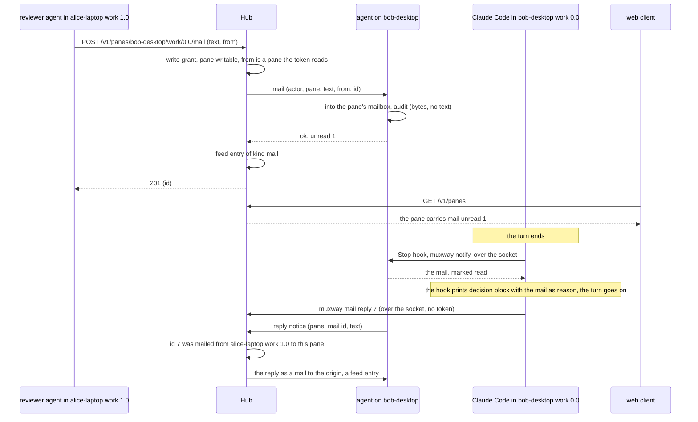
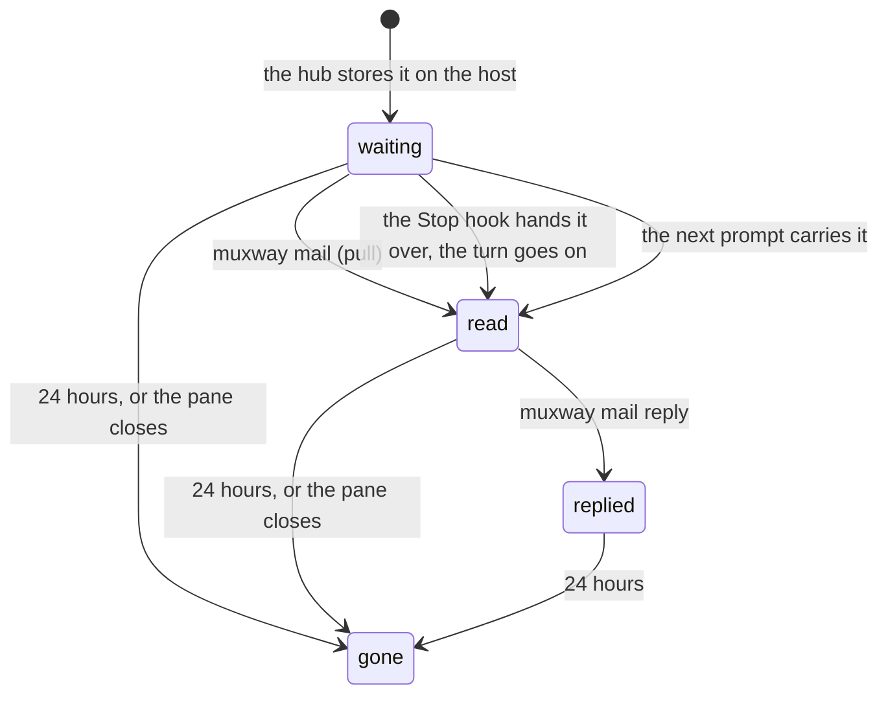

# Feature: mail, messages to a pane that are never typed

> Status: approved 2026-11-01 ("Approved, implement it, deploy here first, publish as DRAFT PR"). Asked for on 2026-11-01: "I don't want
> messaging over typing, it's wrong. Make me a plan for the inbox-based
> communication", after the owner asked "what if something changes on
> the pane and we send keys? Isn't an inbox better in this case?"
> Builds on [talk](2026-10-31-pane-talk.md), on the branch `pane-talk`,
> and replaces its web marks and toast with a group frame, asked for
> the same day (§2, "The web").

## 1. Goal

Today an agent that wants to tell another agent something types it into
that agent's pane. A line typed lands wherever the cursor is: in a
permission prompt it answers the prompt, in a running program it goes
to the program, in a busy agent it queues as a prompt nobody meant. The
sender cannot see the pane's state, and reading it first still leaves a
race. Typing is right for driving a shell; for a message it is wrong.

Mail is the message channel: a text left for a pane, held by the host
agent for the process that runs there, which reads it at a moment of
its own choosing. **Nothing is ever typed into a pane to deliver mail.**
The process gets it in one of three ways, all without a keystroke:

- it pulls (`muxway mail`, blocking or not, through the agent's local
  socket, no token needed, as `muxway ask` works today);
- its harness's hooks hand it over at a safe moment: for Claude Code,
  when a turn ends (the Stop hook continues the turn with the mail as
  its reason) and when the next prompt is sent (the prompt hook adds it
  as context). No prompt, no permission and no running command is ever
  touched;
- a process that expects mail runs `muxway mail --wait` in the
  background and is woken when something arrives (Claude Code wakes a
  session when a background task ends).

The owner sees it everywhere a client lists panes: the panes that talk
to each other framed as one group, like a Chrome tab group, an unread
count on the pane, the history in the messages window when the owner
asks for it and never as a notification per message, and from the web
a mail can be written to a pane without opening its line.

A pane that was mailed may **reply** to the mail's origin through the
same socket, without a token: whoever mails a pane consents to a
reply, and nothing else.

Out of scope: typing to deliver, in any form, also "when the pane is
idle" (the owner's decision: a keystroke into an agent is never the
hub's to make); mail between hubs; mail on disk (it lives in the host
agent's memory, like a question waiting for its answer); attachments
(the file inbox exists); threads beyond `reply_to`. The origin on typed
writes, the feed and the chain built by the talk plan stay: a typed
write still records where it came from, for the audit and the chain,
but the guide for agents now says *mail another agent, type into a
shell*.

## 2. Design

### Where mail lives

The host agent keeps a **mailbox per exposed, writable pane**, in
memory: at most 50 mails, each at most 4000 characters, kept 24 hours
or until the pane goes away. A mail is: an id the hub gave it, when,
the sender (the token's id and name, and the origin pane when the
sender ran in one), the text, and when it was read. The hub keeps only
what the talk feed keeps today, one entry of 200 characters per mail,
and the ids it issued with their origin for 24 hours, so a reply can be
checked.

The hub takes a mail like it takes an answer: the token needs the
write grant on the pane and the pane must be marked for writing (a
mailbox is input to the process, under the same rule as every input).
It forwards it to the host over the agent channel as a new op, the
agent stores it, and the hub records a feed entry of kind `mail`, so
the chain, the window and the toast work as for talk.



### Reading mail from the pane

`muxway mail` talks to the agent's socket for the pane it runs in
(`$TMUX_PANE`, or `--pane`), like `muxway ask`:

```sh
muxway mail                     # unread mail, oldest first, then marked read
muxway mail --wait --timeout 1h # block until one arrives (exit 2 on time out)
muxway mail --all               # read mail too
muxway mail --peek              # list without marking read
muxway mail reply 7 "tests green, two warnings in the log"
```

Each mail prints as a header line, the text, and a blank line:

```
--- 7  1767225600  from alice-laptop/work/1.0  (reviewer)
run the tests on the branch and tell me what fails
```

`--json` prints the agent's own answer. A mail is read when it was
printed or handed to a hook, never before.

### Delivery through the hooks

`muxway notify --from claude-code` already runs as Claude Code's Stop,
UserPromptSubmit and Notification hook. It learns two things:

- **Stop.** After reporting the turn's end, it asks the agent for the
  pane's unread mail. With none, nothing changes. With mail, it prints
  Claude Code's `{"decision": "block", "reason": …}` with the mail as
  the reason, and reports `working` instead of `done`: the turn goes
  on, and Claude reads the mail as what came back, not as something
  typed by its owner. The reason names muxway, the sender's pane and
  the token, and how to reply, so the model knows whom it hears.
- **UserPromptSubmit.** Unread mail is printed to stdout, which Claude
  Code adds to the prompt's context, in the same shape.

For that, the Stop and UserPromptSubmit hooks become synchronous in the
configuration `muxway hooks claude-code` prints (an asynchronous hook's
output is ignored); the Notification hook stays asynchronous. The
timeout stays ten seconds and the command exits 0 whatever happens, so
a stopped agent never disturbs a session. The feature page tells owners
with hooks installed to print and merge them again.

The other harnesses are checked one by one during implementation and
the feature page says, per harness, which of the three ways work: at
the end of a turn where the harness lets a Stop hook continue it, at
the next prompt where its prompt hook feeds context, and by pull
everywhere. A harness without hooks (the watcher's) gets pull only.



### Replies

`muxway mail reply <id> "text"` goes over the socket to the agent,
which finds the mail by id in that pane's mailbox and sends the hub an
unasked notice: the pane, the mail id, the text. The hub checks the id
was issued for a mail *into that pane*, that it is younger than 24
hours, and that its origin was a pane; then it mails the origin pane as
if a token with the right had done so (the origin's pane must still be
exposed and writable, or the reply fails and the command says why) and
records a feed entry from the replying pane to the origin, with the
actor `reply`. A mail without an origin pane (the owner wrote it from
the web) cannot be replied to over the socket: the owner reads the
pane. One reply per mail; a second is refused.

This is the one new path that needs no token, and the one owner
decision this plan asks: **a pane may mail back the pane that mailed
it**, nothing else. The alternative is to require a token for replies
too; then an agent run by hand with hooks only can hear but not answer.

### Sending from the hub side

`muxway client mail <address> "text"` sends through the hub, with the
same `--from` default as `send`. `muxway client mailbox <address>`
lists a pane's mail for a token that reads it, so a sender can see
whether its mail was read. The MCP server gets `mail` (address, text),
`mailbox` (address) and `my_mail` (what arrived for the pane the server
runs in, through the local socket, waiting up to `timeout_seconds`),
eleven tools. `muxway skill` tells an agent: mail another agent, type
into a shell, read your mail when a turn ends and when you are told to
wait.

### What clients see

**The listing.** A pane with unread mail carries `mail`: the count and
when the newest arrived. A small client draws `✉ n` after the name.

**The feed.** A mail is a talk entry of kind `mail` with the first 200
characters, visible where the principal reads both panes; a reply the
same, from the replying pane. A mail the owner wrote from a client has
no origin pane: the entry's `from` is null and the actor names the
token, the window shows `you`.

**The web: groups, not marks.** Asked for on 2026-11-01: "I want
visually to see which panes were talking to each other, grouped in one
border, a bit more red according to theme, like a group in Chrome
tabs. I don't want notifications for each message going back and
forth, but I do want to see history at some point if I want to, part
of messages, notifications left of the header strip." This replaces
the talk plan's chain marks on headers and tabs, and its toast:

- *A group.* Panes that mailed or typed to each other in the last ten
  minutes form a group: the partners of partners too, so three agents
  in a thread are one group, and two threads that share no pane are
  two. Groups come from the listing's `talk` alone, so every client
  can draw them.
- *The strip.* The tabs of a group are drawn inside one frame in the
  talk hue, like a Chrome tab group: a line above and below the run of
  tabs, closed at both ends, the hue a step stronger than the divider's
  so the frame reads against the tab's own border. For that the tabs
  of a group sit side by side: when a group forms, or a pane joins
  one, its tab is pulled next to the group's earliest tab, and the
  owner's order of everything else holds; when the group ends the
  tabs stay where they are. Two groups next to each other keep a
  tab's width of air between their frames. A tab that is dragged out
  of its frame is let go, and not pulled back until the next message.
- *The tiles.* Every open tile of a group gets its frame in the hue;
  tiles of the group that sit beside each other share it, the divider
  between them painted as the talk plan says, so an open pair reads as
  one framed block. Tiles are never moved by themselves: `L`, and a
  click on the frame, lays the partner beside, as before.
- *No toasts.* Nothing pops up for a message. The one trace on the
  tile is its frame; a tile whose pane has unread mail shows `✉ n` in
  its header, after the mode word, until the process there reads it.
- *The history.* Left in the header row, beside `⚑ n`, sits `✉ n`: the
  messages the owner has not looked at yet, mail and typed talk alike,
  per browser, from the hub's feed. A click, `T` or `M` opens the
  messages window over the view, which is the talk window of the talk
  plan with mail rows: oldest at the top, each with the time, who to
  whom as their tabs name them, `✉` for mail and the kind for a typed
  write, the text on one line, a reply indented under what it answers,
  the token dimmed at the end; a group's rows carry its frame colour
  at their left. Opening it clears the count. `j` `k`, `Enter` lays
  the two panes beside, `Esc` closes. Its bottom line, *mail to <the
  focused pane>*, sends a mail with Enter (`POST …/mail`), nothing
  typed; `M` opens the window with that line focused.
- *The list.* A pane's row carries the frame's left edge in the hue
  while it is in a group, the group's rows kept together as the tabs
  are; `✉ n` after the name while mail is unread there.

The native clients take `talk` and `mail` from the listing for the
group frame on their lists and the `✉ n` mark; sending and the window
are follow-ups in their repositories, with an issue each.

## 3. Protocol and API changes

Compatible: new endpoints, optional fields, one new agent op and one
new agent notice. No version bump. A host whose agent takes mail says
so with `"mail": true` in its listing (feature detection); a hub or
host older than that answers `404 not_found`.

`POST /v1/panes/{address}/mail`

```json
{"text": "run the tests on the branch and tell me what fails",
 "from": {"host": "alice-laptop", "pane_id": "%3"}}
```

- `text`: 1 to 4000 characters, no control characters but newline and
  tab. `from` as on `/input`, optional. Needs the write grant and a
  pane marked for writing.
- Answers `201 {"mail": {"id": 7, "at": 1767225600}}`, `400 bad_input`,
  `403 read_only`, `404 not_found` (the pane, or no mail on that host),
  `409 mailbox_full` (50 mails on the pane), `503 host_offline`.
  Audit-logged on the hub and the host with the text's length.

`GET /v1/panes/{address}/mail`, for a token that reads the pane:

```json
{"mail": [{"id": 7, "at": 1767225600,
  "actor": {"id": "0ddba4b5", "name": "reviewer"},
  "from": {"host": "alice-laptop", "address": "alice-laptop/work/1.0", "pane_id": "%3", "alias": "review"},
  "text": "run the tests on the branch and tell me what fails",
  "read_at": 1767225660, "reply_to": null}]}
```

oldest first, read mail included while it lives; `404 not_found` for a
pane the token may not read. Text mode: `<id><TAB><at><TAB><from
address><TAB><actor name><TAB><read_at or 0><TAB><text>` with the text's
newlines and tabs as spaces.

`GET /v1/panes`, `GET /v1/panes/{address}`, the tree, the inbox: a pane
with unread mail carries

```json
"mail": {"unread": 2, "at": 1767225600}
```

`GET /v1/talk`: `kind` gains `mail`; a mail entry carries `"id": 7`
and a reply `"reply_to": 7`. `from` may be null for a mail from a
client that is not a pane.

Agent channel:

- `{"id", "op": "mail", "actor", "pane", "text", "from", "mail_id",
  "name"}` answers `{"id", "unread": 2}` or `read_only`, `not_exposed`,
  `bad_input`, `mailbox_full`. `name` is the token's name, for the
  header the process reads.
- `{"id", "op": "mail-list", "actor", "pane"}` answers `{"id", "mail":
  [...]}` as the endpoint shows it.
- `list` answers carry `"mail": true` and, per pane, `"mail":
  {"unread", "at"}`.
- The agent sends, unasked, `{"reply": {"pane": "%5", "mail_id": 7,
  "text"}}`; the hub checks the id and the pane as §2 says, mails the
  origin, and answers nothing (the agent answers its socket caller once
  the hub's mail op to the origin's host came back, over a request of
  its own: `{"id", "op": "reply", ...}` with the result code). At most
  10 a second per agent, with the events.

The socket (host-local, for the process in the pane): the notify
request gains `"mail": "list" | "take" | "wait" | "reply"`, with
`mail_id`, `text` and `timeout` for the ones that need them, answered
with `{"ok", "mail": [...]}` or an error code.

## 4. Security analysis

- **What an attacker gains.** With a token that may write a pane, the
  same as today: it can tell the agent there what to do. Mail makes
  that *cleaner* than typing, not wider: the text reaches the process
  as a message that names its sender, never as keystrokes that could
  answer a prompt or run in a shell. A false `from` is refused as for
  talk. The right to reply gives a mailed pane one message back to its
  sender's pane and nothing else: the hub, not the agent, checks the
  id, the direction, the age and that a reply was not sent before, so a
  compromised host can only answer mails that were really sent to it.
- **The model hears a stranger.** A mail handed to Claude Code by its
  Stop hook is text the model acts on. The reason says it is mail from
  another pane through muxway, with the sender's address and token, so
  the model can tell it from its owner's words; the skill says the
  same. Who may mail a pane is who holds its write grant, which is the
  owner's choice, exactly as for typing.
- **Authentication and authorisation.** Sending needs the write grant
  and a writable pane; listing a mailbox needs the read grant; the feed
  needs both panes readable. Reading one's own mail goes over the
  agent's socket, mode 600 in a mode 700 directory, so any process of
  the agent's user can read any exposed pane's mailbox on that host, as
  it can already ask on any pane's behalf; the host's user is trusted
  on the host, and the host's user can read the pane's screen anyway.
- **Input across the boundary.** `text` validated for length and
  control characters on the hub and again on the agent; `from` as for
  talk; `mail_id` an integer the hub issued; the socket's request under
  the existing 64 KiB limit; the text printed by the hook is JSON
  encoded, so a mail cannot break out of the reason, and a mail cannot
  change the hook's decision.
- **Bounds.** 50 mails per pane, 4000 characters each, 24 hours, in
  memory; `mailbox_full` after that, as `inbox_full` for files. Sending
  is under the per-token write limit; replies under the per-agent event
  rate; `--wait` and `my_mail` under the one ask-like connection per
  pane rule (a second wait on the same pane ends the first, as a
  second ask does).
- **Logged.** Hub: `audit mail token=<id> host=<host> pane=%5 bytes=52
  result=ok`, `talk … kind=mail`, `reply mail=7 from=<host>/%5
  result=ok`. Agent: `mail pane=%5 bytes=52 actor=<id>`, `mail read
  pane=%5 count=1 how=stop-hook|prompt|pull`. No text, no token secret,
  no screen content.
- **Dependencies.** None.

## 5. Privacy check

Examples use `alice-laptop`, `bob-desktop`, the token name `reviewer`,
synthetic mail text. Fixtures are panes of the test tmux server; the
browser spec retitles the panes it splits before any screenshot (tmux
titles a new pane with the machine's name).

## 6. Test plan

| # | Test | Kind | Expected |
|---|------|------|----------|
| 1 | mail with a token without the write grant, and to a read-only pane | e2e-security | `403 read_only`, no mail, nothing on the screen |
| 2 | a mailbox listed with a token that may not read the pane; the feed for a token that reads one pane only | e2e-security | `404 not_found`; an empty feed |
| 3 | text with control characters, 4001 characters, an empty text, a bad `from` | e2e-security | `400 bad_input`, no mail |
| 4 | the 51st mail on a pane | e2e-security | `409 mailbox_full` |
| 5 | a reply to an id that was not mailed to that pane, a second reply to the same id, a reply to a mail the owner wrote from the web, a reply after the origin was closed | e2e-security | refused with its code, no mail anywhere |
| 6 | the hub's and the agent's logs after a mail and a reply | e2e-security | ids, counts and addresses, no text, no token secret |
| 7 | the screen of the mailed pane | e2e-security | unchanged: nothing was typed |
| 8 | `muxway client mail` from a pane, `muxway mail` in the mailed pane | e2e | the header and the text, then marked read, the listing's `mail` gone |
| 9 | `muxway mail --wait` started before the mail | e2e | returns with it; `--timeout` exits 2 |
| 10 | `muxway notify --from claude-code` with a Stop payload while mail waits, and with none | e2e | the block JSON with the mail as reason, `working` reported; nothing printed and `done` reported |
| 11 | the UserPromptSubmit payload while mail waits | e2e | the mail on stdout |
| 12 | `muxway hooks claude-code` | unit | Stop and UserPromptSubmit synchronous, Notification asynchronous |
| 13 | the MCP tools `mail`, `mailbox`, `my_mail` | e2e | eleven tools listed; sent, listed with `read_at`, received |
| 14 | a reply from the mailed pane | e2e | the origin's `muxway mail` prints it with `reply to 7`; the feed has both entries |
| 15 | the mailbox after the pane closes, and after 24 hours (a clock the test agent takes) | unit | empty |
| 16 | web: a mail to the open pane: no toast, `✉ 1` on the tile's header, the two tabs pulled together inside one frame, the tile framed, `✉ 1` in the header row; the window lists it; the line in the window sends a mail to the other pane; the tile's count clears after `muxway mail` there, the header's on opening the window | UI | screenshots `111-mail-group`, `111-mail-window` |
| 17 | web: three panes in a thread are one frame, two threads two frames with air between; a tab dragged out of its frame stays out; the frame goes after ten minutes (the test clock) | UI | screenshot `111-mail-groups` |
| 18 | web: `M` opens the window with the line focused; the list rows of a group kept together with the frame's edge, `✉ n` after the name | UI | screenshot `111-mail-list` |
| 19 | the group from the listing's `talk`: partners of partners, two threads apart | unit | the sets |

## 7. Documentation

- `docs/features/mail.md`, new: what it is, the three ways to receive,
  per harness, the reply, the command line and MCP, security
  considerations. `docs/features/talk.md`: the "there is no mailbox"
  paragraph replaced by a pointer.
- `docs/features/notifications.md`: the hooks change and the re-print.
- `docs/features/driving.md`: `client mail`, `client mailbox`, `mail`,
  the three MCP tools.
- `docs/protocol/v1.md`: the two endpoints, `mail` on the listing and
  the feed, the agent op, the reply notice, feature detection.
- `docs/ui-guideline.md`: §1.4 the group frame on the strip, the tiles
  and the list in place of the chain marks, the `✉ n` marks, the
  messages count in the header row, no toast for messages; §1.6 the
  talk row becomes the messages row, rows for `M` and for the window's
  line, Android and glasses columns as follow-ups.
- `docs/features/talk.md` and the talk plan's web section: the frame
  in place of the marks and the toast, the screenshot retaken.
- `docs/ARCHITECTURE.md`: the mailbox beside the asks in the agent.
- `internal/skill/SKILL.md`: mail another agent, type into a shell;
  how to read and reply; the background wait.
- README: the line under the agent side.

## 8. Implementation steps

1. Agent: the mailbox per pane (store, take, list, sweep, drop with
   the pane); the `mail` and `mail-list` ops; `mail` in the listing;
   the socket's `mail` requests; the audit lines. Unit tests.
2. Hub: `POST` and `GET …/mail`, the feed entry of kind `mail`, the
   `mail` field on the views, the id map; `mailbox_full` and the
   feature flag. Unit tests.
3. CLI: `muxway mail` with `--wait`, `--all`, `--peek`, `--json`;
   `muxway client mail` and `client mailbox`.
4. Hooks: Claude Code's Stop and UserPromptSubmit deliver; the printed
   configuration; the other harnesses checked and documented.
5. Replies: the socket verb, the agent's notice, the hub's check and
   forward, the feed entry.
6. MCP: `mail`, `mailbox`, `my_mail`; the skill text.
7. Web: the groups from `talk`; the frame on the strip with the pull
   together, on the tiles and on the list, in place of the chain
   marks; the toast removed; `mail` in the types and queries; the
   `✉ n` marks and the header count; the window's mail rows and its
   line; `M`.
8. e2e and security tests, the browser spec with its screenshots.
9. Docs, the guideline, the follow-up issues in the three client
   repositories.

---

## Review (after implementation)

- [x] Diff matches the plan, deviations explained here:
  - The agent channel's capability flag is `mailbox: true` (the
    listing's `mail` field is the pane's count); the client-facing
    `hosts[].mail` is as planned.
  - Several `muxway mail --wait` on one pane are all woken; the plan's
    "a second wait ends the first" was not needed, the socket bounds
    them to the host's own processes.
  - The hook delivery for Codex, Gemini and Copilot was not checked in
    this round: they get pull and `my_mail`; the feature page says so.
  - The header count is per browser (localStorage), cleared by opening
    the window, as planned; the window lists the feed's last hundred
    entries per hub, not only ten minutes.
- [x] Security rules (AGENTS.md section 2) hold
- [ ] Privacy check passed: `scripts/prepush-check.sh` clean and diff read
- [x] Docs and diagrams updated

## Test run

Not yet run.
