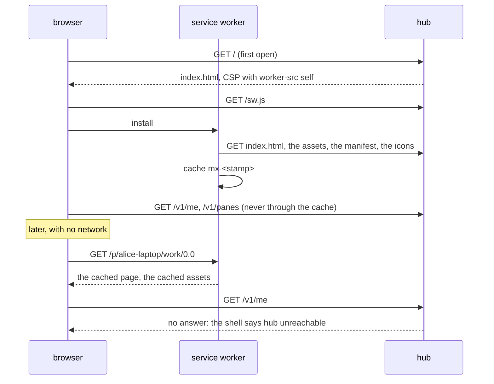
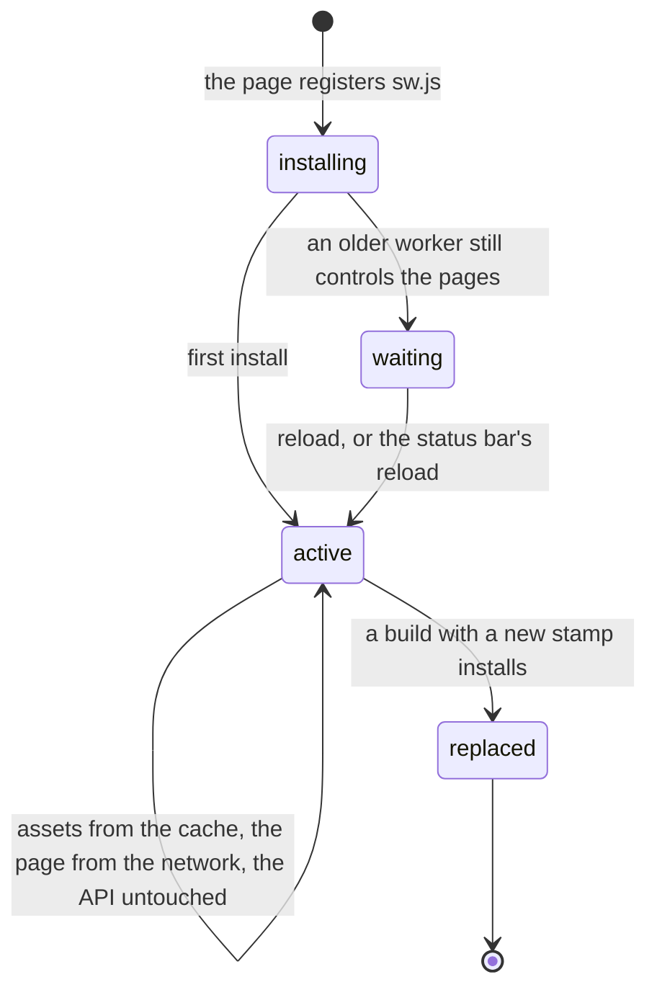

# Feature: the web client as an installable app (PWA)

> Status: approved 2026-11-01 ("Approved, implement it, deploy here first, draft PR"). Asked for on 2026-11-01: "Can we also put
> PWA on a web client?" and "Write the plan for it".

## 1. Goal

The web client opens in a browser tab and nowhere else. A progressive
web app is the same client with two small additions the browsers look
for: a manifest, so the client can be installed on a phone, a tablet or
a desktop as an app of its own, in a standalone window with its icon
and its colours; and a service worker, so the app's own files come from
the device and the shell opens at once, also with no network, showing
*hub unreachable* instead of a blank tab.

What stays exactly as it is: every request to the hub, sign-in, the
session cookie, the hubs box, the admin page, the keyboard, the look.
The worker serves the client's files and nothing else; it never sees,
stores or answers an API request.

Out of scope: web push (it needs a push service outside the hub, which
the no-third-party rule forbids; the inbox already notifies through the
Notification API while the app is open, and the native clients carry
notifications on the phone and the watch); background sync; a share
target; the Android client's place (it stays the phone's client, the
PWA is for the phone without it, the tablet, the iPhone and the
desktop); any new dependency (the worker is forty lines of plain
JavaScript, written here, not a plugin).

## 2. Design

### The manifest

`web/public/manifest.webmanifest`, served by the hub like any file:
the name `muxway`, the short name, the description, `start_url` `/`,
`display` `standalone`, `scope` `/`, the amber background `#0a0603`
and theme `#ffb000` (a manifest's colours are static; the page sets
`<meta name="theme-color">` to the theme in use and changes it with
`t`), and icons: PNGs rendered once from the three theme SVGs and
committed under `web/public/icons/`, 192 and 512 pixels, one of them
with the `maskable` purpose and padding for the circle an Android
launcher cuts, and a 180 pixel one for the iPhone's home screen.
`index.html` gets the manifest link, the `theme-color` meta, and the
three Apple meta tags that make Safari install it standalone with the
icon and a translucent status bar.

### The service worker

`web/public/sw.js`, plain JavaScript, no library, registered by
`main.tsx` after the page loaded, at the root scope. What it does:

- **Install.** It fetches `/index.html`, reads the `/assets/…` paths
  the page references (Vite's hashed script and stylesheet, the fonts
  the stylesheet names are fetched as the page needs them and kept
  then), and puts them, the page, the manifest, the icons and the
  microphone worklet into one cache named by a build stamp.
- **Fetch.** For a same-origin `GET` of a path under `/assets/` it
  answers from the cache first (the files are immutable, as the hub's
  headers say), then the network. For the page itself, any app route
  (`/`, `/signin`, `/p/…`, `/w/…`, `/b/…`, `/admin`), it goes to the
  network first and falls back to the cached page when the network
  fails: that is the offline shell. For everything else, which is to
  say `/v1/…` and anything not the client's own, the handler returns
  without a word and the browser does what it always did: no cache,
  no copy, no change to the cookie flow.
- **Activate.** It deletes every cache of an earlier stamp and takes
  the open pages (`clients.claim`).
- **Update.** The browser fetches `/sw.js` on every open; a changed
  worker installs beside the running one and waits. The page listens
  for it and shows, in the status bar, `new version · reload`; a click
  tells the worker to stop waiting and reloads when it takes over. The
  hub serves `/sw.js` and the manifest with `Cache-Control: no-cache`,
  so a new build is seen at the next open, never a year later.

The build stamp is what makes the worker's bytes change with the
build: `npm run build` runs a small script after Vite,
`web/scripts/stamp-sw.mjs`, that writes the hashed asset paths and a
hash of `index.html` into `dist/sw.js`. The suite's dist check builds
fresh and diffs, so the script is deterministic (the hash, not a date).

### The hub

`webHandler` serves `sw.js` and `manifest.webmanifest` with
`Cache-Control: no-cache` instead of an hour, and `sw.js` with
`Service-Worker-Allowed: /` for clarity (the file sits at the root, so
the scope is the root anyway). The content security policy gains
`worker-src 'self'` and `manifest-src 'self'`; nothing else changes.
`appRoute` already lists the paths the worker treats as the page.

### The web client

- `main.tsx` registers the worker when the browser has one and the
  page is served over https or from localhost (the browser's own rule;
  elsewhere the client is what it was).
- The status bar gets the `new version · reload` line, with a `data-testid`
  for the test, shown when a worker waits.
- The theme switch sets `theme-color`; the settings already know the
  theme, this adds one line.
- `web/scripts/icons.mjs`, run by hand once (not in the build): renders
  the PNGs from the SVGs with Playwright's Chromium, which the suite
  already needs, so no image tool enters the dependencies. The PNGs are
  committed.

## 3. Protocol and API changes

None to the API. Two new files served by the hub (`/sw.js`,
`/manifest.webmanifest`), two new header values on them, two new
sources in the content security policy. Compatible, no version change.

## 4. Security analysis

- **What an attacker gains.** A service worker is script of the
  client's own origin, under the same policy (`script-src 'self'`,
  now `worker-src 'self'`); it is not a new way in. The one thing it
  adds is a cache on the device, so the question is what lands there:
  the client's own files only, which are public and the same for
  everyone. The handler returns without answering for any path under
  `/v1/`, so no pane content, listing, file, token or cookie is ever
  read by the worker or written to a cache; a test reads the cache
  storage after a session and finds no such entry.
- **Authentication and authorisation.** Unchanged: the API calls go to
  the hub as before, with the cookie or the bearer token, and the
  worker does not handle them. The offline shell shows the sign-in or
  the *hub unreachable* line, never data from before.
- **Staleness.** A worker could keep an old client alive; the update
  flow replaces it at the next open, and the hub's `no-cache` on
  `sw.js` makes sure the browser asks. A client revoked by a new build
  is not a security boundary (the API is), so a day of lag costs
  nothing.
- **Input across the boundary.** The worker parses `index.html` for
  `/assets/` paths at install, from the hub's own page; it fetches
  nothing it did not list and caches nothing the network answered with
  an error.
- **Logged.** Nothing new on the hub; the two files are requests like
  any other.
- **Dependencies.** None. The worker, the stamp script and the icon
  script are written here; the icon script runs Playwright's Chromium,
  already required by the suite.

## 5. Privacy check

The manifest names `muxway` and nothing else; the icons are the
project's own; the worker has no host names. Screenshots are taken in
the test environment.

## 6. Test plan

| # | Test | Kind | Expected |
|---|------|------|----------|
| 1 | after sign-in, a listing, a pane read and a file preview, the cache storage holds no entry whose path starts with `/v1/` | UI-security | none |
| 2 | `/sw.js` and the manifest: served with `no-cache`; the policy carries `worker-src 'self'` and `manifest-src 'self'`; a `POST` to either is `404` | e2e-security | headers and status |
| 3 | the worker registers on the test hub (https with the test CA) and the assets are in the cache after the first open | UI | `navigator.serviceWorker.ready`, cache keys |
| 4 | the browser goes offline, the page reloads on a pane route | UI | the shell renders, the status bar says *hub unreachable*; screenshot `112-pwa-offline` |
| 5 | the manifest is linked, parses, names the icons, which answer 200 and are PNGs of the stated sizes | UI | fields and sizes |
| 6 | a worker that waits shows the status bar's line; a click reloads with the new worker in control | UI | the page serves a second `sw.js` from the control server's fixture with another stamp; screenshot `112-pwa-update` |
| 7 | the stamp script is deterministic and lists every hashed asset of `index.html` | unit (node) | same output twice; the paths |
| 8 | the dist check of `scripts/e2e.sh` with the stamp step | e2e | the fresh build matches the committed `dist/` |
| 9 | `theme-color` follows `t` | UI | the meta's content |
| 10 | the icon script renders the three SVGs to the five PNGs | unit (node), by hand | files present, sizes right |

## 7. Documentation

- `docs/features/web-client.md`: an *Install it* section (Android,
  desktop, iPhone), the offline shell, the update line.
- `docs/features/images/`: a screenshot of the standalone window from
  the test environment.
- `docs/ARCHITECTURE.md`: a line on the worker beside the embedded
  files.
- `docs/ui-guideline.md`: §1.4 the status bar's new line (web-only).
- README: a line under the web client.

## 8. Implementation steps

1. The manifest, the icons rendered and committed, the meta tags in
   `index.html`; `theme-color` with the theme switch.
2. The worker and the stamp script; `npm run build` runs the stamp;
   `scripts/e2e.sh` builds the same way for the dist check.
3. The hub: headers on the two files, the policy sources.
4. The registration in `main.tsx`, the status bar's update line.
5. The tests: the security checks on the cache and the headers, the
   offline shell, the update, the manifest; the unit tests.
6. Docs.

---

## Review (after implementation)

- [x] Diff matches the plan, deviations explained here:
  - The update flow (test 6) is covered by a unit test of the page's
    logic with a fake registration, not a browser test: Playwright
    cannot hand the browser a second worker script for the same hub,
    and a fixture server would test the fixture. The status bar's line
    and the reload are the same code.
  - The stamp script's determinism (test 7) is proven by the suite's
    dist check, which builds and stamps fresh and diffs against the
    committed output; the hub test checks the stamped worker's shape.
  - The shell is cached at `/`, not `/index.html`, since the hub serves
    the page at the app routes only.
  - The test browser launches with `--ignore-certificate-errors`: a
    worker's script is fetched outside Playwright's `ignoreHTTPSErrors`,
    and the test hub's certificate is the test CA's.
  - The fonts are cached as the page fetches them (cache-first under
    `/fonts/`), not at install.
- [x] Security rules (AGENTS.md section 2) hold
- [ ] Privacy check passed: `scripts/prepush-check.sh` clean and diff read
- [x] Docs and diagrams updated

## Test run

Not yet run.
