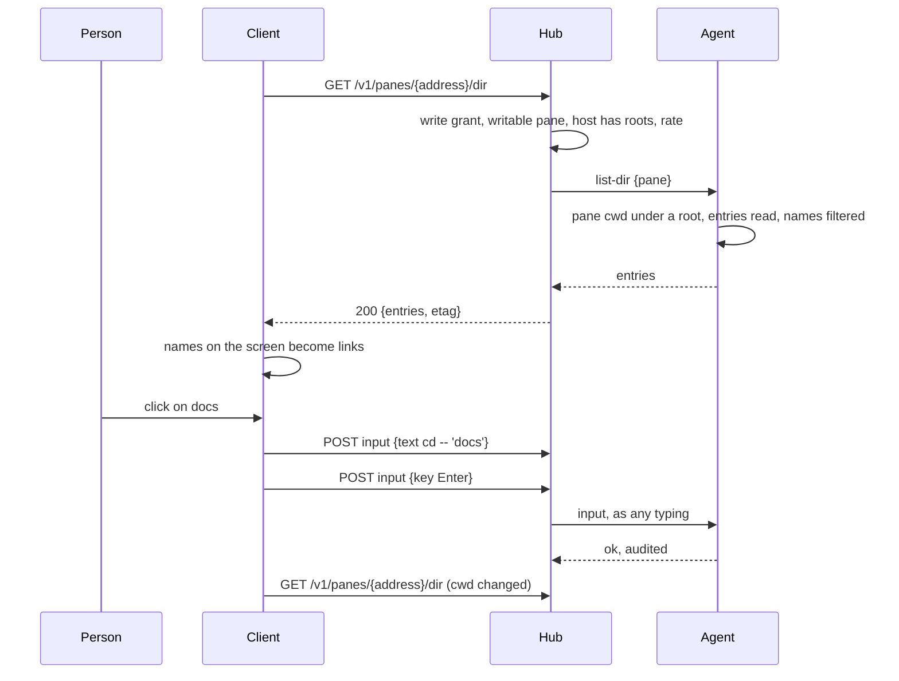
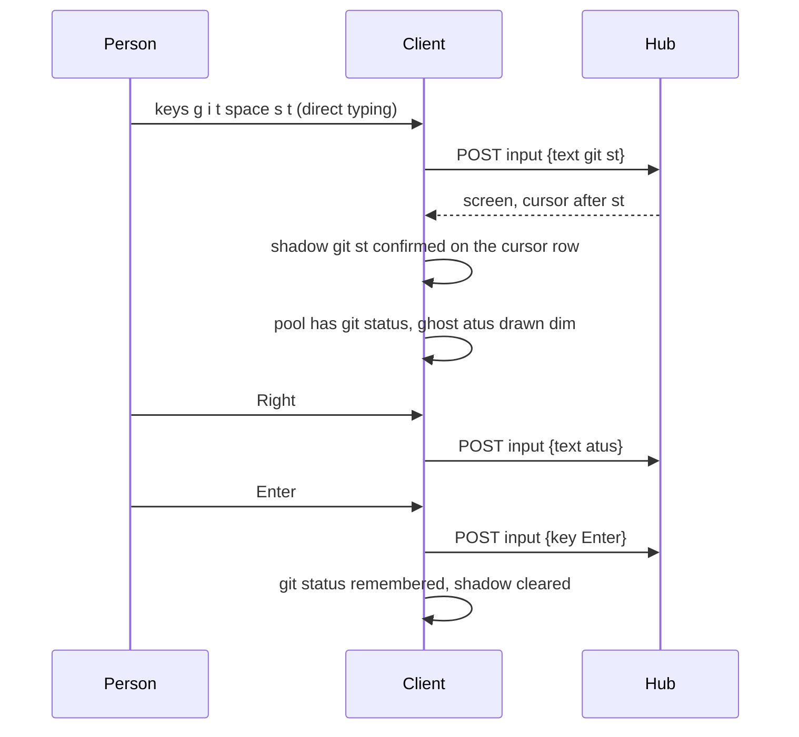
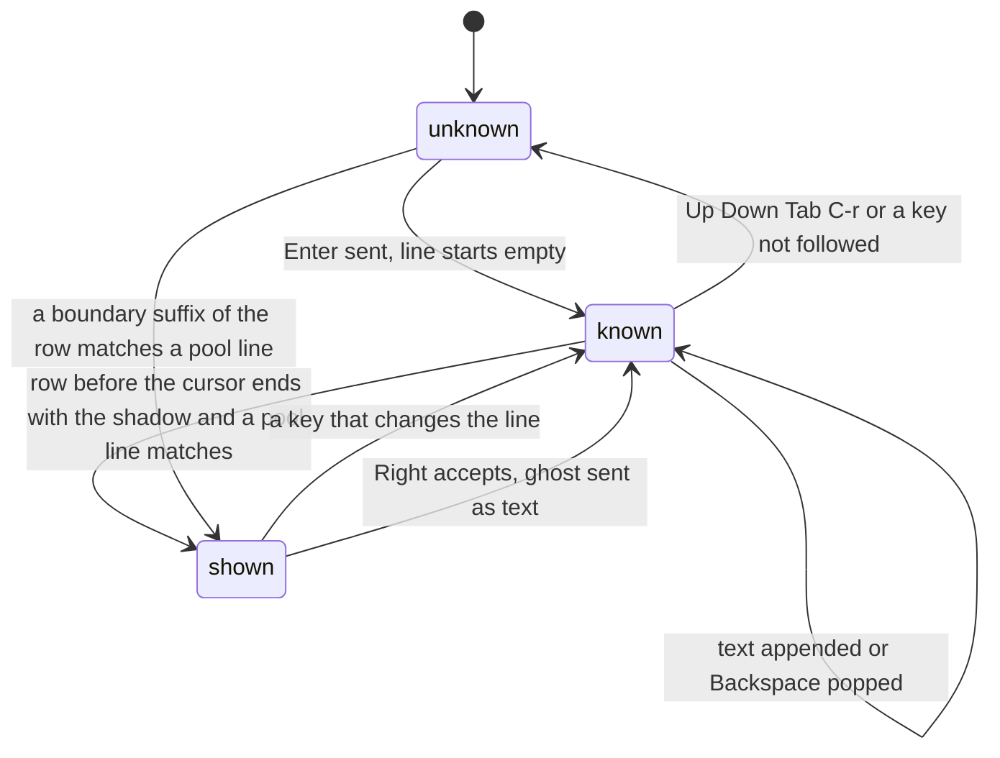

# Feature: shell helper, names you can click and words you can accept

> Status: approved by the owner on 2026-11-02 ("approve, start with the
> names round"). Asked for as "when I
> type `ls` the directories and files should be clickable: a directory
> `cd`s, a file is `cat` or an editor, configurable; and while I type,
> the suggestion pre-filled in a lighter colour right of the cursor, so
> that the right arrow fills it in".

## 1. Goal

A shell pane on the web is a terminal you drive with keys and read with
your eyes. Two things a desktop terminal with shell integration has are
missing: the names a listing prints are not links, and the shell's own
suggestion of what you are typing (fish, zsh-autosuggestions) exists
only if the host's shell has it. This adds both to the web client, for
shell panes:

- **Names are links.** In a writable shell pane on a host with preview
  roots, every name of an entry of the pane's current directory that
  appears on the screen (after `ls`, `tree`, `git status`, `find`, a
  program's output, anything) is a link. A click on a directory types
  `cd -- 'name'` and Enter; a click on a file does what the person
  configured: opens the [preview window](../features/preview.md)
  (nothing typed), types `cat -- 'name'`, or types their own command
  with the name in it (`vim {}`, `less {}`, `bat {}`). Shift+click only
  puts the quoted name on the pane's line, for a `cp` or `mv` in
  progress.
- **The ghost word.** While typing into a shell pane, direct or on the
  line, the rest of what the client thinks is being typed shows in a
  dimmed colour right of the cursor: a line sent before, a command the
  screen shows was typed earlier, a name of the directory after `cd ` or
  `cat `. The right arrow accepts it whole, Ctrl+Right one word; any
  other key ignores it. Off by a setting, for a host shell that draws
  its own.

Out of scope for this plan, each a later round with its own plan: the
native clients (the Android tile gets a tap on a name once the web
behaviour is settled; glasses and MIDP have no typing of this kind);
text mode (no links there by design); reading the host's shell history
file; `file:line` references, git hashes and the other ideas in
section 9; panes whose program is not a shell (nothing links, nothing
is suggested: a click in `vim` must not type `cd`).

## 2. Design

### 2.1 What the host knows and the client does not

The client sees cells. It cannot tell `docs` the directory from `docs`
the word, and it does not know what the shell's line holds. The agent
already resolves a pane's current directory (`#{pane_current_path}`)
for the preview and the changes window, under the owner's preview
roots and nowhere else. The helper rests on that:

- **The agent lists a directory.** A new op `list-dir` takes a pane and
  a path (absent means the pane's current directory), resolves it
  exactly as `read-path` does (relative to the pane's directory, `~`
  to home, symlinks followed, the result under a root, dot components
  refused unless `--preview-hidden`), requires a directory and answers
  its entries: `name` and `kind` (`dir`, `file`, `other`; a symlink
  gets the kind of what it points to, `other` when that leaves the
  roots), sorted, at most 2000 (`"truncated": true` beyond). A name
  with a control character or longer than 255 bytes is left out, so
  nothing the client receives can ever carry a newline into a quoted
  argument. Every refusal is the one code, as the preview's.
- **The hub serves it to a writer.** `GET /v1/panes/{address}/dir?path=…`
  with the write grant on a writable pane on a host whose agent has
  roots, two a second per principal with a burst of five (the preview's
  bucket), `404 not_found` for every refusal, `ETag` so a client that
  asks again pays nothing when nothing changed.
- **The pane listing carries `cwd`** for a shell pane whose directory
  lies under a root, to a principal who may write it; the hub drops it
  for everyone else and for a directory outside the roots. The client
  uses it to know when to list again; the header can show it.

### 2.2 Names on the screen

`web/src/term/names.ts` finds, in a row's plain text, every run that
equals an entry's name, longest name first, bounded on both sides by a
blank, a bar (`│ ┃ |`), a quote or a bracket, or the row's edge. A
listing in columns, `ls -l` with its sizes and dates, `tree`'s drawing,
`git status`'s indented names and a program's prose all give the same
runs. A name with spaces matches as a whole. A run already inside a
link a program named (OSC 8), a web address or a path with a slash
keeps that mark: names fill only what is free, after the marks the
screen builds today.

A run of path characters with a slash (`docs/plans`, `./web/src`,
`../x`) is already a link when it ends in a shown extension; now the
client also asks the host what a slashed run is when its first segment
is a directory of the listing: `list-dir` on the run's parent, once per
parent per listing, at most eight parents per screen, cached with the
listing. A run that names a directory is a directory link; a file, a
file link; anything else stays text.

The client lists when the focused tile is a writable shell pane (the
pane's `command` is one `isShell` knows: `bash`, `zsh`, `fish`, `sh`,
`dash`, `ksh`) on a host that lists `dir`, and lists again when the
pane's `cwd` changes, when the client itself sent Enter to the pane,
and otherwise at most every two seconds while the screen changes (a
program may have written files). An `ETag` match costs one round trip
and no body. Leaving the tile drops the listing.

### 2.3 A click

| on | plain click | Shift+click | the link's title |
|---|---|---|---|
| a directory | `cd -- 'name'` then Enter | `'name' ` on the line | `cd docs` |
| a file, setting *preview* | the preview window, nothing typed (a file the host does not serve, such as a binary, falls to *cat*) | the same | `preview notes.md` |
| a file, setting *cat* | `cat -- 'name'` then Enter | the same | `cat notes.md` |
| a file, setting *command* | the person's command with `{}` replaced by `'name'`, then Enter | the same | the command |
| `other` (a socket, a device) | nothing: not a link | | |

The typed text is one `{"text": …}` request and one `{"key": "Enter"}`,
through the pane's queue as the line sends today, so a click while
direct typing is in flight lands after what was typed. The name is
always single-quoted with `'` written as `'\''`, and `--` ends the
options so a name starting with `-` is a name. A relative name typed
is relative to the pane's directory, which is where the host resolved
it; if the directory changed between the listing and the click the
shell says so, as it would at the keyboard.

Names underline on hover only (`mx-name-link`), not at rest, since a
listing is all names and a screen of dotted underlines reads badly; the
hand and the title say what a click types. In a pane that takes the
mouse a click on a name is the name's, as a link's is today.



### 2.4 The ghost word

`web/src/term/suggest.ts`, pure and unit tested: given the cursor row's
text up to the cursor, the pool of known lines and the directory
listing, it answers the text to show after the cursor, or nothing.

The pool, in order of trust: the lines this browser sent to shell
panes (the `recent` store, grown from 8 to 200 for this, still the
last 8 for the command row; a line that looks like a secret is not
kept, see section 4), the commands the screen shows were typed on the
host (rows that start with a prompt, `$ `, `# `, `% `, `❯ `, `> ` after
anything, which also covers what was typed from another client or at
the keyboard), the shell starters of the command row, and, for the
word at the cursor after `cd `, `cat `, `ls ` or any word that is a
path so far, the listing's names (`cd do` suggests `cs/`; a directory
gets its slash).

The client does not know where the prompt ends. It keeps a shadow of
the line while direct typing: every printable text sent is appended,
Backspace pops, Enter, `C-c`, `C-u`, `C-l`, Up, Down, Tab and any key
it cannot follow clear it to unknown. The row's text before the cursor
must end with the shadow for a ghost to show at all: the screen
confirms what was typed. The typed part is the shadow when known, else
the longest suffix of the row at a word boundary (after a blank or a
prompt sign) that some pool line starts with, two characters at least
when the shadow is unknown. The first pool line that starts with the
typed part, newest first, gives the ghost: the line minus the typed
part. No ghost when the cursor has text to its right on the row (the
person is editing inside the line), when the pane is not a shell, when
the typed part is empty, or when the setting is off.

Drawing: the screen draws the block cursor at the cursor's cell
already; the ghost is one more span in that row at `cursor_x`, in the
theme's dim colour, clipped at the pane's width with `…` when longer.
It is a drawing of the client's, never content: a copy of the screen,
a `cat -v` on the host, the text-mode read see nothing.

Accepting: in direct typing, `Right` with no modifier while a ghost
shows sends `{"text": ghost}` instead of the key, and `Ctrl+Right`
sends up to and including the next blank; the shadow grows by what was
sent. Any other key is the pane's as today. On the input line, the
same function gives a ghost drawn inside the field after the caret
(the field's mirror, dim), `Right` with the caret at the end takes it
into the field; Tab and the list stay as they are, Enter sends the
field as it is, never the ghost.





### 2.5 Settings

Per browser, beside theme and font in the help overlay:

| setting | values | default |
|---|---|---|
| `names` | on, off | on |
| `a file opens with` | preview, cat, command… (a text field, `{}` for the name, 200 characters) | preview |
| `suggest` | on, off | on |
| `forget sent lines` | a button | |

### 2.6 Components touched

Agent: `internal/agent/listing.go` (the op, the resolver shared with
preview), `cwd` in the pane listing, `dir` in the capabilities. Hub:
`internal/hub/listing.go` (the endpoint), the pane listing filter, the
hosts listing. Web: `term/names.ts`, `term/suggest.ts`, `Screen.tsx`
(name marks, the ghost span), `pages/Pane.tsx` (the listing query, the
click actions, the shadow, `Right`), `InputPanel.tsx` (the field's
ghost), `settings.ts`, `shell/Help.tsx`, `term/commands.ts` (the longer
store and the secret filter), `api/types.ts`.

## 3. Protocol and API changes

Compatible.

- `GET /v1/hosts`: `"dir": true` when the host's agent takes `list-dir`
  (it has roots and is new enough).
- `GET /v1/panes` and a pane read: `"cwd": "/home/alice/work"` on a
  pane whose program is a shell, whose directory lies under a preview
  root, for a principal with the write grant on a writable pane; absent
  otherwise.
- `GET /v1/panes/{address}/dir?path=…`: `path` optional, as the
  preview's (1024 bytes, no control characters, else `400 bad_input`).
  `200 {"path": "/home/alice/work", "entries": [{"name": "docs",
  "kind": "dir"}, {"name": "notes.md", "kind": "file"}], "truncated":
  false}` with `ETag` and `Cache-Control: private, no-store`; `403
  read_only`; `404 not_found` for anything the host will not list, one
  code; `429 rate_limited`; `503 host_offline`.
- Agent op `list-dir` `{"pane", "path"}` answering `{"path",
  "entries", "truncated"}` or `no_file` / `not_allowed`.

```http
GET /v1/panes/alice-laptop/work/0.0/dir
→ 200 {"path": "/home/alice/work", "entries": [{"name": "docs", "kind": "dir"}, {"name": "notes.md", "kind": "file"}], "truncated": false}
GET /v1/panes/alice-laptop/work/0.0/dir?path=../../etc
→ 404 {"error": "not_found"}
```

## 4. Security analysis

- **What an attacker gains.** A stolen write token lists directories
  under the roots. It could already list them by typing `ls` into the
  shell, so the op adds no reach to a writer; a reader gains nothing,
  and without roots nothing is served. The pane listing's `cwd` is a
  path of the host and reaches writers only, and only under a root,
  because a path outside is the host's business.
- **A click types into a shell.** The text is built by the client from
  a name the host listed, never from screen text: a run of the screen
  becomes a link only where it equals a listed name, so a program in
  the pane cannot invent a name. It can print a real name to lure a
  click, and the click then does the person's own configured action on
  that real entry, which is what the person would have typed. The name
  is single-quoted with `'` escaped, `--` precedes it, names with
  control characters are never listed, and the person's command
  template is theirs. Only a shell pane links, by the pane's
  `command`; a click while `vim` or an agent has the pane does nothing.
- **The ghost sends nothing until Right.** It is drawn by the client
  from this browser's own sent lines, the pane's screen and the
  listing; accepting sends ordinary text through the same endpoint,
  grant and audit. The sent-lines store is the one the command row has,
  longer: a line that matches a secret shape (`=` or `:` followed by 16
  or more characters without blanks, or `password`, `passwd`, `token`,
  `secret`, `key` followed by `=` or a blank and a value, or any line
  with `--password`, `-p` and a value) is never kept, and the store can
  be emptied by a button. Nothing from the hub or another pane is ever
  suggested.
- **Input that crosses a boundary.** `path` as the preview's, validated
  on the hub and resolved on the agent after symlinks; entry names
  filtered on the agent (length, control characters) and again on the
  client before they become link text; the client never builds HTML
  from a name, React sets text.
- **Enumeration.** One `404` for outside a root, hidden, missing, not a
  directory, no roots; the preview's rate bucket; the `ETag` is a hash
  of the answer, not the path.
- **Logs.** Hub and agent audit the principal, pane, the path asked and
  resolved, the count of entries and the result; never a name. A click
  is an ordinary input audit line: who, when, pane, bytes.
- **Dependencies.** None new.

## 5. Privacy check

Fixtures are the suite's temporary directories with names such as
`docs`, `notes.md`, `a b.txt`; hosts `alice-laptop`; screenshots of the
test environment. The secret filter's unit fixtures use
values shaped like a key that are no one's.

## 6. Test plan

| # | Test | Kind | Expected |
|---|------|------|----------|
| 1 | `dir` without `--preview`; with a read-only token; on a read-only pane; from an older agent | e2e-security | 404, 403, 403, 404; `dir` absent from the hosts listing in each case |
| 2 | `path` of `../../etc`, `/etc`, a symlink out of a root, `.git`, `.ssh`, a file, a NUL, 2 KB; a directory with a name holding a newline and one of 300 bytes | e2e-security | 404 or 400, one code; the two names absent from the listing; the agent audits the refusals without names |
| 3 | Rate limit and audit lines of `dir` | e2e-security | the sixth in a second is 429; the lines carry the count and the paths, no name |
| 4 | `cwd` in the pane listing: a reader, a writer on a host without roots, a writer whose pane sits outside the roots, a writer whose pane program is `vim` | e2e-security | absent in all four; present for a writer's shell pane under a root |
| 5 | A pane prints `docs` where no such entry exists, and `'; rm -rf ~ #` where an entry of that very name exists; a click on each | UI (e2e-security) | the first is text; the second types `cd -- ''\''; rm -rf ~ #'` and `cat -v` in the next pane shows exactly that, nothing else |
| 6 | Secret lines sent on the line: an `export` of a sixteen-character value, `mysql -p hunter2`, `curl -H "Authorization: Bearer x…"` | unit (web) | none remembered; `git status` is |
| 7 | `list-dir` on the pane's directory, on `sub`, on `../`; a symlink to a directory under a root and to one outside; `truncated` at 2001 entries; `ETag` and `304` | e2e | kinds as said, `other` for the leaving link; the count and the flag; a cached answer |
| 8 | `findNames` on an `ls`, an `ls -l`, a `tree`, a `git status`, prose, a name with spaces, a name inside a web address, a name that is also a word | unit (web) | the marks of the table, free runs only |
| 9 | `suggest`: the pool order, newest first; the shadow known and unknown; a suffix of one character never; text right of the cursor; a `cd do` with the listing; a pane that is not a shell | unit (web) | as section 2.4 says |
| 10 | The shadow: text, Backspace, Enter, `C-c`, Up, Tab, a paste, Right accepting | unit (web) | the states of the diagram |
| 11 | `ls` in the pane, a click on a directory, on a file with each setting, Shift+click, a slashed path to a directory and to a file | UI | the pane `cd`s, previews, `cat`s, runs the template, gets the quoted name; screenshots `114-names.png`, `114-names-hover.png` |
| 12 | Direct typing `git st` with `git status` sent before: the ghost shows, Right fills, Enter runs; Ctrl+Right one word; a key after the ghost; a shell with text right of the cursor | UI | `git status` runs; screenshot `115-ghost.png` |
| 13 | The input line: the ghost in the field, Right takes it, Tab still takes the list, Enter sends the field as typed | UI | as said |
| 14 | A pane running `vim` after an `ls`: nothing links, nothing is suggested | UI | no `mx-name-link` in the screen, no ghost |
| 15 | The settings: names off, suggest off, the command template, forget | UI | no links, no ghost, the template typed, the store empty |

## 7. Documentation

New `docs/features/shell-helper.md` (names, the click table, the
ghost, the settings, the diagrams, security). `docs/protocol/v1.md`
(`dir`, `cwd`, the endpoint, the op). `docs/features/hub-and-agent.md`
(what `--preview` now also allows). `docs/features/web-client.md` (the
links paragraph, the settings, the keyboard table: `Right`,
`Ctrl+Right`, Shift+click). `docs/ui-guideline.md` (§1.4 rows *names*
and *suggestion*, §1.6 rows *enter a directory printed in a pane*,
*open a file printed in a pane* grown, *accept the suggestion*, §2 web
only until the Android round). `docs/features/direct.md` (`Right` with
a ghost). README's feature list.

## 8. Implementation steps

Round one, names:

1. Agent: `list-dir`, the resolver shared with `read-path`, the name
   filter, `cwd` in the listing for shell panes under a root, `dir` in
   the capabilities; unit tests of the resolver and the filter.
2. Hub: the endpoint, grant, limits, `ETag`, audit; `cwd` dropped for
   anyone but a writer; Go end-to-end tests of rows 1 to 4 and 7.
3. Web: `names.ts` and its test (row 8); the listing query and its
   refresh rule; name marks in `Screen`; the click actions and the
   quoting; the settings; spec 114 (rows 5, 11, 14, 15 in part).
4. Docs of round one, `make web`, local review, `make e2e`, the run
   recorded, `scripts/prepush-check.sh`, the pull request.

Round two, the ghost word:

5. `commands.ts`: the longer store, the secret filter (row 6), the
   forget button.
6. `suggest.ts` and the shadow, unit tested (rows 9, 10).
7. The ghost span in `Screen`, `Right` and `Ctrl+Right` in the direct
   key handler, the field's ghost in `InputPanel`; spec 115 (rows 12,
   13, 15 in part).
8. Docs of round two, the run, the pull request.

## 9. Ideas for the same treatment of other common output

Each a later plan if the owner wants it; listed in the order they seem
worth it.

1. **`file:line` references.** `grep -n`, `rg`, compilers, `go test`,
   stack traces and linters print `web/src/x.ts:42:7`. The preview
   window opens at that line with it highlighted; with the *command*
   setting the template gets `{line}` too, so `vim +{line} {}` works.
   The links plan deferred exactly this in October.
2. **The directory in the header.** With `cwd` in the listing, a shell
   pane's header can show its directory as breadcrumbs, each segment a
   click that `cd`s there, with `..` and the directories this browser
   `cd`ed to lately in a small menu. The cheapest way to move around
   from a phone.
3. **Git output.** A hash in `git log --oneline` opens the diff in the
   changes window (it has the viewer already) or types `git show`; a
   branch name in `git branch` types `git switch`; the names in `git
   status` already open the changes window and could also take the
   file click.
4. **Targets and scripts.** After `make `, `npm run `, `just ` or
   `cargo ` the ghost and the list offer the targets of the `Makefile`,
   the scripts of `package.json`, the recipes of the `justfile`, read
   through the preview op the host already serves.
5. **Long-running things to watch.** An id in `docker ps` or a pod in
   `kubectl get pods` offers `logs -f` and `describe`; a PID in `ps`
   offers nothing, since every action on a PID is destructive and the
   rule is read-only actions by default.
6. **A history palette.** The sent-lines store, once it holds 200
   lines, is worth a palette (`r`, like the go-to palette) that filters
   as you type and sends the pick: the client's own `Ctrl+R`, and the
   one place to see and prune what the ghost draws from.
7. **Actions by kind, the person's own.** The *a file opens with*
   setting grows into a small table: by extension (`*.md → glow {}`,
   `*.log → tail -f {}`, `*.json → jq . {}`), by kind (`hash → git show
   {}`), each a template the client quotes. Round one keeps one
   template so the table has something to grow from.

---

## Review (round one, names)

- [x] Diff matches the plan. Deviations: a root itself resolves for a
  listing (the preview refuses it, since a root is no file), so a pane
  sitting in a root lists it; `cwd` is the directory's real path,
  symlinks followed, not the one tmux reports; a symlink that leaves the
  roots is listed by name with kind `other` and is no link, by the
  plan's own kind rule; the agent refuses a pane that is not writable by
  its mark (`read_only`) beside the hub's check of the grant; with *a
  file opens with: preview* every file opens the window, and what the
  host cannot show arrives there as a download rather than falling to
  `cat`; the focused tile lists every two seconds, the others every five;
  the listing kept by the query is dropped the moment the pane's
  program is no shell, so a stale one never links; the "older agent"
  case of row 1 is not run (the suite has no older binary) and the
  client goes by the `dir` flag alone; the *forget* button and
  *suggest* of row 15 are round two's.
- [x] Security rules hold: the listing needs the write grant and a
  writable pane on a host with roots, resolves under a root after
  symlinks, keeps hidden and secret names out, caps at 2000, one `404`
  for every refusal, the preview's rate bucket; `cwd` reaches writers
  only and only under a root, and the hub drops a malformed one; the
  typed text is built from the host's listing, single-quoted with `'`
  escaped and `--` before it, through the same input endpoint, grant and
  audit; audit lines carry counts and paths, never a name (tests 185 and
  186 read the logs); no new dependency.
- [x] Privacy check: fixtures are the suite's temporary directories and
  `alice-laptop`; `scripts/prepush-check.sh` to run at the push.
- [x] Docs: `shell-helper.md` with its diagram and screenshot, the
  protocol (`dir`, `cwd`, the endpoint, the op), the agent page, the
  preview page, the web client (links, keyboard table), the guideline
  (§1.4 *names*, three rows of §1.6, §2), the help overlay, the README.

## Review (round two, the ghost word)

- [x] Diff matches the plan. Deviations: the sent-lines store already
  had a secret filter and a *forget* on sign-out, so round two grows the
  store to 200, caps the command row at eight, adds the database
  client's `-p` and `-u user:password` shapes, applies the same filter
  to the commands read off the screen, and gives the help overlay the
  *forget* button; the shadow starts unknown when direct typing is
  entered (the line may not be empty) and is known from the next Enter
  on, so the first line of a session goes by the row alone; a cursor
  row comes without its trailing blanks, so the row is padded to the
  cursor's cell before the typed part is read; a name of the directory
  completes the last word after a command that takes a file from one
  character and elsewhere from two, so a lone letter in another command
  stays quiet; the line's ghost draws from the sent lines, the screen
  and the starters, not the listing; `Ctrl+Right` takes the ghost up to
  and including the next blank.
- [x] Security rules hold: nothing is sent until Right, and then as
  ordinary text through the same endpoint, grant and audit; the pool is
  this browser's sent lines (secret shapes never kept, forgettable,
  emptied on sign-out), the pane's own screen (secret shapes skipped)
  and the host's listing for the pane's writer; nothing from the hub or
  another pane; the ghost is a drawing, never content. Spec 115's
  second test sends two secret-shaped lines and sees neither kept nor
  offered.
- [x] Privacy check: fixtures are the suite's pane and `example.com`;
  `scripts/prepush-check.sh` at the push.
- [x] Docs: the feature page's ghost section with its diagram and
  screenshot, `direct.md`, the web client (links, keyboard table), the
  guideline (§1.4 *suggestion*, §1.6 *accept the suggestion*, §2), the
  help overlay.

## Test run

Go end-to-end tests 184 to 187 (`e2e/s26_listing_test.go`), browser
spec 114 (two tests, screenshots `114-names` and `114-names-hover`),
the finder's and the quoting's unit tests. [Run
20261102-213932-99506f0](https://github.com/notmarkopadjen/muxway/issues/217):
passed, 215 tests, 0 failed, at `99506f0`, whose sources are those of
`841bb52` (the branch was rewritten once after the run, to reword two
example values in this plan that the secret scanner took for keys).
