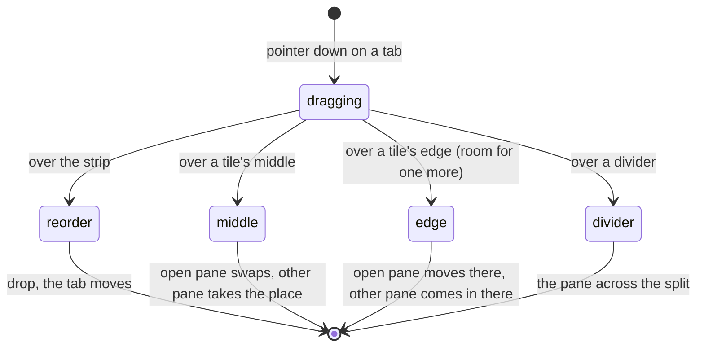

# Feature: a tab dropped on the view, and nothing scrolls sideways

Issue [#213](https://github.com/notmarkopadjen/muxway/issues/213).

## 1. Goal

Four things the owner saw in the web client's pane view on 2026-11-02.

1. A tab dragged from the strip can only be put elsewhere in the strip.
   A tile's header is the only thing that swaps or splits, and it drags
   only while several tiles are open, so a single pane has no drag that
   makes a second column or row at all. Wanted: a tab dragged down onto
   the view behaves as the pane dragged by its header does. With one
   pane open the owner drops a tab on the right half for two columns or
   the bottom half for two rows.
2. The add menu grows a horizontal scrollbar when an entry's place is
   wider than the menu.
3. The go-to dialog does the same with a long pane name.
4. Two tiles side by side each show a vertical and a horizontal
   scrollbar along their whole edges, where the single pane shows at
   most a thin vertical one.

Out of scope: the native clients. Android has the header drag but no
tab drag; a parity issue follows once the web behaviour is settled.
The glasses and the keypad phone have no tiles.

## 2. Design

### A tab dropped on the view

The strip tells the view when a tab is dragged (`onDragPane`, the
address or null at the end), and the view puts it in the same state a
dragged header sets, so the tiles offer their zones and the dividers
widen, as they do for a header. The drop then goes one of two ways.

- **The tab's pane is an open tile.** Exactly the header's drop: the
  middle of another tile swaps the two, an edge splits that tile's
  place with the dragged pane on that side, a divider lays it across.
  The tile the pane is in takes nothing.
- **The tab's pane is not open.** Its middle: the pane takes the tile's
  place, as a click on the tab would take the focused tile's. An edge:
  the pane comes in as one more tile on that side of the tile's place,
  the others keeping their places (the tree with a new leaf where the
  edge drop puts it, as a custom arrangement). A divider: one more tile
  across that split. With four tiles open there is no room for one
  more: the tile offers only its middle and the pane takes that tile's
  place.

A drop inside the strip still reorders and a drop anywhere else
(the line, the header row) still does nothing. The single tile's header
stays undraggable: there is nothing to drop it on.

The count of tiles is the route, so coming in as one more tile is a
navigation that mounts the tiles anew; the made arrangement travels
with it the way a closed tile's does (`carried`), and the new pane is
the one focused.

### The menus

The add menu and the go-to list clip instead of scrolling sideways:
`overflow-x: hidden`, the place after a name and the meta column cut
with an ellipsis, the name shrinking last.

### The tiles' screens

A screen never scrolls sideways: a fitted pane has the columns its box
holds, and a pane not fitted is drawn at the font that fits its box, so
there is nothing to scroll to. The bars the owner saw come from a few
pixels of overflow: the cell is measured on a bare `pre` that takes the
browser's default monospace font and line height, not the screen's own
font and its `.ln` rows, so the columns and rows asked of the host can
be one too many for the box. The probe now renders the screen's own
markup (`div.mx-screen > pre > div.ln`), so the cell is the cell that
is drawn, and the box clips sideways, so a wide fallback glyph or a
held frame at an older size shows no bar either. The vertical bar stays
for what it is for: history above the screen.

## 3. Protocol and API changes

None. The route `/p/a,b` the view navigates to is the existing one, and
the new tile's fit is the existing resize.

## 4. Security analysis

- Nothing new reaches the hub: a drop changes the browser's arrangement
  and the route; the pane added then fits itself through the resize
  endpoint it already uses, under the same grants.
- The dragged address comes from the strip, which the page built from
  the hub's listing; the route it is written into is parsed by
  `parseRoute` as before (well formed, at most four, none twice), so a
  drop can at worst open a pane the token may already read.
- No input crosses a trust boundary; nothing is logged; no new
  dependency.

## 5. Privacy check

The spec uses the harness's `alice-laptop` panes; screenshots are of the
test environment; no real host, person or content in code, docs or
tests.

## 6. Test plan

| # | Test | Kind | Expected |
|---|------|------|----------|
| 1 | 113: the route after a drop holds only what the token may read; a drop of a tab onto the view asks the hub nothing but the new tile's fit | e2e-security | no request but `resize` for the pane added |
| 2 | 113: one tile; a tab dropped on the right half of its screen | UI (`113-tab-right`) | two tiles in a row, the dropped pane right and focused |
| 3 | 113: one tile; a tab dropped on the lower part | UI (`113-tab-below`) | two tiles in a column, the dropped pane below |
| 4 | 113: two tiles; a third tab dropped on a tile's middle | UI | the pane takes that tile's place, two tiles still |
| 5 | 113: two tiles; the tab of an open tile dropped on the other's middle | UI | the two swap, as a header does |
| 6 | 113: four tiles; a tab dropped on an edge | UI | the pane takes that tile's place, four tiles |
| 7 | 113: a tab dropped on a divider | UI | the pane across the split, custom layout |
| 8 | 106: a tab dropped on the line changes nothing | UI | the order as it was (the existing check, aimed off the tiles) |
| 9 | 114: the add menu and the go-to list with a pane whose title is far wider than the box | UI (`114-add-menu`, `114-go-to`) | `scrollWidth <= clientWidth` on both lists |
| 10 | 114: two tiles in a row, a full-width line and a line of box glyphs printed into each | UI (`114-tiles`) | no screen's content wider than its box; no horizontal bar drawn (the box's height is its client height plus its border); a fitted pane with no history has no vertical overflow |
| 11 | unit: `dropOn` and `across` with a leaf the tree lacks | unit | the new leaf is placed on the side asked, nothing else moves |

## 7. Documentation

- `docs/ui-guideline.md` §1.4 *strip*, *tiles* and §1.6 *swap two
  tiles* and *lay a tile across*: a tab from the strip as a second
  source.
- `docs/features/web-client.md`: the strip, the tiles, the add menu and
  the scrolling paragraph.

## 8. Implementation steps

1. `Tabs`: `onDragPane`; the tab's title names the drop.
2. `tiles.test.ts`: `dropOn` and `across` with a new leaf.
3. `Pane.tsx`: the view takes the strip's drag; the tile's drop and the
   divider's drop handle a pane not open; a tile offers only its
   middle when there is no room.
4. CSS: the menus and the go-to list clip; the screen clips sideways;
   `measure.ts` probes the screen's own markup.
5. Specs 113 and 114; 106 aimed off the tiles.
6. Docs.
7. `make web`, the e2e run, the run recorded.

---

## Review (after implementation)

- [ ] Diff matches the plan, deviations explained here
- [ ] Security rules (AGENTS.md section 2) hold
- [ ] Privacy check passed: `scripts/prepush-check.sh` clean and diff read
- [ ] Docs and diagrams updated

## Test run

Pending.
