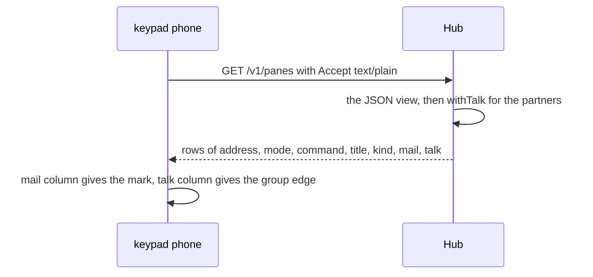

# Feature: the text listing carries mail and talk

## 1. Goal

The MIDP client reads `GET /v1/panes` in text mode, one tab-separated
row per pane, because a JSON reader does not fit its 30 KiB JAR. Mail
counts and talk partners were added to the JSON listing only, so the
keypad phone cannot draw the `✉ n` mark or the group edge the other
clients draw (see the parity issue in muxway-midp). Two trailing
columns give it both. Out of scope: the feed, mailing and answering
from a text-mode client, which keep their own text modes.

## 2. Design

The hub appends two columns to every row of the text listing, after
`kind`: `mail`, the pane's unread count in decimal, empty when nothing
waits; `talk`, the current addresses of the pane's partners, newest
first, joined by `|`, empty when the pane talked with nobody in the
window. Both are ASCII: an address is a host name, a session name and
two numbers, all narrow by the protocol, and `|` is not allowed in any
of them, so the column splits without escaping. A client that splits
on TAB and reads by index sees two more fields and nothing else
changes.



## 3. Protocol and API changes

Text mode of `GET /v1/panes` becomes
`<address><TAB><mode><TAB><command><TAB><title><TAB><kind><TAB><mail><TAB><talk>`.
Compatible within v1: an addition at the end of the row, which a client
that reads by index ignores. Example, a pane with two unread mails that
talked with two others:

```
alice-laptop/work/0.0	write	claude	✳ review		2	alice-laptop/work/0.1|bob-desktop/work/0.0
alice-laptop/work/0.1	write	bash	build			alice-laptop/work/0.0
```

## 4. Security analysis

- Nothing new is exposed: the two columns carry what the JSON listing
  already gives the same principal. A partner appears only when the
  principal may read both panes, as `withTalk` decides; a token that
  reads one side gets an empty column.
- No new grant, no new input: the text mode takes the same `charset`
  parameter as before and nothing else.
- The columns cross no trust boundary on the way in. On the way out the
  partner addresses come from the hub's own listing, never from a
  client's `from` claim as typed.
- Nothing is logged. Pane content is not in the listing.
- No new dependency.

## 5. Privacy check

The docs and the tests use `alice-laptop`, `bob-desktop` and the suite's
synthetic hosts. No real host, person or secret.

## 6. Test plan

| # | Test | Kind | Expected |
|---|------|------|----------|
| 1 | TestSec100: the text listing of a token that reads one side of a talk | e2e-security | its rows have an empty talk column and name no partner |
| 2 | TestSec100: the text listing of a token that reads both sides | e2e | the pane's row ends with the partners' addresses joined by `|`, in the JSON order |
| 3 | TestMailReachesTheProcessAndComesBack: one unread mail | e2e | the row's mail column is `1`, empty again once the process read it |
| 4 | TestFlow16: a pane with nothing pending and no talk | e2e | the row ends with three empty columns |

## 7. Documentation

`docs/protocol/v1.md` (the text-mode row), `docs/features/talk.md` and
`docs/features/mail.md` ("What clients see"), `docs/ui-guideline.md`
(§1.2 and §1.4: what Android, the glasses and MIDP now draw from the
listing).

## 8. Implementation steps

1. `handlePanes`: the two columns.
2. The e2e assertions above.
3. The docs.

## Test run

Run 20261102-125201-8ca1c40, recorded as [issue #209](https://github.com/notmarkopadjen/muxway/issues/209): 208 tests passed, none failed, at commit 8ca1c40. The run before it, at d1a78eb, failed in Flow26 alone, whose text row ended at the pending kind; it expects the two new columns since 8ca1c40.
