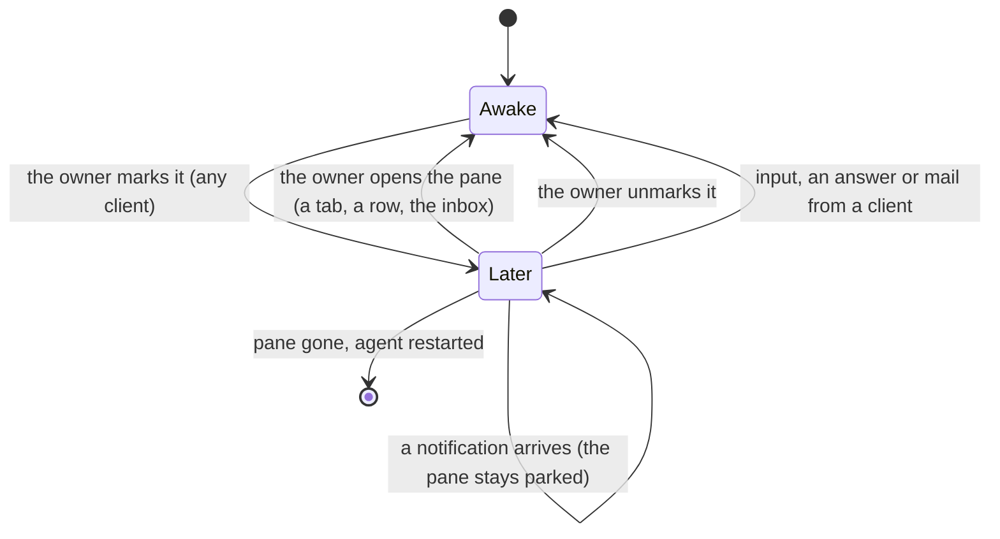
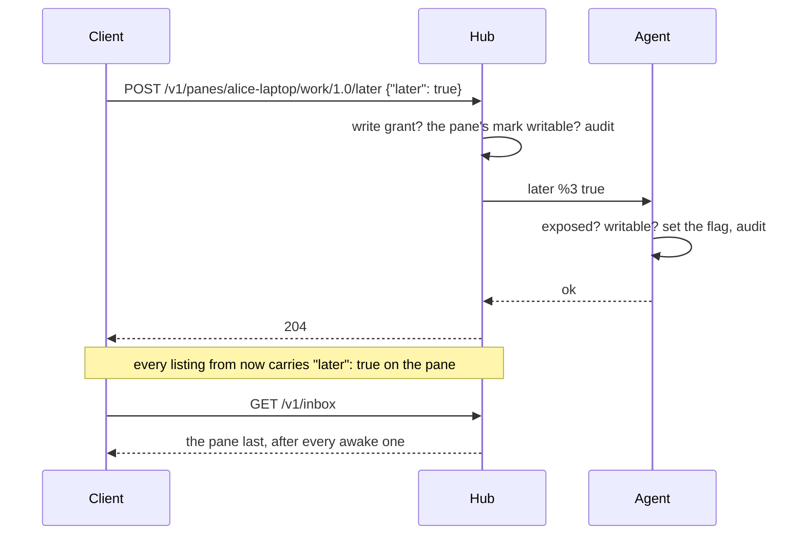

# Feature: later, a pane parked by its owner

> Status: approved by the owner on 2026-11-03. Asked for on 2026-11-03 as
> "manually set some tabs to *later* status: moved to the end of the
> header strip and visually marked with an icon (eg `z`), on all
> clients; these statuses count as done", and "when you click on a tab
> which is asleep, it focuses on that one and takes it out of sleep".

## 1. Goal

Several agents on several hosts call for the owner at once. Some of
them can wait: the owner has looked, decided not now, and wants them out
of the way without losing them. **Later** is that decision, made on a
pane: its tab goes to the end of the strip with a sleeping mark, it
stops calling (no toast, no pulse, no flash), and it counts among the
done panes rather than the pressing ones, on every client, until the
owner opens it again or wakes it on purpose.

Out of scope: a reminder time (later is until the owner comes back),
later on a window or a host, later set by a process in the pane
(`muxway notify` keeps its five kinds), hiding the pane.

## 2. Design

### Where it lives

Later is a flag on a pane, held by the **host agent** beside the pane's
attention: shared by every client, survives a hub restart, dies with
the pane and with the agent process, like attention does. A client sets
it through the hub, which forwards it to the agent as a write; the agent
keeps it and reports it in every listing.



A notification that arrives while the pane is parked does not wake it:
the owner said later, and the listing still carries the kind underneath
for anyone who looks. Typing into it, answering its question or mailing
its process is the owner coming back, so that wakes it, as it clears
attention today. Opening the pane is the owner coming back too: the
client that opens a later pane sends the wake itself (the tab click,
the list row, `Enter` in the inbox, the selector, the add menu).

### What every client shows

| Where | Later |
|---|---|
| glyph | `☾`; where the font has no moon (MIDP, the glasses' own set) `zz` |
| word | `later` |
| paint | plain, like a quiet pane: the mark is the only sign; no inversion, no pulse, no glow, no toast, no title flash, no browser notification |
| strip | after every other tab, the later tabs in the order they would otherwise have; a woken tab goes back to its place |
| list | in its place (the list mirrors tmux), with the mark and the word |
| header | the mark, the word, then the kind underneath dimmed: `☾ later · ! permission` |
| inbox | listed, after every awake pane, oldest later first, with the mark; `Enter` opens and wakes |
| counts | counted as a done pane wherever kinds are counted: `⚑ n`, the watch face, the glasses' first row |
| `o` (oldest waiting) | skips later panes |
| a group (talk) | unchanged: the frame still holds the tab, at the end |

### Setting it

| Client | Mark later / wake |
|---|---|
| web | `d` on the focused tile or the selected row; the `☾` pane button (*later*, selected while on) in the pane view and the window view; *later* on an inbox row; a click on a later tab focuses it and wakes it |
| Android | *later* in the long-press menu of a tab and of a tile's header; a tap on a later tab wakes it; the watch's pane menu gets *later* |
| glasses | *later* in the pane page's menu; selecting a later pane wakes it |
| MIDP | a *Later* command on the pane view; opening a later pane wakes it |

Only a principal with a **write grant** on a writable pane may mark or
wake: later is a change every client sees, on the host, like an answer.
A reader sees the mark and cannot move it; the button is disabled with
*read only*.



### Components touched

- Agent: the flag beside attention (`notify.go`), the `later` op, the
  clearing on input, answer and mail, `later` in every listed pane.
- Hub: `POST /v1/panes/{address}/later`, the field through the listing,
  the tree and the pane read, the inbox's order, text mode's kind column.
- Web: `term/lens.ts` (the glyph, the word, the paint), `term/order.ts`
  (later last), `Tabs.tsx` (the click wakes), `Pane.tsx` and
  `Window.tsx` (the button, `d`, the header), `Panes.tsx` (`d` on the
  row, the open wakes), `Inbox.tsx` (last, the button, the open wakes),
  the toast and the title flash (skipped), `o` (skips).
- Native clients: their own repositories, one issue each (section 7).

## 3. Protocol and API changes

Compatible additions to v1.

- A pane in `GET /v1/panes`, the tree, a pane read and the inbox may
  carry `"later": true`; absent means awake. Text mode: the kind column
  reads `later` for a later pane in the panes listing and the inbox
  (the kind underneath is not carried in text mode; a small client
  shows the mark alone).
- `POST /v1/panes/{address}/later` with `{"later": true}` or
  `{"later": false}`. Needs a write grant and a pane marked for
  writing. Answers `204`, `400 bad_json`, `400 bad_input` (not a
  boolean), `403 read_only`, `404 not_found` (the pane, or a host whose
  agent is older than this), `429 rate_limited` (five a second per
  principal), `503 host_offline`. Audited on the hub and the host.
- `GET /v1/inbox` lists later panes too, after every awake pane,
  oldest first within each half (by `attention.at`; a later pane with
  no attention by the moment it was parked). `count` counts them all.
- The agent channel: `{"id", "op": "later", "actor", "pane", "later":
  true}` answered like `answer`, with `not_exposed`, `read_only`,
  `bad_input`; an agent that takes it says `"later": true` in every
  `list` answer, and the hosts listing passes it on as `hosts[].later`,
  so a client shows the button only for a host that has it.
- Events: none. Later is a state in the listing, which every client
  polls (the web every second on an open pane, every five on the list;
  Android every fifteen and on any event). A client learns a change
  from the listing.

```json
{"address": "alice-laptop/work/1.0", "mode": "write", "command": "claude",
 "later": true,
 "attention": {"kind": "permission", "at": 1767225600, "text": "Claude needs your permission to use Bash"}}
```

## 4. Security analysis

- **What an attacker gains.** With a write grant on the pane: parking
  it, so its owner's clients stop calling for it, which is less than
  typing into it, which clears the attention outright and which the
  same grant allows. With a read grant: the knowledge that the owner
  parked it, one boolean on a pane whose attention they could read.
- **Grants.** The hub checks the write grant and the writable mark;
  the agent checks exposure and the mark again and refuses otherwise,
  as for an answer. A reader's request is `403 read_only`.
- **Input.** One boolean; anything else is `400`. Nothing is typed, and
  nothing reaches the pane's process.
- **Limits.** Five a second per principal; the agent's existing event
  limits are untouched (no event is raised).
- **Logging.** Hub and host audit who, which pane, and the value;
  nothing else, no text.
- **No dependencies.**

## 5. Privacy check

Docs and tests use `alice-laptop`, `work`, `bob-desktop`. Screenshots
from the e2e run only.

## 6. Test plan

| # | Test | Kind | Expected |
|---|------|------|----------|
| 1 | a reader marks later; a writer on a read-only pane; `{"later": "yes"}`; a body with an extra key | e2e-security | `403`, `403`, `400`, `400`; the flag unchanged in the listing |
| 2 | six requests in a second | e2e-security | the sixth is `429` |
| 3 | the host's and the hub's audit after a mark and a wake | e2e-security | actor, pane, value; nothing else |
| 4 | mark, then list, tree, pane read, inbox, text mode | e2e | `"later": true` everywhere, the kind column `later` |
| 5 | input into a later pane; an answer; a mail; a notification arriving | e2e | the first three wake it; the fourth leaves it later with the new kind underneath |
| 6 | a hub restart; the pane closed | e2e | the flag survives the restart; gone with the pane |
| 7 | inbox order: two awake, two later, mixed ages | e2e | awake oldest first, then later oldest first; `count` 4 |
| 8 | `d` on a tile: the tab goes last with `☾`, the header says `☾ later · ✓ done`, no toast on a new notification, no title flash; `d` again brings it back | UI | screenshots `117-later-tab`, `117-later-header` |
| 9 | a click on a later tab | UI | focused and awake, the tab back in its place |
| 10 | `o` with a later pane older than an awake one | UI | opens the awake one |
| 11 | the inbox window with a later row: last, *later* toggles, `Enter` opens and wakes | UI | screenshot `117-later-inbox` |
| 12 | the list: `d` on a row; the row keeps its place with the mark; open wakes | UI | screenshot `117-later-list` |
| 13 | a reader's view: the mark shows, the button disabled | UI | as stated |
| 14 | the lens and the order | unit | `glyph('later')`, `word`, later tabs last and back in place when woken |

## 7. Documentation

- `docs/features/notifications.md`: a section *Later*, with the state
  diagram and the rules (what wakes, what does not).
- `docs/features/inbox.md`: the order and the count.
- `docs/features/web-client.md`: the button, `d`, the strip, the inbox
  row; the keyboard table.
- `docs/protocol/v1.md`: the field, the endpoint, the agent op, feature
  detection (`hosts[].later`), the text-mode column.
- `docs/ui-guideline.md`: §1.2 a fourth row *later* in the lens table
  (the glyph, the word, the paint), §1.4 the strip row (later last),
  §1.6 a row *park the pane for later / wake it* with every client's
  trigger, before any key is bound.
- `docs/features/driving.md`: `muxway client later <address> [--off]`
  and the MCP tool, so an agent orchestrating others can park one.
- Tracking issues: muxway-android (the long-press entries, the watch
  menu, `Board` counting later as done, the strip order), muxway-glasses-even
  (the menu entry, `sorted()` with later last, `MARK`), muxway-midp
  (the *Later* command, the `later` kind column, `mark()`).

## 8. Implementation steps

1. Agent: the flag, the op, the clearing, the listing field, `later` in
   the list answer; unit tests.
2. Hub: the endpoint, the audit, the rate limit, the field through,
   the inbox order, text mode; tests 1 to 7.
3. Protocol page, notifications and inbox pages.
4. Web: lens, order, tabs, the button and `d`, the header, the toast
   and flash skipped, `o`; specs 8 to 10, 13, 14.
5. Web: the inbox row and the list; specs 11, 12.
6. `muxway client later`, the MCP tool, `driving.md`.
7. `make web`, the guideline, the web-client page, the three issues.
   Run, record, pull request.

---

## Review (after implementation)

- [ ] Diff matches the plan, deviations explained here
- [ ] Security rules (AGENTS.md section 2) hold
- [ ] Privacy check passed: `scripts/prepush-check.sh` clean and diff read
- [ ] Docs and diagrams updated

## Test run

Pending.
