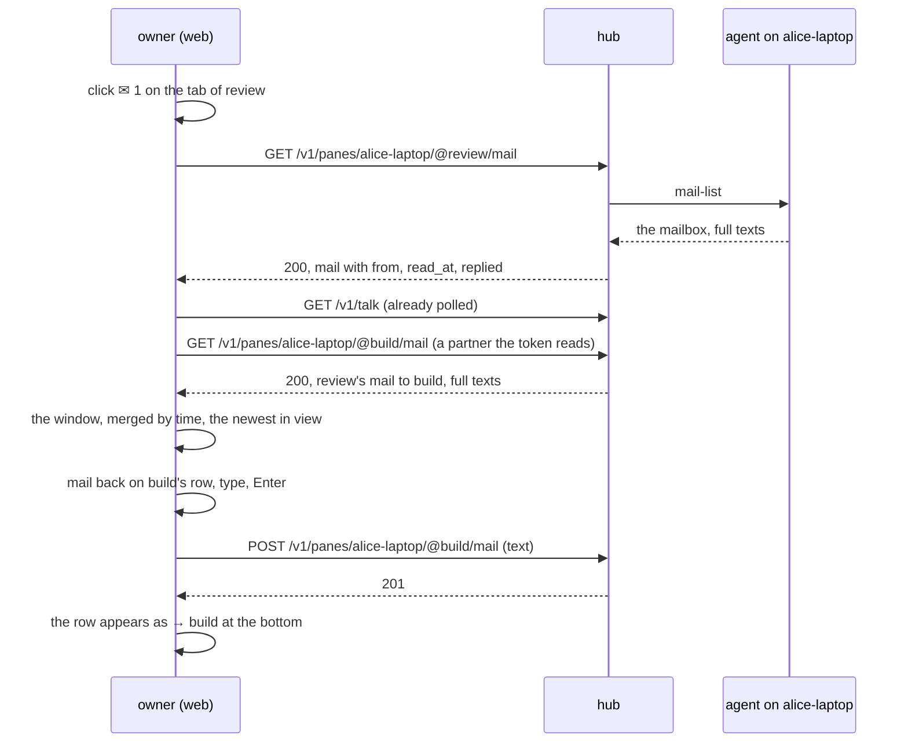
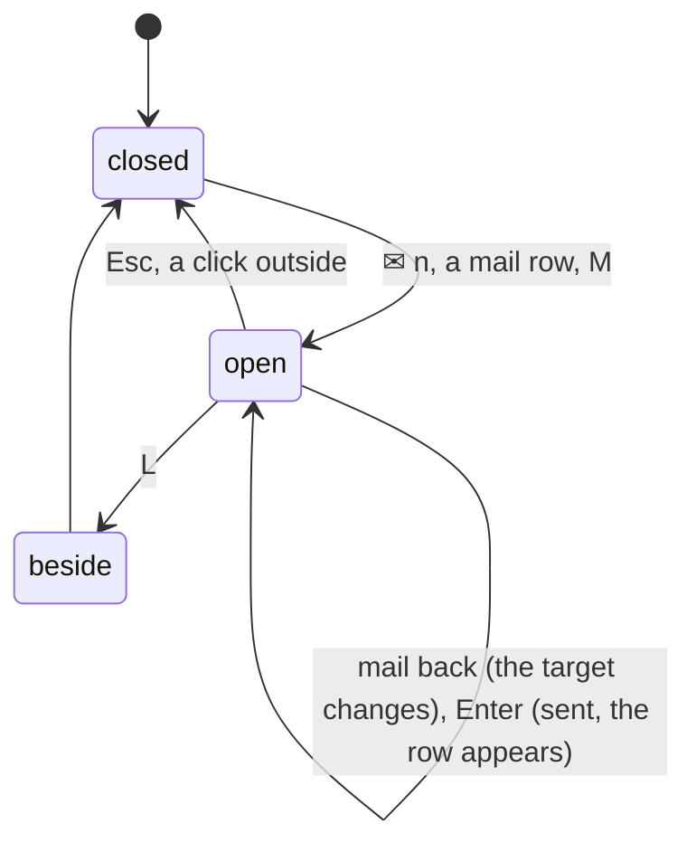

# Feature: the mail window, reading and answering a pane's mail from the web

> Status: approved 2026-11-03 ("ok"). Asked for the same day: "Messaging
> between two panes is not really useful: it looks a lot like the
> generic name for everything and it's too narrow, I cannot determine
> what's there. When showing one message I cannot click on it to see
> what it is and manually continue the conversation. Same goes with
> the envelope shown in the header."
> Companion plan, same session: [pane names](2026-11-03-pane-names.md),
> which gives the rows their names.

## 1. Goal

The messages window shows the talk feed: thirty rows of
`codename → codename`, each with the first words of a 200-character
excerpt cut by a narrow box, and a click lays two panes side by side.
The `✉ 1` on a tab and on a header says mail waits for the pane's
process and does nothing when clicked. So the owner sees that two
agents are talking, cannot read what they say, and cannot join in
without typing into a pane, which is the one thing mail exists to
avoid.

After this change:

- the **messages window** is wide enough to read, and each row gives
  the whole excerpt on its own line under who wrote to whom;
- a **mail window** per pane shows the pane's mail in full, what was
  sent to it and what it sent, oldest at the top, with a line at the
  bottom that mails the pane or mails back whoever wrote to it;
- the `✉ n` on a tab, on a header and on a list row, a mail row in the
  messages window and `M` open it.

Out of scope: marking mail read from a client (a mail is the
process's; it is read when the process reads it); deleting mail;
mail from the glasses and the MIDP client (their parity issues take
the window); a notification per mail (decided against in the mail
plan).

## 2. Design

### The messages window, readable

The box grows to `min(960px, 100vw - 32px)` (the help box's width,
not the palette's). A row becomes two lines: the first carries the
glyph, `from → to` in the talk hue (names as the pane-names plan gives
them), and at the right the time and the token's name; the second the
excerpt, wrapping to two lines at most, then cut. The live bar, the
reply indent, the selection and the `j`/`k`/arrows stay.

Actions on a row: `Enter` lays the two panes side by side, as today;
a click on a mail row opens the mail window of the pane the mail went
to, with that mail in view; a click on a typed row lays the two side
by side (there is no mail to show). A `⇆` at the right end of every
row does the side-by-side with the pointer, so a mail row has both.

### The mail window

One window for one pane, P, over the page like the messages window:

```
┌─ mail · review ──────────────────────────────────────────────┐
│ ← build · 11:52 · reviewer                        read, replied│
│   run the tests on the branch and tell me what fails          │
│   ↳ → build · 11:54 · reply                                    │
│     tests green, two warnings in the log                      │
│ → build · 12:05 · console                                      │
│   merge it when the run is recorded                           │
│ ← you · 12:13 · alice                                   unread │
│   ok, go ahead                                                 │
├────────────────────────────────────────────────────────────────┤
│ ✉ mail to [review ▾]  a message for its process; nothing is …  │
│ Enter send · Esc close · L both panes side by side             │
└────────────────────────────────────────────────────────────────┘
```

What it lists, merged by time:

- `←` every mail in P's mailbox (`GET /v1/panes/P/mail`): the sender
  (the origin pane's name, or `you` for a mail from a client that is
  not a pane, with the token's name), the time, `unread` until the
  process read it, `replied` when it answered, and the **whole text**;
  a reply P made to it indented under it, from the feed, with the
  full text from the origin's mailbox when the token reads that pane;
- `→` every mail P sent, from the talk feed (`from` is P): the
  recipient's name, the time, and the text, whole when the token reads
  the recipient's mailbox (one `GET …/mail` per partner, fetched as
  the window opens), else the feed's 200 characters marked `…`.

The window polls P's mailbox and the feed every five seconds while
open, as the messages window does. Text is text: it is never rendered
as markup, links in it are not made clickable (the pane's own OSC 8
handling does not apply here).

The line at the bottom is the messages window's line, moved here with
a **target**: P by default; `mail back` on a `←` row sets it to that
row's sender, and the `▾` lists P and the partners seen in the window
(only panes the token may mail: the others are listed disabled with
`read-only`). The label always names the target, so a mail never goes
to the wrong pane by habit. Nothing is typed, as before: `POST
/v1/panes/{target}/mail` with no `from` (the owner is not a pane), so
the process reads `from you (alice)` and cannot `reply` over the
socket; it writes back with `muxway client mail`, which the skill
page already tells it.



### Where it opens from

| Opener | P | the line |
|---|---|---|
| `✉ n` on a tab, a tile header, a list row, a cell header | that pane | targets it |
| a mail row in the messages window | the pane the mail went to, the mail in view | targets it |
| `M` | the focused pane | targets it, focused |
| the header's chain, `L` | unchanged: lays the partner beside | — |

`M` today opens the messages window with its line focused; the line
lives in the mail window now, so `M` opens that. `T` keeps opening the
messages window, which keeps its own line for the open pane (one line
less to explain is better, but the owner uses it; it stays until the
mail window has lived a week).



### Unread and seen

The `✉ n` on a pane counts what its **process** has not read and the
window does not change it: the owner reading over the shoulder does
not take a mail from the process. The window says `unread` on those
rows so the owner knows the agent has not seen them yet. The `✉ n`
beside the brand counts feed entries this browser has not looked at
and is cleared by the messages window, as today, and now by the mail
window too.

## 3. Protocol and API changes

None. `GET /v1/panes/{address}/mail` (read grant), `GET /v1/talk` and
`POST /v1/panes/{address}/mail` (write grant) exist. The feature page
and the guideline change.

## 4. Security analysis

- **Abuse.** The window shows mail text to whoever may read the pane,
  which the mailbox endpoint allows already; the sent side shows a
  partner's mailbox only where the token reads the partner, else the
  feed's excerpt, which the feed shows only where the token reads both
  panes. No text reaches a client that could not get it today.
- **Grants.** Reading: the read grant on P; the partners' full texts:
  the read grant on each; sending: the write grant on the target, the
  target marked for writing, checked by the hub as before. The picker
  never offers a target the token cannot mail.
- **Input across the boundary.** Mail text is hostile by definition
  (written by an agent): it is rendered as text through React, never
  as HTML, with no link detection; a UI test sends `` and `javascript:` text and asserts they show as written
  and run nothing. Names come from `describe`, as everywhere. The
  typed text keeps the 4000 limit and the hub's control-character
  check.
- **Logging.** Unchanged: the hub and the agent log a mail's length
  and id, never its text. The browser keeps nothing of a mail.
- **Dependencies.** None added.

## 5. Privacy check

Fixtures use `alice-laptop`, `review`, `build`, `alice` and synthetic
texts. Screenshots come from the test environment.

## 6. Test plan

| # | Test | Kind | Expected |
|---|------|------|----------|
| 1 | the window for a pane the token cannot read | e2e-security | nothing opens: no `✉` is shown for it (it is not listed), the route by hand gets 404 and the window says so |
| 2 | a `→` row whose recipient the token cannot read | e2e-security | the feed's excerpt, marked `…`, never the full text |
| 3 | mail text ``, `javascript:…`, 4000 characters, tabs and newlines | UI-security | shown as written, nothing runs, the row wraps, no horizontal scroll |
| 4 | `mail back` to a sender the token cannot write | e2e-security | the picker lists it disabled; a send forced by hand gets 403 and the window shows `refused` |
| 5 | the hub and agent logs after a send from the window | e2e-security | length and id, no text |
| 6 | the merge of a mailbox and the feed, with a reply, a partner read and one not | unit | ordered by time, the reply under its mail, the excerpt marked |
| 7 | the picker's targets from a window's rows | unit | P, the partners, writable ones enabled |
| 8 | 117-mail-window.spec.ts: `✉ 1` on the tab opens the window, the full text shows, `unread` on it; the process reads it (`muxway mail` in the pane); the row says read | UI | screenshots `mail-window`, `mail-read` |
| 9 | 117: a mail row in the messages window opens the window with the mail in view; `Enter` on the row lays both side by side; `⇆` too | UI | screenshot `messages-wide` |
| 10 | 117: `mail back` sets the target to the sender, Enter sends, the `→` row appears, the sender's pane reads it with `muxway mail` | UI | screenshot `mail-back` |
| 11 | 117: `M` opens it on the focused pane with the line focused; `Esc` closes; `L` lays the panes beside | UI | assertions |
| 12 | 104-mail (existing): `M` no longer opens the messages window's line | UI | updated |

## 7. Documentation

- `docs/features/mail.md`: *What clients see*, the web: the mail
  window, its openers, what unread means there; a new screenshot
  `web-mail-window.png` for the window and `web-messages.png` for the
  wider list.
- `docs/ui-guideline.md`: the *messages* row (two-line rows, the
  click on a mail row), a *mail window* row in §1.6, the `M` row, the
  `✉ n` openers; Android column *follow-up*.
- Parity issue in muxway-android (the mail sheet) and a note on the
  glasses and MIDP issues (read only).

## 8. Implementation steps

1. Web: the messages window's width and two-line rows; `⇆`; the click
   on a mail row calls the opener; unit test for the row model.
2. Web: `useMailbox(address)` query; the merge of mailbox and feed;
   unit tests.
3. Web: `Mail.tsx`, the window with its rows, the target picker, the
   line; `M` and the openers on tab, header, row, cell; the seen mark.
4. Docs, guideline, screenshots; `make web`; e2e run; parity issue.

---

## Review (after implementation)

- [x] Diff matches the plan, deviations explained here: the mail
  window's input is `mail-text` and the messages window keeps its
  `mail-line`, so the specs tell them apart; the mail window lives in
  the shell behind a small store (`shell/mailwin.ts`), so a tab, a
  header, a list row and the messages window open it the same way; a
  partner the token may not write is listed disabled in the picker, as
  planned, and its `mail back` is disabled too.
- [ ] Security rules (AGENTS.md section 2) hold
- [ ] Privacy check passed: `scripts/prepush-check.sh` clean and diff read
- [ ] Docs and diagrams updated

## Test run

Link to the recorded run: result, commit, logs, screenshots.
