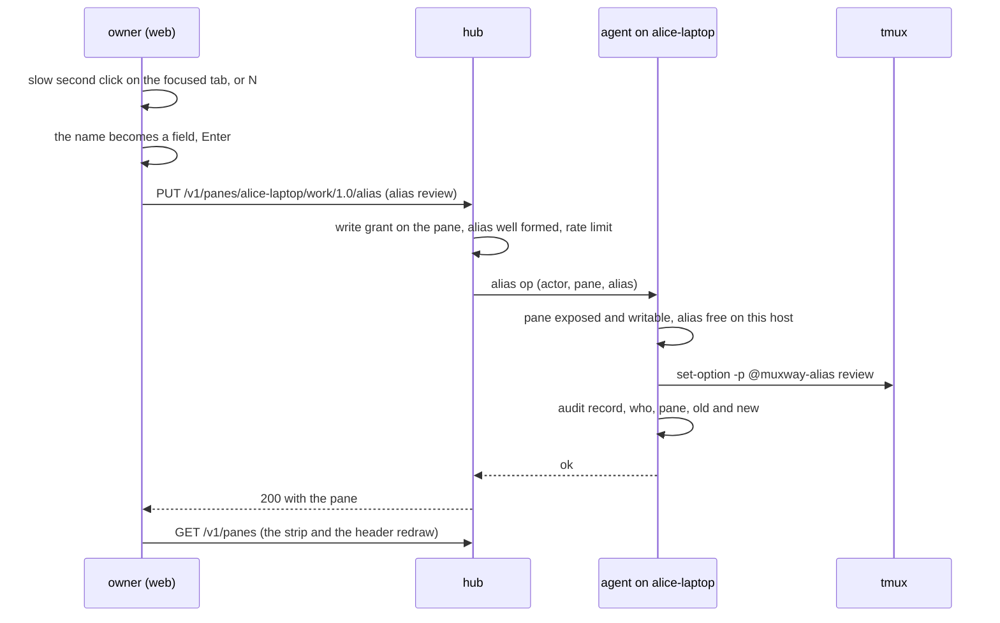
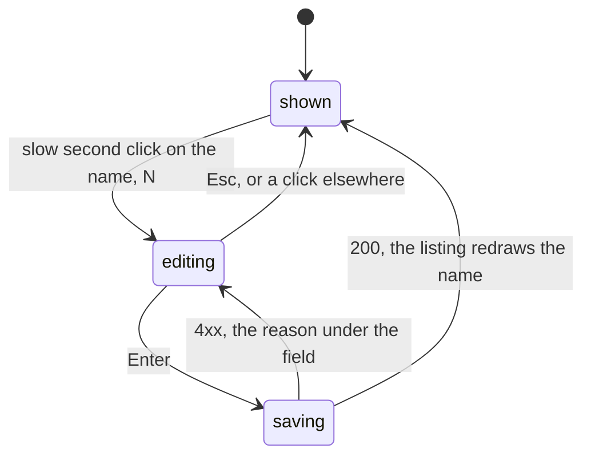

# Feature: a name for a pane, the folder it works in, a lighter header

> Status: approved 2026-11-03 ("ok"). Asked for the same day: "tab names and
> headers are given by Claude or, if they are not in Claude, they have
> just a code name. I would like to have an option to rename it
> somehow. Maybe two times slow click. Also think of a way of telling
> me which folder it is working in: a tooltip on hover on the web and
> the italic information in the pane header. There's already too much
> information in the pane header, which I don't need."
> Companion plan, same session: [the mail window](2026-11-03-mail-window.md).

## 1. Goal

With four Claude sessions open, the strip reads like four copies of
whatever Claude last wrote into its title: the codename changes every
turn, two sessions on the same subject pick the same words, and a
pane without an agent shows only its command. The owner cannot tell
the tabs apart, cannot see which checkout each one works in, and the
tile header spends its row on things nobody reads there (the address,
the size, the mode word).

After this change:

- the owner **names a pane** from any client with a write grant on it,
  by a slow second click on its tab or its header name, or with `N`;
  the name is the pane's alias, so it is also how agents address the
  pane (`alice-laptop/@review`), which the agent playbook already asks
  for by hand;
- a named pane shows its name first everywhere a pane is named (tab,
  header, list row, messages, the go-to palette); Claude's codename
  steps back to a status, as the title of `vim` does;
- the **folder** a pane works in is shown in the header, in italics,
  as its last path segment, with the whole path under the pointer;
- the header carries what is read at a glance and nothing else; the
  rest (the address, the size, the mode, the codename of a named pane)
  moves under the pointer, on the name.

Out of scope: naming sessions or windows (tmux has `rename-window`
for that, and the window view shows tmux's names); a name that is not
an alias (one concept, see §2); the folder on the Android, glasses
and MIDP clients beyond their parity issues; a file browser from the
folder (the directory listing of the shell-helper plan covers shell
panes).

## 2. Design

### One name: the alias

A pane already has an alias (`muxway expose --name review`), kept as
the tmux pane option `@muxway-alias`, read with every listing, part of
the pane's address as `host/@alias`, and the key a grant can name
(`alice-laptop/@review`). The rename sets that option through the
hub, nothing new is stored. The alternative, a second free-text label
beside the alias, was weighed and dropped: two names for one pane, one
of them useless to agents, is what the owner complained about.

An alias is `[a-z0-9-]{1,32}`, as today. The rename field turns what
is typed into one as it goes: letters lowered, a space or `_` to `-`,
anything else refused with the rule shown under the field. Empty
clears the alias; the pane goes back to its codename or command.

### Naming, everywhere

`docs/ui-guideline.md` §1.1 gains one row and changes two:

| Where | Content |
|---|---|
| alias | the owner's name for the pane; when set it **is** the name, in bold, and what the program says about itself (Claude's codename, `vim`'s file) follows as the status, in italics |
| tab | the alias; else the codename alone for Claude Code, else the name |
| folder | the last segment of the directory the pane works in, in italics, dimmer than the name, after the name; the whole path under the pointer; nothing when the host gives none |

Web: `tabName`, `describe` and `PaneTitle` take the alias; `nameOf`
in the messages window and the palette's row follow from them. The
pane list row already shows `@alias` dimmed after the name; with the
alias first that line goes.

### The folder

The listing's `cwd` today is a shell pane's directory, under one of
the agent's preview roots, for a writer of the pane, so the client
can list it. The agent drops the shell condition: every pane whose
directory lies under a root carries `cwd`, under the same two rules
(under a root, writer). tmux reports the directory of the pane's
foreground process, so a Claude pane's `cwd` is the checkout it was
started in, which is what the owner wants to see. A pane outside the
roots, a host without roots and a read-only token see nothing, as
today, and the directory endpoint keeps its own checks.

### The header

Today (web, a tile's header): mark, `Claude · <codename>`, the
address, `·`, the size, the mode word, the chain, `✉ n`, held/sync,
the state glyph and word with the notice text, the choices, then the
changes count, `_`, `×`.

After: mark, **name**, *folder*, *status* (the codename of a named
pane, cut to the room), the chain, `✉ n`, held/sync, the state glyph
and word, the notice text only for a `question` or a `permission`
(an `idle` or `done` notice says nothing the word does not), the
choices, `read-only` when the token cannot write (the usual case,
`write`, says nothing), then the changes count, `_`, `×`. The size
shows only in the tooltip and while a tile is held or syncing. Under
the pointer on the name, one tooltip:

```
Claude · drafting the plan
alice-laptop/work/1.0 · 126×55 · write
/home/alice/src/muxway
```

The window view's cell header gets the folder the same way and keeps
`window.pane` and the size, since cells are one window's panes laid
out as tmux has them and the size is what that view is about.

The pane list row (§1.3) and the tab (§1.4 *strip*) are unchanged
apart from the name; the tab's tooltip adds the folder's path.

### Renaming



The gesture, in the guideline's §1.6 table (web column; Android:
long-press the tab, follow-up): *rename the focused pane: a click on
its tab or its header name more than half a second and less than
three after the click that focused it, or `N`; `Enter` saves, `Esc`
leaves it, empty clears the name*. A double-click keeps zooming: the
slow second click is told apart by its distance from the first. While
the field is open no key reaches the pane (as with the input line).



### What a program sees

Nothing. The alias is a tmux option; no process in the pane is told,
nothing is typed. A Claude pane keeps writing its codename into the
title and the title keeps being shown, as the status.

## 3. Protocol and API changes

Compatible; the protocol stays at v1 with additions.

`PUT /v1/panes/{address}/alias`, body `{"alias": "review"}` or
`{"alias": ""}` to clear. Needs the write grant on the pane and the
pane marked for writing (the same bar as every change to a pane: a
writer of a shell pane can already run `muxway expose --name` in it,
so the rename adds no reach). Answers `200 {"pane": {...}}` with the
pane as `GET /v1/panes` lists it, or `400 bad_alias` (not
`[a-z0-9-]{1,32}`), `403 read_only`, `404 not_found`, `404
not_supported` from a host whose agent predates the op, `409
alias_taken` (another pane on that host has it), `429` under the
write rate limit. Text mode: `alias=review` in the body, the answer
the pane's text row.

`GET /v1/hosts`: `rename` present and true when the agent takes the
op, like `ask`, `mail` and `dir`.

`GET /v1/panes`: `cwd` is present whenever the pane's directory lies
under one of the agent's preview roots and the token may write the
pane, for every program, not only a shell. The text-mode row is
unchanged.

Agent channel: `{"id", "op": "alias", "actor", "pane", "alias"}`
answered `{"id"}` or `bad_input`, `not_exposed`, `read_only`,
`alias_taken`. An agent that takes it says `"rename": true` in every
`list` answer.

## 4. Security analysis

- **Abuse.** A rename changes how a pane is addressed. A grant that
  names an alias (`alice-laptop/@review`) follows the alias, so a
  writer who renames pane B to `review` puts B under that grant. The
  writer can do that today from the pane's shell with `muxway expose
  --name`, and the agent refuses a taken alias, so an existing grant's
  pane cannot be shadowed; the feature page says plainly that a grant
  by alias trusts the pane's writers, and that a grant by address does
  not move. A renamed pane keeps its write mark, so an alias never
  grants anything by itself.
- **Grant.** Write on the pane, pane writable. A reader gets `403`.
  Constant-time comparison does not apply (no secret); the write rate
  limit (the one `input` uses) applies.
- **Input across the boundary.** The alias is matched against
  `^[a-z0-9-]{1,32}$` at the hub and again at the agent before it
  reaches `set-option`; tmux gets it as one argument, never through a
  shell. The pane address is parsed as every endpoint parses it.
- **The folder.** `cwd` reveals a path on the host. It is shown only
  under a preview root the owner named, to a writer, which is the
  rule already in force for shell panes; the client shows the last
  segment and the full path on hover, never a path the hub did not
  send. A pane outside the roots shows nothing, not a hint.
- **Logging.** The agent's audit log takes `alias` with the actor, the
  pane and the old and new alias (names, not content). The hub logs
  the op at Info with the actor and the pane. No token, no text.
- **Dependencies.** None added.

## 5. Privacy check

Docs and tests use `alice-laptop`, `/home/alice/src/project`, `review`
and `build`. Screenshots come from the test environment. The deny-list
grep and gitleaks run before the push.

## 6. Test plan

| # | Test | Kind | Expected |
|---|------|------|----------|
| 1 | rename without a token, with a read token, with a write token on another pane | e2e-security | 401, 403, 403; the alias unchanged |
| 2 | alias `Review`, `a b`, 33 chars, `../x`, `$(id)`, an empty address | e2e-security | 400 `bad_alias`, nothing reaches tmux (the pane's alias unchanged) |
| 3 | alias already on another pane of the host | e2e-security | 409 `alias_taken` |
| 4 | a rename on a read-only pane with a token that writes the host | e2e-security | 403 `read_only` |
| 5 | thirty renames in a second | e2e-security | 429 after the limit, the agent log shows no text |
| 6 | the agent log after a rename | e2e-security | one `alias` record with actor, pane, old and new, nothing else |
| 7 | `cwd` for a Claude pane under a root with a reader, with a writer; outside the roots; host without roots | e2e-security | absent, present, absent, absent |
| 8 | rename, then `GET /v1/panes/alice-laptop/@review` | e2e | the pane; the old alias answers 404 |
| 9 | rename on a host whose agent predates the op | e2e | 404 `not_supported`, `rename` absent from `/v1/hosts` |
| 10 | `tabName`, `describe`, `PaneTitle` with and without an alias, with a codename, with a plain command | unit | alias first, codename as status |
| 11 | the slug of the rename field | unit | `Fix Tests` → `fix-tests`, `a_b` → `a-b`, `ü` refused |
| 12 | `cwdFor` for a non-shell pane under a root | unit | the directory; outside, nothing |
| 13 | 116-rename.spec.ts: slow second click on the focused tab opens the field; Enter; the tab, the header, the list row and the messages window show the name; the codename follows in italics in the header | UI | screenshots `rename-field`, `rename-done` |
| 14 | 116: `N` opens it; Esc leaves; empty clears; a double-click zooms and opens no field; keys typed in the field reach no pane | UI | assertions, screenshot `rename-cleared` |
| 15 | 116: the header shows the folder in italics, the tooltip the path, the address, the size and the mode; no size and no address in the header's text | UI | screenshot `header-light` |
| 16 | the specs that read `pane-size` (fit, refit, held, still) | UI | moved to the header's `data-size` |

## 7. Documentation

- `docs/protocol/v1.md`: the alias endpoint, `rename` on hosts, `cwd`
  for every program, the agent op, the capability table row.
- `docs/ui-guideline.md`: §1.1 rows (alias, tab, folder), §1.4
  *header* and *strip* rows, §1.6 rename gesture, Android/glasses/MIDP
  columns as *follow-up*.
- `docs/features/exposing-panes.md`: naming from a client, the grant
  note. `docs/features/web-client.md`: the header, the tooltip, the
  rename.
- Parity issues in muxway-android, muxway-glasses-even and muxway-midp:
  alias first, the folder, the rename gesture (Android).

## 8. Implementation steps

1. Agent: `cwdFor` for every program; `alias` op with the checks and
   the audit record; `rename` in the list answer; unit tests.
2. Hub: `PUT …/alias`, the capability, the error codes, text mode;
   protocol doc.
3. Web: `describe`/`tabName`/`PaneTitle` with the alias; the list
   row; unit tests.
4. Web: the header (folder, status, tooltip, the notice text rule,
   `read-only`, `data-size`); the window view's cell; the specs that
   read the size.
5. Web: the rename field (slow click, `N`, the slug, the errors); the
   mutation; 116-rename.spec.ts.
6. Docs and guideline; `make web`; e2e run; parity issues.

---

## Review (after implementation)

- [x] Diff matches the plan, deviations explained here: the endpoint is
  `POST …/alias`, not `PUT`, since the hub's CORS allows GET and POST
  and every other pane action is a POST; the size stays in the header
  as an element shown only beside *held* and *sync* (and found by the
  fit specs); the tile header carries `data-mode` so the specs know
  when the mode is known; the double-click check left the UI test,
  because a double-click on a tab opens the window view (it is covered
  by the unit test of the slow click's window); the e2e tests are
  numbered 188 and 189 in the suite's own series.
- [x] Security rules (AGENTS.md section 2) hold: write grant and a
  writable pane for a rename, the alias checked at the hub and the
  agent, a taken name refused, the folder for writers under the roots
  only, audit lines with names and never a token.
- [x] Privacy check passed: `scripts/prepush-check.sh` clean and diff read
- [x] Docs and diagrams updated

## Test run

Run 20261103-184333 at 5e21677, **passed**, 218 tests: recorded as
[issue #236](https://github.com/notmarkopadjen/muxway/issues/236);
logs, screenshots and traces in `test-runs/20261103-184333-5e21677` on
the machine that ran it.
