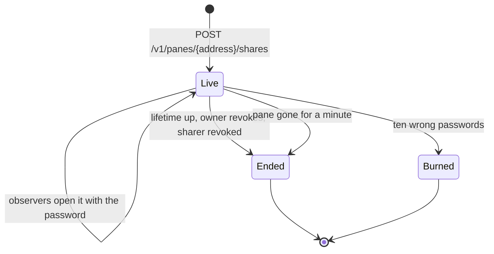

# Feature: sharing a pane read-only, by invite link and password

> Status: approved by the owner on 2026-11-03. Asked for on 2026-11-03 as
> "share a pane read-only to someone with invite link + password, a QR
> code I can send as an image with a copy button; the invite leads to a
> fancy view with no options that snaps to the real resolution; the
> observer only sees what I see: no input, no file links, but web links,
> and the diff window and the file preview when I open them".

## 1. Goal

The owner wants to let one person watch one pane, for a while, without
giving them a token: a link and a password, sent apart, that open the
pane's screen in a browser, as it is, read only. The observer sees the
screen live at the size the owner's clients gave it, follows a web
address printed in it, and sees the file or the diff the owner opens
over it; nothing else. The share ends by itself, with the pane, or when
the owner revokes it.

Out of scope: writing through a share, sharing more than one pane in a
link, a share for a native client (the link is a web page; Android gets
a *share* action that opens the same window as a follow-up), the
observer's own preview, diff, history, inbox, events or talk.

## 2. Design

### The share

A **share** is a hub record: a random id (128 bits, in the link), a
password hash, the pane it shows (host and tmux pane id, so it follows
the pane when it moves), who made it, when it ends. It is made by a
principal with a **write grant** on a writable pane: a writer could pipe
the screen anywhere already, so a share adds convenience, not reach; a
reader cannot share what was only lent to them. Shares live in
`hub.json` beside the tokens, so a hub restart does not end them.

A share ends when its lifetime is up (1 hour, 24 hours by default, 7
days at most, never past the sharer's own expiry), when the owner
revokes it, when the sharer's token or user is revoked or expires, when
the pane is gone from the host's listing for a minute, or after ten
wrong passwords (the link may have leaked: the share is burned and the
owner's log says so).



### The observer

The link is `https://hub.example.com/s/<id>`. The page asks for the
password; a right one sets a cookie that is a **share session**, with
its own cookie name and a `Path` of that share's API prefix, so it never
travels with a request for anything else and does not replace the
owner's own session in the same browser. The observer's whole API is
under `/v1/share/{id}/`: the pane's screen, the owner's *showing*, and
nothing else. The observer is not a principal: the grant code never
sees a share session, and every other endpoint answers it as it answers
a request with no credential.

```mermaid
sequenceDiagram
    participant O as Owner (web)
    participant H as Hub
    participant V as Observer (web)
    participant A as Agent
    O->>H: POST /v1/panes/alice-laptop/work/0.0/shares {ttl}
    H->>H: write grant? writable pane? hash the password, store
    H-->>O: 201 {id, url, password (once), expires}
    O->>O: the window: link, password, QR of the link, copy buttons
    O-->>V: the link, and the password by another way
    V->>H: GET /s/<id> (the page), POST /v1/share/<id>/open {password}
    H->>H: lockout? constant-time check; wrong: count, burn at ten
    H-->>V: 204, Set-Cookie muxway_share (Path=/v1/share/<id>)
    loop every second
        V->>H: GET /v1/share/<id>/pane?ansi=1 (cookie + client header)
        H->>A: read %3 (the hub's 1 s cache)
        H-->>V: the screen, the pane's size, ETag
    end
    V->>H: GET /v1/share/<id>/showing?after=0&wait=30
    O->>H: PUT /v1/share/<id>/showing (the diff the owner opened)
    H-->>V: {rev: 1, showing: {kind: diff, path, view, type, bytes}}
    V->>H: GET /v1/share/<id>/showing/file
    O->>H: DELETE /v1/share/<id>/showing
    H-->>V: {rev: 2, showing: null}
```

### What the observer sees

The route `/s/<id>` renders the **observer's view**: the brand (not a
link), one header row naming the pane as the owner's tab does (the mark,
the name, the place dimmed) with `read only · shared · until <time>`,
and the screen under it, with the page's look: scanlines, glow,
vignette, power-on. No tab strip, no pane buttons, no profile, no input
line, no key bar, no command row, no selector, no help. `t` and `m`
(theme, effects) are the only keys, since they change the observer's
own eyes and nothing else.

- **Size.** The observer never sends a resize. The screen is drawn at
  the size the host has, which is the size the owner's fit gave it, and
  scaled to the observer's box, as a tile with fit off is drawn. So the
  observer sees exactly the owner's columns and rows, smaller or larger.
- **Links.** A web address in the text, and an OSC 8 link whose target
  is `http` or `https`, is a link as in the pane view: a click opens it
  in a new tab and nothing reaches the host. A path of the inbox or of
  the host's preview roots is text: the page is given no roots and no
  file handler, and the hub answers no file to a share session anyway.
- **The owner's window.** When the owner opens a file over the pane
  (a path, an inbox file, a change of the repository) on a page where
  that pane has a live share, the owner's page sends the hub what it
  shows: the kind (`file` or `diff`), the path, the view (`rendered`,
  `plain`, `diff`, `file`), and the bytes it has, up to 8 MiB. The
  observer's page long-polls the showing and opens the same window over
  its screen: the bar with the path and the size, the content as the
  owner sees it (Markdown rendered or plain, code with its colours, a
  diff with its rows, an image, a PDF), and no `⤓`, no switch, no close:
  it closes when the owner's does. The owner's switch (`rendered` /
  `plain`, `diff` / `file`) is sent as a change of the view; a change of
  the file is sent whole. A showing the owner's page stops refreshing
  (closed tab, lost network) is dropped by the hub after ten minutes.
- **The end.** When the share ends the page says `this share has
  ended` over the last screen and stops asking.

### What the owner sees

- A `⇗` pane button (*share*, key `s`) on the focused tile, in both the
  pane view and the window view, enabled on a writable pane. It opens
  the **share window** over the page: the pane's name in its bar; the
  live shares of this pane, each with when it ends and *revoke*; and
  the form: a password, filled with a generated one (`xxxx-xxxx-xxxx`
  from `a-z2-7`, 60 bits), editable, 8 to 64 characters; a lifetime
  (`1 h`, `24 h`, `7 d`); *create*.
- After *create* the box shows, once: the link, the password, a QR code
  of the **link alone**, and the buttons *copy link*, *copy password*,
  *copy image* (the code as a PNG on the clipboard, through the
  browser's clipboard API, from a canvas the page draws the code on;
  where the browser refuses images on the clipboard the button says so
  and `⤓` saves the PNG instead), `⤓ save image`, *done*. The code does
  not hold the password: the link and the password are meant to travel
  apart, and an image that opens the pane by itself is a token in a
  picture. The password is shown once, as a token's secret is; after
  *done* the hub has only its hash.
- A tile whose pane the principal shared carries `⇗ n` in its header,
  dim, before the changes count, so the owner knows they are watched; a
  click on it opens the share window. The listing says so with
  `"shared": n` on the pane, for the sharer's principal alone.
- The admin overview lists every live share (sharer, pane, until,
  observers open) with *revoke*.

```
┌ share · ✳ Claude · fixing the build · alice-laptop/work/0.0 ─────────── × ┐
│ live:  until 2026-11-04 10:12 · 1 watching                      [revoke]   │
│ ───────────────────────────────────────────────────────────────────────────│
│ password  [k7mv-3qzp-wd8n_____]   for  (1 h) (24 h) (7 d)      [create]   │
│                                                                            │
│ link      https://hub.example.com/s/3nK…      [copy link]   ▛▀▀▀▀▀▀▀▀▜     │
│ password  k7mv-3qzp-wd8n                      [copy password] ▌ ▛▀▜ ▄▀ ▐   │
│ send the link and the password apart; the   [copy image]   ▌ ▙▄▟ ▀▄ ▐     │
│ image holds the link only                     [⤓ save image] ▙▄▄▄▄▄▄▄▄▟   │
│                                                              [done]        │
└────────────────────────────────────────────────────────────────────────────┘
```

### Components touched

- Hub: `shares.go` (the record, the store in `hub.json`, the lifetime
  sweep, the pane-gone sweep from the listing, the password check and
  burn, the showing slot per share), routes under `/v1/panes/{address}/shares`,
  `/v1/shares` and `/v1/share/{id}/`, the share cookie, `shared` in the
  listing for the sharer, the admin overview and revoke.
- Agent: nothing. The observer's read is the hub's ordinary read of an
  exposed pane, with the sharer's name as the actor's and the share's
  handle after it, so the host's audit says a share read it.
- Web: `pages/Share.tsx` (the password page and the observer's view),
  `components/ShareWindow.tsx`, the `⇗` button and `s` key, the header
  count, the showing relay in `FileWindow`, the QR to PNG and clipboard,
  `router.tsx` (`/s/$id`, no session required).

## 3. Protocol and API changes

Compatible additions to v1.

**For the sharer** (bearer token or session; a write grant on a
writable pane):

| Method and path | Does |
|---|---|
| `POST /v1/panes/{address}/shares` | `{"ttl": 86400, "password": "…"}`; `password` optional (8 to 64 printable characters; without it the hub makes one), `ttl` 60 to 604800 seconds, default 86400, cut to the principal's own expiry. `201 {"share": {"id", "url", "password", "expires", "host", "pane_id", "address"}}`, the password only here. `400 bad_input`, `403 read_only`, `404 not_found`, `409 too_many` (20 live shares per principal, 200 per hub), `429 rate_limited` (one per ten seconds per principal), `503 host_offline` |
| `GET /v1/shares` | the principal's live shares: `{"shares": [{"id", "url", "expires", "host", "pane_id", "address", "watching": 1}]}` (`address` as the pane is now; absent while the pane is away) |
| `DELETE /v1/shares/{id}` | revoke; every observer's session ends; `204`, `404` (not this principal's, unless admin) |
| `PUT /v1/share/{id}/showing` | the sharer only: `multipart/form-data` with a part `meta` (JSON `{"kind": "file" \| "diff", "path": "…", "view": "rendered" \| "plain" \| "diff" \| "file"}`) and an optional part `file` (the bytes, with their type; omitted: the bytes already held stay, the meta changes). `204`; `400 bad_input`, `413 too_large` (over 8 MiB), `404` |
| `DELETE /v1/share/{id}/showing` | the sharer only; `204` |

**For the observer** (no principal; the share cookie after `open`,
with the `X-Muxway-Client` header as every cookie):

| Method and path | Does |
|---|---|
| `GET /v1/share/{id}` | `{"share": {"expires": 1767225600}}` or `404 not_found`; no authentication; says whether the link is live and nothing more |
| `POST /v1/share/{id}/open` | `{"password": "…"}`; `204` and `Set-Cookie: muxway_share=…; Path=/v1/share/{id}; HttpOnly; Secure; SameSite=Strict`; `401 unauthorized` counts toward the address lockout and the share's ten; `404` after a burn; `429` as sign-in |
| `GET /v1/share/{id}/pane?lines=&ansi=1` | the pane as `GET /v1/panes/{address}` answers, `pane` without `mode`, `talk`, `mail`, `attention.choices` or `shared`, with `ETag`; `404` when the share ended, `503 host_offline` |
| `GET /v1/share/{id}/showing?after=N&wait=30` | `{"rev": 3, "showing": {"kind", "path", "view", "type", "bytes"}}` or `{"rev": 4, "showing": null}`; long-polled like events |
| `GET /v1/share/{id}/showing/file` | the bytes, their type, `nosniff`, `no-store`, `ETag` by rev |
| `POST /v1/share/{id}/close` | ends the observer's session; `204` |

The listing (`GET /v1/panes`, the tree, a pane read) may carry
`"shared": 1` on a pane, the number of live shares the requesting
principal made on it; absent otherwise. The admin overview gains
`"shares": [{"handle", "by", "host", "pane_id", "address", "expires",
"watching"}]`. A share session is rate limited as a principal is (20 a
second, bursts of 40), keyed by its session.

Text mode: none of this; the observer is a browser.

## 4. Security analysis

- **What an attacker gains.** With the link and the password: one
  pane's screen, read only, for the share's life, and the files the
  owner chooses to open over it. With the link alone: the knowledge that
  a share exists, and ten guesses before it burns, each counted toward
  the address lockout. With the password alone: nothing. With a share
  cookie: the same as the password, until the share ends; the cookie's
  path keeps it off every other endpoint.
- **Grants.** Creating, listing, revoking and showing need the sharer's
  write grant on a writable pane, checked on every call against the
  pane's current address (the share holds the pane id). A share ends
  with its sharer's access. The observer has no grant: the share's
  handlers read one pane by id, through the hub's ordinary read of an
  exposed pane, and the agent's own enforcement stands (an unexposed
  pane is refused there whatever the hub asks).
- **Nothing beyond the pane.** The observer's endpoints are the five
  above. No hosts, listings, events, inbox, talk, mail, files, preview,
  git, resize, input, answer, windows, transcribe or admin: each answers
  a share session as it answers no credential. The suite proves it for
  every one.
- **The password** is hashed with PBKDF2-HMAC-SHA256 (the standard
  library's, 210 000 rounds, a 16-byte salt per share) and compared in
  constant time; the hub keeps the hash only, shows the password once
  in the create answer, and never logs it. Generated passwords are 60
  bits; a typed one is the owner's choice, 8 characters at least.
- **Guessing.** A wrong password counts toward the address lockout (ten
  in ten minutes) and toward the share's own ten, after which the
  share is deleted and logged `share burned`. The id is 128 random bits
  and is not guessed; `GET /v1/share/{id}` on a wrong id is `404`.
- **The id in the URL.** The protocol says tokens never go in URLs. The
  id is not a token: it opens nothing without the password, and the
  page the owner sends is the way an invite reaches a browser. The web
  page sends `Referrer-Policy: no-referrer` already, so the id does
  not leak from a link the observer follows.
- **The showing.** The bytes come from the owner's browser, which had
  them under the owner's write grant; the hub holds them in memory for
  the share and serves them to its observers alone, `nosniff`,
  `no-store`, as the preview does. The hub reads nothing from the host
  for the observer. The slot holds one showing per share, replaced or
  cleared by the owner, dropped ten minutes after the last `PUT` and
  with the share. The observer's page builds elements from the parse
  (Markdown, code, diff) as the file window does, never from HTML.
- **Input that crosses a boundary.** The password (printable, 8 to
  64), the ttl (a bounded integer), the meta (fixed kinds and views, a
  path of up to 1024 bytes without control characters), the file (up to
  8 MiB; a text type must be UTF-8 without control bytes but tab,
  newline, return, an image must sniff as itself, a PDF too, anything
  else is refused). The observer sends nothing but the password and
  the polling cursors.
- **The cookie.** `muxway_share`, `HttpOnly`, `Secure`, `SameSite=Strict`,
  `Path=/v1/share/{id}`, honoured only with the client header, like the
  session cookie; the share's API is not in the CORS list, so no other
  origin can call it with it. It is a separate cookie, so opening one's
  own link does not sign the owner out, and a share session never
  becomes a principal.
- **Logging.** The hub logs a share's creation (sharer, host, pane id,
  expiry, the share's handle: a separate random name, never the id),
  each open (handle, address), each failure (handle, address), a burn,
  a revoke (by whom), an expiry, the pane gone, each showing (handle,
  kind, bytes, the path's length) and its clearing. The host's audit
  log sees the reads as the sharer's with the handle after the name.
  Never the password, the id, the cookie, the screen or the file.
- **Dependencies.** None added: `crypto/pbkdf2` is in the standard
  library since Go 1.24; the QR encoder is the project's own; the PNG
  comes from the browser's canvas.
- **Content security policy.** Unchanged: `img-src blob:` and
  `frame-src blob:` are allowed already for the file window; the canvas
  is the page's own.
- **The owner's decisions wanted** (section 2 assumes the first of
  each): the write grant is the grant to share (or: any read grant, and
  a share never outlives the sharer's); the code holds the link alone
  (or: the password in the fragment, so one image opens the pane); the
  observer sees the pane's name (or: only *shared pane*).

## 5. Privacy check

Docs, fixtures and tests use `hub.example.com`, `alice-laptop`, `work`,
`alice`, `bob` and the e2e hub's own addresses. The share id and
password in the docs are made up (`3nK…`, `k7mv-3qzp-wd8n`) and no
generated one is committed. Screenshots come from the e2e run only.

## 6. Test plan

| # | Test | Kind | Expected |
|---|------|------|----------|
| 1 | a share cookie on every endpoint outside `/v1/share/{id}/`: hosts, panes, a pane read by address, input, answer, resize, files, preview, git, windows, events, inbox, talk, mail, transcribe, me, admin | e2e-security | each answers as with no credential (`401`, or the `404` the route gives) |
| 2 | the share cookie of share A on share B's endpoints | e2e-security | not sent by the browser (path); sent by hand, `401` |
| 3 | ten wrong passwords from one address | e2e-security | `401` each, the address locked out after ten, the share gone (`404` on `GET /v1/share/{id}`), `share burned` in the log |
| 4 | a wrong id, a revoked share, an expired share, a share whose sharer's token was revoked, a share whose pane was closed | e2e-security | `404`; an open observer's next poll gets `404` and the page says the share has ended |
| 5 | create by a reader; by a writer on a read-only pane; by a writer on another pane than the one it may write; 21 shares; a ttl of 8 days or 59 s; a 7-character password | e2e-security | `403 read_only` ×3, `409 too_many`, `400 bad_input` ×3 |
| 6 | `PUT …/showing` by another writer; by the observer; with a 9 MiB file; with an HTML type; with a `view` outside the list; with a path of control characters | e2e-security | `404`, `401`, `413`, `400`, `400`, `400` |
| 7 | the hub's log and the host's audit log after a full flow | e2e-security | the handle, addresses, kinds, byte counts; never the id, the password, the cookie, the screen or the file |
| 8 | the create answer, the share window after *done*, the page's storage | UI (e2e-security) | the password is nowhere after *done*; the QR's markup carries no text |
| 9 | the observer's page: DOM has no input, key row, strip, buttons; `i`, `:`, `f`, `g`, `x`, `Enter` do nothing; a click on the screen sends nothing (no input in the audit) | UI (e2e-security) | as stated |
| 10 | a path printed in the pane (preview roots on) and an inbox path, in the observer's view | UI (e2e-security) | plain text, no link, no request |
| 11 | create, open with the password, the screen shows and follows output | UI | screenshots `113-share-window`, `113-share-password`, `113-share-view` |
| 12 | the owner fits the pane to 120×40; the observer's window is small | UI | the observer's screen is 120×40, scaled; no resize in the audit |
| 13 | an `https://` address and an OSC 8 link in the pane | UI | links, open in a new tab |
| 14 | the owner opens a Markdown file, switches to plain, opens a diff from the changes window, closes it | UI | the observer's window follows each step within two seconds, no `⤓`, no switch; closes with the owner's; screenshots `113-share-showing-md`, `113-share-showing-diff` |
| 15 | *copy link*, *copy password*, *copy image*, `⤓ save image` | UI | the clipboard holds the link, the password, a PNG decoding to the link (the e2e browser's clipboard permission granted); the download is a PNG |
| 16 | `⇗ 1` on the tile's header and `"shared": 1` in the listing for the sharer; absent for another principal | UI + e2e | as stated |
| 17 | the admin overview lists the share; *revoke* there ends it | UI | the observer's page says ended |
| 18 | the password hash, the generator, the showing slot's expiry, the pane-gone sweep | unit | as stated |

## 7. Documentation

- `docs/features/share.md`: new, with the diagrams above, the window
  sketch, the observer's view, the security section.
- `docs/protocol/v1.md`: the share section (the tables above), `shared`
  in the pane's fields, the admin overview's `shares`, feature
  detection (`POST …/shares` answers `404` on an older hub).
- `docs/features/web-client.md`: the `⇗` button, the share window, the
  observer's view, a security line.
- `docs/features/admin.md`: shares in the overview.
- `docs/ARCHITECTURE.md`: trust boundaries, a share as the fourth kind
  of caller, with its one-pane surface.
- `docs/ui-guideline.md`: §1.6 a row *share the pane read-only* (web
  `s`, `⇗`; Android follow-up; glasses and MIDP none); §2 the
  observer's view as web-only (the link is a web page).
- `README.md`: one line.
- A tracking issue in muxway-android for the *share* action.

## 8. Implementation steps

1. Hub: the share record and store, create, list, revoke, the sweeps;
   unit tests; tests 5 and 18.
2. Hub: open, the share cookie, the lockout and burn, the observer's
   pane read with the audit actor; tests 1 to 4 and 7.
3. Hub: the showing slot, `PUT`, `DELETE`, the long poll, the file;
   test 6. Admin overview and revoke.
4. Protocol page and `share.md` (sections 2 and 3 as written here).
5. Web: `/s/$id`, the password page, the observer's view; specs 9 to 13.
6. Web: the share window, the `⇗` button, `s`, the QR to PNG and the
   clipboard; specs 8, 11, 15, 16.
7. Web: the showing relay in the file window; spec 14. Admin page;
   spec 17.
8. `make web`, the remaining docs, the guideline, the Android issue.
   Run, record, pull request.

---

## Review (after implementation)

- [ ] Diff matches the plan, deviations explained here
- [ ] Security rules (AGENTS.md section 2) hold
- [ ] Privacy check passed: `scripts/prepush-check.sh` clean and diff read
- [ ] Docs and diagrams updated

## Test run

Pending.
