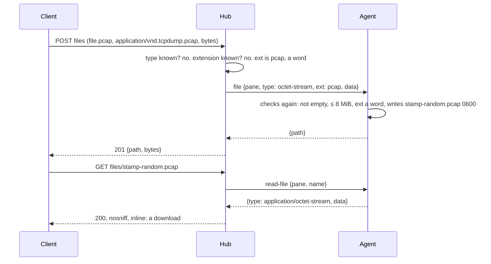

# Feature: any file into the inbox

Issue: notmarkopadjen/muxway#267. Android follows in muxway-android#87.

## 1. Goal

The `⇪` button, a paste and a drop refuse every file that is not one of
nine types. A packet capture, a spreadsheet, a source file or a binary
cannot be handed to the program in a pane, and the picker does not even
offer them. The owner wants any file taken, with the extension the
program in the pane needs to know what it got (`.pcap`, not `.bin`).

Out of scope: a bigger file than 8 MiB; unpacking anything; showing new
kinds in the file window beyond what a preview already shows.

## 2. Design

The inbox keeps its nine **known** types exactly as they are: checked
against their bytes, named by the type. Everything else is a new third
way, **bytes**: kept as it came, under an extension that comes from the
client's file name, reduced to one word of one to eight lowercase letters
or digits (the part after the last dot, lowercased), or `bin` when there
is none. The hub resolves the type: the part's `Content-Type` when known,
else the known type the name's extension names (a `shot.PNG` sent as
`application/octet-stream` is a PNG and checked as one), else bytes. The
agent checks the extension again with the same rule before it names the
file.

Reading back, a name of the inbox may end in any such word. The known
extensions are served as before; any other as a preview would serve a
file of that extension: text extensions as `text/plain`, anything else as
`application/octet-stream`, a download. Nothing is ever served as a page.

Components: `internal/wire/file.go` (the rules: `NamedExt`, `FileExt`,
`FileTypeByExt`, the name pattern, `ValidFile` for bytes), the hub's
`readFilePart` (resolves type and extension, logs both), the agent's
`saveFile` and `readFile` (checks again; types an unknown name as a
preview does), the web client (`fileType`, `fileExt`, the picker without
a filter, the inbox-link pattern), the protocol page and the feature
page.

## 3. Protocol and API changes

Compatible, same version. `POST /v1/panes/{address}/files` takes any
`Content-Type`; the part's `filename` contributes its extension. The
inbox name pattern becomes `^[0-9]{8}-[0-9]{6}-[a-z0-9]{6}\.[a-z0-9]{1,8}$`
for `GET /v1/panes/{address}/files/{name}`, and the answer's type for an
unknown extension is the preview's. The agent op `file` carries `ext`.
A hub older than this answers `415 unsupported` to an unknown type, as
before; an agent older than this refuses an unknown type with
`bad_input`, which the hub answers as `415`.

## 4. Security analysis

- **What an attacker gains**: a principal with a write grant on a pane
  can already type any command into it, so writing an unchecked file
  into the inbox adds no right. What the inbox still guards: the file's
  name (the agent's, never the client's), its place (the inbox only),
  its mode (`0600`, no execute bit), the limits (8 MiB, 500 files, 256
  MiB, one every two seconds), and what comes back to a reader.
- **Input across the boundary**: of the client's file name only the word
  after the last dot is taken, lowercased, and only when it matches
  `^[a-z0-9]{1,8}$`; it is checked by the hub and again by the agent. No
  dot, slash, backslash, space or control character can reach a path.
  The declared type is parsed by `mime.ParseMediaType`; a bad one is
  bytes.
- **What comes back**: the known types as before. An unknown extension is
  typed as a preview types it: text extensions as plain text, which the
  browser never renders as a page (`nosniff`, no `text/html` ever), and
  the rest as `application/octet-stream`, a download. An `.html` or
  `.svg` file therefore comes back as plain text. The web client shows a
  download for anything it cannot show.
- **Text smuggling**: a known text type is still checked for control
  bytes. A `.py` or a `.csv` sent as bytes is not, as a file copied to
  the host by hand would not be; the page says so.
- **Logged**: hub and agent audit lines carry the resolved type and the
  extension, never the client's name or the content.
- No new dependencies.

## 5. Privacy check

Fixtures are synthetic (a 24-byte pcap header, a two-pixel PNG, `MZ`);
names are `alice-laptop` and `shot.png`; no real host, person or secret.

## 6. Test plan

| # | Test | Kind | Expected |
|---|------|------|----------|
| 1 | `TestSec116` | e2e-security | a known type that lies, declared or named, is `415`; nothing is written; an empty part is `415` |
| 2 | `TestSec207` | e2e-security | a pcap, a name with `../`, an upper-case PNG, an html and a sh land as `.pcap`, `.bin`, `.png`, `.html`, `.sh`, `0600`, bytes intact; come back as octet-stream or plain text with `nosniff`; audit lines carry `ext=` and never the name |
| 3 | `TestSec131` | e2e-security | a name with two extensions, an upper-case one or a nine-letter one is `400` before the agent hears of it; a well-formed absent `.svg` is `404` |
| 4 | `TestSec118`, `TestSec130` | e2e-security | unchanged: the agent names the file, reading needs the read grant |
| 5 | `TestValidFile`, `TestFileNames`, `TestNamedExt` | unit | the rules above, edge by edge |
| 6 | `links.test.ts` | unit | an inbox path of any short extension is a link; two extensions, upper case, nine letters are not |
| 7 | spec 80 "of any type" | UI | the picker has no `accept`; a lying PNG toasts `unsupported`; a `Capture.PCAP` lands as `.pcap`; screenshot `80-any-type` |

## 7. Documentation

`docs/protocol/v1.md` (files POST, files GET, the `file` op),
`docs/features/attachments.md` (what goes, diagrams, security), this plan.

## 8. Implementation steps

1. wire: the rules and their unit tests.
2. hub and agent: resolve, check again, log the extension.
3. web: no filter, the extension in the part's name, the link pattern.
4. e2e tests, specs, docs.

---

## Review (after implementation)

- [x] Diff matches the plan; no deviations
- [x] Security rules (AGENTS.md section 2) hold: see section 4
- [x] Privacy check: `scripts/prepush-check.sh` clean and diff read
- [x] Docs and diagrams updated

## Test run

Recorded in the test-run issue linked from the pull request.
