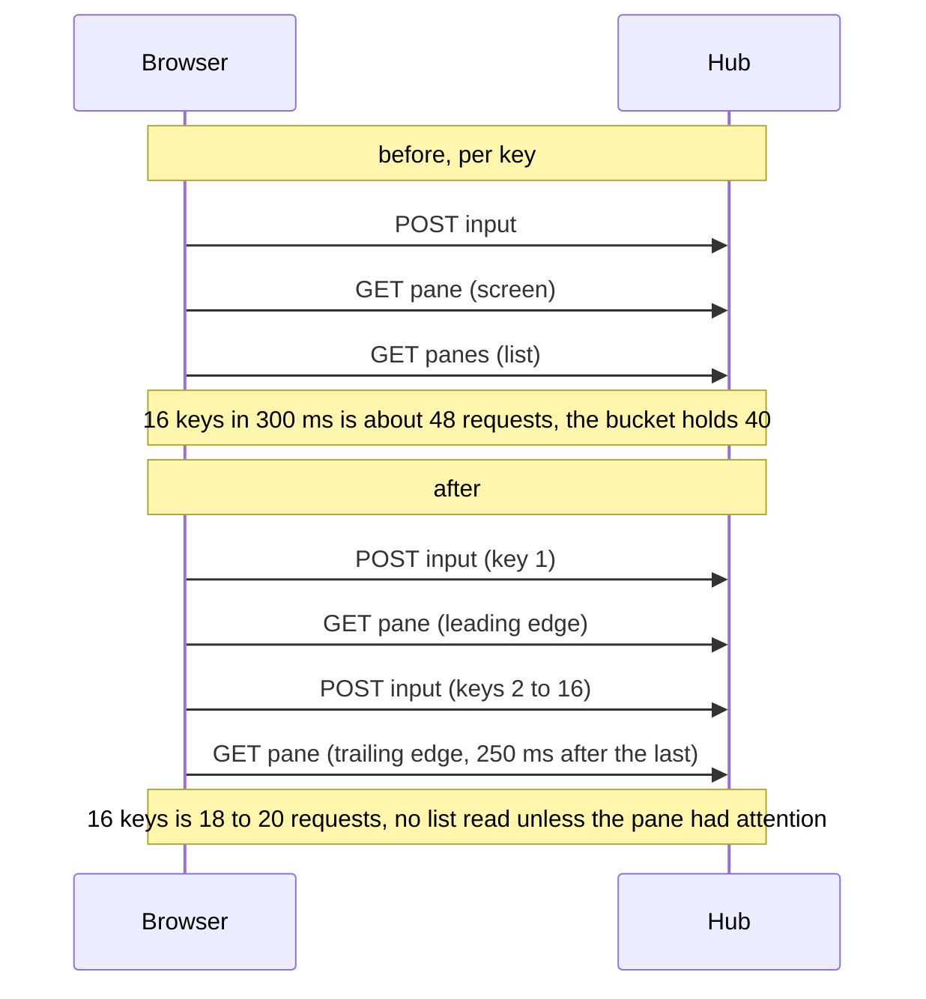

# Feature: input settles once per burst

A fix for the flaky browser spec "84 keys pressed in a burst reach the pane
in order", which is a real loss of keys in the web client.

## 1. Goal

About one CI run in five loses that spec (main at 71a48fd and the merge
commit of #262, both on 2026-11-04) and fourteen specs after it: one key
of sixteen comes back `429 rate_limited`, the client drops it, the spec
never reaches its cleanup, and `cat -v` with a fitted window stays in the
shared pane for every spec that follows.

The cause is the client, not the hub. After every key the web client
refetches the pane's screen, the pane list and the host's tree, so one
key is three requests; sixteen keys in 300 ms on a fast runner is about
48 requests against a bucket of 40 refilled at 20 a second. A person who
types fast, or holds a key on an older host that takes no count, loses
keys the same way, with a toast for each.

Goal: a burst of keys costs the hub about as many requests as it has
keys, so the rate limit stays the backstop it is meant to be, and the
spec holds. Out of scope: the hub's rate and burst, the backlog's
coalescing, and the native clients (each has its own refresh; a parity
check is a question for their issues, not a change here).

## 2. Design

`useInput` in `web/src/api/queries.ts` runs one `onSuccess` per request:
it invalidates the pane's screen, the pane list of its hub and the host's
tree. An invalidated query that is mounted refetches at once, and the pane
view mounts the screen and the list (the strip), so every key is one
input and two reads, three with the tree on the panes page.

Two changes, both in the client:

- **The screen settles once per burst.** A per-address throttle with a
  leading and a trailing edge: the first key of a burst refetches the
  screen at once (the echo a person waits for), keys within the next
  250 ms fold into one refetch after the last of them, and then the
  window opens again. New module `web/src/api/settle.ts` with a small
  `Settle` class (`run(key, fn)`), pure and unit-tested; `useInput` keeps
  one instance for the module.
- **The lists refetch only when there is something to clear.** Input
  clears a pane's attention; that is the only thing input changes in a
  list. So the pane list and the tree are invalidated only when the pane,
  as the open view or some list has it, carries `attention`. The lookup
  is the one `Shell.tsx` already does in `known`; it moves to
  `knownPane(qc, address)` in `queries.ts` and both call it. A pane
  without attention costs no list read; the lists keep their own 5 s poll.

The mouse bodies of a pane in mouse mode and the window view's input go
through the same hook and gain the same.

What a burst of sixteen keys costs, before and after:

Numbers for the spec's burst: sixteen inputs, two or three screen reads,
no list read, plus the page's own polling (the screen once a second, the
list every five, one long poll). Well under forty, with room for a
slower or a faster runner.

## 3. Protocol and API changes

None. The hub, the agent and the wire are untouched; the client sends the
same requests in the same order and fewer reads.

## 4. Security analysis

- An attacker gains nothing: the change is in client code and makes the
  client ask less. The hub's per-token rate (20 a second, bursts of 40)
  is unchanged and still refuses a flood; the backlog still drops a
  refused key with a toast rather than retrying it.
- Authentication and grants: unchanged; every input still needs the
  write grant and goes through the same handler.
- No input crosses a new trust boundary; the throttle holds a timer per
  address and no content.
- Nothing new is logged or stored. No new dependency.
- A client that reads less cannot see more: the screen after a burst is
  the same read it was.

## 5. Privacy check

Synthetic fixtures only (`alice-laptop`, `work:0.0`); no real host,
person or secret in code, docs or the spec. The spec's screenshot is
taken against the test environment.

## 6. Test plan

| # | Test | Kind | Expected |
|---|------|------|----------|
| 1 | security: a flood past the bucket is still refused with `429 rate_limited` (existing `TestSec101_TalkStaysUnderTheRateLimit`) | e2e-security | unchanged, stays green |
| 2 | security: a refused key is dropped with a toast and the next goes (existing `Backlog` unit tests, `direct.test.ts`) | unit | unchanged |
| 3 | `Settle`: the first call runs at once, calls within the window fold into one trailing call, a call after the window runs at once again, two keys are independent | unit (vitest) | as stated |
| 4 | `knownPane` finds the pane in the open view, then the hub's list, then the tree, with the hub's name on another hub's pane | unit (vitest) | as stated |
| 5 | 84 keys pressed in a burst: sixteen keys arrive in order, and the hub saw at most 24 requests during the burst, sixteen of them inputs and none a pane list (counted with `page.on('request')`); screenshot `84-burst` | UI | passes on every run |
| 6 | 47 a question's badge clears on input (existing) | UI | unchanged: the pane carried attention, so the list was read |
| 7 | 85, 87, 91, 92, 96: the specs the cascade took (existing) | UI | green in a full run |

## 7. Documentation

- `docs/features/direct.md`: the "held key" paragraph and the Limits
  bullet say the screen is read once per burst and a list only when the
  key cleared attention.
- `docs/features/web-client.md`: the sentence on keys in a burst gains
  the same.
- The spec's comment counts requests, not keys.
- This plan, with its review and run.

## 8. Implementation steps

1. `web/src/api/settle.ts` and its test.
2. `knownPane` in `queries.ts`, `Shell.tsx` calls it; `useInput` settles
   the screen and reads the lists on attention only.
3. Spec 84 counts the burst's requests; comment fixed.
4. Docs.
5. `make web`, `make lint`, `make test`, full `make e2e`, run recorded;
   pull request from `input-settle`.

---

## Review (after implementation)

- [ ] Diff matches the plan, deviations explained here
- [ ] Security rules (AGENTS.md section 2) hold
- [ ] Privacy check passed: `scripts/prepush-check.sh` clean and diff read
- [ ] Docs and diagrams updated

## Test run

Link to the recorded run: result, commit, logs, screenshots.
