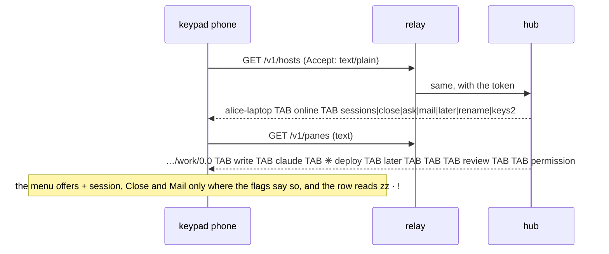

# Feature: the parity pass of 2026-11-04, the core's side

Issues: #286 (the guideline, README and feature pages), #287 (the web's
own gaps), #288 (text mode for the keypad phone). The clients' sides are
muxway-android#88 and #87, muxway-glasses-even#73 and #74, muxway-midp#46
and #47, each with its own plan in its repository.

## 1. Goal

A pass over every row of `docs/ui-guideline.md` §1 against the four
clients found the clients ahead of the words and the web behind the table
in a few places. This plan brings the core to parity in three steps that
ship as one pull request: text mode gains what the phone needs, the web
follows its own table, and the guideline, README and pages say what each
client does today and name the rows the three client pull requests will
bind. Out of scope: any native client code (their repositories), a new
protocol version (everything here is an addition old clients ignore), the
glasses' and MIDP's reading cadences (theirs, recorded as such).

## 2. Design

### 2a. Text mode (#288)

Text mode's rule stays: columns are added at the end and a reader ignores
the ones it does not know.

- `GET /v1/hosts`: a third column, the host's features that are on,
  joined by `|` in a fixed order: `sessions|close|preview|repeat|ask|mail|later|dir|rename|keys2`
  (`keys2` for `keys: 2`). An offline host has it empty. One column rather
  than ten, so the phone finds a flag with `indexOf` and the row stays
  short on GPRS.
- `GET /v1/panes`: a tenth column, `pending`: the attention's kind while
  the pane is parked (`permission`, `question`, `idle`, `done`), empty
  otherwise. The ninth column (`kind`) keeps reading `later` for a parked
  pane, so a client of 0.8.0 still shows its mark; a new one draws
  `zz · !`.
- `GET /v1/inbox`: a sixth column, the same `pending`.
- The inbox count: no change. A text client counts the rows of the inbox
  it already reads, or the listing's non-empty `kind` column, which counts
  the parked panes with the rest as the inbox does. `text-mode.md` says
  so.

### 2b. The web (#287)

- Idle is `z` in `components/Badge.tsx`, as the table, Android and MIDP
  have it; `web-client.md` follows.
- The host line's third state: `nothing exposed` on the line of an online
  host with no pane in the listing (`pages/Panes.tsx`), the body's "no
  panes exposed" kept.
- Help: the `n` line goes; lines for `g`, `e` / `E` and the pane view's
  `=` come.
- The window view: the add menu's capture listener stops propagation of
  `+`, so one press opens the menu and does not scale the cell; a spec
  proves it.
- `d`: the key asks nothing on a read-only tile or a host that does not
  park, as the `☾` button already does not.
- `⇄`: stays as it is (drawn while nobody is signed in; signed in, the
  profile menu's *hubs*); the guideline row says so.

### 2c. The guideline, README and pages (#286)

The guideline is changed first, as §4 asks, and names every cell the
client pull requests will bind. The changed cells, in order of §1.6:

| Row | Android | Glasses | MIDP |
|---|---|---|---|
| pick several | as is | hold, then taps; up to three columns, *open N side by side* | — |
| next / previous pane | as is | the menu's *next pane* / *previous pane* on a single pane; the scroll between columns | D-pad left / right (2.0; 1.0 where the bytes allow) |
| close the pane | asks `end session <session> on <host>?` for the last pane | *close* in the pane page's menu, confirmed | *Close* on a writable pane's menu, confirmed; where the host's text flags say `close` |
| the inbox | as is | rows carry the notice's text and a question's choices | as is |
| open the oldest | as is | *Go to*: the oldest waiting pane of the inbox, parked skipped | as is |
| park / wake | as is | *later* / *wake* in the pane page's menu, and on a list or inbox row (follow-up dropped) | *Later* / *Wake* on the pane's menu (follow-up dropped); after `zz` the mark of what waits, from the `pending` column |
| messages | replies indented, the text wrapping to 200 characters | the `mail n` row under the inbox row opens the messages page, oldest at the top, the count cleared | *Messages* on the list's menu, `7` on the pane; `GET /v1/talk` in text mode |
| the mail window | as is | the pane menu's *mail*, and a pane's row in the messages page, open the mail page | *Mail* on the pane's menu opens the mail list; `GET /v1/panes/{address}/mail` in text mode |
| mail the open pane | as is | by voice (*say it*) or from the phone pane's box, confirmed; *mail back* on a received mail | a text box like Reply; *mail back* aims at the sender; where the host's flags say `mail` |
| lay the partner beside | *⇆ partner beside* in the pane menu (a tab or a header held still) | the pane menu's *partner beside* opens the columns with the partner | — |
| add menu, + pane, + session | as is | a `+ pane` row under a writable window, `+ session` on a host whose flags allow it (the name by voice, from the phone pane, or a default), confirmed | `+ pane` and `+ session` commands on the list's menu where the flags say so, confirmed |
| lay the focused tile across | *across: width* / *across: height* in the pane menu | — | — |
| a command of the row | as is | the answers page's command rows (Claude Code's by the lens, a shell's starters), confirmed | a *Commands* list on the pane's menu (2.0) |
| a console key from an empty line | as is | the answers page: Left, Right, PageUp, PageDown, Home, End join Up, Down, Tab, Shift-Tab, Enter, Esc | the Keys list; the D-pad scrolls |
| theme | as is | the phone pane: amber by default, green, paper | a setting on the 2.0 build: amber, green, paper |
| help | a help sheet from Settings listing the gestures | the hint on every page | the Keys line in Settings |

New rows: pane view `1`–`4` focus a tile and `Enter` opens the focused
tile alone (web); list `j` / `k`, `g` then a letter, `/` (web); window
view `0`, `x`, `+` / `-` (web, §2); the share window's password,
lifetime, watching count, copy and save image (web; Android's sheet has
the password and the lifetime); the keyboard window's click sound (web);
the help overlay's *notifications*, *forget*, *a file opens with* (web;
Android's settings have the last two). Fixes: the §1.4 sketch with ten
buttons; `☾` in the disabled list on a host too old; `admin` in the
profile menu; the command row's count (24); §2's share line no longer
calls the native clients a follow-up (Android has the sheet; the glasses
and MIDP observe in a browser only); §1.1 says the glasses and MIDP put
the program after what it says (`notes.md · vim`) only until their pull
requests land; §1.3 and §1.4 record the cadences as each client's own
(Android 15 s list, 2 s and 4 s panes by its *every* setting; the glasses
every 10 s list, 3 s pane by *follow*; MIDP by *Auto refresh*, 10 s
default, over GPRS).

README: *Only here* gains **share** (a read-only link with a password,
for one person, with the observer page) and **talk and mail** (panes that
talk framed as one group, `✉ n`, the messages window, mail that is never
typed); *The web client* gains a paragraph each for pane names and the
folder, the changes window, the shell helper, the window view and hubs
as peers, in the voice of the existing ones, with the feature page links
in the list; `exposing-panes.md` is linked under *Why*; the three native
rows are rewritten to what each has today; `later` and `connect` join
the verb lists, `agy` the hooks comment; the PWA paragraph moves under
"nothing to install"; "parked for later from any client" becomes true
with this pass and stays.

Pages: `web-client.md` gets a *Talk and mail* section and the missing
keyboard rows (`N` `T` `M` `L` `=` `-` `Enter` `H`), the `n` line
dropped, idle `z`, `i` and `:` told apart; `mail.md` and `talk.md` drop
the stale follow-ups and say where each client stands; `text-mode.md`
lists every endpoint with a text form (hosts, panes, a pane, inbox,
events, alias, pane mail, talk, transcribe) and the new columns;
`ARCHITECTURE.md` gains later, naming, preview roots, the directory
listing, transcription, the keyboard grammar, the window view, hubs as
peers and share in its duties and its flows (share, mail, transcription
as sequence diagrams); `docs/protocol/v1.md` the columns and examples.

## 3. Protocol and API changes

Three text-mode columns, each at the end of its row, documented in
`v1.md` under `/v1/hosts`, `/v1/panes` and `/v1/inbox`, and in the
feature detection table ("a text client reads the host's flags from the
third column; a hub older than this gives two"). Compatible: v1 stays.
JSON is untouched.

## 4. Security analysis

- Abuse: nothing new is reachable. The flags repeat what JSON gives the
  same token; `pending` repeats the attention's kind, which the listing
  already carries for an awake pane.
- Grants: unchanged; the rows are filtered by the token's read grants as
  before.
- Input: none crosses a boundary; the columns are ASCII from fixed sets.
- Logging: nothing new is logged.
- Dependencies: none.
- The web changes bind no new key and widen no request; `d` asks less,
  not more.

## 5. Privacy check

Examples use `alice-laptop`, `bob-desktop` and `hub.example.com`; the
specs run against the test hub; no screenshot is taken on a real machine.

## 6. Test plan

| # | Test | Kind | Expected |
|---|------|------|----------|
| 1 | text hosts: a token without a read grant on a host | e2e-security | the host is not in the rows, flags or not |
| 2 | text panes: a read-only token on a parked pane | e2e-security | the row carries `later` and `pending`, `mode` `read` |
| 3 | hosts text row of an online host with every flag, and of an offline host | unit | `name\tonline\tsessions|close|…|keys2`; `name\toffline\t` |
| 4 | panes and inbox text rows of a parked pane with a permission underneath, and of an awake one | unit | tenth / sixth column `permission`; empty when awake |
| 5 | a hub answer read by a two-column reader (the midp harness's parser) | e2e | the first two columns unchanged |
| 6 | web: idle glyph in the list, a tile, the inbox and a toast | UI (spec 120) | `z`, screenshot |
| 7 | web: an online host with nothing exposed | UI (spec 120) | the line says `nothing exposed` |
| 8 | web: help lists `g`, `e`, `E`, `=`, not `n` | UI | the overlay's text |
| 9 | web: `+` in the window view | UI (spec 120) | the add menu opens, the cell's share is unchanged |
| 10 | web: `d` on a read-only tile | UI | no request leaves (route count) |
| 11 | `make lint`, `make test`, the dist check | unit | green |
| 12 | docs: every Mermaid block parses | UI | the Playwright render check |

## 7. Documentation

As §2c: `ui-guideline.md`, `README.md`, `web-client.md`, `mail.md`,
`talk.md`, `text-mode.md`, `inbox.md` (the `pending` column),
`notifications.md` (later's text form), `ARCHITECTURE.md`,
`protocol/v1.md`. Done in the same commits as the behaviour they
describe.

## 8. Implementation steps

1. The guideline: the cells above, the new rows, the fixes (one commit,
   first, so the client sessions read it).
2. Text mode: the three columns, their unit tests, `v1.md`,
   `text-mode.md`, `inbox.md`, `notifications.md`.
3. The web: Badge, Panes, Help, AddMenu, Pane (`d`), spec 120, `make web`.
4. README, `web-client.md`, `mail.md`, `talk.md`, `ARCHITECTURE.md`.
5. `make e2e`, the run recorded as a test-run issue, the pull request
   (closes #286, #287, #288), redeploy after the merge.

## 9. Run

- 2026-11-04 21:36 UTC, commit 23381cc: `make e2e`, 248 tests, 0 failed,
  recorded as [#292](https://github.com/notmarkopadjen/muxway/issues/292);
  the targeted run of spec 120 before it, 20261104-210347 at e62d786, was
  green on the spec and red on three Go checks that counted the text
  columns exactly, fixed in 5def017 and 23381cc.
