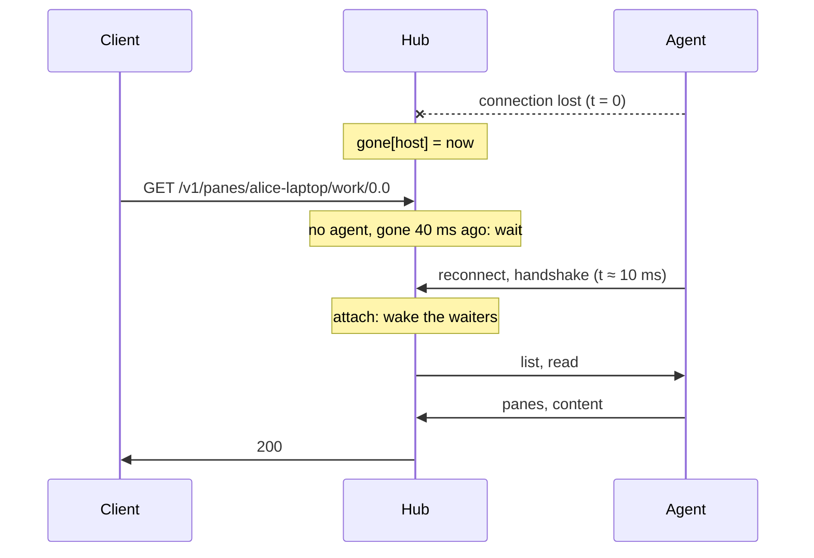
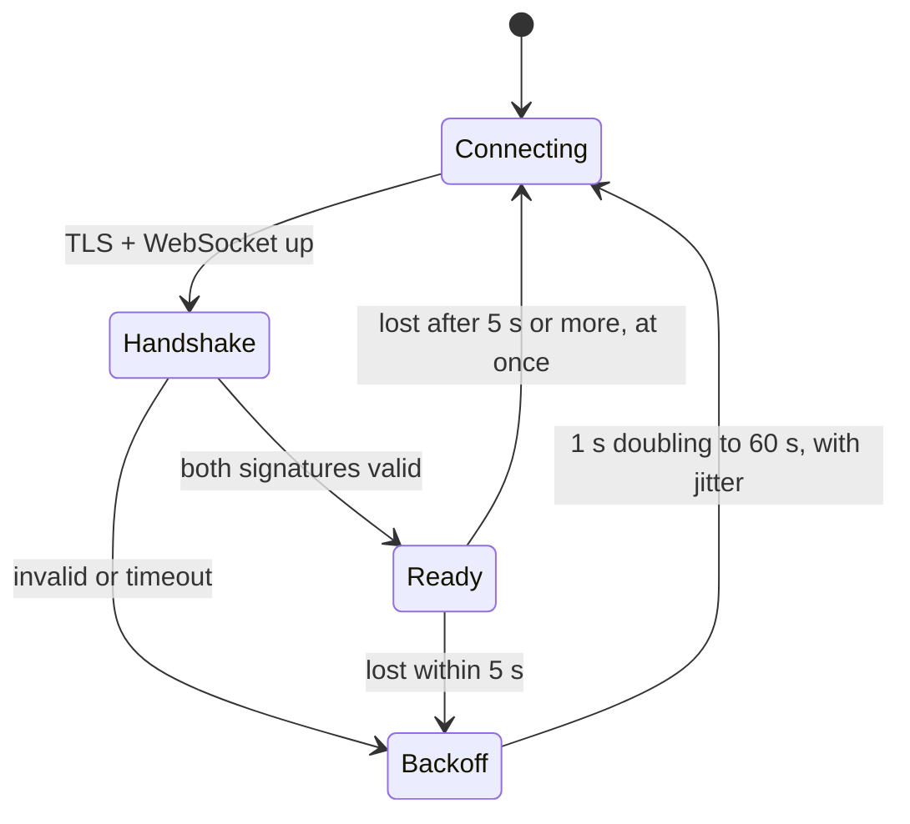

# Feature: the reconnect gap, and a parked pane's name leaning

Issues [#260](https://github.com/notmarkopadjen/muxway/issues/260) (a bug)
and [#258](https://github.com/notmarkopadjen/muxway/issues/258) (web parity
for *later*), in one change.

## 1. Goal

Two in sixteen local runs lost a browser spec to `503 host_offline`
while the host's agent was reconnecting: the agent had dropped its hub
connection with `message failed authentication` and was back 1.4 s
later. Find why a frame failed to open, stop it, and make the gap, when
it still happens (a hub restart, a cut line), cheap for clients: the
agent retries at once, the hub waits a moment for an agent it just
lost before it answers `host_offline`.

Beside it, the web client draws the name of a parked pane in italics in
the tile's header and the window view's cell header, as the owner asked
for Android and the guideline now says.

## 2. Design

### Why a frame failed to open

`secure.Session` seals every frame with an implicit counter as nonce;
the receiver's counter must match. `Session.Write` advanced the counter
*before* the websocket write, and the websocket write took the caller's
context. The hub writes a request to the agent under the client's HTTP
request context: when the browser gives a fetch up (a page closing, a
component re-rendering: a sign-in fires dozens at once, and the logs
show the drop right after `signed in` every time) while that write is
queued behind another frame on the socket, the library returns
`context canceled` from its frame mutex **without sending anything and
without closing the connection**. The counter had moved on, so the next
frame went out sealed with a nonce one ahead of what the agent expected:
`message failed authentication`, which rightly ends the connection.
The same path exists on the agent's side for events and mail, under a
hook's request context.

So:

- `Session.Write` detaches the write from the caller's cancellation
  (`context.WithoutCancel`, a fixed 10 s bound instead): a frame on a
  counter-chained channel is all or nothing, and a caller that gave up
  must not skip it. The counter advances after a successful write only,
  and a write that failed poisons the session: every later `Write`
  returns the same error, since the wire's state is unknown. A write
  that times out lets the library close the socket, so both sides
  reconnect; a poisoned session never sends a frame the peer cannot
  open.
- `Session.Read` names the frame in the error when it fails to open:
  the receive counter and the length (`message failed authentication
  (frame 57, 1234 bytes)`). Neither is a secret, and the agent's warning
  line then says whether it was drift or a stray frame, which is what
  #260 asked a debug log for.

### The gap, when it still happens

- **Agent.** The retry loop keeps its doubling backoff from 1 s to a
  minute with jitter for connections that fail quickly (a hub down, a
  handshake refused, two agents fighting over one name). A connection
  that held for five seconds or more is retried **at once**, then the
  backoff applies if that fails. A hub restart therefore costs one
  refused dial and about a second, not 1 s plus jitter after the hub is
  back.
- **Hub.** `Hub.await(ctx, host)` returns the host's agent, or, when the
  host's agent dropped within the last **3 s**, waits for a new one to
  attach (or the grace or the request's context to end). Every client
  request that would answer `host_offline` goes through it (`readable`,
  `locate`, the hosts list's `online`, new panes, mail to another host,
  shares); the admin status, `hub agents` and the share sweeper do not,
  so an operator and the tests see the drop at once. `attach` clears the
  mark and wakes the waiters; `detach` sets it only when the connection
  that ended was the current one (a replaced connection is not a gap).

### The parked name (web)

One rule: `.mx-tile-head[data-state='later'] .mx-title-name` and the
cell header's twin are `font-style: italic`. The folder and the status
already lean; now the name does too while the pane is parked, upright
again when woken. Nothing else changes: no inversion, no pulse, no glow.

## 3. Protocol and API changes

None to the shape of any message. `503 host_offline` keeps its meaning;
the hub now takes up to 3 s to say it for a host it lost just now. The
protocol page says so.

## 4. Security analysis

- A frame that fails to open still ends the connection: tampering and
  replay look exactly like this, and the fix is on the sender, never a
  tolerance on the receiver.
- The error now carries the receive counter and the frame length. They
  say nothing about keys or content.
- A write bounded by a fixed timeout instead of the caller's context
  cannot be held open by a client: the client's request still returns
  when its context ends; only the frame itself completes or kills the
  connection.
- The hub's wait is bounded (3 s, and the request's own context) and
  costs one goroutine per waiting request, which is what a request
  costs anyway. It is keyed by host and set only by a real agent
  connection ending, so an unauthenticated party cannot make the hub
  wait.
- The agent's immediate retry happens once per connection that held;
  the lockout for failed handshakes is untouched, and a failing agent
  still backs off.

## 5. Privacy check

Nothing new is logged but a counter and a length. Tests and docs use the
placeholder hosts.

## 6. Test plan

- `internal/secure`: a write under a cancelled context still goes out
  and opens on the far side; a write that fails poisons the session
  (the next write returns the error, nothing further reaches the peer);
  an open failure names the frame.
- `e2e` (Go): a request in the reconnect gap is answered by the
  returned agent (stop the agent, wait for the hub to notice, ask, start
  the agent within the grace: `200`); a host still gone after the grace
  answers `503`; the agent's log after a hub restart says it retried at
  once, and never `failed authentication`.
- Browser spec 118: the parked tile's name is italic and upright again
  when woken; the window view's cell header the same.
- Security: a tampered or replayed frame still fails (existing test).

## 7. Documentation

`docs/ui-guideline.md` (the *later* row's paint), `docs/features/notifications.md`,
`docs/features/hub-and-agent.md` (operations: the gap), `docs/ARCHITECTURE.md`
(the agent's state diagram), `docs/protocol/v1.md` (`host_offline`).

## 8. Implementation steps

1. `secure.Session`: detached, bounded, poisoning write; the named open
   failure; tests.
2. Agent retry at once after a held connection.
3. Hub `await` and its call sites.
4. e2e Go tests, spec 118, the CSS rule and the rebuilt dist.
5. Docs and this plan.

## Review (after implementation)

(see below)

## Test run

(see below)
