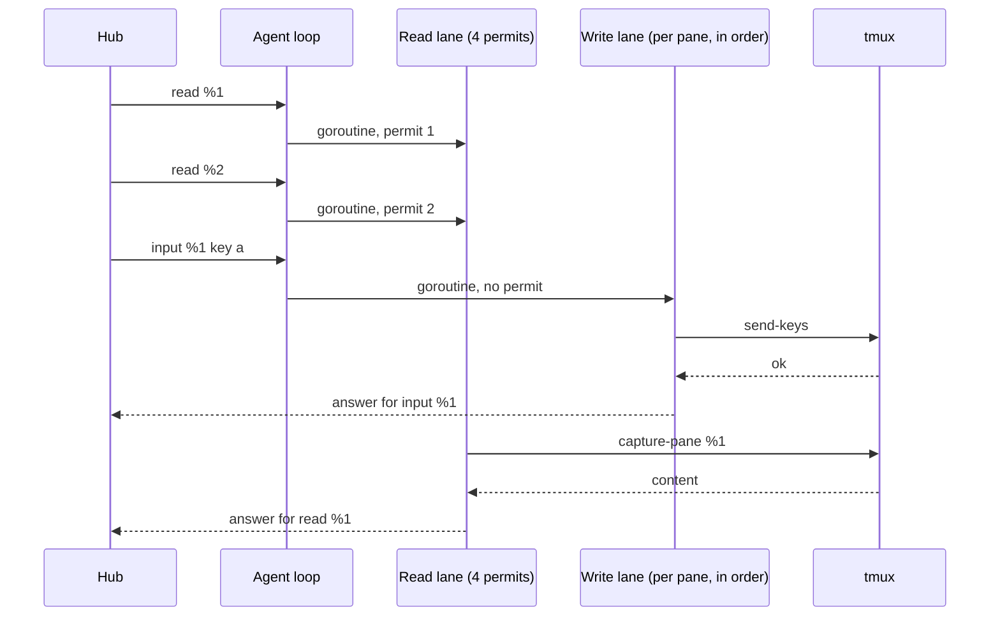
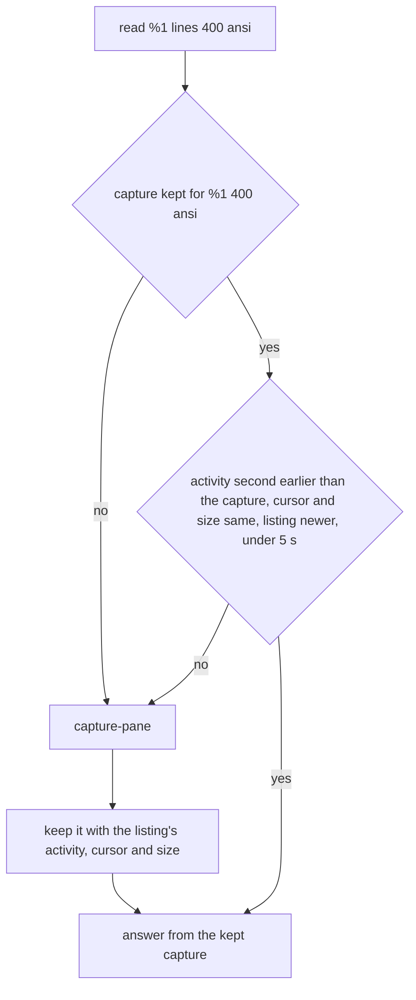

# Feature: the agent serves requests in lanes, and an unchanged pane costs no capture

Issue [#291](https://github.com/notmarkopadjen/muxway/issues/291). Branch `agent-lanes`.

## 1. Goal

With many tiles open, some of them panes that type or mail into each other,
a key typed directly into a pane arrives late. The owner saw it on
2026-11-04 on a loaded host. The cause is on the host: the agent takes
the hub's requests from one channel and serves them **one after
another**, and almost every request is one or two tmux processes. A
read is `list-panes` (to find the pane and check it is exposed) and
`capture-pane`; a key is `list-panes` and `send-keys`. Eight open tiles
read every second, a second browser or a phone reads the same panes
again, and a key waits behind all of it. The hub's `ETag` is computed
after the capture, so a `304` saves the wire and nothing on the host.

This plan makes the agent serve requests concurrently, in lanes, so a
key never waits behind a read; makes a read of a pane that has not
changed cost no capture; and lets the hub share one agent read among
clients asking for the same pane at the same time. Clients change
nothing. Out of scope: the clients' reading cadence, push instead of
polling, and the hub's rate limits.

## 2. Design

### 2a. Lanes in the agent

The agent's loop reads a request and hands it to a goroutine; the loop
goes on reading. The hub already matches answers by request id, so
answers may come back in any order. The session's `Write` is serialised
by its own lock today (the notify and mail paths write from other
goroutines), so nothing changes on the wire.

Three lanes, by op:

| Lane | Ops | Rule |
|---|---|---|
| read | `read`, `mail-list`, `dir`, `preview`, `changes`, `diff`, `file-read`, `files-probe` and every other op that only looks | at most four at a time (a semaphore); the rest wait for a permit |
| write | `input`, `answer`, `mail`, `later`, `alias` | no permit; per pane, in arrival order (a chain of done channels under the agent's lock), so two keys to one pane are typed in the order they came and the audit log keeps that order |
| shape | `split`, `new-session`, `kill-pane`, `close-pane`, `resize`, `fit`, `release`, `rename` | one at a time (a mutex): they move windows and the agent's maps of what it made and resized |

`list` is single-flighted: concurrent list requests share one
`list-panes`. The watcher's own listing every two seconds shares it too.

Every request gets a deadline of ten seconds, the same the hub gives it,
so a request the hub has given up on does not run on. In-flight requests
are capped at 256: past that the loop stops reading until one finishes,
which is today's behaviour for every request. A hub cannot make the
agent start more than four captures at once, however many clients ask.

### 2b. A listing shared by reads

Today every request lists the panes to find its pane and check that it
is exposed and, for a write, writable. Reads share a listing at most
half a second old, single-flighted, so a burst of reads is one
`list-panes`. Writes list fresh, every time, as today: the exposure and
mode check before typing stays as current as tmux is. The listing's
side effects (sweeping attention, parking, asks and mail for panes that
are gone) run under the agent's lock already and are idempotent.

### 2c. A capture reused while the pane stands still

The agent keeps the last capture per pane, lines, `ansi` and `join`. A
read answers from it when, in the listing the read uses:

- the pane's `pane_activity` second is **earlier** than the second the
  capture was taken (tmux updates it on every byte the pane shows; equal
  seconds recapture, so output in the capture's own second is never
  missed),
- the cursor, width and height are the same,
- the listing itself is younger than the capture is not, that is it was
  taken after the capture,
- the capture is under five seconds old (a ceiling, so anything the
  rules above could miss is at most five seconds late).

Otherwise it captures and stores the result. Entries go with their pane
in the listing's sweep and the store holds 256 at most, oldest out.

For an idle tile, which most tiles are most of the time, a read is then
no process at all, and the hub's `304` costs the host nothing. The
contents a client gets are the same as a fresh capture would give, by
the rules above.

### 2d. The hub shares one agent read

Several clients reading the same pane within one moment make one agent
request: a small in-flight map on the agent connection keyed by pane,
lines, `ansi` and `wrapped`; a request that finds one in flight waits
for its answer. The answer is the pane's content only; the view, the
talk and the shares around it are still built per token, so no client
sees more than its grant allows.

### 2e. What does not change

The web's cadence, `inOrder` (keys of one pane sent one at a time) and
the direct-typing backlog stay. With 2a a key's round trip is the
network plus `list-panes` and `send-keys`.

## 3. Protocol and API changes

None. No new op, endpoint, field or column. The hosts listing's flags
are unchanged. Compatible with every client and every agent: an old
agent against a new hub serves one after another as before; a new agent
against an old hub answers in any order, which the old hub already
matches by id.

## 4. Security analysis

- **What an attacker gains.** Nothing new: no new surface. A hub, or a
  token behind it, that floods reads could today keep the host busy with
  one capture after another; after this it can keep at most four
  captures running, so the flood costs the host less, and it cannot hold
  a key back, which it can today.
- **Authentication and authorisation.** Unchanged: the hub checks the
  grant before it asks the agent; the agent checks exposure and mode on
  its own listing as before. Writes keep a fresh listing, so a pane
  unexposed or made read-only is refused the moment tmux says so. Reads
  may use a listing up to half a second old; the hub's own listing is
  cached for a second already, and a read of a pane unexposed within
  that half second shows what the owner showed half a second ago.
- **Order.** Writes to one pane run in arrival order; the audit log
  records them in that order. Two clients' keys interleave as they
  arrive at the hub, which is today's behaviour.
- **Trust boundaries.** The same inputs cross the same boundaries,
  validated as before. The kept capture is content tmux gave the agent;
  it is matched by the pane id, lines, `ansi` and `join` the request
  names and never served for a different pane or a different grant.
- **Resource bounds.** Four captures at once; 256 requests in flight;
  256 kept captures of at most `MaxLines` rows each; a deadline on every
  request. The agent's lock covers every map it already covers; the
  new per-pane chain, the capture store and the shared listing live
  under it too. The unit tests and the end-to-end suite run with the
  race detector for this change.
- **Logging.** Nothing new is logged. Audit lines are unchanged.
- **Dependencies.** None added: the semaphore is a channel, the single
  flight a map and a channel.

## 5. Privacy check

The plan, code, tests and docs name no real host, person or secret;
tests use the suite's throwaway tmux and the synthetic hosts of the
harness. `scripts/prepush-check.sh` before the push.

## 6. Test plan

| # | Test | Kind | Expected |
|---|------|------|----------|
| 1 | A flood of reads from a reader token while a writer types: with sixteen reads in flight against two panes printing output, the writer's keys reach the pane, in order, and each input request answers within a bound (median under 250 ms on the suite's host, no key over 2 s); the audit log has the keys in the order sent | e2e-security | holds |
| 2 | The agent never runs more than four captures at once: the agent is started with a `tmux` wrapper first on `PATH` that counts concurrent `capture-pane` calls to a file; a flood of reads leaves the high-water mark at four or less | e2e-security | at most 4 |
| 3 | A pane unexposed between two keys: the second key is refused, with a fresh listing, under load as without | e2e-security | `403`, no key reaches the pane |
| 4 | A kept capture is never served across panes or grants: two panes, two tokens, concurrent reads; every answer carries its own pane's content | e2e-security | holds |
| 5 | Two inputs to one pane sent back to back by one client arrive in order under read load (sixty pairs) | e2e | order kept every time |
| 6 | An idle pane read every 100 ms for three seconds makes one capture (the wrapper's count); the content is the same every time; a key typed into it is seen by the next read | e2e | 1 capture, then the new content |
| 7 | Output within the capture's own second is not missed: a program prints, the pane is read, it prints again in the same second, the next read shows the second line | e2e | second line shown |
| 8 | A resize or a cursor move without new output invalidates the kept capture | e2e | fresh content |
| 9 | Capture store rules: reuse, the equal-second case, cursor, size, the 5 s ceiling, the 256 cap and the sweep | unit | table-driven |
| 10 | Per-pane arrival-order chain under the race detector: a hundred writes to three panes from many goroutines run in order per pane | unit | order kept, no race |
| 11 | The read semaphore and the shared listing: twenty concurrent reads make one listing and at most four captures at a time against a fake tmux | unit | holds |
| 12 | The hub shares one agent read: two tokens read the same pane at once; the agent's log shows one read, each answer wears its own view | e2e | one agent read |
| 13 | The existing suite, with the race detector on the agent's unit tests | e2e | green |

The run record states the input round trip measured by test 1 on this
commit and on `main` before it, on the same host.

## 7. Documentation

- `docs/features/direct.md`, How it works: the lanes, why a key does not
  wait behind reads.
- `docs/features/hub-and-agent.md`, a short "What a request costs the
  host" under Operations: lanes, the shared listing, the kept capture,
  the bounds.
- `docs/ARCHITECTURE.md`: a line in the agent's description and the
  sequence above.
- `docs/protocol/v1.md`: none, nothing changes on the wire; a sentence
  that answers may come back in any order (already true of the hub).

## 8. Implementation steps

1. Agent loop: hand each request to a goroutine with a deadline and the
   in-flight cap; answers under the session's write lock. Unit test 10's
   harness (a fake tmux via `PATH`).
2. Lanes: the read semaphore, the per-pane write chain, the shape mutex,
   the single-flighted list. Unit tests 10 and 11.
3. The shared listing for reads (half a second, single-flighted); writes
   fresh.
4. The capture store and its rules. Unit test 9.
5. Hub: the in-flight map for reads.
6. End-to-end tests 1 to 8 and 12 (new files `s30_lanes_test.go`), the
   `tmux` wrapper in the harness, the race detector in `scripts/e2e.sh`
   for the agent package.
7. Docs (section 7). Full run, recorded; the measurement in the record.

---

## Review (after implementation)

- [x] Diff matches the plan, deviations explained here
- [x] Security rules (AGENTS.md section 2) hold
- [x] Privacy check passed: `scripts/prepush-check.sh` clean and diff read
- [x] Docs and diagrams updated

Deviations:

- **The activity time is the window's**, not the pane's: tmux (3.6
  here) keeps `window_activity` and no activity time per pane, and the
  pane's own fields (cursor, size, history) miss a program that redraws
  in place. So a printing pane beside an idle one in the same window
  makes the idle one capture again; still correct, and no dearer than
  before. The docs say so.
- **A shared listing older than the kept capture is replaced by a
  fresh one** before the capture is trusted, when the listing shows the
  pane unmoved. Without it, a tile read every second with the listing
  half a second old would capture again every time (the listing could
  not say whether the pane moved after the capture). The fresh listing
  is single-flighted, so it is one `list-panes` for every idle pane read
  in that moment, where a capture is one per pane. A pane the shared
  listing already shows as moved captures without a fresh listing.
- **`file` (a file for the inbox) runs in the write lane**, per pane,
  with the other writes; the plan's table did not place it.
- **Observers' reads of a shared pane** go through the hub's shared
  read too, keyed by pane, lines and form like a client's.
- **Numbering**: the relative-paths feature took `s30` and tests
  210–213, so the lanes are `e2e/s31_lanes_test.go`, tests 214–222 (the
  plan's 1 to 8 and 12, in that order).
- The unit tests fake tmux with a script first on `PATH` that lists
  the panes given, sleeps a fifth of a second per capture and logs each
  call, so permits and single-flighting are observed, not inferred.

Measured by test 214 on this host, the suite's own flood of sixteen
readers over two printing panes, twenty keys typed meanwhile:

| | main (c26018c) | this branch |
|---|---|---|
| input round trip, median | 397 ms | 34 ms |
| input round trip, worst | 672 ms | 72 ms |
| reads the flood served in the same two seconds | 375 | 1048 |
| captures for thirty reads of an idle pane (test 219) | 30 | 1 |
| captures for sixty reads of a printing pane by two clients at once (test 222) | 60 | 30 |

## Test run

- 2026-11-05 12:29 UTC, commit d9ed0bd: `make e2e` with the race detector
  on the agent's and the hub's unit tests, 262 tests, 0 failed, recorded
  as [#297](https://github.com/notmarkopadjen/muxway/issues/297). Test
  214 measured a median input round trip of 30 ms (worst 50 ms) under
  1006 reads in that run. Three runs before it were red on one test
  each: 218 paced past the token's rate (fixed in d04ca74), the specs'
  `otherPane` meeting the hub's listing still naming a pane just closed
  (the fixture tries again, d9ed0bd), and spec 87 once, a window zoom
  landing mid-output on the shell's line; it passed alone and in the
  recorded run, with the audit order the same as main's.
