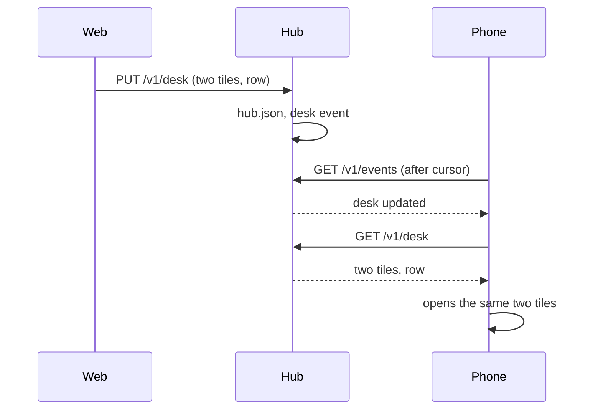

# Feature: the desk, and marks that survive a restart

Asked by the owner on 2026-11-05: a client closed and opened again, or
another client, should show what was there: the open panes and their
arrangement, the parked and minimised ones, and the chains of panes that
mail each other. Today the web client keeps most of that in the page
(lost when the tab closes), the host keeps the parked marks and the
mail in the agent's memory (lost when the agent restarts), and the hub
keeps the talk that chains panes in memory (lost when the hub
restarts). The Android client keeps its own view and sees none of it.

## 1. Goal

One **desk** per hub, kept by the hub: which panes are open as tiles,
the arrangement, the focused one, the minimised ones, the tab order, or
the window the window view shows. Every client writes the desk as the
person changes it and opens the desk when it starts, so the web client
reopened, or the phone picked up, shows what the last client showed.

And three marks that must survive a restart of the process holding
them, because they are the owner's, not a client's:

- a pane parked for *later* (the `☾` mark) survives the agent;
- the mail held for a pane's process survives the agent;
- the talk log, which chains panes that mail or type to each other,
  survives the hub.

Out of scope: the native clients' code (parity issues follow for
Android, which gets the desk, and for the glasses and the phone, which
open the desk's focused pane); the settings a client keeps for itself
(theme, font, motion, the open mode), which stay in the client.

## 2. Design

### 2.1 Parked panes live on the pane (agent)

`later` moves from the agent's map to a tmux pane option,
`@muxway-later <unix time>`, set and unset where the map was written and
read in the listing where it was read, beside the alias. It dies with
the pane, as the marks do, and survives the agent as the marks do. The
map stays as nothing: the listing reads the option.

### 2.2 Mail lives in the agent's directory (agent)

A mailbox is written to `<agent dir>/mail/<pane id>.json` (mode 0600)
whenever it changes, with the tmux server's start time, and the files
are read at start: a file for a server that is not the one running, or
for a pane that is gone, is removed, and the sweep that drops mail
after a day removes the file too. The inbox already keeps pasted files
there for a day under the same trust; mail is the same kind of thing.

### 2.3 The talk log lives in the hub's directory (hub)

The ring of 500 entries is written to `<hub dir>/talk.json` (0600) at
most once a second after a change and read at start, the sequence
continuing from the last entry. Nothing else changes: the feed shows
what it showed, the chains come from the same window.

**A decision for the owner.** Panes are chained while they talked in
the last ten minutes. That window was chosen for typed talk; mail is
slow by nature (a hook delivers it at the end of a turn), so a chain of
mailing panes falls apart during a long turn and comes back with the
next mail, which is what the owner saw as "blank until they start
communicating again". The plan proposes **a chain lasts as long as the
mail does, a day**, for mail; typed talk keeps its ten minutes. The
guideline's §1.2 says so afterwards. If the owner prefers ten minutes
for both, only the persistence lands.

### 2.4 The desk (hub)

One document per hub, in `hub.json` beside the tokens:

```json
{
  "view": "panes",
  "panes": ["alice-laptop/work/0.0", "alice-laptop/work/1.1"],
  "focused": "alice-laptop/work/1.1",
  "arrangement": "custom",
  "tree": {"kind": "h", "key": "r", "children": [0, 1]},
  "weights": {"r": [0.6, 0.4]},
  "minimised": ["alice-laptop/work/1.2"],
  "order": ["alice-laptop/work/0.0", "alice-laptop/work/1.1"],
  "updated": 1793900000,
  "by": "web"
}
```

or `{"view": "window", "window": "alice-laptop/work/1", ...}` for the
window view. `GET /v1/desk` answers it with the panes the principal may
not read left out (and `304` on the ETag); `PUT /v1/desk` replaces it
and stamps `updated` and `by` (the principal's name). The hub then
appends a `desk` event to the event stream, visible to every principal,
carrying `updated` only, so an open client asks for the desk once
instead of polling.

Validation: `view` one of `panes`, `window`; up to four panes by the
address grammar, no pane twice; `focused` among them; `arrangement` one
of the six; `tree` with as many leaves as panes, keys short; `weights`
numbers between 0 and 1 under keys of the tree; `minimised` up to 16
addresses; `order` up to 64; the body under 8 KiB. Any pane named must
be one the principal may read.

**Who may write it.** The desk is the owner's and shared by the
owner's devices; a principal with a write grant on any pane may write
it, a read-only principal may only read it, an observer (a share) sees
nothing of it. A hub used by several people with write grants shares
one desk; the page says so and recommends read-only tokens for guests.

### 2.5 The clients

**Web.** The pane view and the window view write the desk, debounced
half a second, on every change of the tiles, the arrangement, the
weights, the minimised row, the focus and the tab order; the tab order
leaves the browser's storage for the desk. On a visit to `/`, the list
is shown as now, with a `desk` row at the top (and `D`) that opens the
desk; a client that was in the pane or window view when it was closed
opens the desk at once when it starts, unless the address bar names a
view (a link still goes where it points). An open client applies a
`desk` event from another client, the panes, the arrangement and the
minimised row within a second, so two screens side by side show the
same; the focus is restored on opening only, so typing on the phone
does not move the web's focus. Its own write in flight is not undone:
a desk whose `updated` is older than the client's last change is
ignored.



**Android, the glasses, the phone.** Parity issues: Android reads and
writes the desk as the web does; the glasses and the phone open the
desk's focused pane from their lists.

## 3. Protocol and API changes

Compatible, no new version:

- `GET /v1/desk`, `PUT /v1/desk` as in 2.4, with `400 bad_input`,
  `403 read_only` (no write grant) or `403 not_yours` (a pane the
  principal may not read), `413 too_large`, `429 rate_limited` (one
  write a second per principal, a burst of five), `404` from the
  observer's side.
- The event stream gains the kind `desk`, visible to every principal.
- The pane listing is unchanged (`later`, `later_at`, `talk` and `mail`
  as they are); `talk` partners last a day for mail if the decision
  above is taken.

## 4. Security analysis

- **The desk** names panes, never content. Reading it reveals which
  panes the owner has open, filtered to what the reader may read
  already from the listing. Writing it moves other clients' views: a
  write grant is required, observers cannot reach it, and the body is
  validated field by field and capped. A hostile client can at most
  rearrange the owner's devices' views, within the panes it may read.
  The write is audited on the hub (principal, size).
- **Mail on disk** puts mail bodies (up to 4000 characters, already in
  memory today) under the agent's directory, 0600, beside the inbox
  files that already hold pasted content; swept with the same lifetime.
- **The talk log on disk** puts the 200-character head of typed texts
  and mail (already in memory today) in the hub's directory, 0600, with
  `hub.json`, which already holds the token hashes and shares.
- **Parked marks** become a pane option a person at the host could set
  by hand; it only parks a pane, which they can do anyway.
- No secrets in any of the three files, nothing logged but counts. No
  new dependencies.

## 5. Privacy check

The plan, the docs and the fixtures name `alice-laptop`, `work/1.1`
and `web` only. The browser specs run against the test hub.

## 6. Test plan

| # | Test | Kind | Expected |
|---|------|------|----------|
| 1 | A read-only token writes the desk | e2e-security | `403 read_only`; `GET` works |
| 2 | A token with one pane's grant writes a desk naming another pane | e2e-security | `403 not_yours`; its `GET` of a desk with both shows one |
| 3 | An observer's share calls `/v1/desk` | e2e-security | `404` |
| 4 | Malformed desks: five panes, a pane twice, a bad address, an unknown view, a tree with the wrong leaves, weights out of range, 9 KiB | e2e-security | `400` or `413`, the desk unchanged |
| 5 | Six writes in a second | e2e-security | the sixth `429` |
| 6 | The desk file and the talk file hold no secret, mode 0600; the hub log shows no pane name's content | e2e-security | clean |
| 7 | PUT, GET with the ETag, the `desk` event seen by another token | e2e | `304` on the ETag, the event carries `updated` |
| 8 | The hub restarts | e2e | the desk and the talk partners are as they were |
| 9 | The agent restarts | e2e | a parked pane is still parked, its mail still unread and listed |
| 10 | Mail for a pane that is gone, or from an earlier tmux server | e2e | its file is removed at start |
| 11 | Mail chain after twelve minutes of silence | e2e | still chained (if the decision is taken) |
| 12 | Spec 125: two tiles opened, one minimised, the page reloaded at `/` | UI | the desk row opens the same tiles, the minimised row, the focus; screenshots `125-before`, `125-after` |
| 13 | Spec 125: a second browser context changes the desk | UI | the first follows within two seconds; typing in the second does not move the first's focus |
| 14 | Spec 125: a link to another pane view | UI | opens the link, then writes the desk |
| 15 | Unit: desk validation, the talk ring round trip, the mailbox file round trip | unit | as named |

## 7. Documentation

- `docs/protocol/v1.md`: the desk endpoints, the `desk` event, the
  chain window if changed.
- `docs/features/desk.md` (new): what it holds, who writes it, the
  security considerations above.
- `docs/features/talk.md`, `mail.md`, `inbox.md` (later): what
  survives a restart; the chain window.
- `docs/ui-guideline.md`: the desk as a shared behaviour (§1.1 the
  list's `desk` row, §1.4 the view written and followed), the §1.2
  window, with the Android, glasses and MIDP columns.
- `docs/features/web-client.md`, `docs/features/hub-and-agent.md`
  (the files under the directories).

## 8. Implementation steps

1. Guideline rows.
2. Later as a pane option; e2e 9 (the later half).
3. Mail files; e2e 9, 10.
4. The talk file; e2e 8 (the talk half); the chain window if taken.
5. The desk in the store, validation, endpoints, event, limits; e2e 1
   to 8.
6. Web: the desk written, the desk row, the start, the event followed;
   spec 125.
7. Docs, dist, full run, review, run recorded; parity issues filed.

---

## Review (after implementation)

- [ ] Diff matches the plan, deviations explained here
- [ ] Security rules (AGENTS.md section 2) hold
- [ ] Privacy check passed: `scripts/prepush-check.sh` clean and diff read
- [ ] Docs and diagrams updated

## Test run

To be recorded.
