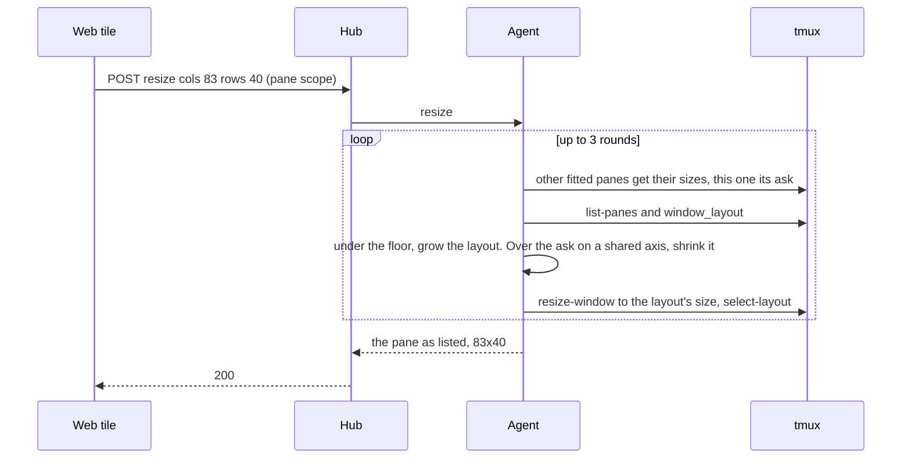
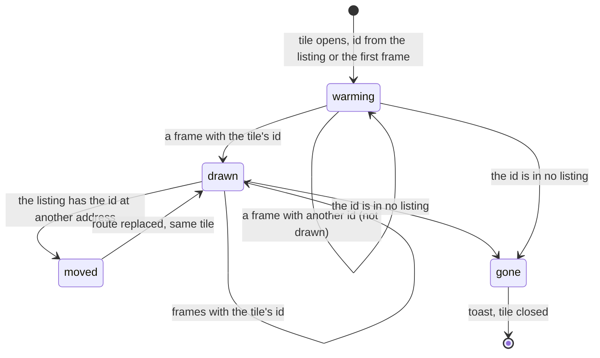

# Feature: a fit that gives the window back, a tile that shows its own pane or nothing, and the pane chords

Issues [#283](https://github.com/notmarkopadjen/muxway/issues/283) (the
window that never shrinks, a grid's fits rate limited, a zoom under the
floor), [#284](https://github.com/notmarkopadjen/muxway/issues/284) (a new
tile shows another pane for a moment) and
[#285](https://github.com/notmarkopadjen/muxway/issues/285) (`Ctrl+[` and
`Ctrl+]` cycle the panes from anywhere), in one change. The host side of
#283 is the agent's; #284 and #285 are the web client's, with the
guideline rows the native clients will follow.

## 1. Goal

**#283.** Three tiles of a four-pane window, each fitting its own pane,
end with one tile drawn scaled and the others *held* after a zoom in and
out, because `ResizePane` grows the window when a fit needs room and
never gives it back, and a window-scope zoom sizes the window to the
browser and leaves the pane that is not a tile under the 20-column
floor. A 2×2 grid of four tiles sends four fits within milliseconds;
the agent takes one resize per window per second, so three come back
`rate_limited`, are retried 1.8 s apart and each re-squeezes the others
on the shared axis. After this change: a fitted pane never keeps
columns or rows its tile did not ask for (the window shrinks by the
excess); the floor holds on every path that sizes the window, a zoom
included; and a window takes the burst a grid sends.

**#284.** A tile opened for a pane showed another pane's text for about
a second. The tile's address is a tmux position (`work/1.1`), and tmux
renumbers panes when one closes: the frame the client keeps per address
for the moment a fit is in flight may be another pane's, and a read of
the address may answer another pane as well. After this change a tile
knows the pane it was opened for by its id, draws nothing that is not
that pane's, follows the pane when the host renumbers it, and closes
when the pane is gone. While it has nothing of its own to draw it shows
a short CRT warm-up in the theme's colour instead of a blank or a
borrowed screen.

**#285.** `Ctrl+]` and `Ctrl+[` go to the next and the previous pane
from anywhere in the web client: the page, the line, the strip, direct
typing and the window view alike, coming round at the ends, direct
typing staying on so the next pane is typed into at once. The chords
never reach the pane; the literal keys come from the virtual keyboard.

Out of scope: the native clients (parity issues follow, as the
guideline asks, for the warm-up, the tile that follows its pane and the
chords on Android's hardware keyboard); the hub's one-second listing
cache, which the pane identity check makes harmless for the tiles.

## 2. Design

### 2.1 The fit gives the window back (agent)

`ResizePane` already runs rounds: the other fitted panes of the window
get their sizes, this pane gets its own, every pane under the floor
grows the layout, and the window is resized to the grown layout. One
more check joins the round: a **fitted pane wider or taller than its
ask on an axis it shares** has the excess taken off its cell with
`GrowLayout` and a negative delta (the siblings after it move over, the
cells across the split scale, nothing else changes) and the window
shrinks by the same amount. An axis the pane spans is set to the ask
already. Unfitted panes keep what they have: the floor is the only
claim they make, and the floor check runs in the same round, so a
shrink that would push a neighbour under it is grown back; three rounds
settle both. Test 177 (a narrower fit gives to the neighbour) stays:
the neighbour is unfitted and takes the difference. What changes is the
case of #283: the window grown to 340 by a zoom comes back to the three
fits' sum plus the unfitted pane's share.

### 2.2 The floor on a window resize, a zoom included (agent)

`ResizeWindow` lays the window's layout at the size asked. After the
layout is selected, every pane is checked against the floor as a pane
fit does. Without a zoom, a pane under it grows the layout and the
window with it, exactly as a pane fit would: the client sees its pane
larger than the box and says *held*, as today. With a zoom, the pane
shown alone is the window, so growing the window would make the zoomed
pane bigger than its tile: the difference is taken from the **zoomed
pane's own cell** underneath instead (`GrowLayout` on the neighbour,
the negative on the zoomed pane), which costs nothing while the zoom is
on and is refitted when the tiles come back. Only when the zoomed cell
itself would go under the floor does the window grow. The fifth pane of
#283 stays at 20 columns under a 257-column zoom instead of 12.

### 2.3 A window takes a burst (agent)

The gate `a.resized` (one resize per window per second) becomes a small
bucket per window: **four resizes at once, then one more per second**,
the depth being the most tiles the pane view opens. A release is always
taken, as now. The audit log is unchanged (`result=rate_limited` past
the bucket). The web client's retry after a 429 stays for the case a
burst still overflows; a grid of four never needs it.

### 2.4 A tile shows its own pane or nothing (web)

A `Tile` learns the id of its pane from the first listing entry or
frame it sees for its address and keeps it for its life. From then on:

- A frame whose `pane.pane_id` is not the tile's is **not drawn**, and
  the kept frame of the address (`frames`) is used only when its id is
  the tile's; a kept frame of another id is dropped. So a read answered
  for another pane (the hub's listing was a second stale), or a frame
  kept for a pane that used to sit at this address, never shows.
- `Tiles` watches the listing for each tile's id. A pane found at
  **another address** moves the tile there: the route is replaced
  (`go` with the address swapped, the focus, the arrangement and direct
  typing kept). A pane **absent** from the listing is gone: the tile
  closes with the toast it has today. Today the tile at the renumbered
  address reads the neighbour's pane and the neighbour's tile gets a
  404 and closes; after this change the pane that exited closes its own
  tile and the others keep their panes.
- While the tile has **nothing of its own** to draw (no frame yet, or
  only one that is not its pane's), its body shows the warm-up.

### 2.5 The CRT warm-up (web)

A `div.mx-warmup` over the tile's body, `pointer-events: none`, in the
theme's ink with its glow (`var(--mx-ink)`, `var(--mx-glow-text)`), so
it is amber by default, green or the paper variant's ink. One keyframe
set `mx-warmup`, 600 ms, the ease the page's power-on uses: a bright
2 px line across the middle (the beam), opening to the full height by a
third of the way with a brightness bloom, the fill fading through
settling scanlines (a repeating gradient) to transparent. The first
frame is drawn under it as it arrives, so a fast hub is never made to
look slow: the frame shows through the fading bloom. The overlay is
mounted while the tile has nothing of its own and for the rest of its
600 ms once a frame is there (`data-warm="1"` while it plays, for the
spec), then unmounted. With effects off (`data-motion="off"`, the `m`
key) or reduced motion the overlay is `display: none`: the tile is
blank until its frame arrives, as the issue asks. No spinner, no
skeleton, no text.

### 2.6 The pane chords (web)

`Ctrl+]` and `Ctrl+[` (matched on `key` `]` / `[` with `ctrlKey`, or
`code` `BracketRight` / `BracketLeft` for layouts where the key is
elsewhere, with neither `Alt` nor `Meta`):

- **The page and the line.** The pane view's key handler takes the two
  chords before its bail-outs for an input target and for modifiers:
  with several tiles the focus moves to the next or the previous tile,
  with one tile open the strip's neighbour takes its place (`neighbour`),
  round at the ends, as `]` and `[` do.
- **Direct typing.** The direct handler (capture phase, first in line)
  takes the chords before `keyToBody`, so they are never sent, and
  calls the same move; direct typing stays on, the backlog is the
  focused pane's already (it is keyed on the focus), so the next key
  lands in the new pane. `Esc` alone, `Ctrl+V` and `Shift+Insert`
  behave as today.
- **The window view** has its own `]` / `[` and its own direct typing
  handler: the same two chords move between its cells, direct typing
  kept.
- `keyToBody` is not changed: the chords are taken before it. The
  virtual keyboard sends the literal keys as it does now (`Esc` in its
  key row, `Ctrl` then `]`).
- The help lists the chords in the pane section with a line that they
  work while typing directly and that the keyboard sends the keys
  themselves.

## 3. Protocol and API changes

Compatible, no new version. `docs/protocol/v1.md`, the resize endpoint:

- "A fit never shrinks the window" becomes: a fitted pane is never left
  wider or taller than its ask on an axis it shares; the window shrinks
  by the excess, the floor and the other panes' sizes kept.
- The floor holds on a window-scope resize too: without a zoom the
  window grows as for a pane fit; with a zoom the difference comes from
  the zoomed pane's cell underneath first.
- `429 rate_limited`: "for more than one resize per second on the same
  window" becomes "above four at once on the same window, then one more
  per second".

The pane listing and the read are unchanged; the client reads
`pane_id`, which both carry already.

## 4. Security analysis

- **Burst.** A writer could already resize a window once a second; now
  four at once, then one a second. Each resize is a write the person at
  the host sees, audited as today (actor, pane, result). The bucket is
  per window, so a token with many windows gets no more per window; the
  principal's own limit (20 a second, 40 in a burst) still bounds the
  whole. A hostile hub gets the same answers it gets today.
- **Shrink and floor.** The agent computes both from tmux's own layout
  string, as it does the grow; no new input crosses a boundary. The
  floor cannot be undone by a client: a zoom that would need it grows
  the window as a last resort.
- **Pane identity.** The web client compares ids the hub already
  returns; nothing is sent. A tile that follows its pane goes only to
  an address the listing names for the same id under the same host,
  which the token could read already (it is in the listing).
- **Chords.** Two key chords fewer reach the pane than today; nothing
  new reaches the host.
- No new dependencies. No secret or pane content is logged; the
  warm-up and the follow log nothing.

## 5. Privacy check

The plan, the code, the docs and the fixtures name `alice-laptop`,
`work/1.1` and friends only. The browser specs run against the test
hub; their screenshots show synthetic panes. The sizes quoted from the
owner's report (340, 257, 39×55, 12 columns) carry no personal data.

## 6. Test plan

| # | Test | Kind | Expected |
|---|------|------|----------|
| 1 | Sec53 (updated): thirty resizes of one window in a burst | e2e-security | the first four `200`, at least 25 of the rest `429`, the window at the last size taken, the audit log shows `rate_limited` |
| 2 | Sec: the chords typed in direct typing | UI (spec 123) | the pane's input receives no `C-[`, `C-]` or `Escape` for the chords (the requests are watched); `Esc` alone is sent as `Escape` |
| 3 | Flow178: four panes in a row, the window widened by a window-scope resize to 340, then three panes fitted at 40 columns | e2e | the window is the three fits plus the fourth pane's share, no fitted pane wider than 40, the fourth at least 20 |
| 4 | Flow179: five panes, four in a row above one; a window-scope zoom to 100×20 | e2e | no pane under 20 columns, the window stays 100 wide (the zoomed cell gave the difference), the zoomed pane shown alone at 100×20; a zoom to 60 columns grows the window to what five floors need |
| 5 | Flow180: four fits of a 2×2 grid sent together | e2e | all four `200`, each pane at its ask within one round |
| 6 | Flow175, 176, 177, 59, 171, 174 | e2e | unchanged: exact fits keep the width, an unfitted neighbour takes a narrower fit's difference, the floor grows the window |
| 7 | Unit: `GrowLayout` with a negative delta | unit | the pane's cell shrinks, the siblings after it move over, the root shrinks by the same, a delta past the cell's size is an error |
| 8 | Spec 122: three of four panes as tiles, zoom in on one, zoom out | UI | after the zoom out no tile is *held*, every tile's size is its ask, the window's width (control `/window-size`) is under the zoom's; screenshots `122-tiles`, `122-zoomed`, `122-back` |
| 9 | Spec 122: a 2×2 grid of four panes of a five-pane window | UI | four fits, no `429` answer seen, no tile *held* |
| 10 | Spec 124: pane A has a marker line; pane B opened as a second tile with its read delayed 1500 ms | UI | B's tile never contains A's marker (polled through the delay), shows the warm-up (`data-warm`, animation `mx-warmup`), then B's content with the warm-up gone; screenshots `124-open`, `124-warm`, `124-settled`; with `m` the overlay's display is `none` |
| 11 | Spec 124: a pane with a marker is killed at the host and a new pane takes its address; the address is opened | UI | the new tile never shows the marker |
| 12 | Spec 124: tiles of `work/1.1` and `work/1.2` open, `work/1.1` killed at the host | UI | the first tile closes with its toast, the second tile's pane stays, the route now names `work/1.1` for it, its marker still shown; screenshot `124-followed` |
| 13 | Spec 123: two tiles, direct typing in the first, `Ctrl+]` | UI | the second tile is focused, direct typing still on, the next character lands in the second pane, round trip at both ends with `Ctrl+[`; the chords work from the line and the page too; one tile open: the strip's neighbour comes in; the window view's cells move the same; `?` lists the chords; screenshot `123-direct-next` |
| 14 | Unit: `keyToBody` | unit | unchanged (the chords are taken before it); a test that the matcher recognises `key` and `code` forms |

## 7. Documentation

- `docs/protocol/v1.md`: the resize endpoint as in section 3.
- `docs/ui-guideline.md`: the *fit* cell (the window shrinks to the
  fits, the floor on a zoom), the *tiles* cell (a tile shows its own
  pane or nothing, the warm-up, follows its pane when renumbered), the
  *next / previous pane* row (the chords, in direct typing too), the
  *direct typing* row (the chords among the exceptions). Rows first,
  then the binding, as section 4 asks.
- `docs/features/web-client.md`: the fit and the tiles sections.
- `docs/features/direct.md`: the chords beside the paste exceptions.
- `docs/features/keyboard.md`: the literal keys from the keyboard.
- The help (`?`) in the web client.
- This plan: review and run sections after implementation.

## 8. Implementation steps

1. Guideline rows for the chords, the warm-up and the fit (docs only).
2. `GrowLayout` with a negative delta; unit tests.
3. `ResizePane`: the excess check in the round; Flow178 and Flow180.
4. `ResizeWindow`: the floor, from the zoomed cell first; Flow179.
5. The resize bucket; Sec53 updated.
6. Protocol page.
7. Web: the tile's pane id, frames by id, the follow and the gone;
   spec 124 parts 11 and 12.
8. Web: the warm-up overlay and its CSS; spec 124 part 10.
9. Web: the chords in the pane view, the direct handler, the window
   view and the help; spec 123.
10. Web: spec 122 for the fit.
11. Feature pages, dist rebuilt, full run, review, run recorded.

---

## Review (after implementation)

- [x] Diff matches the plan, deviations explained here
- [x] Security rules (AGENTS.md section 2) hold
- [x] Privacy check passed: `scripts/prepush-check.sh` clean and diff read
- [x] Docs and diagrams updated

Deviations:

- **The floor on a window resize (2.2)** is one algorithm for both
  cases, not two: the layout is laid out with every part at least what
  its panes need, the parts with room giving (`scaleFloor`), under a
  zoom and without one alike, and the window grows only when every pane
  at the floor does not fit it (`LeastLayout`). The plan had the
  no-zoom case grow the window as a pane fit does; taking from the
  roomiest cell of the split is the same promise with less movement,
  and the window view's exact layout rarely meets it. The protocol page
  says what is done.
- **Gone and moved (2.4)** are decided in the tiles view from the
  listing, not in the tile: a read's 404 only marks the tile as
  missing and asks the listing again at once, because when a pane in
  the middle of a window exits, the tile of the pane after it gets the
  404 first and would have closed before the listing could show where
  its pane went. A tile whose pane the view never knew still goes on
  its 404 alone. A frame of a stranger also asks the listing again (at
  most every two seconds), so a tile follows its pane in a second or
  two rather than at the listing's five-second poll.
- **The warm-up (2.5)** holds its bright line, paused, while the tile
  has nothing of its own; the 600 ms opening plays once the first frame
  is in, so the frame comes up through the bloom, as the issue asked.
- **Spec 122** reads the pane widths from tmux itself after the zoom
  out (every fitted pane exactly its ask, the fourth at the floor or
  above, the window their sum), rather than comparing window widths
  before and after the zoom: in the test browser a zoomed window is
  narrower than three fitted tiles, so the comparison said nothing.
- The resize bucket per window is never garbage collected, as the
  timestamp before it was not; it is one small struct per window ever
  resized.

## Test run

[#302](https://github.com/notmarkopadjen/muxway/issues/302): run
`20261105-170711-9feccf7`, **passed**, 259 tests, 0 failed, at 9feccf7
(the full suite: lint, the unit tests, the dist check, the Go end-to-end
tests with the race detector, the browser specs with screenshots and
traces). An earlier full run at b27409c
(`20261105-163850-b27409c`) was red only from the new specs leaving a
window of eleven panes behind for the specs after them (Playwright runs
the files in string order, so `122-` runs before `62-`) and from the
moving-panes security test still expecting the one-per-second gate;
both fixed in 9feccf7.
