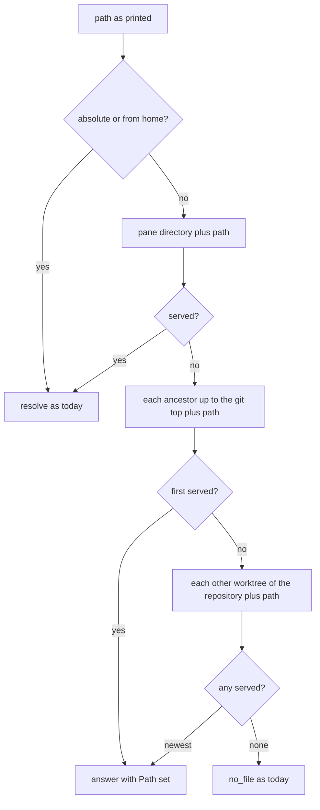
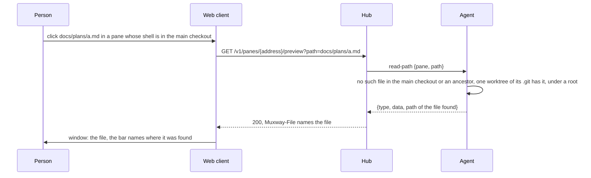

# Feature: a relative path finds its file in the pane's repository

A file link printed as a relative path opens even when the pane's shell
sits somewhere else in the same repository: a subdirectory, or the main
checkout while the work happens in a worktree.

## 1. Goal

The file window resolves a relative path from the directory the pane's
shell is in. A coding agent that works in a git worktree prints paths
relative to that worktree (`docs/plans/a.md`), but its pane's shell
never left the main checkout, so the host looks in the wrong tree and
the window says "the host does not serve this file". The owner met it
again on 2026-11-05 and said it happens often; every Claude pane on his
host sits in a main checkout and works in a worktree under a sibling
directory, and the sessions cannot be made to print absolute paths
reliably.

Goal: a relative path that misses under the pane's directory is looked
for where the same repository has it, up the tree to the repository's
top and across its worktrees, under the same rules as today (under a
root, no hidden component, no secret, a regular file). When it is found
elsewhere, the window says where. Out of scope: paths relative to
anything but the pane's repository (another repository, a search of the
roots), absolute and `~` paths (unchanged), and the native clients'
windows (the resolution lives in the agent, so they get it with no
change; showing the found path there is a parity note, not part of
this).

## 2. Design

All in the agent, in `resolvePreview` (`internal/agent/preview.go`).
The function takes a list of base directories instead of one, tries the
relative path from each in order, and answers the first that passes
every check it makes today. A new helper, `bases`, builds the list from
the pane's directory:

1. **The pane's directory.** As today; a hit here is what every link
   meant until now, so nothing a working link does changes.
2. **Its ancestors, up to the repository's top.** From the pane's
   directory upwards until the directory holding `.git` (a directory or
   a file), that one included. A shell in `web/` printing `docs/a.md`
   finds it. With no `.git` above, the list ends here.
3. **The repository's other worktrees.** Read from git's own metadata,
   no git process: when `.git` is a directory, every
   `.git/worktrees/<name>/gitdir` file names `<worktree>/.git` of a
   linked worktree; when `.git` is a file, its one line
   `gitdir: <common>/worktrees/<name>` names the common directory, whose
   parent is the main worktree, and the same `worktrees/*/gitdir` files
   name the siblings. A gitdir that does not exist or is not a directory
   is skipped (a worktree removed by hand). At most 64 worktrees are
   read, each gitdir file at most 4 KiB. When several worktrees hold the
   file, the most recently modified one wins: that is the file that was
   just written and printed; ties go to the first in directory order.

Steps 1 and 2 are first hit wins; step 3 is best of the candidates. Each
candidate goes through the unchanged tail of `resolvePreview`: symlinks
followed, under a root, no hidden component without the flag, never a
secret by name, regular and at most 8 MiB. A candidate that fails any of
those is simply not the file; the next is tried.

When the file was found by step 2 or 3, the agent puts the resolved
path in the answer's `Path`, the hub repeats it in a `Muxway-File`
header, and the web file window shows it in its bar after the printed
path, dim, so the reader sees which tree answered. A hit by step 1
sends nothing new, and a window that sees no header looks as it does
today.

## 3. Protocol and API changes

- `GET /v1/panes/{address}/preview`: the request is unchanged. The
  answer may carry a `Muxway-File` header, the path of the file on the
  host, present only when the file was not found from the pane's
  directory. The entry says how a relative path is resolved (the three
  steps above). Compatible: a client that ignores headers sees no
  difference.
- Agent op `read-path`: the answer's existing `path` field, so far used
  by the inbox, carries the resolved path in the same case. Compatible
  both ways: an old hub ignores it, an old agent never sends it.

No new op, flag, column or protocol version.

## 4. Security analysis

- **What an attacker gains.** Nothing new to read: every candidate goes
  through the same checks as a path typed in full, and a writer of the
  pane, the only one who may ask, can already read any of these files
  through the shell. What is new is where the agent looks: it reads
  `.git`, `.git/worktrees/*/gitdir` and the one-line `.git` file of a
  worktree, as metadata, never as served content; `.git` stays a denied
  directory for serving, and asking for `.git/worktrees/x/gitdir` by
  name stays `not_found`. The metadata is read by the agent with its
  own rights, so a repository under a root could point the agent at a
  worktree anywhere on the host; that worktree is a base only, and a
  file under it is served only when it lies under a root itself, so a
  forged `gitdir` line reaches nothing the owner did not name.
- **Mapping the host.** One code for every refusal stays. The new
  header is sent only with a served file, so it names nothing the
  caller could not then read.
- **Bounds.** At most 64 worktrees, 4 KiB per gitdir file, the ancestor
  walk ends at the first `.git` or at the file system's root; no git
  process, no shell, no network. The cost of a miss is a few dozen
  stats, under the same two-a-second limit.
- **Grants.** Unchanged: a write grant on a writable pane, on a host
  with roots.
- **Input.** The path is validated as before (`wire.ValidPath`); the
  gitdir contents are treated as paths only after `EvalSymlinks` and
  the root check; a line that is not an absolute path is skipped.
- **Logs.** The agent's audit line already names the path as asked and
  as resolved; it gains `found=ancestor|worktree` when a fallback hit.
  Never the content.
- **Dependencies.** None added.

## 5. Privacy check

The fixtures are synthetic temporary directories; the examples use
`docs/plans/a.md` and `alice-laptop`. No real host, path, person or
secret in the plan, the code, the tests or the docs.

## 6. Test plan

| # | Test | Kind | Expected |
|---|------|------|----------|
| 1 | Sec210: the fallback never leaves the roots: a worktree outside every root holding the file → `404`; a secret (`key.pem`) that exists only in a worktree → `404`; `.git/worktrees/w/gitdir` asked by name → `404`; a forged `.git` file whose `gitdir:` line points outside the roots → `404`; a `gitdir` file of 100 KiB of noise → ignored, `404` | e2e-security | one code for all, served nothing |
| 2 | Sec211: the audit lines name the file found and `found=worktree`, never the content; a refused fallback logs `no_file` as today | e2e-security | log lines as stated |
| 3 | Flow212: the shell in the main checkout, the file only in a worktree → `200`, body from the worktree, `Muxway-File` names it; the file in both → the checkout's copy, no header; the file in two worktrees → the newest; the shell in `web/` and `docs/a.md` at the top → `200` with the header; the shell in no repository and a missing file → `404` | e2e | as stated |
| 4 | Flow213: the same from a worktree's shell whose `.git` is a file: a path that only the main checkout has is served | e2e | `200`, header names the main checkout |
| 5 | Web spec 121: a pane prints a relative path that only a worktree holds; the click opens the window; the bar shows the printed path and the found path (screenshot `121-found-elsewhere.png`); a link that the pane's directory holds shows the bar as before | UI | as stated |
| 6 | Unit: `bases` for a plain directory, a subdirectory of a repository, a repository with two linked worktrees (`.git` dir), a linked worktree (`.git` file), a removed worktree, 70 worktrees (64 read), a `gitdir` with a relative line | unit | the lists as designed |
| 7 | Unit: `resolvePreview` with several bases: first hit wins, newest among worktrees, every existing refusal still holds from a fallback base | unit | as designed |
| 8 | The full suite with the race detector on the agent's tests | all | green |

## 7. Documentation

- `docs/protocol/v1.md`: the preview entry, the resolution steps and
  the `Muxway-File` header; the `read-path` op's `path` in the answer.
- `docs/features/preview.md`: how a relative path is found, the
  worktree case, the security notes above; the sequence diagram gains
  the lookup.
- `docs/ui-guideline.md`: the file window's bar names where a file was
  found when it is not the pane's directory (web; Android a parity
  note).
- Parity: one issue in muxway-android to show the header in its file
  sheet; the glasses and MIDP have no file window, nothing to do.

## 8. Implementation steps

1. `bases` and its unit tests in `internal/agent/preview.go`.
2. `resolvePreview` over bases, the audit field and `Path` in the
   answer; unit tests.
3. The hub's `Muxway-File` header; e2e tests Sec210, Sec211, Flow212,
   Flow213 in `e2e/s30_relative_test.go`.
4. The web window's bar and spec 121; `make web`.
5. Docs: protocol, feature page, guideline; the Android parity issue.
6. `make e2e`, record the run, PR closing the issue.

---

## Review (after implementation)

- [ ] Diff matches the plan, deviations explained here
- [ ] Security rules (AGENTS.md section 2) hold
- [ ] Privacy check passed: `scripts/prepush-check.sh` clean and diff read
- [ ] Docs and diagrams updated

## Test run

Pending.
