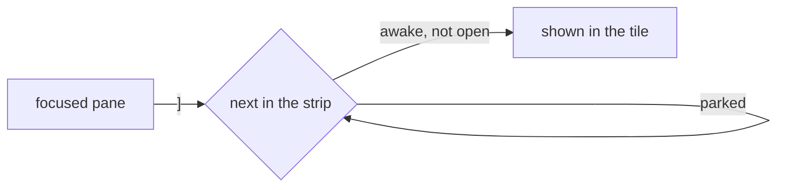

# Feature: `]` and `[` pass a parked pane over

> Status: approved by the owner on 2026-11-06 ("when I scroll through the
> panes left and right with Control+[ and ], I end up in the sleeping
> pane, which is not correct. It should be skipping the sleeping pane on
> the web").

## 1. Goal

With one tile open, `]` and `[` (and the `Ctrl` chords) show the strip's
next pane in it. The strip ends with the panes the owner parked for
[later](../features/notifications.md#later), so going round lands on a
parked pane, which the owner put away on purpose. The guideline already
has the phone's swipe and the glasses' next/previous pass them over;
the web does the same. Out of scope: several tiles open, where the keys
move the focus among the tiles on screen, a parked one included, since
focusing a tile wakes nothing and the owner chose to keep it open.

## 2. Design

`neighbour` in `web/src/pages/Pane.tsx` walks the strip from the
focused pane and takes the first address that is not open; it now also
passes an address whose listing carries `later`. With every other pane
parked, nothing happens, as with nothing else to show. Waking a parked
pane is as before: its tab, a row, the inbox, `d`.

## 3. Protocol and API changes

None.

## 4. Security analysis

None: a client-side choice of which pane a key shows, from the listing
the principal may already read. No request is made for a passed pane.

## 5. Privacy check

The test parks a pane split for it in the test environment; names are
the fixtures' own.

## 6. Test plan

| # | Test | Kind | Expected |
|---|------|------|----------|
| 1 | 118: a parked pane last in the strip; `[` from the first pane | UI | the awake pane before it shows, the parked one stays parked |
| 2 | 118: `]` round the strip | UI | every awake pane once, never the parked one |
| 3 | 118: the parked pane woken by its tab | UI | `]` and `[` reach it again |

## 7. Documentation

`docs/ui-guideline.md` (the next/previous row's web column),
`docs/features/web-client.md` (the keys' bullet and table row),
`docs/features/notifications.md` (the later section).

## 8. Implementation steps

1. `neighbour` passes parked panes; spec 118's test; docs.

---

## Review (after implementation)

- [x] Diff matches the plan: `neighbour` passes parked panes; with
  several tiles the keys move the focus among the open tiles as before.
- [x] Security rules (AGENTS.md section 2) hold: nothing is requested;
  the choice is made from the listing the principal already has.
- [x] Privacy check passed: `scripts/prepush-check.sh` clean and the diff
  read; the test parks a pane split in the test environment.
- [x] Docs updated: the guideline's next/previous row, the web client's
  keys, the later section of notifications.

## Test run

Pending.
