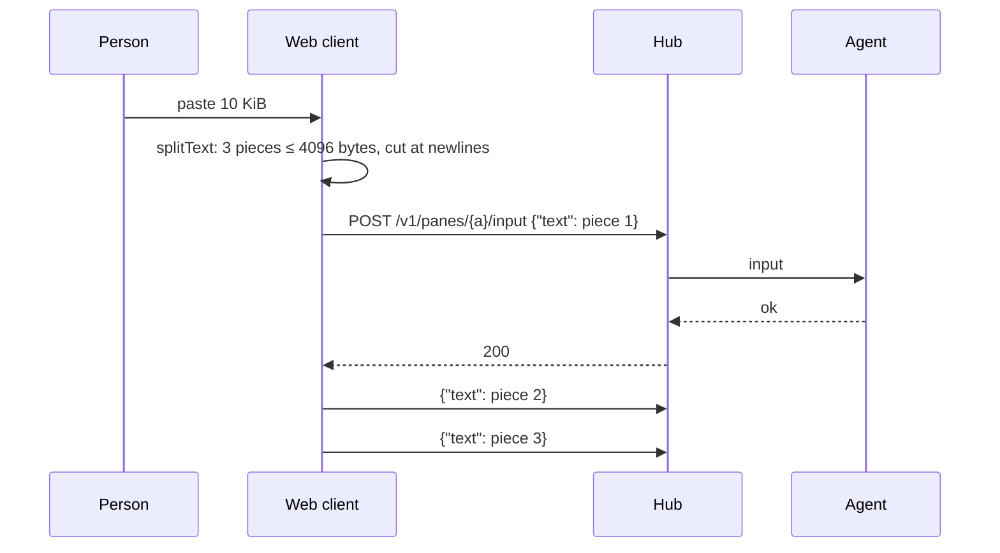

# Feature: a long paste goes in pieces

> Status: approved by the owner on 2026-11-06 ("do a client split"),
> after the report that a paste of 8.6 KiB into a pane answered the toast
> `refused bad_input` and nothing reached the pane.

## 1. Goal

A text pasted into a pane, or sent from the input line, that is longer
than the 4096 bytes one input request takes reaches the pane whole, in
the order pasted, instead of being refused. The protocol's limit stays:
the web client cuts the text into pieces of at most 4096 bytes and sends
them one after another. Out of scope: raising the limit (a public
contract and a size chosen for security), and the native clients, whose
rule is written into the guideline for them to follow.

## 2. Design

`splitText(s)` in `web/src/term/direct.ts` cuts a text into pieces: each
at most 4096 bytes as the hub measures them (UTF-8); the cut falls after
the last newline that fits, so lines stay whole where they can, and
otherwise after the last character that fits, never inside a multi-byte
character. Joined, the pieces are the text. A text within the limit is
one piece.

Both paths use it:

- direct typing: the paste handler in `Pane.tsx` pushes one body per
  piece into the backlog, which sends them in order behind the request
  in flight (two pieces never coalesce, their sum is over the limit);
- the input line: `line()` in `InputPanel.tsx` sends one request per
  piece, then `Enter`.

The agent pastes each piece with a newline through a tmux buffer,
bracketed when the program asked, and types a piece without one; so a
program takes the pieces appended. Claude Code shows a long paste as
several pasted blocks instead of one; the text it gets is the same.

## 3. Protocol and API changes

None. The request and its limit are as `docs/protocol/v1.md` has them;
the page notes that a client sends a longer text as several requests.

## 4. Security analysis

- Nothing new crosses a trust boundary: the pieces are the same input
  requests, each validated by the hub as before (size, control
  characters), each audit-logged by the agent as before.
- A paste of the most the browser holds is at most a few hundred
  requests, sent one after another behind the response of the one
  before; the token's rate limit (20 a second, bursts of 40) applies and
  a refused piece is dropped as any refused body is.
- No new dependency; nothing logged by the client.

## 5. Privacy check

The tests paste synthetic text (`line 1`, `line 2`…). No real content.

## 6. Test plan

| # | Test | Kind | Expected |
|---|------|------|----------|
| 1 | `splitText`: under the limit, at the limit, cut at the last newline, a line over the limit cut between characters, a multi-byte character at the cut kept whole, pieces join to the text | unit | as named |
| 2 | 104: a 10 KiB paste while typing direct | UI | the pane's program reads the whole text; three text requests, each ≤ 4096 bytes, none refused |
| 3 | 92: a 10 KiB text on the line, Enter | UI | three text requests then `Enter`, each ≤ 4096 bytes |

## 7. Documentation

`docs/features/direct.md` (the paste row), `docs/features/web-client.md`
(the line's multi-line paragraph), `docs/protocol/v1.md` (a note at the
text limit), `docs/ui-guideline.md` (the input row: a long text goes in
pieces).

## 8. Implementation steps

1. `splitText` and its unit tests.
2. The two call sites, the e2e tests.
3. Docs, dist rebuilt, run recorded.

---

## Review (after implementation)

- [x] Diff matches the plan. One addition: on the input line a refused
  piece ends the line, so no `Enter` follows a partial text (a shell
  would run half a command); while typing direct the backlog drops a
  refused body and sends the next, as it does for every body.
- [x] Security rules (AGENTS.md section 2) hold: the hub's limit and
  checks are untouched, each piece is one input request under the same
  grant, rate limit and audit line.
- [x] Privacy check passed: `scripts/prepush-check.sh` clean and the diff
  read; the tests paste `line n` and shell comments.
- [x] Docs updated: direct, web-client, the protocol's text limit, the
  guideline's input row.

## Test run

Run 20261106-204349-eec57c7, recorded as [issue #309](https://github.com/notmarkopadjen/muxway/issues/309): 278 tests passed, none failed, at commit eec57c7, with the new tests of specs 92 and 104.
