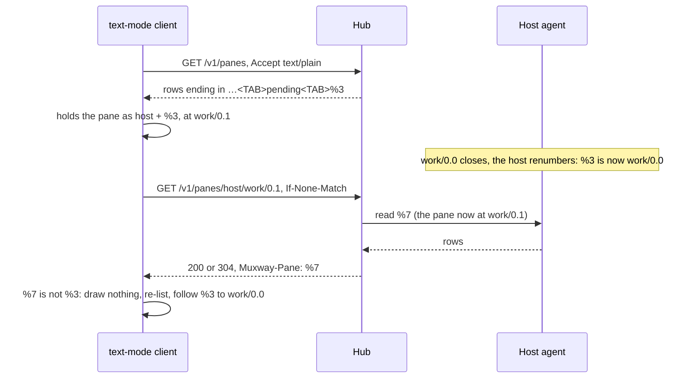

# Feature: text mode carries the pane id

## 1. Goal

The guideline's *tiles* cell (§1.4) asks every client to know a pane by
its id, draw no frame of another pane, and follow its pane to its new
address when the host renumbers it. JSON gives a client `pane_id` for
that; text mode gives nothing: the pane row and the inbox row name a
pane by address alone, and a pane read answers rows and an `ETag`. So a text-mode client cannot tell a renumbered pane from a new
one at the same address, and after a renumber it may draw a stranger's
rows for up to one listing's wait. The glasses client reads panes in
text mode, and the MIDP client is text mode throughout; both record this
as a limitation ([issue #315](https://github.com/notmarkopadjen/muxway/issues/315)).

This plan gives text mode the id: a trailing `pane_id` column on the
two text rows a client learns a pane from (the listing and the inbox),
and a `Muxway-Pane` answer header on a pane read, in both modes, so a
read says which pane answered. Out of scope: the events text row (no
client reads it: the MIDP client polls the listing and the inbox, the
glasses read events in JSON, which carries the id; a column is added
when a client needs it), the talk and mail text rows (they name the
other pane by address; a text client resolves it against the listing it
holds, and JSON already carries `from.pane_id` there), the share
observer (no text mode), and the clients' own follow logic (their
repositories' plans take this up).

## 2. Design

**The column.** The hub appends `pane_id` as the last column of each
row of the two text listings: `GET /v1/panes` and `GET /v1/inbox`, after
`pending`. The value is the pane's tmux id as the JSON gives it,
`%<digits>`, ASCII and never empty. Both listings' last column today is
`pending`, a fixed word the hub writes, so a client that splits on TAB
and reads by index sees one more field and nothing else changes.

**The header.** `GET /v1/panes/{address}` sets `Muxway-Pane: %N` on
every `200` and `304`, in text and JSON mode alike, the id of the pane
the hub located for the address and asked the agent to read. It is set
before the `If-None-Match` check so a `304` carries it too: a pane
renumbered under a client's address answers a different id, so the
client learns of the change on the very next poll, even one that costs
a few bytes. Error answers carry no header. The CORS answer exposes
`Muxway-Pane` beside `ETag` and `Muxway-File`, so a page on another
origin (the glasses' WebView) can read it.



`muxway client panes` and `inbox`, and the MCP tools `list_panes` and
`inbox`, pass the hub's text rows through, so they carry the column too.
A client older than this reads the columns it knows and never looks at
the header. A hub older than this ends the rows where they end today
and sets no header; a client takes an absent header as "unknown" and
keeps its present behaviour.

## 3. Protocol and API changes

Compatible within v1: two additions at the end of a row and one
answer header, all of which an old client ignores.

- `GET /v1/panes`, text mode:
  `<address><TAB><mode><TAB><command><TAB><title><TAB><kind><TAB><mail><TAB><talk><TAB><alias><TAB><cwd><TAB><pending><TAB><pane_id>`
  (a hub older than this ends the row at `pending`).
- `GET /v1/inbox`, text mode:
  `<address><TAB><kind><TAB><at><TAB><text><TAB><choices><TAB><pending><TAB><pane_id>`
  (a hub older than this ends the row at `pending`).
- `GET /v1/panes/{address}`: the answer header `Muxway-Pane: %<digits>`,
  on `200` and `304`, in both modes; absent on an error. Exposed to
  pages on other origins: `Access-Control-Expose-Headers: ETag,
  Muxway-File, Muxway-Pane`.
- Feature detection, text mode: the pane row has eleven columns, or a
  pane read carries `Muxway-Pane`; a hub older than that gives ten and
  no header.

Example, the listing and a read after a renumber:

```
GET /v1/panes   Accept: text/plain

alice-laptop/work/0.0	write	claude	✳ review		2	alice-laptop/work/0.1			%3
alice-laptop/work/0.1	write	bash	build						%7
```

```
GET /v1/panes/alice-laptop/work/0.1?lines=20   Accept: text/plain
If-None-Match: "7a1c…"

HTTP/1.1 304 Not Modified
ETag: "7a1c…"
Muxway-Pane: %7
```

## 4. Security analysis

- An attacker gains nothing: the id of every pane in a row, and of the
  pane a read answers, is already given to the same principal by the JSON
  listing and the JSON read. The column and the header carry what JSON
  carries, to the same principal, for the same panes.
- Authorisation is unchanged. The rows are built from `readable`, so a
  row names the id of a pane the token may read and no other; the inbox
  filters the same way. The header is set only after
  `locate` found the pane within the token's grants and the agent's read
  succeeded: a pane the token may not read answers `404 not_found` with
  no header, as today, so a token cannot probe addresses for ids.
- No new input. The id crosses no trust boundary on the way in: it comes
  from the agent over its authenticated channel, where the hub already
  checks an event's `pane_id` against `%<digits>`; the header is set only
  when the located pane's id matches the same pattern, so a header value
  is digits after `%` and nothing else (Go's writer would also fold a
  line break in a header value to a space).
- Nothing new is logged. The audit lines already name the pane by id.
  No pane content is in a listing or a header.
- No new dependency.

## 5. Privacy check

The docs and the tests use `alice-laptop`, `bob-desktop`, `%3`, `%7` and
the suite's synthetic hosts and panes. No real host, person, service or
secret. No screenshot.

## 6. Test plan

| # | Test | Kind | Expected |
|---|------|------|----------|
| 1 | Sec223: a token granted one host lists in text mode | e2e-security | every row ends in `%<digits>`, and none of the other host's ids appear in the body; the same for the inbox |
| 2 | Sec224: a token that cannot read a pane reads its address, and reads an address that is not there | e2e-security | `404`, no `Muxway-Pane` header; `503 host_offline` likewise carries none |
| 3 | Sec225: the CORS preflight and answer on `/v1/panes/{address}` | e2e-security | `Access-Control-Expose-Headers` is `ETag, Muxway-File, Muxway-Pane`; the sign-in and agent endpoints still get none |
| 4 | Flow16: list, tree and read in JSON and text mode | e2e | the text row's last column is the pane's tmux id |
| 5 | Flow226: a renumber | e2e | a text read and a JSON read of work/0.1 carry `Muxway-Pane` with the listing's id, a `304` with `If-None-Match` too; with two panes exposed, read work/0.1 in text mode and note the header; kill work/0.0; read work/0.1 again (as `If-None-Match` and without): the header is now the id the listing gave work/0.2 before, and work/0.0's row carries the id work/0.1 had |
| 6 | Flow26, Sec140, Sec141, the inbox listing test, Flow194, Sec100 (`textRow`): the exact-row assertions on the listing and the inbox | e2e | pass with the new column (`Contains` checks unchanged; `HasSuffix` and column counts take the id) |
| 7 | Sec16: the CORS answer on the listing | e2e-security | the expose list names the three headers |

Security tests first, as the table has them. The run is recorded as a
test-run issue.

## 7. Documentation

- `docs/protocol/v1.md`: the two text rows, the `Muxway-Pane` header
  under `GET /v1/panes/{address}`, the CORS expose list, the feature
  detection row.
- `docs/features/text-mode.md`: the table and "What it does" (every row
  that stands for a pane ends with its id; a read says whose rows these
  are), with the sequence diagram above.
- `docs/features/inbox.md`: the text row, one line.
- `docs/ui-guideline.md` §1.4 *tiles*: the glasses and MIDP know a pane
  by id from the text listing's `pane_id` and the read's `Muxway-Pane`.
- `docs/ARCHITECTURE.md`: nothing; it does not list the columns.
- The two client repositories' plans follow in their own rounds
  (muxway-glasses-even#93, muxway-midp#54); this plan only removes the
  core gap they name.

## 8. Implementation steps

1. `handlePanes` and `handleInbox`: the trailing column;
   the e2e assertions that read whole rows take it (step 6 of the test
   plan).
2. `handleRead`: `Muxway-Pane` before the `If-None-Match` check, when
   the id matches `%<digits>`; `cors.go` exposes it; Sec16 takes the
   new expose list.
3. The security tests 1 to 3 and the flow tests 4 and 5.
4. The docs: protocol, text-mode, inbox, guideline.
5. `make e2e`, record the run, link it below.

---

## Review (after implementation)

- [x] Diff matches the plan. One deviation: there is no CORS unit
  test to extend (the expose list is checked end to end by Sec16 and
  Sec225), so test 7 is an e2e test, not a unit test. The first full
  run failed in the command-line test alone, whose `inbox` assertion
  expected the row to end at the choices; it takes the id since.
- [x] Security rules (AGENTS.md section 2) hold: nothing new is disclosed,
  no new input, no new grant, nothing new logged.
- [x] Privacy check passed: `scripts/prepush-check.sh` clean and diff read
- [x] Docs and diagrams updated

## Test run

Run 20261107-164807-e65abc5, recorded as
[issue #319](https://github.com/notmarkopadjen/muxway/issues/319): 282
tests passed, none failed, at commit e65abc5. The run before it, at
ed2f10f, failed in the command-line test alone, whose `inbox` assertion
expected the row to end at the choices; it takes the id since.
