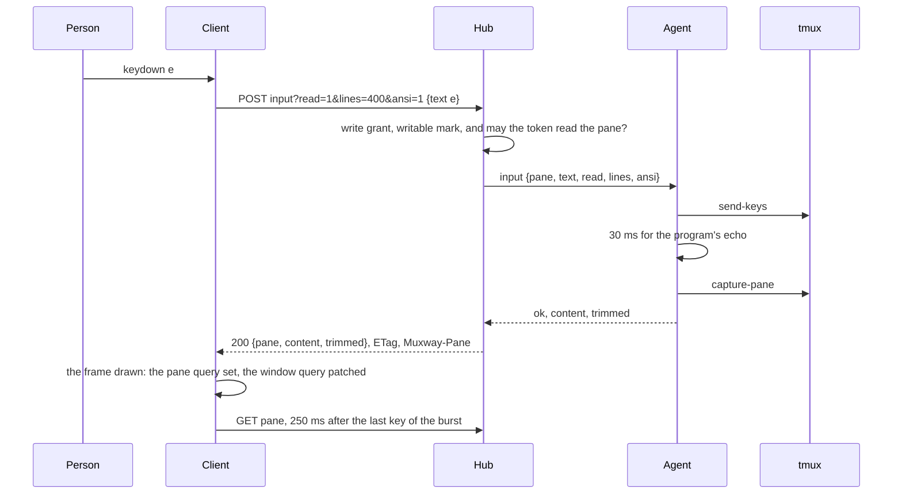
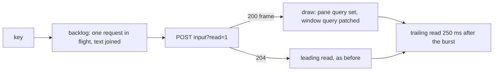

# Feature: a key's echo rides on the input's answer

Issue [#324](https://github.com/notmarkopadjen/muxway/issues/324).

## 1. Goal

A typed character shows on the web client long after the key: in the
pane view about 200 ms, in the window view about 550 ms and up to a
second, at any network round trip. Measured on 2026-11-09 in a headless
browser against a hub and agent on loopback with the round trip
emulated (Chromium's network conditions, `rtt` the latency set), 25
keys 80 ms apart, the time from the key to the character on the screen:

| view | rtt | echo median | p90 |
|---|---|---|---|
| pane | 10 ms | 175 ms | 263 ms |
| pane | 50 ms | 182 ms | 299 ms |
| window | 20 ms | 538 ms | 949 ms |
| window | 50 ms | 609 ms | 1042 ms |

The hub and agent take 10 to 16 ms for an input and 10 to 13 ms for a
read. The lag is the client's: a key's echo needs a second request,
the read, which the pane view sends only once the input is answered and
settles to one per 250 ms during a burst (since 2026-11-04), and which
the window view does not send at all: it waits for its one-second poll.

The goal: the character shows one round trip after the key, in both
views, with no more requests than today. Out of scope: local echo
(drawing the typed line before the host confirms it) and a pushed screen
over the event stream.

## 2. Design

The input's answer carries the screen. A client adds `read=1` to
`POST /v1/panes/{address}/input`; the agent, once the keys have landed,
waits a moment for the program's echo and captures the pane as a read
would; the hub answers `200` with the read's body instead of `204`. The
client draws that frame at once, in the pane view and in the window
view, and keeps its trailing read 250 ms after the last key of a burst,
for output that came later. The leading read of the burst goes: the
frame it fetched now comes with the input.



**Agent.** `OpInput` with `Read` set: after the keys are sent (text, key
or mouse), the handler pauses `echoWait` (30 ms) under the request's
context and takes `a.read` with the request's `Lines`, `ANSI` and
`Wrapped`, the same kept-capture path a read uses; the cursor or
activity moved, so a fresh capture comes. The answer carries `Content`
and `Trimmed`, and `Read: true` so the hub tells a screen from an
agent that ignored the field. A failed capture leaves the input's
answer as it is: the keys landed, the client reads as before.

**Hub.** `read`, `lines` and `ansi` are read from the query as `GET
/v1/panes/{address}` reads them; with `read=1` and a token that may
read the pane, the request to the agent carries them, and an answer
with `Read` is written as the read handler writes one: the same JSON
body, `ETag`, `Muxway-Pane`. Without `read`, without the read grant,
or from an agent that answered no screen, `204` as today. Text mode
(`Accept: text/plain`) is answered `204` always: the keypad phone
reads on its own clock. The audit line is unchanged.

**Web.** `sendInput` asks `read=1&lines=400&ansi=1`, the pane query's
own shape, and returns the body when there is one. `useInput` sets the
pane query's data from it and patches the pane's entry in any window
query that holds it (by `pane_id`), so both views draw it at once;
the burst's settle becomes trailing only, and its read invalidates the
window query too when the input came from the window view. A `204`
(an older hub) keeps today's path: leading and trailing read.



## 3. Protocol and API changes

`POST /v1/panes/{address}/input` takes `read=1` with `lines` (1 to
2000, default 100) and `ansi=1` as `GET /v1/panes/{address}` takes
them. With it, success is `200` with the read's body and headers:

```http
POST /v1/panes/alice-laptop/work/0.0/input?read=1&lines=400&ansi=1
{"text": "e"}
→ 200 {"pane": {...}, "content": "$ e", "trimmed": 38}
   ETag: "…", Muxway-Pane: %3
```

A token that may write but not read the pane, a hub or an agent older
than this, or text mode, answer `204`: a client that asked and got
`204` reads as before. Compatible; the protocol page's version note
says so. The agent channel's `input` request takes `read`, `lines`,
`ansi` and `wrapped`, and its answer `read`, `content` and `trimmed`.

## 4. Security analysis

- The screen comes back only to a token that may read the pane: the
  hub checks the read grant before asking, as the read handler does.
  A write-only token gets `204` and nothing of the screen.
- The capture is the same `capture-pane` a read takes, of the pane the
  keys went to, under the same lanes; nothing new crosses a boundary.
  `lines` and `ansi` are validated as on a read; a bad value is `400
  bad_parameter` before anything is typed.
- Rate: one request where there were two, so a burst sits further
  under the token's twenty per second and forty burst.
- Audit: the input's line as before; a read is not audited today and
  is not here. No secret or pane content is logged.
- The agent's pause is bounded (30 ms) and under the request's deadline;
  a write to the same pane waits that much longer for its turn, which is
  less than a round trip.
- No new dependencies.

## 5. Privacy check

The benchmark runs against a hub and agent in a scratch directory on
loopback; the spec against the test environment. Examples use
`alice-laptop`. No real host, person or secret.

## 6. Test plan

| # | Test | Kind | Expected |
|---|------|------|----------|
| 1 | a write-only token posts `input?read=1` | e2e-security | `204`, no body, the key typed |
| 2 | `read=1&lines=0`, `lines=2001`, `ansi=2` | e2e-security | `400 bad_parameter`, nothing typed |
| 3 | a read-only token or pane with `read=1` | e2e-security | `403 read_only`, no body |
| 4 | a writer posts a text with `read=1&lines=50&ansi=1` | e2e | `200`, the body shows the text on the screen, `Muxway-Pane` names the pane, `ETag` set |
| 5 | the same without `read` | e2e | `204` as before |
| 6 | the agent's lane: `OpInput` with `Read` answers content | unit (agent) | content and `Read` set; without `Read`, neither |
| 7 | `useInput` with a `200` frame | unit (web) | the pane query holds the frame, the window query's pane entry is patched, the settle is trailing only |
| 8 | `useInput` with a `204` | unit (web) | leading and trailing invalidation as before |
| 9 | typing in direct mode in the pane view | UI | the character is on the screen once the input's response is in, before any read; screenshot `126-echo-pane` |
| 10 | typing in direct mode in the window view | UI | the same, well under the one-second poll; screenshot `126-echo-window` |
| 11 | echo under an emulated 100 ms round trip, both views | UI | p90 of 25 keys under 2 × rtt + 150 ms, the numbers in the run's log |

## 7. Documentation

- `docs/protocol/v1.md`: `read` on the input endpoint, the agent
  channel's fields, the version note.
- `docs/features/direct.md`: how a key's echo comes back, the diagram.
- `docs/features/web-client.md`: a line in the pane view and the window
  view.
- `docs/ui-guideline.md` §1.4: the echo on the input's answer as shared
  behaviour, for the other clients to take up.

## 8. Implementation steps

1. Wire and agent: `Read` on input, the pause, the capture; unit test.
2. Hub: the query, the read grant, the `200` body; e2e tests.
3. Web: `sendInput` with `read=1`, the frame into both queries, the
   trailing settle; unit tests.
4. Browser specs and the benchmark spec.
5. Docs.

---

## Review (after implementation)

- [x] Diff matches the plan, deviations explained here. Test 1: the hub
  addresses only a pane the token may read (`locate` answers `404` to
  the rest), so a token that writes but may not read the pane gets `404`
  with `read=1` as without, and the hub's own read-grant check before
  asking the agent is a second guard, not the first (e2e 223). Test 2:
  `ansi` is not validated beyond `1`, as on a read, so `ansi=2` is not
  an error; `lines` is (e2e 224). The e2e tests are 223 to 227, the
  browser specs 126 (in the keyboard suite, for its byte-echo pane); the
  benchmark is spec 126's third test, which writes its numbers as
  annotations. The agent's echo lists afresh before the capture, since
  the listing the input found its pane in was taken before the keys and
  would have shown a kept capture as still.
- [x] Reviewed (an independent read of the diff) and fixed: a screen
  poll in flight when the frame landed could answer after it and put the
  old screen back until the trailing read, so `takeFrame` cancels the
  pane's and the window's polls first (web unit test); an input's answer
  is never `304`, whatever `If-None-Match` the client sends; `lines` is
  checked with `read=1` only, so an input without it keeps its old
  contract; the echo's capture holds a read permit, so the bound on
  captures at once holds for this path too.
- [x] Security rules (AGENTS.md section 2) hold: the screen goes to a
  token that may read the pane only, the parameters are checked before
  anything is typed, one request where there were two, audit unchanged.
- [ ] Privacy check passed: `scripts/prepush-check.sh` clean and diff read
- [x] Docs and diagrams updated

## Test run

To be recorded.
