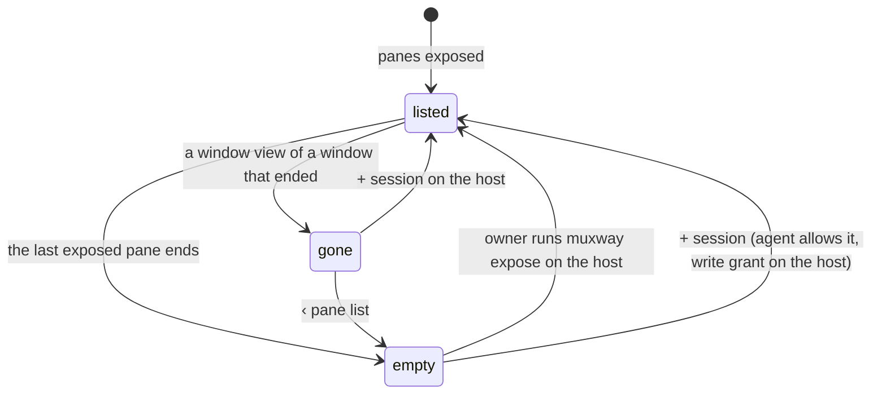

# Feature: the empty host and the gone window

Issues [#322](https://github.com/notmarkopadjen/muxway/issues/322) and
[#323](https://github.com/notmarkopadjen/muxway/issues/323).

## 1. Goal

When the last exposed pane of a host ends, every mark on its session
ends with it, and the web client is left with a host that says
*nothing exposed* and a window view that says *no such window, or not
yours to see*, and nothing else on either. The owner is left to guess.
Both places should say what is known and offer the way forward: the
pane list, and `+ session` on the host where the agent allows it; the
list also says how to expose something from the host, and that a
standing mark survives a tmux restart.

Out of scope: a host that is offline (the list says so already), and
the Android, glasses and phone clients, which show a host line with
`+ session` of their own and are not changed here.

## 2. Design

**The pane list.** Under an online host that lists nothing, the empty
state grows from one line into a short block:

```
┌ alice-laptop ───────────────────────── + session · nothing exposed ┐
│ no panes exposed                                                   │
│ on the host: muxway expose -t <session> --write                    │
│ to keep a session marked across tmux restarts:                     │
│   muxway agent run --expose <session>=write                        │
│ + session starts one here                        (where allowed)   │
└────────────────────────────────────────────────────────────────────┘
```

The last line is a button that opens the host's session form, the same
one the host line's `+ session` opens, shown only when the agent starts
sessions and the account may write on the host; otherwise, when the
agent does not start sessions, a dim *this host's agent does not start
sessions (`--allow-sessions`)*. A filter that matches nothing keeps
the one-line *no panes match*.

**The window view.** The `404` branch keeps its sentence and adds, under
it, `‹ pane list` (to `/`) and, when the host is online, starts
sessions and the account may write there, `+ session on <host>`, which
opens the same session form in place; the new session's first pane
opens as the list's form does. The hub-unreachable branch stays as it
is. The pane view already closes a gone tile and goes back to the list.



Components: `web/src/pages/Panes.tsx` (the empty state, `SessionForm`
reused), `web/src/pages/Window.tsx` (the error branch),
`web/src/term/hoststate.ts` unchanged. No new state is stored.

## 3. Protocol and API changes

None. The list and the window view use `sessions` of `GET /v1/hosts`
and the write patterns of `GET /v1/me` as the host line does today.

## 4. Security analysis

- Nothing new reaches the hub: the session form posts to
  `POST /v1/hosts/{host}/sessions` as before, under the same grant check
  on the hub and the agent's `--allow-sessions`.
- The hints name no path, host or secret of the viewer's; they are the
  documented commands with placeholders.
- A read-only account, or a host whose agent does not start sessions,
  sees no `+ session` in either place, as in the list today.
- Nothing is logged beyond today's audit of a session's creation.
- No new dependencies.

## 5. Privacy check

The examples use `alice-laptop`; the screenshots are of the test
environment. No real host, person or secret.

## 6. Test plan

| # | Test | Kind | Expected |
|---|------|------|----------|
| 1 | a read-only account on an empty host | UI-security | the block has no `+ session`; the window view's `404` has no `+ session` either |
| 2 | a host whose agent does not start sessions, listing nothing | UI-security | the block says the agent does not start sessions, no button |
| 3 | an online host with nothing exposed | UI | the block with the two commands and `+ session`; screenshot `125-empty-host` |
| 4 | `+ session` in the block | UI | the form opens, a name starts the session and its first pane opens |
| 5 | `/w/<host>/nosuch/0` | UI | the sentence, `‹ pane list` goes to the list, `+ session on <host>` opens the form, a name opens the new session's pane; screenshot `125-gone-window` |
| 6 | the hub unreachable | UI | the window view's other sentence, no `+ session` (existing branch, unchanged) |

The empty host is made by unexposing the test host's session through
the environment's control endpoint for the span of the spec and
exposing it again after.

## 7. Documentation

- `docs/features/web-client.md`: the list's empty state and the window
  view's gone state.
- `docs/features/exposing-panes.md`: a line on what the web client
  says when nothing is exposed.
- `docs/ui-guideline.md` §1.3: the empty host state as shared
  behaviour (the hints are web-only, the `+ session` offer is shared).

## 8. Implementation steps

1. The list's empty-host block with `+ session` and the hints; spec and
   screenshot.
2. The window view's gone state with the list link and `+ session`;
   spec and screenshot.
3. Docs.

---

## Review (after implementation)

- [x] Diff matches the plan, deviations explained here: the specs run in
  an environment of their own (`TestUI_Empty`, two hosts that expose
  nothing, one agent with `--allow-sessions`), not by unexposing the
  main environment's host, whose sessions earlier specs add to; the
  window view's `+ session` reuses the list's `SessionForm`.
- [x] Found by the first CI run and fixed: with no data, the window
  query goes pending for every one-second poll, so the error branch and
  the session form in it unmounted once a second; the page now keeps the
  last error shown while a poll is in flight, and spec 127 waits across
  a poll with the form open (and across the one-per-two-seconds creation
  limit) before it sends the name.
- [x] Security rules (AGENTS.md section 2) hold: nothing new reaches the
  hub, the session form posts as before, a read-only account and a host
  without the flag see no button (specs 127 security).
- [x] Privacy check passed: gitleaks and the deny-list clean over the
  branch, the diff read, commits under the repository's noreply identity
- [x] Docs and diagrams updated

## Test run

[Run 20261109-161841-781d141](https://github.com/notmarkopadjen/muxway/issues/326):
passed, 288 tests, at `781d141`, with the logs, screenshots and traces of
specs 126 and 127 under `test-runs/20261109-161841-781d141/`.
