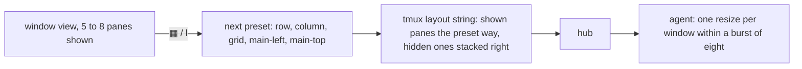

# Feature: tiles up to eight

> Status: approved by the owner on 2026-11-11 in the console ("I've
> noticed that when I have more than four panes it doesn't offer me the
> option to rearrange them across the screen. The button is disabled. I
> want to have them all the time but keep it realistically up to eight
> for example." Then "go" to the plan below, with its two defaults.)

## 1. Goal

The `▦` arrange button was off in the window view above four panes, and
the pane view could not open more than four tiles at all: the cap of
four was one constant in the web client, mirrored by the hub's desk
validation, the agent's resize burst and the docs. After this change
arrange is offered whenever two or more panes are shown, in the window
view and the pane view, for windows and desks of up to eight panes.
Eight is the agent's own cap on panes per window
(`wire.MaxPanesPerWindow`), so nothing above it can exist.

Out of scope: the glasses (three columns at most) and MIDP; new
arrangement shapes beyond the five presets; the Android client, which
keeps four and shows the first four of a wider desk (a parity issue
follows in muxway-android); a per-width cap on the phone-width web,
where the owner picks fewer tiles instead.

## 2. Design

- `MAX_TILES` goes from 4 to 8 in `web/src/term/tiles.ts`. Everything
  keyed on it follows: the pick in the list, the add menu and its
  *eight open* heading, the route, the zoom-out that opens a pane's
  window mates, tab and header drops, the help overlay.
- The window view's arrange (`web/src/pages/Window.tsx`) stops at
  `MAX_TILES` instead of four. Its presets already build any count, and
  the hidden panes keep their thin stack at the right.
- Presets by count stay: 2 row, column; 3 adds main-left and main-top;
  4 and above add grid. Grid with five to eight is two rows, the odd
  tile in the top one. The split tree (`tree`) is already generic.
- The hub's desk accepts up to eight panes, tree leaves and weight
  lists (`deskPanes` in `internal/hub/desk.go`).
- The agent's resize burst per window (`resizeBurst` in
  `internal/agent/agent.go`) goes from four to eight, so a grid of eight
  fits lands together instead of half of it waiting a second. Then one
  a second as now.

## 3. Protocol and API changes

`PUT /v1/desk`: `panes` one to eight, a compatible widening, noted in
`docs/protocol/v1.md` with the date; a client that shows four takes the
first four. `POST /v1/panes/{address}/resize`: `429 rate_limited` above
eight at once on a window instead of four.

## 4. Security analysis

The same write grants gate every resize and desk write. A wider burst
means up to four more resizes a second per window from one principal,
still per window, still audited. The desk's body limit of 8 KiB holds
eight addresses with room. A nine-pane route, desk or pick is refused
as a five-pane one was.

## 5. Privacy check

Fixtures only (`alice-laptop`, `bob-desktop`).

## 6. Test plan

| # | Test | Kind | Expected |
|---|------|------|----------|
| 1 | nine panes in a route are refused (spec 83); nine in a desk (`desk_test.go`) | e2e-security, UI, unit | refused |
| 2 | the ninth resize in a second on one window is 429, the eighth is not (`s6_layout_test.go`, `s15_arrange_test.go`) | e2e-security | pass |
| 3 | spec 132: eight tiles from two windows, `▦` cycles the five presets, `132-column`, `132-grid`, `132-main-left`, `132-main-top`; a ninth pane's tab dropped on an edge takes the tile's place | UI | pass |
| 4 | spec 132: the window view with six panes, arrange on, the host's layout follows, `132-window-six` | UI | pass |
| 5 | specs 105 (eight open, a pick replaces), 113 (a fifth tab is one more tile), 122 (seven of an eight-pane window fit together, none rate limited) updated | UI | pass |

## 7. Documentation

`docs/ui-guideline.md` rows for pick, add menu, tiles, fit and the
window view; `docs/features/web-client.md`; `docs/protocol/v1.md` desk
and resize sections.

## 8. Implementation steps

1. Hub and agent constants with their tests.
2. The client: the constant, the window view, the words.
3. The specs and the docs.

---

## Review (after implementation)

- [x] Diff matches the plan
- [x] Security rules (AGENTS.md section 2) hold: the same grants, audit and caps
- [x] Privacy check passed: `scripts/prepush-check.sh` clean and diff read
- [x] Docs updated

## Test run

Recorded below once the suite has run.
