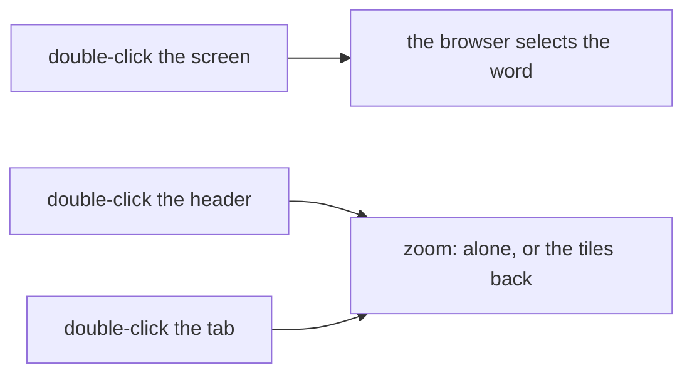

# Feature: a double-click zooms from the header alone

> Status: approved by the owner on 2026-11-11, written the same day from the owner's request in the console
> ("I like it in general, but it's distracting me from selecting the
> text. So, I would like double-click to work as zoom only on pane
> header, both on the pane itself and pane header list on top. Make
> this for all the clients."). The
> phone's side of the same round is
> [muxway-android](https://github.com/notmarkopadjen/muxway-android)'s
> plan `2026-11-11-drop-in-place.md`.

## 1. Goal

A double-click anywhere on a tile, or on a window view's cell, zooms
the pane: alone, or back to the tiles it came from. The browser's own
double-click selects the word under the pointer, and on a terminal
screen that is how a word is picked up to copy; every such pick zooms
the view away instead. After this change a double-click on the pane's
**screen** does what the browser does and nothing else, and the zoom
stays on the pane's **headers**: the tile's header, the window cell's
header, and the pane's tab in the strip at the top. `z`, `Enter` and
`⊡` are untouched.

On the phone a double tap already zooms from the header alone and the
screen's double tap does nothing; its tabs have no double tap and gain
none here (a tab's tap would wait for a second one). The glasses and
MIDP have no pointer. Out of scope: any change to the zoom itself.

## 2. Design

The `onDoubleClick` handler moves one element in, from the tile's root
(`web/src/pages/Pane.tsx`, `.mx-tile`) to its header (`.mx-tile-head`),
and from the window cell (`web/src/pages/Window.tsx`, `.mx-cell`) to its
header (`.mx-cell-head`). The tab (`web/src/components/Tabs.tsx`) keeps
its own. The changes window stopped a double-click from reaching the
cell under it; with no handler on the cell that stop goes. The titles
and the help that say "double-click" say "double-click the header".

The slow second click on a focused tile's name still opens the name
field, and a quick double-click on the name still zooms, since the name
sits in the header.

## 3. Protocol and API changes

None.

## 4. Security analysis

None: which element of the page a pointer event is read from. No
request changes.

## 5. Privacy check

The spec runs against the test environment; nothing real is named.

## 6. Test plan

| # | Test | Kind | Expected |
|---|------|------|----------|
| 1 | 75: double-click a window cell's screen | UI | the URL and the cell count stay; the view does not zoom |
| 2 | 75: double-click a tile's screen with one tile open | UI | the tile stays alone |
| 3 | 75: double-click the cell's header, the tile's header, the tab | UI | zoom in, out and in, as before |

## 7. Documentation

`docs/ui-guideline.md` (the zoom row's web column, the window view
row), `docs/features/web-client.md` (the zoom bullet, the window view's
table and text, the pane names paragraph, the key tables),
`web/src/shell/Help.tsx` and the `⊡` titles.

## 8. Implementation steps

1. Move the two handlers; drop the changes window's stop; reword the
   titles and the help.
2. Spec 75.
3. Docs; `make web`.

---

## Review (after implementation)

- [x] Diff matches the plan, deviations explained here
- [x] Security rules (AGENTS.md section 2) hold
- [x] Privacy check passed: `scripts/prepush-check.sh` clean and diff read
- [x] Docs and diagrams updated

## Test run

The full suite, 295 Go tests and 159 browser specs, 0 failed, at
`d6eb21c` ([#338](https://github.com/notmarkopadjen/muxway/issues/338),
`20261111-102050-d6eb21c`); `scripts/prepush-check.sh` clean.
