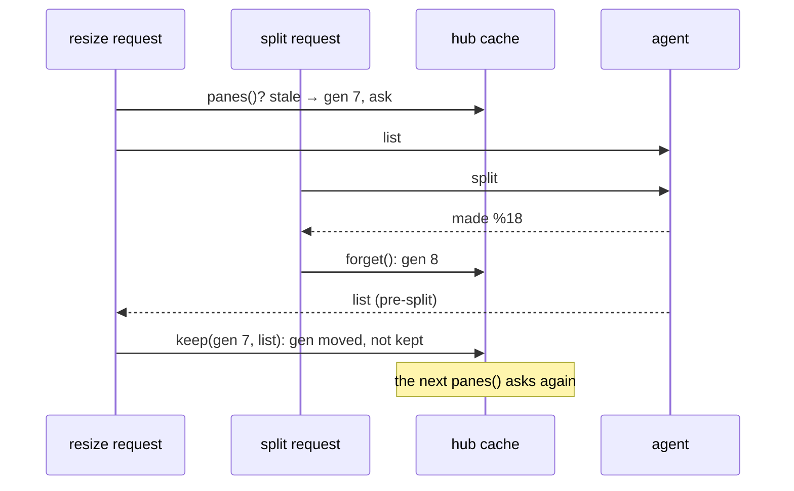

# Feature: the pane a split made is the pane that opens

> Status: approved by the owner on 2026-11-11 in the console; written the same day from the owner's report in the console
> ("when I open a new pane, it should open to the right of the existing
> one but instead it brings me back to an old one. The new one is
> created and visible in a pane header list but it's not open there. I
> need to click it").

## 1. Goal

`+ pane` splits the focused pane's window and opens the new pane beside
the tiles. On the owner's hub it opened an old neighbour instead, and
the new pane stood in the strip, not open. The hub's journal shows why:
right after the split at 07:57:02 the client opened the old tile and
the made address `work/0.2` side by side, but the hub resized `%17`,
the pane that *had* been `0.2` before the split, not `%18`, the pane
made. For a moment the hub served the pre-split listing under the
post-split address, the tile read that pane, confirmed its identity
from the frame, and then followed it to its new address `0.3` when the
next listing came, as a tile is meant to follow a renumbered pane. The
owner's click at 07:57:07 opened `%18`.

The hub caches a host's listing for a second and forgets it after a
split or a new session. A listing that was *in flight* across that
forget, asked before the split by another request of the same client
(a resize, a read, the strip's poll) and answered after it, is a
pre-split listing stored as fresh, and it is served for up to a second.
The lab never hits the window, since the agent answers in microseconds
there; the owner's hub, a network away, does. After this change a
listing asked before a forget is never kept.

## 2. Design

`agentConn` counts its forgets (`gen`). `panes()` notes the count
before it asks the agent and stores the answer only when the count has
not moved; the caller still gets the answer it asked for. `forget()`
and the event path that also clears the cache (a pane event from the
agent) bump the count. The cache's read and store move into two small
methods, `cached()` and `keep()`, so the race is tested without a
session.

## 3. Protocol and API changes

None.

## 4. Security analysis

None: when the hub reuses a listing it already has. Every listing is
still the agent's, filtered by the principal's grants on each read.

## 5. Privacy check

The report's pane ids above are the test environment's kind; no host
or person is named.

## 6. Test plan

| # | Test | Kind | Expected |
|---|------|------|----------|
| 1 | `hub`: `keep` after a `forget` that followed `cached` | unit | nothing cached; the next `cached` misses |
| 2 | `hub`: `keep` with no forget in between | unit | cached; `cached` hits within the second |
| 3 | 98, 105 as they stand | UI | the made pane is the tile, focused |

## 7. Documentation

`docs/features/new-panes.md` gains a line on the listing after a split.

## 8. Implementation steps

1. `gen`, `cached()`, `keep()`; `forget()` and the event path bump.
2. The unit tests.
3. The feature page line.

---

## Review (after implementation)

- [ ] Diff matches the plan, deviations explained here
- [ ] Security rules (AGENTS.md section 2) hold
- [ ] Privacy check passed: `scripts/prepush-check.sh` clean and diff read
- [ ] Docs and diagrams updated

## Test run

To come.
