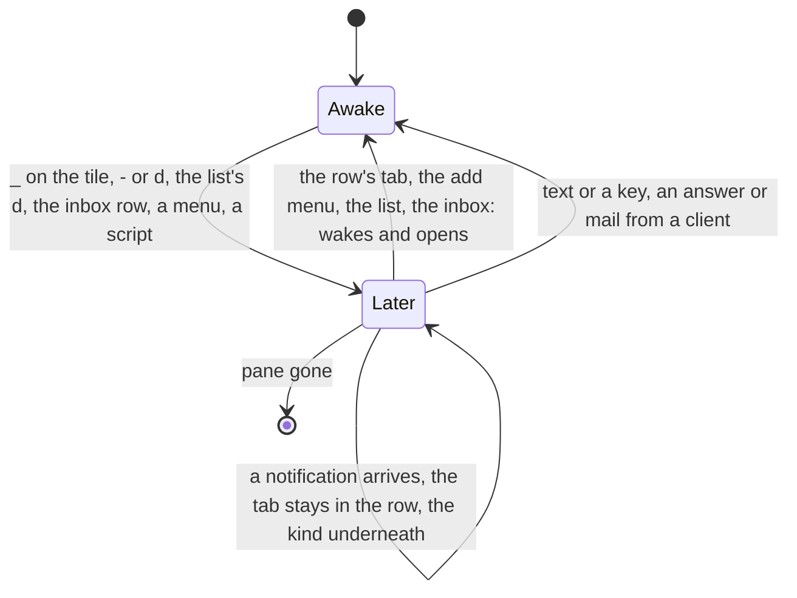
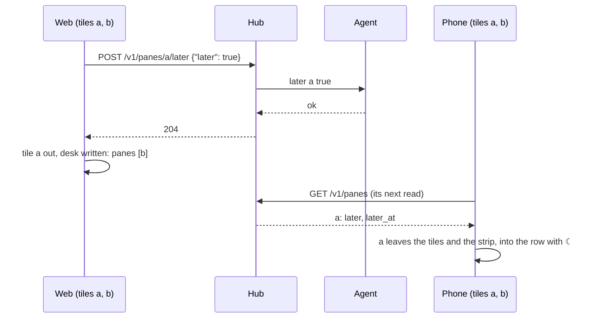

# Feature: minimise is later

> Status: approved by the owner on 2026-11-11 in the console ("do both here
> in one session": the core and Android); written the same day from the owner's words:
> "I want to merge minimization and *later*. They are basically the same
> thing, and I don't need both. So, on pane there should be only
> *minimize* button, not *later* moon in toolbar. But we should retain
> the moon icon even though the pane is below the main pane, as on the
> list it's very useful to have this icon. Do this for all clients."

## 1. Goal

Two features put a pane out of the way, and they have grown to mean the
same thing from two sides. **Later** (plan 2026-11-03) is a mark on the
pane, kept by the host: the pane stops calling, its tab goes last with
`☾`, the inbox lists it after the waiting ones, every client sees it.
**The minimised row** (plans 2026-11-05 and 2026-11-11) is a place in
the view: a tile taken out of the arrangement waits as a tab above the
keys, and the desk carries which panes are there so every client shows
the same row. The owner parks a pane for one reason, "not now", and
should not have to pick between `_` and `☾`, nor meet a pane parked on
one axis and not the other.

After this change there is **one state, later, and one way into it,
minimise**. `_` on a tile parks its pane on the host; the row above the
keys is the parked panes, read from the listing like the strip; a parked
pane leaves the strip for the row on every client at once, whichever
client, script or MCP tool parked it; bringing it back from the row
wakes it. The `☾` button leaves the toolbar of the pane view and the
window view. The moon stays wherever the state is shown: the row's tab,
the list's row, the inbox, the add menu, a reader's header, text mode's
`later` column, the glasses' and the phone's `zz`.

Out of scope: a reminder time; parking a window or a host; a row for the
glasses and MIDP, which have no tiles (they keep *Later* / *Wake* on the
pane's menu, which is their minimise); a client-side hide for a pane the
principal may not park (section 2, *who may*).

## 2. Design

### 2.1 One state

| | before | after |
|---|---|---|
| where it lives | later: the pane's tmux option, via the agent; minimised: the desk's `minimised` list | the pane's option only |
| who sets it | `☾` / `d` (later), `_` / `-` (minimise), the inbox row, the list's `d`, Android's hold menu and watch, the glasses' and MIDP's menus, `muxway client later`, the MCP tool | the same places, less the `☾` toolbar button and Android's hold-menu *later* on a tile or a tab; all of them set the one mark |
| the strip | parked tabs last with `☾`; minimised tabs gone from the strip | parked tabs gone from the strip: they are the row |
| the row | the desk's `minimised`, each pane read every two seconds | the listing's parked panes not open as tiles, oldest parking first, painted from the listing like the strip (no reads of their own); each tab `☾` and what waits underneath dimmed, as the lens paints *later* |
| the tiles | a tile may be parked (`☾ later` in its header) | a writer's tile is never parked: a tile whose pane another client parked goes to the row; a parked pane the view opens is woken (as the list does today); a reader's parked tile stays with the mark, since a reader cannot move it |
| back | a click on a row tab restores; a click on a parked tab wakes | a click on a row tab, its add-menu entry, the list, the inbox: the pane wakes and opens as a tile, focused |
| the last tile | `_`: the next awake pane takes the tile or the view goes to the list, the desk saying `list` with the row; `×`: a minimised pane comes back, else the list | `_`: unchanged, the desk saying `list` (the row needs no saying: it is the listing's); `×`: the list, a parked pane stays parked |
| the desk | `minimised` written, read, settled at opening | no `minimised`: accepted from an older client and dropped, never answered; a view that opens needs no settling, the row is read with the listing |





### 2.2 Who may

Minimise is the later mark, so it is a write under the write grant on a
writable pane of a host whose agent parks (`hosts[].later`), as `☾` is
today. `_` is **disabled** with the reason in its title for a read-only
pane ("needs a writable pane") and for a host older than the mark ("the
host is older than this"), as the `☾` button is now; a reader still
sees the mark on the row, the list and the header. This is a change
from today, where a reader minimised a tile into a row of their own.
The owner's alternative is a second, client-side hide for those panes,
which is the second mechanism this change removes; the plan recommends
the single one. **Decision for the owner.**

### 2.3 Words and keys

The state keeps its name: `later`, `☾` (`zz` without a moon), in the
listing, the inbox, text mode, the protocol. The action on a tile is
**minimise**, `_`, because that is what it does to the tile; its title
says both: *minimise: the pane is parked for later and its tab goes to
the row above the keys (-, d)*. Where there is no tile the action keeps
the state's words, *later* / *wake*: the inbox row, Android's watch
menu, the glasses' and MIDP's menus. **Decision for the owner:** one
word everywhere instead (*minimise* / *restore* on the inbox row and
the menus) is a wording change in the same places.

Keys (the guideline's §1.6 table is changed first):

| action | web | Android | glasses, MIDP |
|---|---|---|---|
| minimise (park) | `_` on the header; `-` and `d` on the focused tile; `d` on the list's selected row and in the window view on the focused cell (the cell stays, the mirror is the host's) | `_` on the header; *later* in the watch's reply menu | *Later* / *Wake* on the pane's menu, as today |
| bring back (wake) | a click on the row's tab, the add menu, the list, the inbox's `Enter`; *wake* on the inbox row | a tap on the row's tab, the add menu, the list, the inbox | opening the pane from the list or the inbox, as today |

`d` stays beside `-` so the owner's hand finds it; the two rows of the
keyboard table become one. The `☾` button, its `⋯` menu entry and
`onWake` on a strip tab go.

### 2.4 Components touched

- **Hub** (`internal/hub/desk.go`): `Minimised` leaves the stored desk;
  the decoder accepts the field from an older client and drops it
  (`DisallowUnknownFields` would otherwise refuse that client's every
  write). The `list` view stays, with `order` alone. Tests in
  `e2e/s31_desk_test.go` that write and expect `minimised` are turned
  around.
- **Web** (`web/src/pages/Pane.tsx`): `minimise(a)` = park + the tile
  out (the last-tile rules kept); `restore(a)` = wake + the tile in;
  the row is `all.data` filtered by `later` less the tiles, sorted by
  `later_at`; `minimisedKept`, the row's settling, `setMinimised` and
  the desk's `minimised` go; the listing effect takes a parked tile out
  (writer) or wakes a parked pane the view opened; `closeTile` on the
  last tile goes to the list; the `☾` button and `toggleLater` go, `d`
  calls `minimise`. `Minimised.tsx` paints from the listing. `Tabs.tsx`
  loses the parked-last split and `onWake`; `term/order.ts` loses
  `parkedLast` and gains the row's order (`later_at`, then address).
  `Window.tsx`: the `☾` button goes, `d` parks the focused cell.
  `Panes.tsx` and `Inbox.tsx` unchanged in behaviour (they park and wake
  the one mark). `AddMenu` lists the parked panes under **minimised**
  as it lists the row today. `Help.tsx` and the key table.
- **Android** (its repository, one issue): `_` parks through
  `model.later`; the `parked` list and `Desk.minimised` go, the row is
  `model.panes.filter { it.later }` less the tiles; the hold menu's
  *later* / *wake* on a tab and a tile's header go (the watch's stays);
  a parked tile from another client leaves the tiles; a tap on the row
  wakes; `×` on the last tile goes to the list.
- **Glasses, MIDP**: no row, no desk `minimised`; nothing to change in
  code. Their pages are checked for the words and the guideline's
  tables cover them; no issue is filed unless the owner takes the
  one-word decision of §2.3, which renames their menu entries.

## 3. Protocol and API changes

Compatible, v1.

- `GET /v1/desk` no longer answers `minimised`. `PUT /v1/desk` still
  accepts it, up to 16 addresses as before, and drops it; the page says
  the row is the listing's `later` panes and the field is kept for
  clients older than this. A `list` desk is `{"view": "list", "order":
  [...]}`.
- Nothing else: `POST /v1/panes/{address}/later`, `later`, `later_at`,
  the inbox and text mode are as they are.

```json
{"desk": {"view": "panes", "panes": ["alice-laptop/work/0.0"],
 "focused": "alice-laptop/work/0.0", "arrangement": "row",
 "order": ["alice-laptop/work/0.0", "alice-laptop/work/1.2"],
 "updated": 1767225600, "by": "web", "rev": 13}}
```

## 4. Security analysis

- **What an attacker gains.** Nothing new: minimise is the existing
  later write, under the same write grant and writable mark, checked on
  the hub and again on the agent, five a second, audited on both. A
  reader loses the client-side row they had, which is less exposure,
  not more.
- **Grants.** A reader's `_` is disabled and a forged request answers
  `403 read_only`, as `☾` does today (test 1).
- **Input.** The desk's `minimised` is parsed as before and discarded;
  the body stays under 8 KiB with the same address grammar on what is
  kept. The row is built from the listing the principal may read.
- **Logging.** The later write's audit as today; the desk write's audit
  (principal, view, count of panes) unchanged; nothing of the row is
  logged.
- **No dependencies.**

## 5. Privacy check

Docs and tests use `alice-laptop`, `work`, `bob-desktop`; screenshots
from the e2e run only.

## 6. Test plan

| # | Test | Kind | Expected |
|---|------|------|----------|
| 1 | a reader's view with a parked pane: the row shows it with `☾`, `_` on the reader's tile is disabled, `POST …/later` by the reader | e2e-security, UI | the mark shown, the button off with its reason, `403`; screenshot `131-reader` |
| 2 | `PUT /v1/desk` with `minimised` (16 addresses; 17) | e2e | `200` without `minimised`; `400 bad_input` |
| 3 | a `list` desk written and read | e2e | `{"view": "list", "order": [...]}`, no `minimised` |
| 4 | `_` on a tile among two: the pane is `later` in the listing, the tile gone, the row has its tab with `☾`, the strip without it; `d` and `-` do the same | UI | screenshot `131-row` |
| 5 | a click on the row's tab | UI | awake in the listing, open as a tile, focused, the row empty and not drawn |
| 6 | `muxway client later` on an open tile from a second principal | UI | the tile leaves for the row within a listing's read; the desk written without it |
| 7 | the last tile minimised, another pane awake; none awake | UI | the next awake takes the tile; the list, the desk `list` |
| 8 | `×` on the last tile with a parked pane | UI | the list; the pane still `later` |
| 9 | a parked pane opened by link | UI | woken, a tile, not in the row |
| 10 | a notification on a parked pane | UI | the row's tab shows `☾ · !` dimmed, no toast, no title flash (spec 118's checks moved to the row) |
| 11 | the inbox row's *later* on a tile's pane | UI | the tile goes to the row; *wake* brings it back as a tile |
| 12 | the add menu lists the parked panes under **minimised**; a pick wakes and opens | UI | as stated |
| 13 | the toolbar: no `☾`, eight pane buttons; the `⋯` menu matches | UI | spec 90's counts |
| 14 | the row's order: two panes parked a second apart | unit | oldest parking first |

Specs 105, 118, 125, 129 and the desk tests are reshaped where they
assert the old row or the parked-last strip.

## 7. Documentation

- `docs/ui-guideline.md`: §1.2 the later row (the tile's slant goes for a
  writer; the row's tab), §1.4 *strip* (no parked tabs), *header* (`_`
  disabled for a reader and an older host; no `☾` among the controls),
  *minimised row* (the parked panes, from the listing), *add menu*; §1.6
  the two rows *park* and *minimise* become one, the key table.
- `docs/features/notifications.md` *Later*: how a client gets there
  now; `docs/features/web-client.md`: the row, the keys, the toolbar;
  `docs/features/desk.md`: `minimised` gone, what the desk carries;
  `docs/features/inbox.md` and `new-panes.md` where they say
  "minimised"; `docs/protocol/v1.md`: the desk.
- Screenshots `web-minimised.png`, `web-later-tab.png` retaken.
- Issue in muxway-android (§2.4); none for the glasses and MIDP unless
  §2.3's one-word decision is taken.

## 8. Implementation steps

1. Guideline: the tables first.
2. Hub: `minimised` accepted and dropped; the desk tests; the protocol
   page.
3. Web: the row from the listing, `minimise` and `restore` on the mark,
   the strip, the tabs, the last-tile rules, the toolbar, the keys, the
   help; unit tests.
4. Web specs 1, 4 to 13 (spec `131-minimise`), the old specs reshaped;
   `make web`.
5. Feature pages, screenshots.
6. The Android issue. Run, record, pull request.

---

## Review (after implementation)

- [x] Diff matches the plan, deviations explained here
- [x] Security rules (AGENTS.md section 2) hold: minimise is the later
      write, under the write grant and the writable mark, checked on the
      hub and the agent as before; a reader's `_` is disabled with the
      reason and their forged request answers `403` (spec 131); the
      desk's `minimised` is validated as before and then dropped, so an
      older client's write is neither refused nor kept (tests 196, 197,
      the desk unit test)
- [x] Privacy check passed: `scripts/prepush-check.sh` clean and diff read
- [x] Docs and diagrams updated

Deviations:

- The shell's toast and title flash looked a pane up in its own read's
  cache first, which stops being refreshed the moment the pane leaves
  the tiles, so a pane minimised a moment before still called when a
  notification came. `knownPane` now takes the later mark from the
  listing, which is read wherever the client is.
- Spec 129 (the row as the desk's) is gone: its subject no longer
  exists. Spec 131 takes its place, in two tests: the main environment's
  (the row, another client's park, the reader, the list) and the arrange
  environment's (the last tile to the next pane and to the list, a
  parked pane opened by a link), since a view reaches the list only when
  every other pane is parked, which needs every pane writable. The
  arrange environment runs its own two specs under `MX_GREP`, not the
  whole pattern, so `MX_GREP` can name them with the main environment's.
- `×` on a lone tile needs a host that closes panes; spec 131 goes back
  to the list by the brand instead and checks the pane stays parked.
- The window view keeps `d` as a toggle: a parked pane's cell stays
  there (the mirror is the host's), so `d` on it wakes it, as the
  guideline's §1.6 says for the window view.
- The row's tab is painted from the listing and has `data-state="later"`
  always; spec 105 checks the listing's mark and the glyph underneath
  instead of a read of the pane.

## Test run

Link to the recorded run: result, commit, logs, screenshots.
