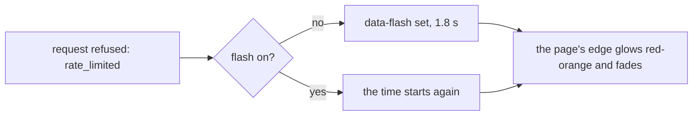

# Feature: a rate limit flashes the page's border, not a toast

> Status: approved by the owner on 2026-11-11 in the console; written the same day from the owner's screenshot in the console
> (three `refused rate_limited` toasts stacked over the pane while
> typing fast: "Don't make it a dialog box, as it's happening from time
> to time on fast actions. Make border of entire page mildly and slowly
> flash red/orange with CRT effect, only as full-page border as a mild
> effect").

## 1. Goal

The hub limits writes per principal; a burst of keys from the key bar
or the board, or a run of fast clicks, trips it, and every refused
request raised a toast that said `refused rate_limited`. The toasts
pile up and cover the screen, and they tell the owner nothing they can
act on: the keys were simply too fast. After this change a rate limit
is shown once, as a mild, slow red-orange flash of the whole page's
edge, in the client's CRT manner; nothing covers the pane, and a burst
is one flash, not three. Other refusals (`read_only`, `not_found`, a
hub unreachable) stay toasts: they say something.

Web only: the phone shows refusals on its status line, not over the
pane, and the glasses and MIDP have no rate-limited bursts.

## 2. Design

`ToastProvider.push` (`web/src/components/Toast.tsx`) treats a
`refused` toast whose title is `rate_limited` as a *flash*: no toast is
added; `document.documentElement` gets `data-flash` for 1.8 s, set
again on a second refusal within that time so a burst is one flash
that lasts until the burst ends. The style (`web/src/styles/motion.css`
and `tokens.css`) draws it as a fixed, full-viewport pseudo-element
that takes no pointer: an inset border of two pixels and a soft inset
glow of a few dozen pixels in a red-orange token (`--mx-flash`, set per
theme: a warm orange-red on the dark themes, a deeper red on paper),
rising and fading with a slow ease over the whole duration, with the
CRT's scanlines over the glow and a faint flicker, the same as the
`mx-flicker` the page already has. With effects off or
`prefers-reduced-motion`, the border fades in and out without the
flicker and the scanlines. The glow never reaches more than a few per
cent of the width in, so it reads as the edge of the tube.

## 3. Protocol and API changes

None.

## 4. Security analysis

None: how a refusal the hub already made is shown. The code of the
refusal is not shown any more for this one case, which hides nothing
the owner could use.

## 5. Privacy check

The spec screenshot is of the test environment.

## 6. Test plan

| # | Test | Kind | Expected |
|---|------|------|----------|
| 1 | 130: a rate-limited input (the hub's limit tripped by a burst of keys from the test) | UI | no toast; `data-flash` on the root while it lasts, gone after; screenshot `130-flash` |
| 2 | 130: another refusal (`read_only` on a read-only pane) | UI | a toast as before, no flash |
| 3 | `toast.test.ts`: `push` of `rate_limited` sets the flash, restarts it, and adds no toast | unit | as said |

## 7. Documentation

`docs/ui-guideline.md` (the toasts, where refusals are listed) and
`docs/features/web-client.md` (refusals and the flash, under the
look).

## 8. Implementation steps

1. The flash in `Toast.tsx`, its tokens and motion.
2. The unit test; spec 130.
3. Docs.

---

## Review (after implementation)

- [x] Diff matches the plan, deviations explained here
- [x] Security rules (AGENTS.md section 2) hold
- [x] Privacy check passed: `scripts/prepush-check.sh` clean and diff read
- [x] Docs and diagrams updated

## Test run

The full suite, 295 Go tests and 159 browser specs, 0 failed, at
`d6eb21c` ([#338](https://github.com/notmarkopadjen/muxway/issues/338),
`20261111-102050-d6eb21c`); `scripts/prepush-check.sh` clean.
