# Feature: the minimised row is the desk's, and the last tile minimises too

> Status: written 2026-11-11 from two of the owner's reports in the
> console ("I cannot minimize pane when it's full-screen. It should be
> possible. In this case, next pane should be zoomed in. If no pane
> active left, it should go back to pane list screen"; "When I minimize
> panes, sometimes it resets. So, nothing is minimized. Is the
> minimization data stored on server? Should be, and should be also
> shared with all clients"); awaiting the owner's approval. The phone's
> side is [muxway-android](https://github.com/notmarkopadjen/muxway-android)'s
> plan of the same name.

## 1. Goal

**The row resets.** The minimised row is already the hub's: it travels
in the desk (`minimised`), every client writes it and follows it. What
resets it is how a view starts. A view opened from the list, a link or
a bookmark begins with an empty row (only the desk's own row, opened
from the list's `desk` line, carries one), writes its desk half a
second later, and that write, with no `minimised`, is what every other
client then follows. Minimise two panes on the phone, open a pane from
the browser's list, and both rows are gone. After this change a view
that opens without a row of its own takes the desk's, less the tiles it
opens, and writes nothing before it has read the desk once.

**The last tile.** `_` and `-` are off on the last tile, since a view
needs a pane. The owner wants the pane out of the way all the same: the
next awake pane of the strip takes the tile (the one `]` would show),
and the minimised pane joins the row; with no other awake pane the pane
joins the row and the client goes back to the list, as the brand does.
That last state is one the desk cannot say today, since a `panes` desk
needs a pane: it gains a third view, `list`, nothing open and the row
kept.

Out of scope: the glasses and MIDP, which open the desk's focused pane
from their lists and have no row; a `list` desk gives them nothing to
open.

## 2. Design

**The row at opening (web, `web/src/pages/Pane.tsx`).** The view's
`minimised` state starts as it does when the desk's row opened it
(`minimisedKept`). Otherwise it is *unsettled*: the first desk read
settles it with `desk.minimised` less the open tiles (a `window` desk
settles it empty), and the desk write effect holds its first write
until then, so a slow desk read is never overtaken by a write that
would empty the row. A desk read that fails (no desks on this hub, a
reader) settles it empty.

**Minimising the last tile (web).** `minimise(a)` with one tile: the
next awake pane as `neighbour(1)` finds it (strip order, not open, not
parked) takes the tile, focused, and `a` joins the row:
`go([next], [...minimised, a])`. With none, the desk is written as
`{view: "list", minimised: [...minimised, a], order}` at once (not
debounced; the view is leaving) and the client navigates to `/`. The
`_` button is on for the last tile, `-` works with one tile; the title
says what happens.

**The `list` desk (hub, `internal/hub/desk.go`).** `view` is `panes`,
`window` or `list`; `list` takes no `panes`, `window`, `focused`,
`arrangement`, `tree` or `weights`, and keeps `minimised` and `order`.
Read, it is `{"view": "list", "minimised": [...], ...}`. The list's
`desk` row reads *desk · the list* and opens nothing; followers in a
view keep their view and, since the desk names no panes, change
nothing (that is what every client does with a desk without panes
today, so an older client is not confused). A view that opens from the
list after a `list` desk starts with its row, by the first rule.

```mermaid
stateDiagram-v2
    [*] --> opening: a pane from the list, a link
    opening --> settled: the desk read once: its row, less the tiles
    settled --> settled: _ on a tile among several: into the row
    settled --> next: _ on the last tile, another pane awake: it takes the tile
    settled --> list: _ on the last tile, none awake: desk = list + row; back to the list
    next --> settled
```

**Android** mirrors it: `parked` settles from `model.deskOf(hub)` when
the view opens without an opening of its own, after the desk is read,
and the first write waits; `minimise` of the last tile shows the next
pane of `order` with the row, or writes the `list` desk and opens the
list. `Desk` parses `list`.

## 3. Protocol and API changes

`docs/protocol/v1.md`, the desk: `view` gains `list`, with the rules
above; `PUT` with `list` and any of `panes`, `window`, `focused`,
`arrangement`, `tree` or `weights` is `400 bad_input`. Compatible: an
older client reads a desk with no panes and opens nothing.

## 4. Security analysis

- A `list` desk names no pane: nothing to check beyond `minimised` and
  `order`, which are checked as today (readable addresses, the counts,
  the body size). The write needs the write grant as before.
- The row a view adopts comes from the desk the principal may read;
  every address in it is still read through the principal's grants.
- Nothing new is logged; the audit line counts panes, zero for `list`.

## 5. Privacy check

The specs run against the test environment; fixtures' names only.

## 6. Test plan

| # | Test | Kind | Expected |
|---|------|------|----------|
| 1 | `hub`: `PUT` a `list` desk with `panes`, with `window`, with `focused` | unit (security) | `400 bad_input` each |
| 2 | `hub`: `PUT` a `list` desk with a `minimised` pane the principal may not read | unit (security) | `403 not_yours` |
| 3 | `hub`: a `list` desk round trip | unit | read back with its row and `rev` |
| 4 | 129: the desk holds a row; a pane opened from the list | UI | the row shows the desk's panes, less the tile; the desk written still holds them; screenshot `129-row-kept` |
| 5 | 129: `_` on the last tile with another awake pane | UI | that pane is the tile, focused; the row has the minimised one |
| 6 | 129: every other pane parked; `-` on the last tile | UI | the list; the desk is `list` with the row; its row reads *desk · the list*; a pane opened then shows the row |
| 7 | 105: the "last tile stays" assertion goes | UI | replaced by 5 and 6 |

## 7. Documentation

`docs/protocol/v1.md` (the desk), `docs/ui-guideline.md` (the desk row,
the minimised row, the `_` row), `docs/features/web-client.md` (the
minimised row, the desk, the key tables), `docs/features/desk.md` if
present, and the Android pages in its own plan.

## 8. Implementation steps

1. Hub: the `list` view, validation, tests; protocol page.
2. Web: the row settles from the desk, the first write waits; the
   last tile's `_` and `-`; the list's desk words.
3. Spec 129; spec 105 trimmed.
4. Docs.

---

## Review (after implementation)

- [ ] Diff matches the plan, deviations explained here
- [ ] Security rules (AGENTS.md section 2) hold
- [ ] Privacy check passed: `scripts/prepush-check.sh` clean and diff read
- [ ] Docs and diagrams updated

## Test run

To come.
