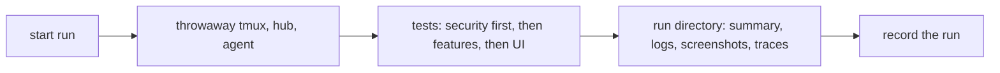
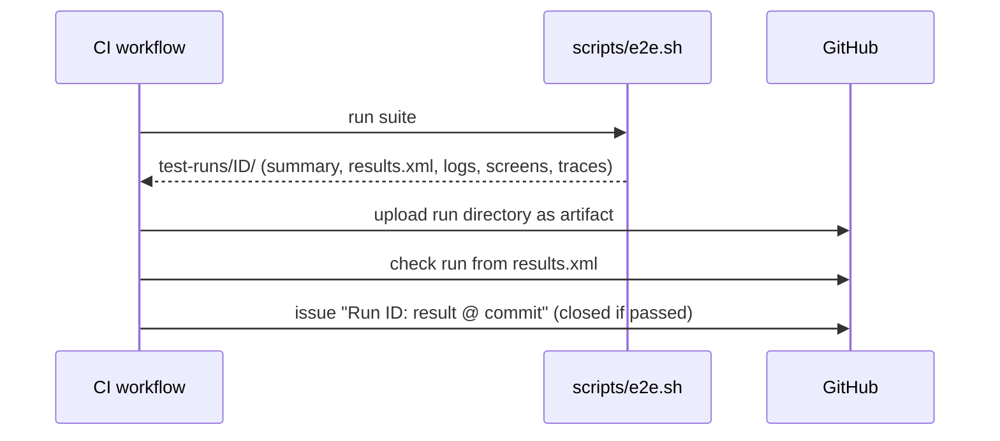

# Testing

End-to-end tests are the main line of defence, and security tests come
first. See AGENTS.md section 6 for the rules; this page describes the
mechanics.

## Test environment

Tests never touch a real machine. Each run starts its own tmux server on a
private socket, a test hub and a test host agent on loopback with throwaway
certificates and tokens, and synthetic panes. Nothing from a developer's own
environment is read.

## A run

Every run writes `test-runs/<timestamp>-<commit>/` (ignored by git):

| File | Content |
|---|---|
| `summary.md` | date, commit, totals, result per test |
| `environment.txt` | tmux, Go and OS versions |
| `results.xml` | JUnit XML, for tools |
| `logs/<component>.log` | full log of hub, agent, tmux and test runner |
| `screens/<test>/<step>.png` | UI tests: a screenshot per step and on failure |
| `traces/<test>.zip` | UI tests: Playwright trace, opened with `npx playwright show-trace` |
| `report/index.html` | HTML report of the run |

UI tests drive the web client with Playwright. The specs live in
`web/e2e/`; a Go test (`e2e/s5_ui_test.go`) builds the environment, runs
`npx playwright test` against the production build the hub embeds, and
reports each spec as a subtest, so one `results.xml` covers everything.
Specs reach tmux, notifications and the hub through a small control
endpoint the Go test serves on loopback, and a second loopback origin
serves the cross-site attack page. A second Go test in the same file
starts a hub with the transcription tests' stand-in transcriber and
runs the microphone spec against it, with Chromium's fake microphone;
the control endpoint there also breaks the transcriber and counts its
calls. Screenshots land in `screens/<spec>/`, traces in `traces/`.

Locally the suite needs Node 22 and Chromium (`cd web && npm ci && npx
playwright install chromium`); without Node, `scripts/e2e.sh` skips the
web checks and the UI test. With Node it also lints, unit-tests and
rebuilds the client, and fails if `web/dist` differs from the committed
build. `MX_GREP=<pattern>` limits a run to matching specs.

## Recording runs

Every run on `main`, and each feature's final run, is recorded as a **test
run**: a GitHub issue labelled `test-run`.

- Title: `Run <run id>: <passed|failed> @ <commit>`, labels `test-run` and
  `run:passed` or `run:failed`.
- Body: result, commit, totals, a link to the workflow run whose artifacts
  hold the logs, screenshots and traces, then the run's `summary.md`.
- A green run is closed at once; a red one stays open until the fix lands
  and links back to it. The issue list filtered by `label:test-run` is the
  run history.

`scripts/record-run.sh <run directory>` creates the entry. CI calls it after
every run outside pull requests; a local run can be recorded by hand.

In CI each run also gets a **check run** with a per-test table and failure
annotations on the commit (the test-reporter action reading
`results.xml`), and its run directory is kept as a workflow artifact for 90
days.

### The suite's contract

Each repository provides `scripts/e2e.sh`. It builds the throwaway test
environment, runs the suite, writes one run directory under `test-runs/`
with at least `summary.md` and `results.xml` (JUnit), and exits non-zero if
any test failed. Until a repository has one, CI skips the test steps.

Considered and not used: an Allure report on GitHub Pages (needs a paid plan
while private; may be added for trends once public), and committing runs to
the repository (logs and screenshots would risk leaking private data into
permanent history).
